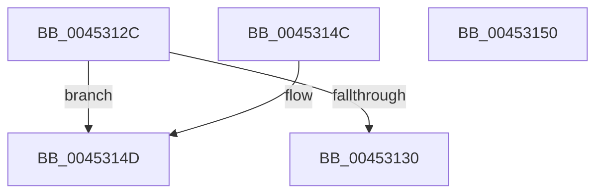

# KiFlushAffinity

- RVA: `0x0045312C`–`0x00453151` (길이 `37` bytes)
- VA: `0x000000014045312C`
- 실행 섹션: `.text`
- PDB 이름 있음: `예`; PDB Function 태그: `아니요`
- unwind 정보 RVA: `0x000DB714`
- 디코드: `11`개 명령, `37/37` bytes 표시
- 미해석 바이트: `0` (있으면 어셈블리에 `.byte`로 보존)

> 이 문서는 커널 이미지의 기계어와 PDB 기호를 분석해 생성했습니다. 4번과 5번은 함수 원형과 자료형을 바이너리 사용 방식에서 추정한 C 해석이며 원본 소스 복구 결과는 아닙니다.

## 1. Dependencies

- 직접 호출 지점: **0**; 고유 호출 대상: **0**
- 직접 호출자로 확인된 함수: **1**
- RIP 상대 이미지 참조: **0**

### Outgoing calls
- 직접 디코드된 call 명령이 없습니다.

### Direct callers
- [KeFlushSingleTb](../5B/KeFlushSingleTb_function_005BDE84.md) at `0x005BDF89`

### Static image references
- 디코드된 RIP-relative 메모리 참조가 없습니다.

## 2. Other-region calls and transfers

- 다른 실행 섹션으로 향하는 call: **0**
- 별도 외부 분기/꼬리 이동을 확인하지 못했습니다.

## 3. Assembly (complete function range)

```asm
0045312C  85 C9                           test ecx, ecx
0045312E  75 1D                           jne 0x14045314d
00453130  F0 09 0C 24                     lock or dword ptr [rsp], ecx
00453134  65 48 8B 04 25 88 01 00 00      mov rax, qword ptr gs:[0x188]
0045313D  48 8B 80 B8 00 00 00            mov rax, qword ptr [rax + 0xb8]
00453144  48 8B 80 80 00 00 00            mov rax, qword ptr [rax + 0x80]
0045314B  C3                              ret
0045314C  CC                              int3
0045314D  33 C0                           xor eax, eax
0045314F  C3                              ret
00453150  CC                              int3
```

## 4. C-style interpretation (structured pseudocode)

```c
__int64 __fastcall KiFlushAffinity(int a1)
{
    __int64 result;
    unsigned int v_stack_p0;

    if (a1 != 0) goto loc_0045314D;
    return *(unsigned __int64 *)(*(unsigned __int64 *)(*(unsigned __int64 *)(gs_base + (0 + 392)) + 184) + 128);
loc_0045314D:
    result = 0;
    return result;
}
```

## 5. (Beta) C Style

```c
int64_t KiFlushAffinity(int32_t Arg1)
{
    int64_t result;
    uint32_t v_stack_p0;

    if (Arg1 != 0) goto loc_0045314D;
    return *(uint64_t *)(*(uint64_t *)(*(uint64_t *)(gs_base + (0 + 0x188)) + 0xB8) + 0x80);
loc_0045314D:
    result = 0;
    return result;
}
```

## 6. Execution-region graph

[열기: 2D/3D 그래프와 함수 탐색 컨트롤 패널](../../../control-panel.html?section=text&rva=0x0045312C&view=graph)

- 2D 그래프는 위에서 아래로 흐르고, 3D 그래프는 빈 공간을 드래그해 회전합니다. Shift+드래그는 이동, 휠은 확대·축소, 함수 노드 선택은 대상 보고서 이동입니다.

### Static fallback


