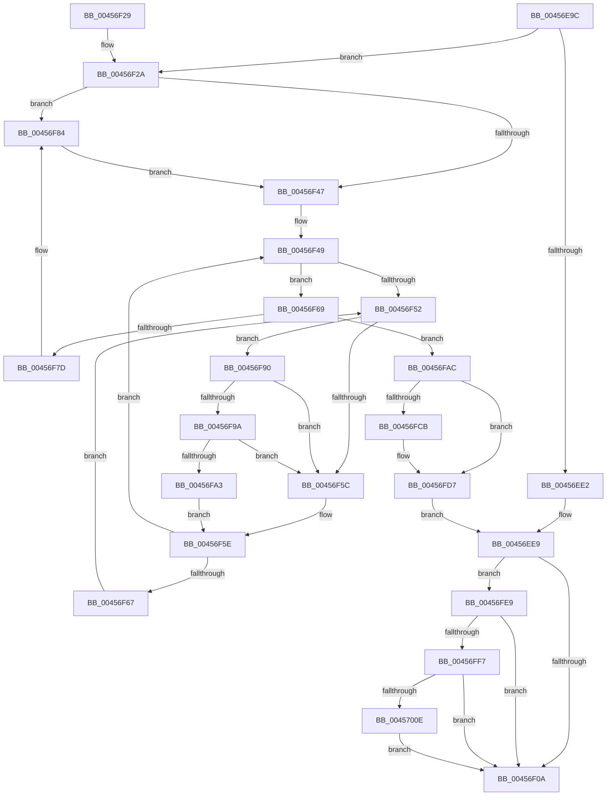

# KiInitializeMutant

- RVA: `0x00456E9C`–`0x00457017` (길이 `379` bytes)
- VA: `0x0000000140456E9C`
- 실행 섹션: `.text`
- PDB 이름 있음: `예`; PDB Function 태그: `아니요`
- unwind 정보 RVA: `0x000A8090`
- 디코드: `106`개 명령, `379/379` bytes 표시
- 미해석 바이트: `0` (있으면 어셈블리에 `.byte`로 보존)

> 이 문서는 커널 이미지의 기계어와 PDB 기호를 분석해 생성했습니다. 4번과 5번은 함수 원형과 자료형을 바이너리 사용 방식에서 추정한 C 해석이며 원본 소스 복구 결과는 아닙니다.

## 1. Dependencies

- 직접 호출 지점: **5**; 고유 호출 대상: **5**
- 직접 호출자로 확인된 함수: **11**
- RIP 상대 이미지 참조: **3**

### Outgoing calls
- `0x00456F89` → [KiRaiseIrqlProcessIrqlFlags](../4F/KiRaiseIrqlProcessIrqlFlags_function_004F56FC.md) (function, `0x004F56FC`)
- `0x00456F9A` → [KiCheckVpBackingLongSpinWaitHypercall](../30/KiCheckVpBackingLongSpinWaitHypercall_function_0030F490.md) (function, `0x0030F490`)
- `0x00456FA5` → [HvlNotifyLongSpinWait](../30/HvlNotifyLongSpinWait_function_0030F460.md) (function, `0x0030F460`)
- `0x00456FD2` → [KiLowerIrqlProcessIrqlFlags](../4F/KiLowerIrqlProcessIrqlFlags_function_004F5698.md) (function, `0x004F5698`)
- `0x00457000` → [KeAbPreAcquire](../21/KeAbPreAcquire_function_00210230.md) (function, `0x00210230`)

### Direct callers
- [KeInitializeMutant](../5B/KeInitializeMutant_function_005BE5B0.md) at `0x005BE5BA`
- [NtdllRunOnceInitMuiCrits](../5E/NtdllRunOnceInitMuiCrits_function_005E6030.md) at `0x005E603F`
- [DifKeInitializeMutantWrapper](../62/DifKeInitializeMutantWrapper_function_0062F990.md) at `0x0062FA6D`
- [DifKeInitializeMutexWrapper](../62/DifKeInitializeMutexWrapper_function_0062FB00.md) at `0x0062FBDB`
- [PnpInitializeDeviceEvents](../../init/C3/PnpInitializeDeviceEvents_function_00C3557C.md) at `0x00C355B9`
- [ViInitSystemPhase0](../../init/C4/ViInitSystemPhase0_function_00C4C1B0.md) at `0x00C4C21A`
- [WmipDriverEntry](../../init/C4/WmipDriverEntry_function_00C4D490.md) at `0x00C4D4C0`
- [EtwpInitialize](../../init/C4/EtwpInitialize_function_00C4DBCC.md) at `0x00C4DC1D`
- [EtwpInitialize](../../init/C4/EtwpInitialize_function_00C4DBCC.md) at `0x00C4DC31`
- [EtwpInitializeRegistration](../../init/C4/EtwpInitializeRegistration_function_00C4ECEC.md) at `0x00C4ED22`
- [ExpProfileInitialization](../../init/C5/ExpProfileInitialization_function_00C54448.md) at `0x00C5447E`
- [sub_00C6D0F8](../../init/C6/Unknown_function_00C6D0F8.md) at `0x00C6D10D`

### Static image references
- `0x00456F3F` → RVA `0x00FC6D20` (`ALMOSTRO`; read)
- `0x00456F54` → RVA `0x00FC52AC` (`ALMOSTRO`; reference)
- `0x00456F90` → RVA `0x00FC6AB8` (`ALMOSTRO`; read)

## 2. Other-region calls and transfers

- 다른 실행 섹션으로 향하는 call: **0**
- 별도 외부 분기/꼬리 이동을 확인하지 못했습니다.

## 3. Assembly (complete function range)

```asm
00456E9C  48 8B C4                        mov rax, rsp
00456E9F  48 89 58 08                     mov qword ptr [rax + 8], rbx
00456EA3  48 89 68 10                     mov qword ptr [rax + 0x10], rbp
00456EA7  48 89 70 18                     mov qword ptr [rax + 0x18], rsi
00456EAB  48 89 78 20                     mov qword ptr [rax + 0x20], rdi
00456EAF  41 54                           push r12
00456EB1  41 56                           push r14
00456EB3  41 57                           push r15
00456EB5  48 83 EC 20                     sub rsp, 0x20
00456EB9  0F 57 C0                        xorps xmm0, xmm0
00456EBC  33 C0                           xor eax, eax
00456EBE  48 8B D9                        mov rbx, rcx
00456EC1  45 8B F9                        mov r15d, r9d
00456EC4  45 8A E0                        mov r12b, r8b
00456EC7  44 8A F2                        mov r14b, dl
00456ECA  0F 11 01                        movups xmmword ptr [rcx], xmm0
00456ECD  0F 11 41 10                     movups xmmword ptr [rcx + 0x10], xmm0
00456ED1  0F 11 41 20                     movups xmmword ptr [rcx + 0x20], xmm0
00456ED5  48 89 41 30                     mov qword ptr [rcx + 0x30], rax
00456ED9  8D 48 02                        lea ecx, [rax + 2]
00456EDC  88 0B                           mov byte ptr [rbx], cl
00456EDE  84 D2                           test dl, dl
00456EE0  75 48                           jne 0x140456f2a
00456EE2  C7 43 04 01 00 00 00            mov dword ptr [rbx + 4], 1
00456EE9  48 8D 43 08                     lea rax, [rbx + 8]
00456EED  48 89 40 08                     mov qword ptr [rax + 8], rax
00456EF1  48 89 00                        mov qword ptr [rax], rax
00456EF4  8A 43 30                        mov al, byte ptr [rbx + 0x30]
00456EF7  24 FE                           and al, 0xfe
00456EF9  44 88 63 31                     mov byte ptr [rbx + 0x31], r12b
00456EFD  88 43 30                        mov byte ptr [rbx + 0x30], al
00456F00  41 F6 C7 01                     test r15b, 1
00456F04  0F 85 DF 00 00 00               jne 0x140456fe9
00456F0A  48 8B 5C 24 40                  mov rbx, qword ptr [rsp + 0x40]
00456F0F  48 8B 6C 24 48                  mov rbp, qword ptr [rsp + 0x48]
00456F14  48 8B 74 24 50                  mov rsi, qword ptr [rsp + 0x50]
00456F19  48 8B 7C 24 58                  mov rdi, qword ptr [rsp + 0x58]
00456F1E  48 83 C4 20                     add rsp, 0x20
00456F22  41 5F                           pop r15
00456F24  41 5E                           pop r14
00456F26  41 5C                           pop r12
00456F28  C3                              ret
00456F29  CC                              int3
00456F2A  65 48 8B 3C 25 88 01 00 00      mov rdi, qword ptr gs:[0x188]
00456F33  48 89 7B 28                     mov qword ptr [rbx + 0x28], rdi
00456F37  44 0F 20 C5                     mov rbp, cr8
00456F3B  44 0F 22 C1                     mov cr8, rcx
00456F3F  39 05 DB FD B6 00               cmp dword ptr [rip + 0xb6fddb], eax
00456F45  75 3D                           jne 0x140456f84
00456F47  33 F6                           xor esi, esi
00456F49  F0 48 0F BA 6F 40 00            lock bts qword ptr [rdi + 0x40], 0
00456F50  73 17                           jae 0x140456f69
00456F52  FF C6                           inc esi
00456F54  85 35 52 E3 B6 00               test dword ptr [rip + 0xb6e352], esi
00456F5A  74 34                           je 0x140456f90
00456F5C  F3 90                           pause
00456F5E  48 8B 47 40                     mov rax, qword ptr [rdi + 0x40]
00456F62  48 85 C0                        test rax, rax
00456F65  74 E2                           je 0x140456f49
00456F67  EB E9                           jmp 0x140456f52
00456F69  48 8D 8F 08 03 00 00            lea rcx, [rdi + 0x308]
00456F70  48 8B 51 08                     mov rdx, qword ptr [rcx + 8]
00456F74  48 8D 43 18                     lea rax, [rbx + 0x18]
00456F78  48 39 0A                        cmp qword ptr [rdx], rcx
00456F7B  74 2F                           je 0x140456fac
00456F7D  B9 03 00 00 00                  mov ecx, 3
00456F82  CD 29                           int 0x29
00456F84  8A D1                           mov dl, cl
00456F86  40 8A CD                        mov cl, bpl
00456F89  E8 6E E7 09 00                  call 0x1404f56fc
00456F8E  EB B7                           jmp 0x140456f47
00456F90  8B 05 22 FB B6 00               mov eax, dword ptr [rip + 0xb6fb22]
00456F96  A8 40                           test al, 0x40
00456F98  74 C2                           je 0x140456f5c
00456F9A  E8 F1 84 EB FF                  call 0x14030f490
00456F9F  84 C0                           test al, al
00456FA1  74 B9                           je 0x140456f5c
00456FA3  8B CE                           mov ecx, esi
00456FA5  E8 B6 84 EB FF                  call 0x14030f460
00456FAA  EB B2                           jmp 0x140456f5e
00456FAC  48 89 08                        mov qword ptr [rax], rcx
00456FAF  48 89 50 08                     mov qword ptr [rax + 8], rdx
00456FB3  48 89 02                        mov qword ptr [rdx], rax
00456FB6  48 89 41 08                     mov qword ptr [rcx + 8], rax
00456FBA  48 C7 47 40 00 00 00 00         mov qword ptr [rdi + 0x40], 0
00456FC2  83 3D 57 FD B6 00 00            cmp dword ptr [rip + 0xb6fd57], 0
00456FC9  74 0C                           je 0x140456fd7
00456FCB  44 0F 20 C1                     mov rcx, cr8
00456FCF  40 8A D5                        mov dl, bpl
00456FD2  E8 C1 E6 09 00                  call 0x1404f5698
00456FD7  40 0F B6 C5                     movzx eax, bpl
00456FDB  44 0F 22 C0                     mov cr8, rax
00456FDF  B9 02 00 00 00                  mov ecx, 2
00456FE4  E9 00 FF FF FF                  jmp 0x140456ee9
00456FE9  0A C1                           or al, cl
00456FEB  88 43 30                        mov byte ptr [rbx + 0x30], al
00456FEE  45 84 F6                        test r14b, r14b
00456FF1  0F 84 13 FF FF FF               je 0x140456f0a
00456FF7  33 D2                           xor edx, edx
00456FF9  48 8B CB                        mov rcx, rbx
00456FFC  44 8D 42 01                     lea r8d, [rdx + 1]
00457000  E8 2B 92 DB FF                  call 0x140210230
00457005  48 85 C0                        test rax, rax
00457008  0F 84 FC FE FF FF               je 0x140456f0a
0045700E  C6 40 0A 01                     mov byte ptr [rax + 0xa], 1
00457012  E9 F3 FE FF FF                  jmp 0x140456f0a
```

## 4. C-style interpretation (structured pseudocode)

```c
__int64 __fastcall KiInitializeMutant(__int64 a1, unsigned __int8 a2, unsigned __int8 a3, int a4)
{
    __int64 result;
    __int64 v_rsi;
    __int64 v_rsp;
    unsigned __int64 v_stack_p10;
    unsigned __int64 v_stack_p18;
    unsigned __int64 v_stack_p20;
    unsigned __int64 v_stack_p8;

    *(unsigned __int64 *)(v_rsp + 8) = v_rbx;
    *(unsigned __int64 *)(v_rsp + 16) = v_rbp;
    *(unsigned __int64 *)(v_rsp + 24) = v_rsi;
    *(unsigned __int64 *)(v_rsp + 32) = v_rdi;
    v_rsp = (v_rsp) - (32);
    result = 0;
    *(unsigned __int64 *)(a1) = v_xmm0;
    *(unsigned __int64 *)(a1 + 16) = v_xmm0;
    *(unsigned __int64 *)(a1 + 32) = v_xmm0;
    *(unsigned __int64 *)(a1 + 48) = 0;
    *(unsigned __int8 *)(a1) = (unsigned __int8)(result + 2);
    if (a2 != 0) goto loc_00456F2A;
    *(unsigned int *)(a1 + 4) = 1;
loc_00456EE9:
    *(unsigned __int64 *)(a1 + 8 + 8) = a1 + 8;
    *(unsigned __int64 *)(a1 + 8) = a1 + 8;
    result = (unsigned __int8)((*(unsigned __int8 *)(a1 + 48)) & (254));
    *(unsigned __int8 *)(a1 + 49) = a3;
    *(unsigned __int8 *)(a1 + 48) = (unsigned __int8)(result);
    if ((((unsigned __int8)((unsigned int)(a4))) & (1)) != 0) goto loc_00456FE9;
loc_00456F0A:
    v_rsp = (v_rsp) + (32);
    return result;
loc_00456F2A:
    *(unsigned __int64 *)(v_stack_p8 + 40) = *(unsigned __int64 *)(gs_base + (0 + 392));
    if ((*(unsigned int *)(v_rip + 11992539)) != ((unsigned int)(result))) goto loc_00456F84;
loc_00456F47:
    v_rsi = 0;
loc_00456F49:
    if (condition_is_above_or_equal) goto loc_00456F69;
loc_00456F52:
    v_rsi = (unsigned int)((v_rsi) + 1);
    if (((*(unsigned int *)(v_rip + 11985746)) & ((unsigned int)(v_rsi))) == 0) goto loc_00456F90;
loc_00456F5C:
loc_00456F5E:
    if (*(unsigned __int64 *)(*(unsigned __int64 *)(gs_base + (0 + 392)) + 64) == 0) goto loc_00456F49;
    goto loc_00456F52;
loc_00456F69:
    if ((*(unsigned __int64 *)(*(unsigned __int64 *)(*(unsigned __int64 *)(gs_base + (0 + 392)) + 776 + 8))) == (*(unsigned __int64 *)(gs_base + (0 + 392)) + 776)) goto loc_00456FAC;
loc_00456F84:
    result = KiRaiseIrqlProcessIrqlFlags((unsigned __int8)(v_cr8), 3, a3, a4);
    goto loc_00456F47;
loc_00456F90:
    if ((((unsigned __int8)((unsigned int)(*(unsigned int *)(v_rip + 11991842)))) & (64)) == 0) goto loc_00456F5C;
    result = KiCheckVpBackingLongSpinWaitHypercall((unsigned __int8)(v_cr8), 3, a3, a4);
    if ((unsigned __int8)(result) == 0) goto loc_00456F5C;
    result = HvlNotifyLongSpinWait((unsigned int)((unsigned int)(v_rsi)), 3, a3, a4);
    goto loc_00456F5E;
loc_00456FAC:
    *(unsigned __int64 *)(result) = (unsigned int)((unsigned int)(v_rsi));
    *(unsigned __int64 *)(result + 8) = 3;
    *(unsigned __int64 *)(3) = result;
    *(unsigned __int64 *)((unsigned int)((unsigned int)(v_rsi)) + 8) = result;
    *(unsigned __int64 *)(*(unsigned __int64 *)(gs_base + (0 + 392)) + 64) = 0;
    if ((*(unsigned int *)(v_rip + 11992407)) != 0) {
        a1 = result + 2;
        a2 = (unsigned __int8)(v_cr8);
        result = KiLowerIrqlProcessIrqlFlags(a1, a2, a3, a4);
    }
    goto loc_00456EE9;
loc_00456FE9:
    result = (unsigned __int8)(((unsigned __int8)(v_cr8)) | (2));
    *(unsigned __int8 *)(v_stack_p8 + 48) = (unsigned __int8)(result);
    if (a2 == 0) goto loc_00456F0A;
    a2 = 0;
    result = KeAbPreAcquire(v_stack_p8, a2, a2 + 1, a4);
    if (result == 0) goto loc_00456F0A;
    *(unsigned __int8 *)(result + 10) = 1;
    goto loc_00456F0A;
}
```

## 5. (Beta) C Style

```c
int64_t KiInitializeMutant(void *Arg1, uint8_t Arg2, uint8_t Arg3, int32_t Arg4)
{
    uint8_t *arg1 = (uint8_t *)Arg1;

    int64_t result;
    int64_t local_rsi;
    int64_t local_rsp;
    uint64_t v_stack_p10;
    uint64_t v_stack_p18;
    uint64_t v_stack_p20;
    uint64_t v_stack_p8;

    *(uint64_t *)(local_rsp + 0x8) = local_rbx;
    *(uint64_t *)(local_rsp + 0x10) = local_rbp;
    *(uint64_t *)(local_rsp + 0x18) = local_rsi;
    *(uint64_t *)(local_rsp + 0x20) = local_rdi;
    local_rsp = (local_rsp) - (32);
    result = 0;
    *(uint64_t *)(arg1) = v_xmm0;
    *(uint64_t *)(arg1 + 0x10) = v_xmm0;
    *(uint64_t *)(arg1 + 0x20) = v_xmm0;
    *(uint64_t *)(arg1 + 0x30) = 0;
    *(uint8_t *)(arg1) = (uint8_t)(result + 2);
    if (Arg2 != 0) goto loc_00456F2A;
    *(uint32_t *)(arg1 + 0x4) = 1;
loc_00456EE9:
    *(void **)(arg1 + 0x8 + 0x8) = Arg1 + 8;
    *(void **)(arg1 + 0x8) = Arg1 + 8;
    result = (uint8_t)((*(uint8_t *)(arg1 + 0x30)) & (254));
    *(uint8_t *)(arg1 + 0x31) = Arg3;
    *(uint8_t *)(arg1 + 0x30) = (uint8_t)(result);
    if ((((uint8_t)((uint32_t)(Arg4))) & (1)) != 0) goto loc_00456FE9;
loc_00456F0A:
    local_rsp = (local_rsp) + (32);
    return result;
loc_00456F2A:
    *(uint64_t *)(v_stack_p8 + 0x28) = *(uint64_t *)(gs_base + (0 + 0x188));
    if ((*(uint32_t *)(v_rip + 0xB6FDDB)) != ((uint32_t)(result))) goto loc_00456F84;
loc_00456F47:
    local_rsi = 0;
loc_00456F49:
    if (condition_is_above_or_equal) goto loc_00456F69;
loc_00456F52:
    local_rsi = (uint32_t)((local_rsi) + 1);
    if (((*(uint32_t *)(v_rip + 0xB6E352)) & ((uint32_t)(local_rsi))) == 0) goto loc_00456F90;
loc_00456F5C:
loc_00456F5E:
    if (*(uint64_t *)(*(uint64_t *)(gs_base + (0 + 0x188)) + 0x40) == 0) goto loc_00456F49;
    goto loc_00456F52;
loc_00456F69:
    if ((*(uint64_t *)(*(uint64_t *)(*(uint64_t *)(gs_base + (0 + 0x188)) + 0x308 + 0x8))) == (*(uint64_t *)(gs_base + (0 + 0x188)) + 776)) goto loc_00456FAC;
loc_00456F84:
    result = KiRaiseIrqlProcessIrqlFlags((uint8_t)(v_cr8), 3, Arg3, Arg4);
    goto loc_00456F47;
loc_00456F90:
    if ((((uint8_t)((uint32_t)(*(uint32_t *)(v_rip + 0xB6FB22)))) & (64)) == 0) goto loc_00456F5C;
    result = KiCheckVpBackingLongSpinWaitHypercall((uint8_t)(v_cr8), 3, Arg3, Arg4);
    if ((uint8_t)(result) == 0) goto loc_00456F5C;
    result = HvlNotifyLongSpinWait((uint32_t)((uint32_t)(local_rsi)), 3, Arg3, Arg4);
    goto loc_00456F5E;
loc_00456FAC:
    *(uint64_t *)(result) = (uint32_t)((uint32_t)(local_rsi));
    *(uint64_t *)(result + 0x8) = 3;
    *(uint64_t *)(3) = result;
    *(uint64_t *)((uint32_t)((uint32_t)(local_rsi)) + 0x8) = result;
    *(uint64_t *)(*(uint64_t *)(gs_base + (0 + 0x188)) + 0x40) = 0;
    if ((*(uint32_t *)(v_rip + 0xB6FD57)) != 0) {
        Arg1 = result + 2;
        Arg2 = (uint8_t)(v_cr8);
        result = KiLowerIrqlProcessIrqlFlags(Arg1, Arg2, Arg3, Arg4);
    }
    goto loc_00456EE9;
loc_00456FE9:
    result = (uint8_t)(((uint8_t)(v_cr8)) | (2));
    *(uint8_t *)(v_stack_p8 + 0x30) = (uint8_t)(result);
    if (Arg2 == 0) goto loc_00456F0A;
    Arg2 = 0;
    result = KeAbPreAcquire(v_stack_p8, Arg2, Arg2 + 1, Arg4);
    if (result == 0) goto loc_00456F0A;
    *(uint8_t *)(result + 0xA) = 1;
    goto loc_00456F0A;
}
```

### 관측된 메모리 오프셋

구조체 형식이 확인되지 않은 접근은 인자 기준의 오프셋으로만 기록했습니다.

| 기준 인자 | 오프셋 표현 | 폭 (bit) | 접근 |
|---|---:|---:|---|
| `Arg1` | `+ 0x0` | `8` | `W` |
| `Arg1` | `+ 0x0` | `64` | `W` |
| `Arg1` | `+ 0x0` | `128` | `R` |
| `Arg1` | `+ 0x4` | `32` | `W` |
| `Arg1` | `+ 0x8` | `64` | `R` |
| `Arg1` | `+ 0x8` | `64` | `W` |
| `Arg1` | `+ 0x10` | `128` | `R` |
| `Arg1` | `+ 0x18` | `64` | `R` |
| `Arg1` | `+ 0x20` | `128` | `R` |
| `Arg1` | `+ 0x28` | `64` | `W` |
| `Arg1` | `+ 0x30` | `8` | `R` |
| `Arg1` | `+ 0x30` | `8` | `W` |
| `Arg1` | `+ 0x30` | `64` | `W` |
| `Arg1` | `+ 0x31` | `8` | `W` |

## 6. Execution-region graph

[열기: 2D/3D 그래프와 함수 탐색 컨트롤 패널](../../../control-panel.html?section=text&rva=0x00456E9C&view=graph)

- 2D 그래프는 위에서 아래로 흐르고, 3D 그래프는 빈 공간을 드래그해 회전합니다. Shift+드래그는 이동, 휠은 확대·축소, 함수 노드 선택은 대상 보고서 이동입니다.

### Static fallback


