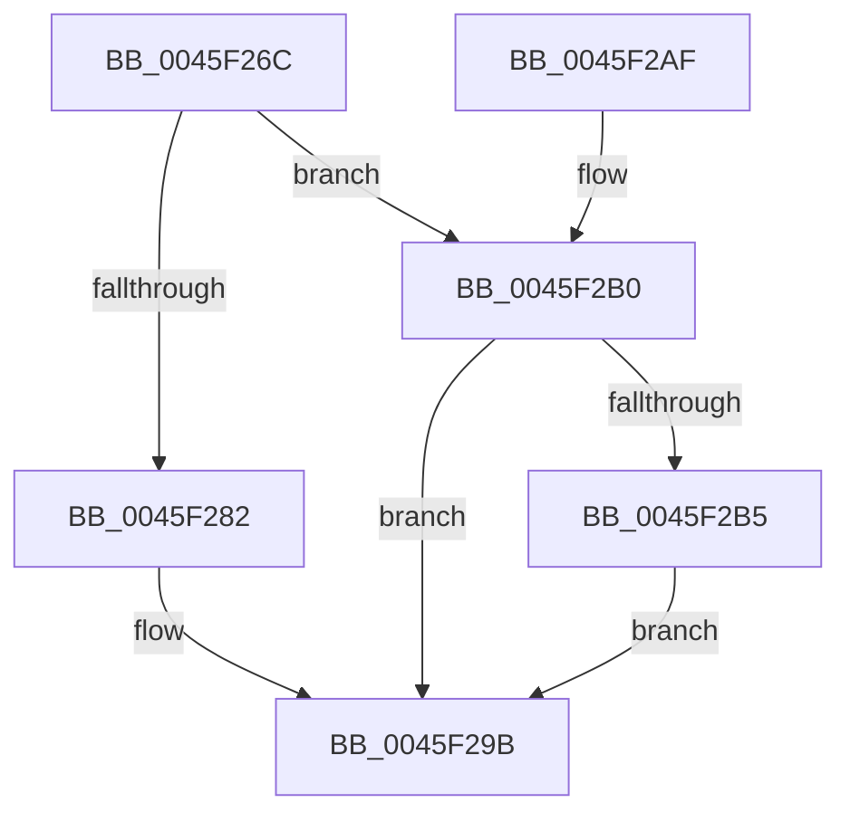

# KiIntSteerAddLoadToProcessorAndCheckThreshold

- RVA: `0x0045F26C`–`0x0045F2D3` (길이 `103` bytes)
- VA: `0x000000014045F26C`
- 실행 섹션: `.text`
- PDB 이름 있음: `예`; PDB Function 태그: `아니요`
- unwind 정보 RVA: `0x000DB714`
- 디코드: `25`개 명령, `103/103` bytes 표시
- 미해석 바이트: `0` (있으면 어셈블리에 `.byte`로 보존)

> 이 문서는 커널 이미지의 기계어와 PDB 기호를 분석해 생성했습니다. 4번과 5번은 함수 원형과 자료형을 바이너리 사용 방식에서 추정한 C 해석이며 원본 소스 복구 결과는 아닙니다.

## 1. Dependencies

- 직접 호출 지점: **0**; 고유 호출 대상: **0**
- 직접 호출자로 확인된 함수: **1**
- RIP 상대 이미지 참조: **2**

### Outgoing calls
- 직접 디코드된 call 명령이 없습니다.

### Direct callers
- [KeIntSteerSnapPerf](../2D/KeIntSteerSnapPerf_function_002D76C0.md) at `0x002D7A3D`

### Static image references
- `0x0045F26F` → RVA `0x00FC8C40` (`ALMOSTRO`; read)
- `0x0045F282` → RVA `0x00F10BC8` (`.data`; read)

## 2. Other-region calls and transfers

- 다른 실행 섹션으로 향하는 call: **0**
- 별도 외부 분기/꼬리 이동을 확인하지 못했습니다.

## 3. Assembly (complete function range)

```asm
0045F26C  45 8B D0                        mov r10d, r8d
0045F26F  48 8D 05 CA 99 B6 00            lea rax, [rip + 0xb699ca]
0045F276  4A 8B 04 D0                     mov rax, qword ptr [rax + r10*8]
0045F27A  44 8B 40 44                     mov r8d, dword ptr [rax + 0x44]
0045F27E  85 D2                           test edx, edx
0045F280  75 2E                           jne 0x14045f2b0
0045F282  4C 0F AF 05 3E 19 AB 00         imul r8, qword ptr [rip + 0xab193e]
0045F28A  48 69 C1 10 27 00 00            imul rax, rcx, 0x2710
0045F291  33 D2                           xor edx, edx
0045F293  49 F7 F0                        div r8
0045F296  43 01 44 91 04                  add dword ptr [r9 + r10*4 + 4], eax
0045F29B  43 8B 84 91 04 01 00 00         mov eax, dword ptr [r9 + r10*4 + 0x104]
0045F2A3  43 03 44 91 04                  add eax, dword ptr [r9 + r10*4 + 4]
0045F2A8  41 39 01                        cmp dword ptr [r9], eax
0045F2AB  0F 96 C0                        setbe al
0045F2AE  C3                              ret
0045F2AF  CC                              int3
0045F2B0  83 FA 01                        cmp edx, 1
0045F2B3  75 E6                           jne 0x14045f29b
0045F2B5  4C 0F AF 05 0B 19 AB 00         imul r8, qword ptr [rip + 0xab190b]
0045F2BD  48 69 C1 10 27 00 00            imul rax, rcx, 0x2710
0045F2C4  33 D2                           xor edx, edx
0045F2C6  49 F7 F0                        div r8
0045F2C9  43 01 84 91 04 01 00 00         add dword ptr [r9 + r10*4 + 0x104], eax
0045F2D1  EB C8                           jmp 0x14045f29b
```

## 4. C-style interpretation (structured pseudocode)

```c
__int64 __fastcall KiIntSteerAddLoadToProcessorAndCheckThreshold(__int64 a1, int a2, int a3, __int64 a4)
{
    __int64 result;

    if (a2 != 0) goto loc_0045F2B0;
    a3 = ((unsigned int)(*(unsigned int *)(*(unsigned __int64 *)(v_rip + 11966922 + (unsigned int)(a3) * 8) + 68))) * (*(unsigned __int64 *)(v_rip + 11213118));
    result = (*(unsigned __int64 *)(v_rip + 11966922 + (unsigned int)(a3) * 8)) * (a1);
    a2 = 0;
loc_0045F29B:
    result = (unsigned int)(((unsigned int)(*(unsigned int *)(a4 + (unsigned int)(a3) * 4 + 260))) + (*(unsigned int *)(a4 + (unsigned int)(a3) * 4 + 4)));
    result = ((*(unsigned int *)(a4)) <= ((unsigned int)(result))) ? 1 : 0;
    return result;
loc_0045F2B0:
    if (0 != 1) goto loc_0045F29B;
    a3 = (a3) * (*(unsigned __int64 *)(v_rip + 11213067));
    result = (result) * (a1);
    a2 = 0;
    goto loc_0045F29B;
}
```

## 5. (Beta) C Style

```c
int64_t KiIntSteerAddLoadToProcessorAndCheckThreshold(int64_t Arg1, int32_t Arg2, int32_t Arg3, void *Arg4)
{
    uint8_t *arg4 = (uint8_t *)Arg4;

    int64_t result;

    if (Arg2 != 0) goto loc_0045F2B0;
    Arg3 = ((uint32_t)(*(uint32_t *)(*(uint64_t *)(v_rip + 0xB699CA + (uint32_t)(Arg3) * 8) + 0x44))) * (*(uint64_t *)(v_rip + 0xAB193E));
    result = (*(uint64_t *)(v_rip + 0xB699CA + (uint32_t)(Arg3) * 8)) * (Arg1);
    Arg2 = 0;
loc_0045F29B:
    result = (uint32_t)(((uint32_t)(*(uint32_t *)(arg4 + (uint32_t)(Arg3) * 4 + 0x104))) + (*(uint32_t *)(arg4 + (uint32_t)(Arg3) * 4 + 0x4)));
    result = ((*(uint32_t *)(arg4)) <= ((uint32_t)(result))) ? 1 : 0;
    return result;
loc_0045F2B0:
    if (0 != 1) goto loc_0045F29B;
    Arg3 = (Arg3) * (*(uint64_t *)(v_rip + 0xAB190B));
    result = (result) * (Arg1);
    Arg2 = 0;
    goto loc_0045F29B;
}
```

### 관측된 메모리 오프셋

구조체 형식이 확인되지 않은 접근은 인자 기준의 오프셋으로만 기록했습니다.

| 기준 인자 | 오프셋 표현 | 폭 (bit) | 접근 |
|---|---:|---:|---|
| `Arg4` | `+ 0x0` | `32` | `R` |
| `Arg4` | `+ 0x4 + r10*4` | `32` | `R` |
| `Arg4` | `+ 0x4 + r10*4` | `32` | `R/W` |
| `Arg4` | `+ 0x104 + r10*4` | `32` | `R` |
| `Arg4` | `+ 0x104 + r10*4` | `32` | `R/W` |

## 6. Execution-region graph

[열기: 2D/3D 그래프와 함수 탐색 컨트롤 패널](../../../control-panel.html?section=text&rva=0x0045F26C&view=graph)

- 2D 그래프는 위에서 아래로 흐르고, 3D 그래프는 빈 공간을 드래그해 회전합니다. Shift+드래그는 이동, 휠은 확대·축소, 함수 노드 선택은 대상 보고서 이동입니다.

### Static fallback


