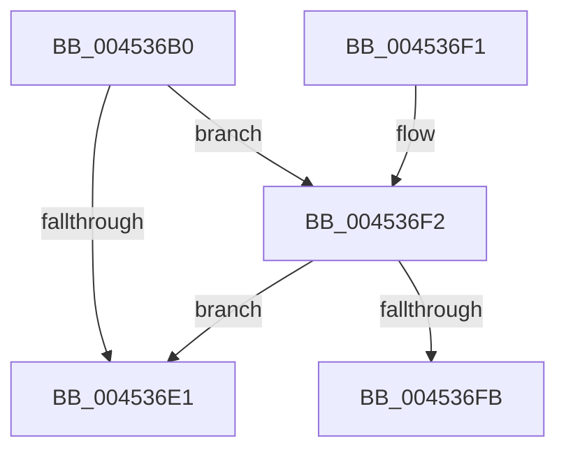

# KiIpiEnlightenedGuestPriorityKick

- RVA: `0x004536B0`–`0x00453713` (길이 `99` bytes)
- VA: `0x00000001404536B0`
- 실행 섹션: `.text`
- PDB 이름 있음: `예`; PDB Function 태그: `예`
- unwind 정보 RVA: `0x000A77AC`
- 디코드: `27`개 명령, `99/99` bytes 표시
- 미해석 바이트: `0` (있으면 어셈블리에 `.byte`로 보존)

> 이 문서는 커널 이미지의 기계어와 PDB 기호를 분석해 생성했습니다. 4번과 5번은 함수 원형과 자료형을 바이너리 사용 방식에서 추정한 C 해석이며 원본 소스 복구 결과는 아닙니다.

## 1. Dependencies

- 직접 호출 지점: **1**; 고유 호출 대상: **1**
- 직접 호출자로 확인된 함수: **1**
- RIP 상대 이미지 참조: **0**

### Outgoing calls
- `0x004536F2` → [KeIsEmptyAffinityEx](../2D/KeIsEmptyAffinityEx_function_002D1580.md) (function, `0x002D1580`)

### Direct callers
- [KiIpiSendRequest](../31/KiIpiSendRequest_function_003113C0.md) at `0x00311733`
- [KiIpiSendRequest](../31/KiIpiSendRequest_function_003113C0.md) at `0x00311918`

### Static image references
- 디코드된 RIP-relative 메모리 참조가 없습니다.

## 2. Other-region calls and transfers

- 다른 실행 섹션으로 향하는 call: **0**
- call이 아닌 외부 분기/꼬리 이동: **1**
  - `0x0045370E` → [sub_006F178E + 0x23](../6F/Unknown_function_006F178E.md) (`tail-transfer`)

## 3. Assembly (complete function range)

```asm
004536B0  48 8B C4                        mov rax, rsp
004536B3  48 89 58 08                     mov qword ptr [rax + 8], rbx
004536B7  48 89 70 18                     mov qword ptr [rax + 0x18], rsi
004536BB  57                              push rdi
004536BC  48 83 EC 40                     sub rsp, 0x40
004536C0  65 48 8B 1C 25 20 00 00 00      mov rbx, qword ptr gs:[0x20]
004536C9  33 F6                           xor esi, esi
004536CB  48 8B F9                        mov rdi, rcx
004536CE  89 70 EA                        mov dword ptr [rax - 0x16], esi
004536D1  66 89 70 EE                     mov word ptr [rax - 0x12], si
004536D5  89 70 10                        mov dword ptr [rax + 0x10], esi
004536D8  48 39 B3 B8 8E 00 00            cmp qword ptr [rbx + 0x8eb8], rsi
004536DF  75 11                           jne 0x1404536f2
004536E1  48 8B 5C 24 50                  mov rbx, qword ptr [rsp + 0x50]
004536E6  48 8B 74 24 60                  mov rsi, qword ptr [rsp + 0x60]
004536EB  48 83 C4 40                     add rsp, 0x40
004536EF  5F                              pop rdi
004536F0  C3                              ret
004536F1  CC                              int3
004536F2  E8 89 DE E7 FF                  call 0x1402d1580
004536F7  85 C0                           test eax, eax
004536F9  75 E6                           jne 0x1404536e1
004536FB  48 8B 47 08                     mov rax, qword ptr [rdi + 8]
004536FF  48 89 44 24 28                  mov qword ptr [rsp + 0x28], rax
00453704  66 89 74 24 30                  mov word ptr [rsp + 0x30], si
00453709  48 89 7C 24 20                  mov qword ptr [rsp + 0x20], rdi
0045370E  E9 9E E0 29 00                  jmp 0x1406f17b1
```

## 4. C-style interpretation (structured pseudocode)

```c
__int64 __fastcall KiIpiEnlightenedGuestPriorityKick(__int64 a1)
{
    __int64 result;
    __int64 v_rsi;
    __int64 v_rsp;
    unsigned __int64 v_stack_p18;
    unsigned __int64 v_stack_p20;
    unsigned __int64 v_stack_p28;
    unsigned __int16 v_stack_p30;
    unsigned __int64 v_stack_p8;

    *(unsigned __int64 *)(v_rsp + 8) = v_rbx;
    *(unsigned __int64 *)(v_rsp + 24) = v_rsi;
    v_rsp = (v_rsp) - (64);
    v_rsi = 0;
    *(unsigned int *)(v_rsp - 22) = 0;
    *(unsigned __int16 *)(v_rsp - 18) = 0;
    *(unsigned int *)(v_rsp + 16) = 0;
    if ((*(unsigned __int64 *)(*(unsigned __int64 *)(gs_base + (0 + 32)) + 36536)) != 0) goto loc_004536F2;
loc_004536E1:
    v_rsp = (v_rsp) + (64);
    return v_rsp;
loc_004536F2:
    result = KeIsEmptyAffinityEx(a1, a2, a3, a4);
    if ((unsigned int)(result) != 0) goto loc_004536E1;
    v_stack_p28 = *(unsigned __int64 *)(a1 + 8);
    v_stack_p30 = (unsigned __int16)(v_stack_p18);
    v_stack_p20 = a1;
}
```

## 5. (Beta) C Style

```c
int64_t KiIpiEnlightenedGuestPriorityKick(void *Arg1)
{
    uint8_t *arg1 = (uint8_t *)Arg1;

    int64_t result;
    int64_t local_rsi;
    int64_t local_rsp;
    uint64_t v_stack_p18;
    uint64_t v_stack_p20;
    uint64_t v_stack_p28;
    uint16_t v_stack_p30;
    uint64_t v_stack_p8;

    *(uint64_t *)(local_rsp + 0x8) = local_rbx;
    *(uint64_t *)(local_rsp + 0x18) = local_rsi;
    local_rsp = (local_rsp) - (64);
    local_rsi = 0;
    *(uint32_t *)(local_rsp - 0x16) = 0;
    *(uint16_t *)(local_rsp - 0x12) = 0;
    *(uint32_t *)(local_rsp + 0x10) = 0;
    if ((*(uint64_t *)(*(uint64_t *)(gs_base + (0 + 0x20)) + 0x8EB8)) != 0) goto loc_004536F2;
loc_004536E1:
    local_rsp = (local_rsp) + (64);
    return local_rsp;
loc_004536F2:
    result = KeIsEmptyAffinityEx(Arg1, a2, a3, a4);
    if ((uint32_t)(result) != 0) goto loc_004536E1;
    v_stack_p28 = *(uint64_t *)(arg1 + 0x8);
    v_stack_p30 = (uint16_t)(v_stack_p18);
    v_stack_p20 = Arg1;
}
```

### 관측된 메모리 오프셋

구조체 형식이 확인되지 않은 접근은 인자 기준의 오프셋으로만 기록했습니다.

| 기준 인자 | 오프셋 표현 | 폭 (bit) | 접근 |
|---|---:|---:|---|
| `Arg1` | `+ 0x8` | `64` | `R` |

## 6. Execution-region graph

[열기: 2D/3D 그래프와 함수 탐색 컨트롤 패널](../../../control-panel.html?section=text&rva=0x004536B0&view=graph)

- 2D 그래프는 위에서 아래로 흐르고, 3D 그래프는 빈 공간을 드래그해 회전합니다. Shift+드래그는 이동, 휠은 확대·축소, 함수 노드 선택은 대상 보고서 이동입니다.

### Static fallback


