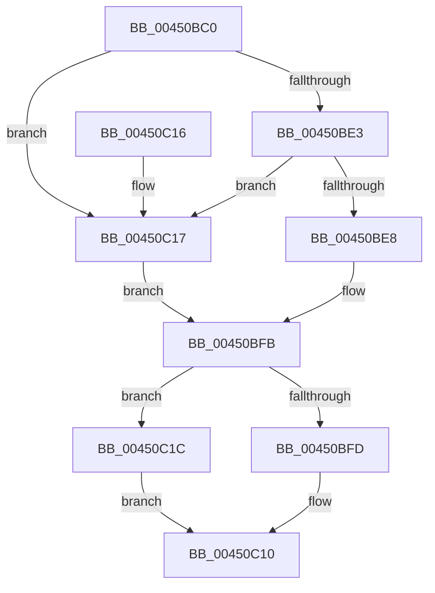

# KiPerformSoftParkElectionRound

- RVA: `0x00450BC0`–`0x00450C21` (길이 `97` bytes)
- VA: `0x0000000140450BC0`
- 실행 섹션: `.text`
- PDB 이름 있음: `예`; PDB Function 태그: `아니요`
- unwind 정보 RVA: `0x00085AEC`
- 디코드: `28`개 명령, `97/97` bytes 표시
- 미해석 바이트: `0` (있으면 어셈블리에 `.byte`로 보존)

> 이 문서는 커널 이미지의 기계어와 PDB 기호를 분석해 생성했습니다. 4번과 5번은 함수 원형과 자료형을 바이너리 사용 방식에서 추정한 C 해석이며 원본 소스 복구 결과는 아닙니다.

## 1. Dependencies

- 직접 호출 지점: **2**; 고유 호출 대상: **2**
- 직접 호출자로 확인된 함수: **1**
- RIP 상대 이미지 참조: **1**

### Outgoing calls
- `0x00450BF3` → [KiPerformHeteroSoftParkElection](../39/KiPerformHeteroSoftParkElection_function_0039E490.md) (function, `0x0039E490`)
- `0x00450C07` → [KiReduceAffinityToRankListMinimums](../39/KiReduceAffinityToRankListMinimums_function_0039EFA0.md) (function, `0x0039EFA0`)

### Direct callers
- [KiPerformSoftParkElection](KiPerformSoftParkElection_function_00450B14.md) at `0x00450B76`

### Static image references
- `0x00450BDA` → RVA `0x00FC6B78` (`ALMOSTRO`; read)

## 2. Other-region calls and transfers

- 다른 실행 섹션으로 향하는 call: **0**
- 별도 외부 분기/꼬리 이동을 확인하지 못했습니다.

## 3. Assembly (complete function range)

```asm
00450BC0  40 53                           push rbx
00450BC2  48 83 EC 30                     sub rsp, 0x30
00450BC6  49 8B C0                        mov rax, r8
00450BC9  48 8B D9                        mov rbx, rcx
00450BCC  4C 8B 82 E0 06 00 00            mov r8, qword ptr [rdx + 0x6e0]
00450BD3  48 81 C2 60 03 00 00            add rdx, 0x360
00450BDA  83 3D 97 5F B7 00 00            cmp dword ptr [rip + 0xb75f97], 0
00450BE1  74 34                           je 0x140450c17
00450BE3  48 85 D2                        test rdx, rdx
00450BE6  74 2F                           je 0x140450c17
00450BE8  4C 89 4C 24 20                  mov qword ptr [rsp + 0x20], r9
00450BED  4D 8B C8                        mov r9, r8
00450BF0  4C 8B C0                        mov r8, rax
00450BF3  E8 98 D8 F4 FF                  call 0x14039e490
00450BF8  48 85 C0                        test rax, rax
00450BFB  74 1F                           je 0x140450c1c
00450BFD  48 8D 93 C0 01 00 00            lea rdx, [rbx + 0x1c0]
00450C04  48 8B C8                        mov rcx, rax
00450C07  E8 94 E3 F4 FF                  call 0x14039efa0
00450C0C  48 0F BC C0                     bsf rax, rax
00450C10  48 83 C4 30                     add rsp, 0x30
00450C14  5B                              pop rbx
00450C15  C3                              ret
00450C16  CC                              int3
00450C17  49 23 C0                        and rax, r8
00450C1A  EB DF                           jmp 0x140450bfb
00450C1C  83 C8 FF                        or eax, 0xffffffff
00450C1F  EB EF                           jmp 0x140450c10
```

## 4. C-style interpretation (structured pseudocode)

```c
__int64 __fastcall KiPerformSoftParkElectionRound(__int64 a1, __int64 a2, __int64 a3, __int64 a4)
{
    __int64 result;
    __int64 v_rsp;
    unsigned __int64 v_stack_m18;

    v_rsp = (v_rsp) - (48);
    a2 = (a2) + (864);
    if ((*(unsigned int *)(v_rip + 12017559)) == 0) goto loc_00450C17;
    if (a2 == 0) goto loc_00450C17;
    v_stack_m18 = a4;
    result = KiPerformHeteroSoftParkElection(a1, a2, a3, *(unsigned __int64 *)(a2 + 1760));
loc_00450BFB:
    if (result == 0) goto loc_00450C1C;
    result = KiReduceAffinityToRankListMinimums(result, a1 + 448, a3, *(unsigned __int64 *)(a2 + 1760));
loc_00450C10:
    v_rsp = (v_rsp) + (48);
    return result;
loc_00450C17:
    result = (result) & (a3);
    goto loc_00450BFB;
loc_00450C1C:
    result = (unsigned int)((result) | (0xFFFFFFFFULL));
    goto loc_00450C10;
}
```

## 5. (Beta) C Style

```c
int64_t KiPerformSoftParkElectionRound(void *Arg1, void *Arg2, int64_t Arg3, int64_t Arg4)
{
    uint8_t *arg1 = (uint8_t *)Arg1;
    uint8_t *arg2 = (uint8_t *)Arg2;

    int64_t result;
    int64_t local_rsp;
    uint64_t v_stack_m18;

    local_rsp = (local_rsp) - (48);
    Arg2 = (Arg2) + (864);
    if ((*(uint32_t *)(v_rip + 0xB75F97)) == 0) goto loc_00450C17;
    if (Arg2 == NULL) goto loc_00450C17;
    v_stack_m18 = Arg4;
    result = KiPerformHeteroSoftParkElection(Arg1, Arg2, Arg3, *(uint64_t *)(arg2 + 0x6E0));
loc_00450BFB:
    if (result == 0) goto loc_00450C1C;
    result = KiReduceAffinityToRankListMinimums(result, Arg1 + 448, Arg3, *(uint64_t *)(arg2 + 0x6E0));
loc_00450C10:
    local_rsp = (local_rsp) + (48);
    return result;
loc_00450C17:
    result = (result) & (Arg3);
    goto loc_00450BFB;
loc_00450C1C:
    result = (uint32_t)((result) | (0xFFFFFFFFULL));
    goto loc_00450C10;
}
```

### 관측된 메모리 오프셋

구조체 형식이 확인되지 않은 접근은 인자 기준의 오프셋으로만 기록했습니다.

| 기준 인자 | 오프셋 표현 | 폭 (bit) | 접근 |
|---|---:|---:|---|
| `Arg1` | `+ 0x1C0` | `64` | `R` |
| `Arg2` | `+ 0x6E0` | `64` | `R` |

## 6. Execution-region graph

[열기: 2D/3D 그래프와 함수 탐색 컨트롤 패널](../../../control-panel.html?section=text&rva=0x00450BC0&view=graph)

- 2D 그래프는 위에서 아래로 흐르고, 3D 그래프는 빈 공간을 드래그해 회전합니다. Shift+드래그는 이동, 휠은 확대·축소, 함수 노드 선택은 대상 보고서 이동입니다.

### Static fallback


