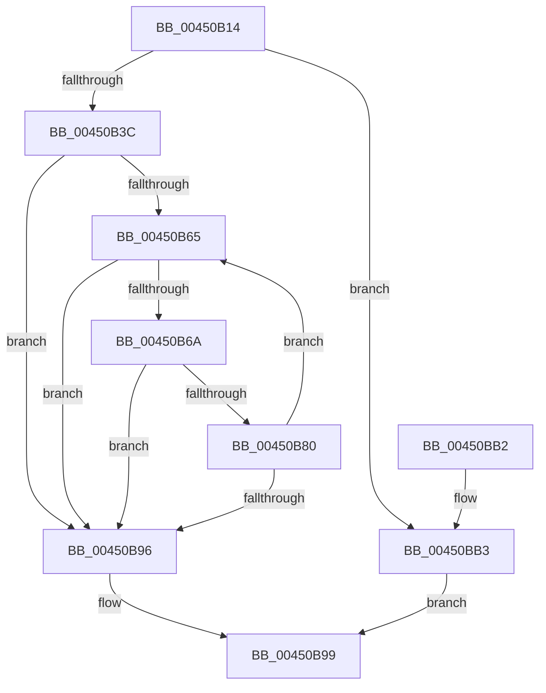

# KiPerformSoftParkElection

- RVA: `0x00450B14`–`0x00450BB7` (길이 `163` bytes)
- VA: `0x0000000140450B14`
- 실행 섹션: `.text`
- PDB 이름 있음: `예`; PDB Function 태그: `아니요`
- unwind 정보 RVA: `0x00098958`
- 디코드: `52`개 명령, `163/163` bytes 표시
- 미해석 바이트: `0` (있으면 어셈블리에 `.byte`로 보존)

> 이 문서는 커널 이미지의 기계어와 PDB 기호를 분석해 생성했습니다. 4번과 5번은 함수 원형과 자료형을 바이너리 사용 방식에서 추정한 C 해석이며 원본 소스 복구 결과는 아닙니다.

## 1. Dependencies

- 직접 호출 지점: **1**; 고유 호출 대상: **1**
- 직접 호출자로 확인된 함수: **1**
- RIP 상대 이미지 참조: **1**

### Outgoing calls
- `0x00450B76` → [KiPerformSoftParkElectionRound](KiPerformSoftParkElectionRound_function_00450BC0.md) (function, `0x00450BC0`)

### Direct callers
- [KiSoftParkElectionDpcRoutine](KiSoftParkElectionDpcRoutine_function_004508F0.md) at `0x004509C6`

### Static image references
- `0x00450B2C` → RVA `0x00F23454` (`.data`; read)

## 2. Other-region calls and transfers

- 다른 실행 섹션으로 향하는 call: **0**
- 별도 외부 분기/꼬리 이동을 확인하지 못했습니다.

## 3. Assembly (complete function range)

```asm
00450B14  48 89 5C 24 08                  mov qword ptr [rsp + 8], rbx
00450B19  48 89 6C 24 10                  mov qword ptr [rsp + 0x10], rbp
00450B1E  48 89 74 24 18                  mov qword ptr [rsp + 0x18], rsi
00450B23  57                              push rdi
00450B24  41 56                           push r14
00450B26  41 57                           push r15
00450B28  48 83 EC 20                     sub rsp, 0x20
00450B2C  8B 05 22 29 AD 00               mov eax, dword ptr [rip + 0xad2922]
00450B32  4C 8B F2                        mov r14, rdx
00450B35  48 8B E9                        mov rbp, rcx
00450B38  85 C0                           test eax, eax
00450B3A  74 77                           je 0x140450bb3
00450B3C  48 8B 75 50                     mov rsi, qword ptr [rbp + 0x50]
00450B40  8B C8                           mov ecx, eax
00450B42  49 8B 86 18 03 00 00            mov rax, qword ptr [r14 + 0x318]
00450B49  33 D2                           xor edx, edx
00450B4B  48 8B 5D 60                     mov rbx, qword ptr [rbp + 0x60]
00450B4F  BF 00 00 00 00                  mov edi, 0
00450B54  48 F7 F1                        div rcx
00450B57  48 8B CE                        mov rcx, rsi
00450B5A  48 F7 D1                        not rcx
00450B5D  4C 8B F8                        mov r15, rax
00450B60  48 23 D9                        and rbx, rcx
00450B63  74 31                           je 0x140450b96
00450B65  4D 85 FF                        test r15, r15
00450B68  74 2C                           je 0x140450b96
00450B6A  4C 8B CE                        mov r9, rsi
00450B6D  4C 8B C3                        mov r8, rbx
00450B70  49 8B D6                        mov rdx, r14
00450B73  48 8B CD                        mov rcx, rbp
00450B76  E8 45 00 00 00                  call 0x140450bc0
00450B7B  83 F8 FF                        cmp eax, -1
00450B7E  74 16                           je 0x140450b96
00450B80  8B C8                           mov ecx, eax
00450B82  49 FF CF                        dec r15
00450B85  48 0F AB CF                     bts rdi, rcx
00450B89  48 0F AB CE                     bts rsi, rcx
00450B8D  48 0F B3 CB                     btr rbx, rcx
00450B91  48 85 DB                        test rbx, rbx
00450B94  75 CF                           jne 0x140450b65
00450B96  48 8B C7                        mov rax, rdi
00450B99  48 8B 5C 24 40                  mov rbx, qword ptr [rsp + 0x40]
00450B9E  48 8B 6C 24 48                  mov rbp, qword ptr [rsp + 0x48]
00450BA3  48 8B 74 24 50                  mov rsi, qword ptr [rsp + 0x50]
00450BA8  48 83 C4 20                     add rsp, 0x20
00450BAC  41 5F                           pop r15
00450BAE  41 5E                           pop r14
00450BB0  5F                              pop rdi
00450BB1  C3                              ret
00450BB2  CC                              int3
00450BB3  33 C0                           xor eax, eax
00450BB5  EB E2                           jmp 0x140450b99
```

## 4. C-style interpretation (structured pseudocode)

```c
__int64 __fastcall KiPerformSoftParkElection(__int64 a1, __int64 a2)
{
    __int64 result;
    __int64 v_r15;
    __int64 v_rbx;
    __int64 v_rsp;
    unsigned __int64 v_stack_p10;
    unsigned __int64 v_stack_p18;
    unsigned __int64 v_stack_p8;

    v_stack_p8 = v_rbx;
    v_stack_p10 = v_rbp;
    v_stack_p18 = v_rsi;
    v_rsp = (v_rsp) - (32);
    if ((unsigned int)((unsigned int)(*(unsigned int *)(v_rip + 11348258))) == 0) goto loc_00450BB3;
    a2 = 0;
    a1 = ~(*(unsigned __int64 *)(a1 + 80));
    v_rbx = (*(unsigned __int64 *)(a1 + 96)) & (a1);
    if (condition_is_equal) goto loc_00450B96;
loc_00450B65:
    if (*(unsigned __int64 *)(a2 + 792) == 0) goto loc_00450B96;
    result = KiPerformSoftParkElectionRound(a1, 0, v_rbx, *(unsigned __int64 *)(a1 + 80));
    if (((unsigned int)(result)) == -1) goto loc_00450B96;
    v_r15 = (*(unsigned __int64 *)(a2 + 792)) - 1;
    if (v_rbx != 0) goto loc_00450B65;
loc_00450B96:
loc_00450B99:
    v_rsp = (v_rsp) + (32);
    return 0;
loc_00450BB3:
    result = 0;
    goto loc_00450B99;
}
```

## 5. (Beta) C Style

```c
int64_t KiPerformSoftParkElection(void *Arg1, void *Arg2)
{
    uint8_t *arg1 = (uint8_t *)Arg1;
    uint8_t *arg2 = (uint8_t *)Arg2;

    int64_t result;
    int64_t local_r15;
    int64_t local_rbx;
    int64_t local_rsp;
    uint64_t v_stack_p10;
    uint64_t v_stack_p18;
    uint64_t v_stack_p8;

    v_stack_p8 = local_rbx;
    v_stack_p10 = local_rbp;
    v_stack_p18 = local_rsi;
    local_rsp = (local_rsp) - (32);
    if ((uint32_t)((uint32_t)(*(uint32_t *)(v_rip + 0xAD2922))) == 0) goto loc_00450BB3;
    Arg2 = 0;
    Arg1 = ~(*(uint64_t *)(arg1 + 0x50));
    local_rbx = (*(uint64_t *)(arg1 + 0x60)) & (Arg1);
    if (condition_is_equal) goto loc_00450B96;
loc_00450B65:
    if (*(uint64_t *)(arg2 + 0x318) == 0) goto loc_00450B96;
    result = KiPerformSoftParkElectionRound(Arg1, 0, local_rbx, *(uint64_t *)(arg1 + 0x50));
    if (((uint32_t)(result)) == -1) goto loc_00450B96;
    local_r15 = (*(uint64_t *)(arg2 + 0x318)) - 1;
    if (local_rbx != 0) goto loc_00450B65;
loc_00450B96:
loc_00450B99:
    local_rsp = (local_rsp) + (32);
    return 0;
loc_00450BB3:
    result = 0;
    goto loc_00450B99;
}
```

### 관측된 메모리 오프셋

구조체 형식이 확인되지 않은 접근은 인자 기준의 오프셋으로만 기록했습니다.

| 기준 인자 | 오프셋 표현 | 폭 (bit) | 접근 |
|---|---:|---:|---|
| `Arg1` | `+ 0x50` | `64` | `R` |
| `Arg1` | `+ 0x60` | `64` | `R` |
| `Arg2` | `+ 0x318` | `64` | `R` |

## 6. Execution-region graph

[열기: 2D/3D 그래프와 함수 탐색 컨트롤 패널](../../../control-panel.html?section=text&rva=0x00450B14&view=graph)

- 2D 그래프는 위에서 아래로 흐르고, 3D 그래프는 빈 공간을 드래그해 회전합니다. Shift+드래그는 이동, 휠은 확대·축소, 함수 노드 선택은 대상 보고서 이동입니다.

### Static fallback


