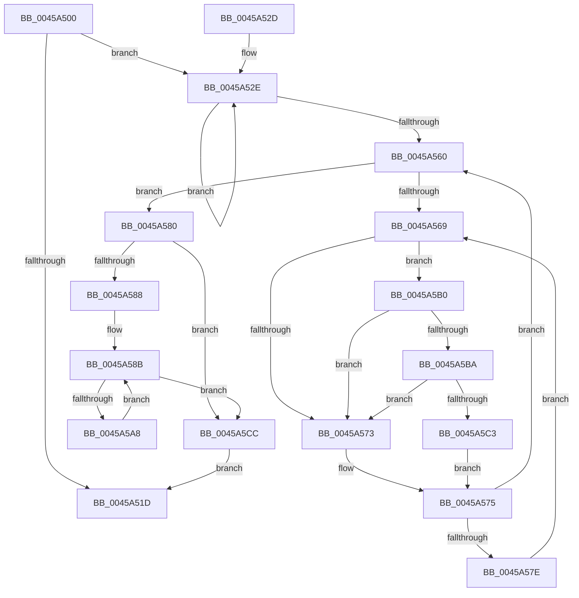

# KiProcessScbTracingList

- RVA: `0x0045A500`–`0x0045A5D7` (길이 `215` bytes)
- VA: `0x000000014045A500`
- 실행 섹션: `.text`
- PDB 이름 있음: `예`; PDB Function 태그: `아니요`
- unwind 정보 RVA: `0x000A8F64`
- 디코드: `63`개 명령, `215/215` bytes 표시
- 미해석 바이트: `0` (있으면 어셈블리에 `.byte`로 보존)

> 이 문서는 커널 이미지의 기계어와 PDB 기호를 분석해 생성했습니다. 4번과 5번은 함수 원형과 자료형을 바이너리 사용 방식에서 추정한 C 해석이며 원본 소스 복구 결과는 아닙니다.

## 1. Dependencies

- 직접 호출 지점: **3**; 고유 호출 대상: **3**
- 직접 호출자로 확인된 함수: **4**
- RIP 상대 이미지 참조: **2**

### Outgoing calls
- `0x0045A553` → [EtwTraceScbRankChange](../4F/EtwTraceScbRankChange_function_004F899C.md) (function, `0x004F899C`)
- `0x0045A5BA` → [KiCheckVpBackingLongSpinWaitHypercall](../30/KiCheckVpBackingLongSpinWaitHypercall_function_0030F490.md) (function, `0x0030F490`)
- `0x0045A5C5` → [HvlNotifyLongSpinWait](../30/HvlNotifyLongSpinWait_function_0030F460.md) (function, `0x0030F460`)

### Direct callers
- [KiGroupSchedulingGenerationEnd](../30/KiGroupSchedulingGenerationEnd_function_0030A9B4.md) at `0x0030B128`
- [KiGroupSchedulingQuantumEnd](../30/KiGroupSchedulingQuantumEnd_function_0030B220.md) at `0x0030B728`
- [KiParkCurrentProcessor](../35/KiParkCurrentProcessor_function_003533A4.md) at `0x003536F0`
- [KiSwapThread](../35/KiSwapThread_function_00355640.md) at `0x00355BC7`

### Static image references
- `0x0045A56B` → RVA `0x00FC52AC` (`ALMOSTRO`; reference)
- `0x0045A5B0` → RVA `0x00FC6AB8` (`ALMOSTRO`; read)

## 2. Other-region calls and transfers

- 다른 실행 섹션으로 향하는 call: **0**
- 별도 외부 분기/꼬리 이동을 확인하지 못했습니다.

## 3. Assembly (complete function range)

```asm
0045A500  48 89 5C 24 08                  mov qword ptr [rsp + 8], rbx
0045A505  48 89 74 24 10                  mov qword ptr [rsp + 0x10], rsi
0045A50A  57                              push rdi
0045A50B  48 83 EC 20                     sub rsp, 0x20
0045A50F  48 8B 3A                        mov rdi, qword ptr [rdx]
0045A512  48 8B F2                        mov rsi, rdx
0045A515  48 8B D9                        mov rbx, rcx
0045A518  48 85 FF                        test rdi, rdi
0045A51B  75 11                           jne 0x14045a52e
0045A51D  48 8B 5C 24 30                  mov rbx, qword ptr [rsp + 0x30]
0045A522  48 8B 74 24 38                  mov rsi, qword ptr [rsp + 0x38]
0045A527  48 83 C4 20                     add rsp, 0x20
0045A52B  5F                              pop rdi
0045A52C  C3                              ret
0045A52D  CC                              int3
0045A52E  8B 83 D8 00 00 00               mov eax, dword ptr [rbx + 0xd8]
0045A534  4C 8D 87 50 FE FF FF            lea r8, [rdi - 0x1b0]
0045A53B  45 8A 48 70                     mov r9b, byte ptr [r8 + 0x70]
0045A53F  49 8B C8                        mov rcx, r8
0045A542  45 8B 40 7C                     mov r8d, dword ptr [r8 + 0x7c]
0045A546  48 2B C8                        sub rcx, rax
0045A549  8B 53 24                        mov edx, dword ptr [rbx + 0x24]
0045A54C  41 D0 E9                        shr r9b, 1
0045A54F  41 80 E1 01                     and r9b, 1
0045A553  E8 44 E4 09 00                  call 0x1404f899c
0045A558  48 8B 3F                        mov rdi, qword ptr [rdi]
0045A55B  48 85 FF                        test rdi, rdi
0045A55E  75 CE                           jne 0x14045a52e
0045A560  F0 48 0F BA 6B 30 00            lock bts qword ptr [rbx + 0x30], 0
0045A567  73 17                           jae 0x14045a580
0045A569  FF C7                           inc edi
0045A56B  85 3D 3B AD B6 00               test dword ptr [rip + 0xb6ad3b], edi
0045A571  74 3D                           je 0x14045a5b0
0045A573  F3 90                           pause
0045A575  48 8B 43 30                     mov rax, qword ptr [rbx + 0x30]
0045A579  48 85 C0                        test rax, rax
0045A57C  74 E2                           je 0x14045a560
0045A57E  EB E9                           jmp 0x14045a569
0045A580  48 8B 06                        mov rax, qword ptr [rsi]
0045A583  48 85 C0                        test rax, rax
0045A586  74 44                           je 0x14045a5cc
0045A588  48 8B 08                        mov rcx, qword ptr [rax]
0045A58B  48 83 20 00                     and qword ptr [rax], 0
0045A58F  41 B8 FF FE 00 00               mov r8d, 0xfeff
0045A595  66 44 21 80 C0 FE FF FF         and word ptr [rax - 0x140], r8w
0045A59D  48 8B D1                        mov rdx, rcx
0045A5A0  48 89 0E                        mov qword ptr [rsi], rcx
0045A5A3  48 85 C9                        test rcx, rcx
0045A5A6  74 24                           je 0x14045a5cc
0045A5A8  48 8B 09                        mov rcx, qword ptr [rcx]
0045A5AB  48 8B C2                        mov rax, rdx
0045A5AE  EB DB                           jmp 0x14045a58b
0045A5B0  8B 05 02 C5 B6 00               mov eax, dword ptr [rip + 0xb6c502]
0045A5B6  A8 40                           test al, 0x40
0045A5B8  74 B9                           je 0x14045a573
0045A5BA  E8 D1 4E EB FF                  call 0x14030f490
0045A5BF  84 C0                           test al, al
0045A5C1  74 B0                           je 0x14045a573
0045A5C3  8B CF                           mov ecx, edi
0045A5C5  E8 96 4E EB FF                  call 0x14030f460
0045A5CA  EB A9                           jmp 0x14045a575
0045A5CC  F0 48 83 63 30 00               lock and qword ptr [rbx + 0x30], 0
0045A5D2  E9 46 FF FF FF                  jmp 0x14045a51d
```

## 4. C-style interpretation (structured pseudocode)

```c
__int64 __fastcall KiProcessScbTracingList(__int64 a1, __int64 a2)
{
    __int64 result;
    __int64 v_rdi;
    __int64 v_rsp;
    unsigned __int64 v_stack_p10;
    unsigned __int64 v_stack_p8;

    v_stack_p8 = v_rbx;
    v_stack_p10 = v_rsi;
    v_rsp = (v_rsp) - (32);
    if (*(unsigned __int64 *)(a2) != 0) goto loc_0045A52E;
loc_0045A51D:
    v_rsp = (v_rsp) + (32);
    return result;
loc_0045A52E:
    a1 = (*(unsigned __int64 *)(a2) - 432) - ((unsigned int)(*(unsigned int *)(v_stack_p8 + 216)));
    a4 = (unsigned __int8)((*(unsigned __int8 *)(*(unsigned __int64 *)(a2) - 432 + 112)) >> (1));
    a4 = (unsigned __int8)((a4) & (1));
    result = EtwTraceScbRankChange(a1, (unsigned int)(*(unsigned int *)(v_stack_p8 + 36)), (unsigned int)(*(unsigned int *)(*(unsigned __int64 *)(a2) - 432 + 124)), a4);
    if (*(unsigned __int64 *)(*(unsigned __int64 *)(a2)) != 0) goto loc_0045A52E;
loc_0045A560:
    if (condition_is_above_or_equal) goto loc_0045A580;
loc_0045A569:
    v_rdi = (unsigned int)((*(unsigned __int64 *)(*(unsigned __int64 *)(a2))) + 1);
    if (((*(unsigned int *)(v_rip + 11971899)) & ((unsigned int)(v_rdi))) == 0) goto loc_0045A5B0;
loc_0045A573:
loc_0045A575:
    if (*(unsigned __int64 *)(v_stack_p8 + 48) == 0) goto loc_0045A560;
    goto loc_0045A569;
loc_0045A580:
    if (*(unsigned __int64 *)(v_stack_p10) == 0) goto loc_0045A5CC;
loc_0045A58B:
    *(unsigned __int64 *)(v_stack_p10) = *(unsigned __int64 *)(*(unsigned __int64 *)(v_stack_p10));
    if (*(unsigned __int64 *)(*(unsigned __int64 *)(v_stack_p10)) == 0) goto loc_0045A5CC;
    goto loc_0045A58B;
loc_0045A5B0:
    if ((((unsigned __int8)((unsigned int)(*(unsigned int *)(v_rip + 11977986)))) & (64)) == 0) goto loc_0045A573;
    result = KiCheckVpBackingLongSpinWaitHypercall(*(unsigned __int64 *)(*(unsigned __int64 *)(*(unsigned __int64 *)(v_stack_p10))), *(unsigned __int64 *)(*(unsigned __int64 *)(v_stack_p10)), (unsigned int)(0xFEFFULL), a4);
    if ((unsigned __int8)(result) == 0) goto loc_0045A573;
    result = HvlNotifyLongSpinWait((unsigned int)((unsigned int)(v_rdi)), *(unsigned __int64 *)(*(unsigned __int64 *)(v_stack_p10)), (unsigned int)(0xFEFFULL), a4);
    goto loc_0045A575;
loc_0045A5CC:
    goto loc_0045A51D;
}
```

## 5. (Beta) C Style

```c
int64_t KiProcessScbTracingList(void *Arg1, void *Arg2)
{
    uint8_t *arg1 = (uint8_t *)Arg1;
    uint8_t *arg2 = (uint8_t *)Arg2;

    int64_t result;
    int64_t local_rdi;
    int64_t local_rsp;
    uint64_t v_stack_p10;
    uint64_t v_stack_p8;

    v_stack_p8 = local_rbx;
    v_stack_p10 = local_rsi;
    local_rsp = (local_rsp) - (32);
    if (*(uint64_t *)(arg2) != 0) goto loc_0045A52E;
loc_0045A51D:
    local_rsp = (local_rsp) + (32);
    return result;
loc_0045A52E:
    Arg1 = (*(uint64_t *)(arg2) - 432) - ((uint32_t)(*(uint32_t *)(v_stack_p8 + 0xD8)));
    a4 = (uint8_t)((*(uint8_t *)(*(uint64_t *)(arg2) - 0x1B0 + 0x70)) >> (1));
    a4 = (uint8_t)((a4) & (1));
    result = EtwTraceScbRankChange(Arg1, (uint32_t)(*(uint32_t *)(v_stack_p8 + 0x24)), (uint32_t)(*(uint32_t *)(*(uint64_t *)(arg2) - 0x1B0 + 0x7C)), a4);
    if (*(uint64_t *)(*(uint64_t *)(arg2)) != 0) goto loc_0045A52E;
loc_0045A560:
    if (condition_is_above_or_equal) goto loc_0045A580;
loc_0045A569:
    local_rdi = (uint32_t)((*(uint64_t *)(*(uint64_t *)(arg2))) + 1);
    if (((*(uint32_t *)(v_rip + 0xB6AD3B)) & ((uint32_t)(local_rdi))) == 0) goto loc_0045A5B0;
loc_0045A573:
loc_0045A575:
    if (*(uint64_t *)(v_stack_p8 + 0x30) == 0) goto loc_0045A560;
    goto loc_0045A569;
loc_0045A580:
    if (*(uint64_t *)(v_stack_p10) == 0) goto loc_0045A5CC;
loc_0045A58B:
    *(uint64_t *)(v_stack_p10) = *(uint64_t *)(*(uint64_t *)(v_stack_p10));
    if (*(uint64_t *)(*(uint64_t *)(v_stack_p10)) == 0) goto loc_0045A5CC;
    goto loc_0045A58B;
loc_0045A5B0:
    if ((((uint8_t)((uint32_t)(*(uint32_t *)(v_rip + 0xB6C502)))) & (64)) == 0) goto loc_0045A573;
    result = KiCheckVpBackingLongSpinWaitHypercall(*(uint64_t *)(*(uint64_t *)(*(uint64_t *)(v_stack_p10))), *(uint64_t *)(*(uint64_t *)(v_stack_p10)), (uint32_t)(0xFEFFULL), a4);
    if ((uint8_t)(result) == 0) goto loc_0045A573;
    result = HvlNotifyLongSpinWait((uint32_t)((uint32_t)(local_rdi)), *(uint64_t *)(*(uint64_t *)(v_stack_p10)), (uint32_t)(0xFEFFULL), a4);
    goto loc_0045A575;
loc_0045A5CC:
    goto loc_0045A51D;
}
```

### 관측된 메모리 오프셋

구조체 형식이 확인되지 않은 접근은 인자 기준의 오프셋으로만 기록했습니다.

| 기준 인자 | 오프셋 표현 | 폭 (bit) | 접근 |
|---|---:|---:|---|
| `Arg1` | `+ 0x24` | `32` | `R` |
| `Arg1` | `+ 0x30` | `64` | `R` |
| `Arg1` | `+ 0x30` | `64` | `R/W` |
| `Arg1` | `+ 0xD8` | `32` | `R` |
| `Arg2` | `+ 0x0` | `64` | `R` |
| `Arg2` | `+ 0x0` | `64` | `W` |

## 6. Execution-region graph

[열기: 2D/3D 그래프와 함수 탐색 컨트롤 패널](../../../control-panel.html?section=text&rva=0x0045A500&view=graph)

- 2D 그래프는 위에서 아래로 흐르고, 3D 그래프는 빈 공간을 드래그해 회전합니다. Shift+드래그는 이동, 휠은 확대·축소, 함수 노드 선택은 대상 보고서 이동입니다.

### Static fallback


