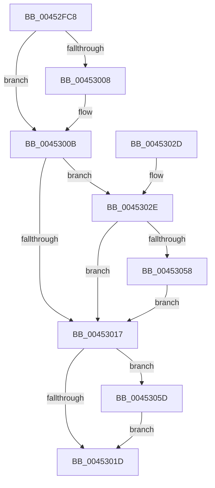

# KiRecomputeGroupSchedulingRank

- RVA: `0x00452FC8`–`0x0045306D` (길이 `165` bytes)
- VA: `0x0000000140452FC8`
- 실행 섹션: `.text`
- PDB 이름 있음: `예`; PDB Function 태그: `아니요`
- unwind 정보 RVA: `0x000A7750`
- 디코드: `49`개 명령, `165/165` bytes 표시
- 미해석 바이트: `0` (있으면 어셈블리에 `.byte`로 보존)

> 이 문서는 커널 이미지의 기계어와 PDB 기호를 분석해 생성했습니다. 4번과 5번은 함수 원형과 자료형을 바이너리 사용 방식에서 추정한 C 해석이며 원본 소스 복구 결과는 아닙니다.

## 1. Dependencies

- 직접 호출 지점: **2**; 고유 호출 대상: **2**
- 직접 호출자로 확인된 함수: **3**
- RIP 상대 이미지 참조: **1**

### Outgoing calls
- `0x00452FE0` → [KiChargeSchedulingGroupCycleTime](KiChargeSchedulingGroupCycleTime_function_00453074.md) (function, `0x00453074`)
- `0x00453066` → [KiResortScbQueue](../20/KiResortScbQueue_function_002024CC.md) (function, `0x002024CC`)

### Direct callers
- [KiQueueReadyThread](../21/KiQueueReadyThread_function_0021C7B0.md) at `0x0021D054`
- [KiGroupSchedulingQuantumEnd](../30/KiGroupSchedulingQuantumEnd_function_0030B220.md) at `0x0030B6BE`
- [sub_00356086](../35/Unknown_function_00356086.md) at `0x00356199`

### Static image references
- `0x00452FE9` → RVA `0x00FC52D0` (`ALMOSTRO`; read)

## 2. Other-region calls and transfers

- 다른 실행 섹션으로 향하는 call: **0**
- 별도 외부 분기/꼬리 이동을 확인하지 못했습니다.

## 3. Assembly (complete function range)

```asm
00452FC8  48 89 5C 24 08                  mov qword ptr [rsp + 8], rbx
00452FCD  48 89 74 24 10                  mov qword ptr [rsp + 0x10], rsi
00452FD2  57                              push rdi
00452FD3  48 83 EC 20                     sub rsp, 0x20
00452FD7  49 8B F0                        mov rsi, r8
00452FDA  48 8B FA                        mov rdi, rdx
00452FDD  48 8B D9                        mov rbx, rcx
00452FE0  E8 8F 00 00 00                  call 0x140453074
00452FE5  44 8B 53 08                     mov r10d, dword ptr [rbx + 8]
00452FE9  4C 0F AF 15 DF 22 B7 00         imul r10, qword ptr [rip + 0xb722df]
00452FF1  FF 47 7C                        inc dword ptr [rdi + 0x7c]
00452FF4  48 8B 87 80 00 00 00            mov rax, qword ptr [rdi + 0x80]
00452FFB  49 C1 EA 07                     shr r10, 7
00452FFF  4C 01 57 18                     add qword ptr [rdi + 0x18], r10
00453003  48 85 C0                        test rax, rax
00453006  74 03                           je 0x14045300b
00453008  F0 FF 00                        lock inc dword ptr [rax]
0045300B  48 8B 07                        mov rax, qword ptr [rdi]
0045300E  4C 8B 4F 18                     mov r9, qword ptr [rdi + 0x18]
00453012  49 3B C1                        cmp rax, r9
00453015  77 17                           ja 0x14045302e
00453017  F6 47 70 01                     test byte ptr [rdi + 0x70], 1
0045301B  75 40                           jne 0x14045305d
0045301D  48 8B 5C 24 30                  mov rbx, qword ptr [rsp + 0x30]
00453022  48 8B 74 24 38                  mov rsi, qword ptr [rsp + 0x38]
00453027  48 83 C4 20                     add rsp, 0x20
0045302B  5F                              pop rdi
0045302C  C3                              ret
0045302D  CC                              int3
0045302E  49 2B C1                        sub rax, r9
00453031  33 D2                           xor edx, edx
00453033  48 FF C8                        dec rax
00453036  49 03 C2                        add rax, r10
00453039  49 F7 F2                        div r10
0045303C  01 47 7C                        add dword ptr [rdi + 0x7c], eax
0045303F  8B C8                           mov ecx, eax
00453041  49 0F AF CA                     imul rcx, r10
00453045  49 03 C9                        add rcx, r9
00453048  48 89 4F 18                     mov qword ptr [rdi + 0x18], rcx
0045304C  48 8B 8F 80 00 00 00            mov rcx, qword ptr [rdi + 0x80]
00453053  48 85 C9                        test rcx, rcx
00453056  74 BF                           je 0x140453017
00453058  F0 01 01                        lock add dword ptr [rcx], eax
0045305B  EB BA                           jmp 0x140453017
0045305D  41 B0 01                        mov r8b, 1
00453060  48 8B D7                        mov rdx, rdi
00453063  48 8B CE                        mov rcx, rsi
00453066  E8 61 F4 DA FF                  call 0x1402024cc
0045306B  EB B0                           jmp 0x14045301d
```

## 4. C-style interpretation (structured pseudocode)

```c
__int64 __fastcall KiRecomputeGroupSchedulingRank(__int64 a1, __int64 a2, __int64 a3)
{
    __int64 result;
    __int64 v_r10;
    __int64 v_rsp;
    unsigned __int64 v_stack_p10;
    unsigned __int64 v_stack_p8;

    v_stack_p8 = v_rbx;
    v_stack_p10 = v_rsi;
    v_rsp = (v_rsp) - (32);
    result = KiChargeSchedulingGroupCycleTime(a1, a2, a3, a4);
    v_r10 = ((unsigned int)(*(unsigned int *)(a1 + 8))) * (*(unsigned __int64 *)(v_rip + 12002015));
    v_r10 = (v_r10) >> (7);
    if (*(unsigned __int64 *)(a2 + 128) != 0) {
    }
    if ((*(unsigned __int64 *)(a2)) > (*(unsigned __int64 *)(a2 + 24))) goto loc_0045302E;
loc_00453017:
    if (((*(unsigned __int8 *)(a2 + 112)) & (1)) != 0) goto loc_0045305D;
loc_0045301D:
    v_rsp = (v_rsp) + (32);
    return *(unsigned __int64 *)(a2);
loc_0045302E:
    result = (*(unsigned __int64 *)(a2)) - (*(unsigned __int64 *)(a2 + 24));
    a2 = 0;
    result = (result) - 1;
    result = (result) + (v_r10);
    a1 = ((unsigned int)((unsigned int)(result))) * (v_r10);
    a1 = (a1) + (*(unsigned __int64 *)(a2 + 24));
    *(unsigned __int64 *)(a2 + 24) = a1;
    if (*(unsigned __int64 *)(a2 + 128) == 0) goto loc_00453017;
    goto loc_00453017;
loc_0045305D:
    result = KiResortScbQueue(v_stack_p10, 0, 1, *(unsigned __int64 *)(a2 + 24));
    goto loc_0045301D;
}
```

## 5. (Beta) C Style

```c
int64_t KiRecomputeGroupSchedulingRank(void *Arg1, void *Arg2, int64_t Arg3)
{
    uint8_t *arg1 = (uint8_t *)Arg1;
    uint8_t *arg2 = (uint8_t *)Arg2;

    int64_t result;
    int64_t local_r10;
    int64_t local_rsp;
    uint64_t v_stack_p10;
    uint64_t v_stack_p8;

    v_stack_p8 = local_rbx;
    v_stack_p10 = local_rsi;
    local_rsp = (local_rsp) - (32);
    result = KiChargeSchedulingGroupCycleTime(Arg1, Arg2, Arg3, a4);
    local_r10 = ((uint32_t)(*(uint32_t *)(arg1 + 0x8))) * (*(uint64_t *)(v_rip + 0xB722DF));
    local_r10 = (local_r10) >> (7);
    if (*(uint64_t *)(arg2 + 0x80) != 0) {
    }
    if ((*(uint64_t *)(arg2)) > (*(uint64_t *)(arg2 + 0x18))) goto loc_0045302E;
loc_00453017:
    if (((*(uint8_t *)(arg2 + 0x70)) & (1)) != 0) goto loc_0045305D;
loc_0045301D:
    local_rsp = (local_rsp) + (32);
    return *(uint64_t *)(arg2);
loc_0045302E:
    result = (*(uint64_t *)(arg2)) - (*(uint64_t *)(arg2 + 0x18));
    Arg2 = 0;
    result = (result) - 1;
    result = (result) + (local_r10);
    Arg1 = ((uint32_t)((uint32_t)(result))) * (local_r10);
    Arg1 = (Arg1) + (*(uint64_t *)(arg2 + 0x18));
    *(void **)(arg2 + 0x18) = Arg1;
    if (*(uint64_t *)(arg2 + 0x80) == 0) goto loc_00453017;
    goto loc_00453017;
loc_0045305D:
    result = KiResortScbQueue(v_stack_p10, 0, 1, *(uint64_t *)(arg2 + 0x18));
    goto loc_0045301D;
}
```

### 관측된 메모리 오프셋

구조체 형식이 확인되지 않은 접근은 인자 기준의 오프셋으로만 기록했습니다.

| 기준 인자 | 오프셋 표현 | 폭 (bit) | 접근 |
|---|---:|---:|---|
| `Arg1` | `+ 0x8` | `32` | `R` |
| `Arg2` | `+ 0x0` | `64` | `R` |
| `Arg2` | `+ 0x18` | `64` | `R` |
| `Arg2` | `+ 0x18` | `64` | `R/W` |
| `Arg2` | `+ 0x18` | `64` | `W` |
| `Arg2` | `+ 0x70` | `8` | `R` |
| `Arg2` | `+ 0x7C` | `32` | `R/W` |
| `Arg2` | `+ 0x80` | `64` | `R` |

## 6. Execution-region graph

[열기: 2D/3D 그래프와 함수 탐색 컨트롤 패널](../../../control-panel.html?section=text&rva=0x00452FC8&view=graph)

- 2D 그래프는 위에서 아래로 흐르고, 3D 그래프는 빈 공간을 드래그해 회전합니다. Shift+드래그는 이동, 휠은 확대·축소, 함수 노드 선택은 대상 보고서 이동입니다.

### Static fallback


