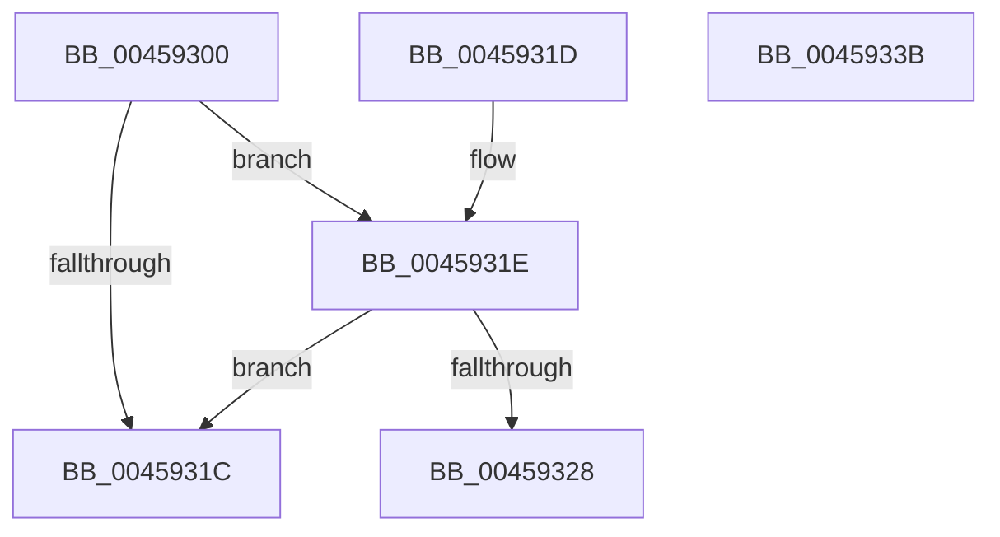

# KiSetupForInstrumentationReturn

- RVA: `0x00459300`–`0x0045933C` (길이 `60` bytes)
- VA: `0x0000000140459300`
- 실행 섹션: `.text`
- PDB 이름 있음: `예`; PDB Function 태그: `아니요`
- unwind 정보 RVA: `0x000DB714`
- 디코드: `14`개 명령, `60/60` bytes 표시
- 미해석 바이트: `0` (있으면 어셈블리에 `.byte`로 보존)

> 이 문서는 커널 이미지의 기계어와 PDB 기호를 분석해 생성했습니다. 4번과 5번은 함수 원형과 자료형을 바이너리 사용 방식에서 추정한 C 해석이며 원본 소스 복구 결과는 아닙니다.

## 1. Dependencies

- 직접 호출 지점: **0**; 고유 호출 대상: **0**
- 직접 호출자로 확인된 함수: **4**
- RIP 상대 이미지 참조: **0**

### Outgoing calls
- 직접 디코드된 call 명령이 없습니다.

### Direct callers
- [KiDispatchException](../3D/KiDispatchException_function_003D7650.md) at `0x003D7BEE`
- [KiDispatchException](../3D/KiDispatchException_function_003D7650.md) at `0x003D7E35`
- [KiInitializeUserApc](../3D/KiInitializeUserApc_function_003D8D38.md) at `0x003D91C0`
- [KeRaiseUserException](../4D/KeRaiseUserException_function_004D7750.md) at `0x004D77D6`
- [sub_006E983C](../6E/Unknown_function_006E983C.md) at `0x006E983F`

### Static image references
- 디코드된 RIP-relative 메모리 참조가 없습니다.

## 2. Other-region calls and transfers

- 다른 실행 섹션으로 향하는 call: **0**
- 별도 외부 분기/꼬리 이동을 확인하지 못했습니다.

## 3. Assembly (complete function range)

```asm
00459300  65 48 8B 04 25 88 01 00 00      mov rax, qword ptr gs:[0x188]
00459309  48 8B 90 B8 00 00 00            mov rdx, qword ptr [rax + 0xb8]
00459310  4C 8B 82 68 01 00 00            mov r8, qword ptr [rdx + 0x168]
00459317  4D 85 C0                        test r8, r8
0045931A  75 02                           jne 0x14045931e
0045931C  C3                              ret
0045931D  CC                              int3
0045931E  66 83 B9 70 01 00 00 33         cmp word ptr [rcx + 0x170], 0x33
00459326  75 F4                           jne 0x14045931c
00459328  48 8B 81 68 01 00 00            mov rax, qword ptr [rcx + 0x168]
0045932F  48 89 41 58                     mov qword ptr [rcx + 0x58], rax
00459333  4C 89 81 68 01 00 00            mov qword ptr [rcx + 0x168], r8
0045933A  C3                              ret
0045933B  CC                              int3
```

## 4. C-style interpretation (structured pseudocode)

```c
__int64 __fastcall KiSetupForInstrumentationReturn(__int64 a1)
{
    if (*(unsigned __int64 *)(*(unsigned __int64 *)(*(unsigned __int64 *)(gs_base + (0 + 392)) + 184) + 360) != 0) goto loc_0045931E;
loc_0045931C:
    return *(unsigned __int64 *)(gs_base + (0 + 392));
loc_0045931E:
    if ((*(unsigned __int16 *)(a1 + 368)) != 51) goto loc_0045931C;
    *(unsigned __int64 *)(a1 + 88) = *(unsigned __int64 *)(a1 + 360);
    *(unsigned __int64 *)(a1 + 360) = *(unsigned __int64 *)(*(unsigned __int64 *)(*(unsigned __int64 *)(gs_base + (0 + 392)) + 184) + 360);
    return *(unsigned __int64 *)(a1 + 360);
}
```

## 5. (Beta) C Style

```c
int64_t KiSetupForInstrumentationReturn(void *Arg1)
{
    uint8_t *arg1 = (uint8_t *)Arg1;

    if (*(uint64_t *)(*(uint64_t *)(*(uint64_t *)(gs_base + (0 + 0x188)) + 0xB8) + 0x168) != 0) goto loc_0045931E;
loc_0045931C:
    return *(uint64_t *)(gs_base + (0 + 0x188));
loc_0045931E:
    if ((*(uint16_t *)(arg1 + 0x170)) != 51) goto loc_0045931C;
    *(uint64_t *)(arg1 + 0x58) = *(uint64_t *)(arg1 + 0x168);
    *(uint64_t *)(arg1 + 0x168) = *(uint64_t *)(*(uint64_t *)(*(uint64_t *)(gs_base + (0 + 0x188)) + 0xB8) + 0x168);
    return *(uint64_t *)(arg1 + 0x168);
}
```

### 관측된 메모리 오프셋

구조체 형식이 확인되지 않은 접근은 인자 기준의 오프셋으로만 기록했습니다.

| 기준 인자 | 오프셋 표현 | 폭 (bit) | 접근 |
|---|---:|---:|---|
| `Arg1` | `+ 0x58` | `64` | `W` |
| `Arg1` | `+ 0x168` | `64` | `R` |
| `Arg1` | `+ 0x168` | `64` | `W` |
| `Arg1` | `+ 0x170` | `16` | `R` |

## 6. Execution-region graph

[열기: 2D/3D 그래프와 함수 탐색 컨트롤 패널](../../../control-panel.html?section=text&rva=0x00459300&view=graph)

- 2D 그래프는 위에서 아래로 흐르고, 3D 그래프는 빈 공간을 드래그해 회전합니다. Shift+드래그는 이동, 휠은 확대·축소, 함수 노드 선택은 대상 보고서 이동입니다.

### Static fallback


