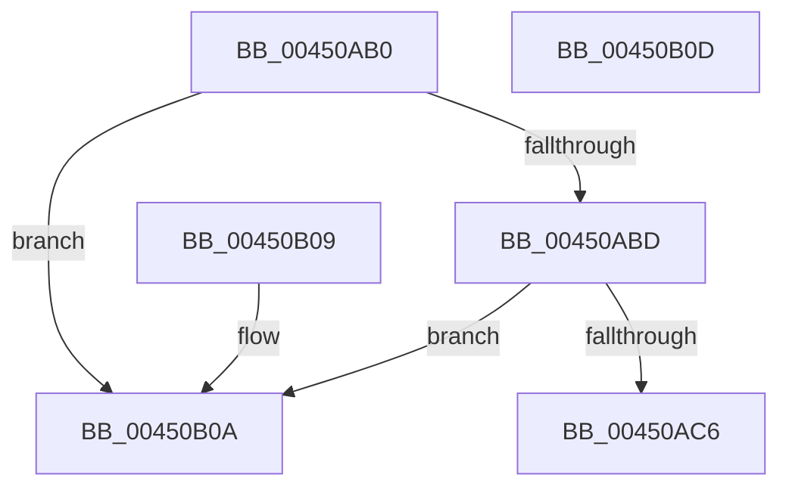

# KiShouldSoftParkElectionBePerformed

- RVA: `0x00450AB0`–`0x00450B0E` (길이 `94` bytes)
- VA: `0x0000000140450AB0`
- 실행 섹션: `.text`
- PDB 이름 있음: `예`; PDB Function 태그: `아니요`
- unwind 정보 RVA: `0x000DB714`
- 디코드: `25`개 명령, `94/94` bytes 표시
- 미해석 바이트: `0` (있으면 어셈블리에 `.byte`로 보존)

> 이 문서는 커널 이미지의 기계어와 PDB 기호를 분석해 생성했습니다. 4번과 5번은 함수 원형과 자료형을 바이너리 사용 방식에서 추정한 C 해석이며 원본 소스 복구 결과는 아닙니다.

## 1. Dependencies

- 직접 호출 지점: **0**; 고유 호출 대상: **0**
- 직접 호출자로 확인된 함수: **1**
- RIP 상대 이미지 참조: **3**

### Outgoing calls
- 직접 디코드된 call 명령이 없습니다.

### Direct callers
- [KiSoftParkElectionDpcRoutine](KiSoftParkElectionDpcRoutine_function_004508F0.md) at `0x0045098C`

### Static image references
- `0x00450AB0` → RVA `0x00F23454` (`.data`; read)
- `0x00450ADB` → RVA `0x00F231B8` (`.data`; read)
- `0x00450AE5` → RVA `0x00FC8C40` (`ALMOSTRO`; read)

## 2. Other-region calls and transfers

- 다른 실행 섹션으로 향하는 call: **0**
- 별도 외부 분기/꼬리 이동을 확인하지 못했습니다.

## 3. Assembly (complete function range)

```asm
00450AB0  8B 05 9E 29 AD 00               mov eax, dword ptr [rip + 0xad299e]
00450AB6  48 8B D1                        mov rdx, rcx
00450AB9  85 C0                           test eax, eax
00450ABB  74 4D                           je 0x140450b0a
00450ABD  48 39 81 18 03 00 00            cmp qword ptr [rcx + 0x318], rax
00450AC4  76 44                           jbe 0x140450b0a
00450AC6  0F B7 89 C6 02 00 00            movzx ecx, word ptr [rcx + 0x2c6]
00450ACD  0F B6 82 C1 02 00 00            movzx eax, byte ptr [rdx + 0x2c1]
00450AD4  48 C1 E1 06                     shl rcx, 6
00450AD8  48 03 C8                        add rcx, rax
00450ADB  48 8B 05 D6 26 AD 00            mov rax, qword ptr [rip + 0xad26d6]
00450AE2  8B 04 88                        mov eax, dword ptr [rax + rcx*4]
00450AE5  48 8D 0D 54 81 B7 00            lea rcx, [rip + 0xb78154]
00450AEC  48 8B 04 C1                     mov rax, qword ptr [rcx + rax*8]
00450AF0  48 8B 88 C0 00 00 00            mov rcx, qword ptr [rax + 0xc0]
00450AF7  48 8B 51 50                     mov rdx, qword ptr [rcx + 0x50]
00450AFB  48 8B 41 60                     mov rax, qword ptr [rcx + 0x60]
00450AFF  48 F7 D2                        not rdx
00450B02  48 85 D0                        test rax, rdx
00450B05  0F 95 C0                        setne al
00450B08  C3                              ret
00450B09  CC                              int3
00450B0A  32 C0                           xor al, al
00450B0C  C3                              ret
00450B0D  CC                              int3
```

## 4. C-style interpretation (structured pseudocode)

```c
__int64 __fastcall KiShouldSoftParkElectionBePerformed(__int64 a1)
{
    __int64 result;

    if ((unsigned int)((unsigned int)(*(unsigned int *)(v_rip + 11348382))) == 0) goto loc_00450B0A;
    if ((*(unsigned __int64 *)(a1 + 792)) <= ((unsigned int)(*(unsigned int *)(v_rip + 11348382)))) goto loc_00450B0A;
    a1 = (*(unsigned __int16 *)(a1 + 710)) << (6);
    a1 = (a1) + (*(unsigned __int8 *)(a1 + 705));
    a2 = ~(*(unsigned __int64 *)(*(unsigned __int64 *)(*(unsigned __int64 *)(v_rip + 12026196 + (unsigned int)(*(unsigned int *)(*(unsigned __int64 *)(v_rip + 11347670) + a1 * 4)) * 8) + 192) + 80));
    result = (((*(unsigned __int64 *)(*(unsigned __int64 *)(*(unsigned __int64 *)(v_rip + 12026196 + (unsigned int)(*(unsigned int *)(*(unsigned __int64 *)(v_rip + 11347670) + a1 * 4)) * 8) + 192) + 96)) & (a2)) != 0) ? 1 : 0;
    return result;
loc_00450B0A:
    result = 0;
    return result;
}
```

## 5. (Beta) C Style

```c
int64_t KiShouldSoftParkElectionBePerformed(void *Arg1)
{
    uint8_t *arg1 = (uint8_t *)Arg1;

    int64_t result;

    if ((uint32_t)((uint32_t)(*(uint32_t *)(v_rip + 0xAD299E))) == 0) goto loc_00450B0A;
    if ((*(uint64_t *)(arg1 + 0x318)) <= ((uint32_t)(*(uint32_t *)(v_rip + 0xAD299E)))) goto loc_00450B0A;
    Arg1 = (*(uint16_t *)(arg1 + 0x2C6)) << (6);
    Arg1 = (Arg1) + (*(uint8_t *)(arg1 + 0x2C1));
    a2 = ~(*(uint64_t *)(*(uint64_t *)(*(uint64_t *)(v_rip + 0xB78154 + (uint32_t)(*(uint32_t *)(*(uint64_t *)(v_rip + 0xAD26D6) + arg1 * 4)) * 8) + 0xC0) + 0x50));
    result = (((*(uint64_t *)(*(uint64_t *)(*(uint64_t *)(v_rip + 0xB78154 + (uint32_t)(*(uint32_t *)(*(uint64_t *)(v_rip + 0xAD26D6) + arg1 * 4)) * 8) + 0xC0) + 0x60)) & (a2)) != 0) ? 1 : 0;
    return result;
loc_00450B0A:
    result = 0;
    return result;
}
```

### 관측된 메모리 오프셋

구조체 형식이 확인되지 않은 접근은 인자 기준의 오프셋으로만 기록했습니다.

| 기준 인자 | 오프셋 표현 | 폭 (bit) | 접근 |
|---|---:|---:|---|
| `Arg1` | `+ 0x2C1` | `8` | `R` |
| `Arg1` | `+ 0x2C6` | `16` | `R` |
| `Arg1` | `+ 0x318` | `64` | `R` |

## 6. Execution-region graph

[열기: 2D/3D 그래프와 함수 탐색 컨트롤 패널](../../../control-panel.html?section=text&rva=0x00450AB0&view=graph)

- 2D 그래프는 위에서 아래로 흐르고, 3D 그래프는 빈 공간을 드래그해 회전합니다. Shift+드래그는 이동, 휠은 확대·축소, 함수 노드 선택은 대상 보고서 이동입니다.

### Static fallback


