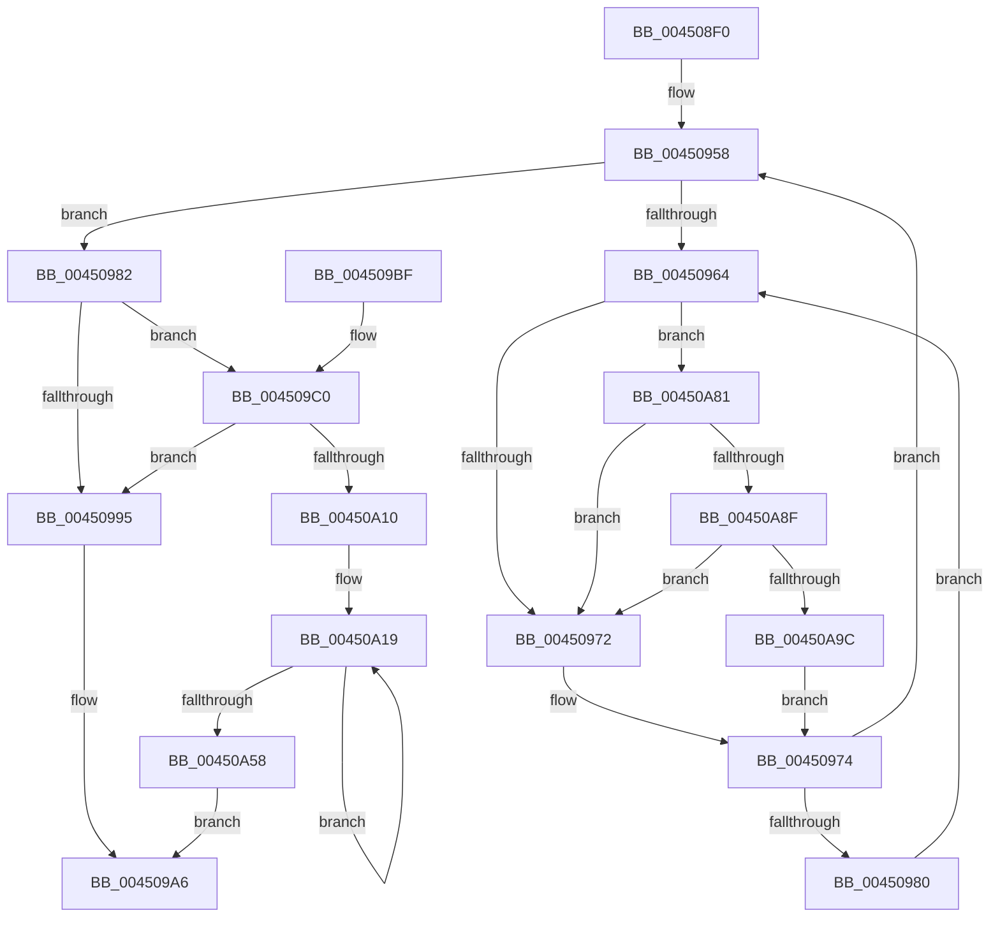

# KiSoftParkElectionDpcRoutine

- RVA: `0x004508F0`–`0x00450AA8` (길이 `440` bytes)
- VA: `0x00000001404508F0`
- 실행 섹션: `.text`
- PDB 이름 있음: `예`; PDB Function 태그: `아니요`
- unwind 정보 RVA: `0x000A731C`
- 디코드: `103`개 명령, `440/440` bytes 표시
- 미해석 바이트: `0` (있으면 어셈블리에 `.byte`로 보존)

> 이 문서는 커널 이미지의 기계어와 PDB 기호를 분석해 생성했습니다. 4번과 5번은 함수 원형과 자료형을 바이너리 사용 방식에서 추정한 C 해석이며 원본 소스 복구 결과는 아닙니다.

## 1. Dependencies

- 직접 호출 지점: **11**; 고유 호출 대상: **10**
- 직접 호출자로 확인된 함수: **0**
- RIP 상대 이미지 참조: **4**

### Outgoing calls
- `0x00450951` → [ExAcquireSpinLockExclusiveAtDpcLevel](../24/ExAcquireSpinLockExclusiveAtDpcLevel_function_00248E80.md) (function, `0x00248E80`)
- `0x0045098C` → [KiShouldSoftParkElectionBePerformed](KiShouldSoftParkElectionBePerformed_function_00450AB0.md) (function, `0x00450AB0`)
- `0x004509A1` → [ExReleaseSpinLockExclusiveFromDpcLevel](../24/ExReleaseSpinLockExclusiveFromDpcLevel_function_002497E0.md) (function, `0x002497E0`)
- `0x004509C6` → [KiPerformSoftParkElection](KiPerformSoftParkElection_function_00450B14.md) (function, `0x00450B14`)
- `0x00450A06` → [memset](../6C/memset_function_006C6C40.md) (function, `0x006C6C40`)
- `0x00450A4E` → [KiSoftParkElectionUnparkProcessor](../30/KiSoftParkElectionUnparkProcessor_function_0030B818.md) (function, `0x0030B818`)
- `0x00450A5B` → [ExReleaseSpinLockExclusiveFromDpcLevel](../24/ExReleaseSpinLockExclusiveFromDpcLevel_function_002497E0.md) (function, `0x002497E0`)
- `0x00450A67` → [KiFlushSoftwareInterruptBatch](../25/KiFlushSoftwareInterruptBatch_function_00252200.md) (function, `0x00252200`)
- `0x00450A77` → [KiProcessDeferredReadyList](../25/KiProcessDeferredReadyList_function_00250800.md) (function, `0x00250800`)
- `0x00450A8F` → [KiCheckVpBackingLongSpinWaitHypercall](../30/KiCheckVpBackingLongSpinWaitHypercall_function_0030F490.md) (function, `0x0030F490`)
- `0x00450A9E` → [HvlNotifyLongSpinWait](../30/HvlNotifyLongSpinWait_function_0030F460.md) (function, `0x0030F460`)

### Direct callers
- 이 함수 시작 RVA로 연결되는 직접 call은 확인되지 않았습니다. 간접 호출은 완전히 역산할 수 없습니다.

### Static image references
- `0x0045090D` → RVA `0x00FC8C40` (`ALMOSTRO`; read)
- `0x00450935` → RVA `0x00F231B8` (`.data`; read)
- `0x00450966` → RVA `0x00FC52AC` (`ALMOSTRO`; reference)
- `0x00450A81` → RVA `0x00FC6AB8` (`ALMOSTRO`; read)

## 2. Other-region calls and transfers

- 다른 실행 섹션으로 향하는 call: **0**
- 별도 외부 분기/꼬리 이동을 확인하지 못했습니다.

## 3. Assembly (complete function range)

```asm
004508F0  48 8B C4                        mov rax, rsp
004508F3  48 89 58 08                     mov qword ptr [rax + 8], rbx
004508F7  48 89 68 18                     mov qword ptr [rax + 0x18], rbp
004508FB  48 89 70 20                     mov qword ptr [rax + 0x20], rsi
004508FF  57                              push rdi
00450900  41 54                           push r12
00450902  41 56                           push r14
00450904  48 83 EC 30                     sub rsp, 0x30
00450908  48 83 60 D8 00                  and qword ptr [rax - 0x28], 0
0045090D  4C 8D 25 2C 83 B7 00            lea r12, [rip + 0xb7832c]
00450914  0F B6 82 C1 02 00 00            movzx eax, byte ptr [rdx + 0x2c1]
0045091B  48 8B DA                        mov rbx, rdx
0045091E  0F B7 8A C6 02 00 00            movzx ecx, word ptr [rdx + 0x2c6]
00450925  65 48 8B 34 25 20 00 00 00      mov rsi, qword ptr gs:[0x20]
0045092E  48 C1 E1 06                     shl rcx, 6
00450932  48 03 C8                        add rcx, rax
00450935  48 8B 05 7C 28 AD 00            mov rax, qword ptr [rip + 0xad287c]
0045093C  8B 0C 88                        mov ecx, dword ptr [rax + rcx*4]
0045093F  49 8B 04 CC                     mov rax, qword ptr [r12 + rcx*8]
00450943  4C 8B B0 C0 00 00 00            mov r14, qword ptr [rax + 0xc0]
0045094A  49 8D 6E 78                     lea rbp, [r14 + 0x78]
0045094E  48 8B CD                        mov rcx, rbp
00450951  E8 2A 85 DF FF                  call 0x140248e80
00450956  33 FF                           xor edi, edi
00450958  F0 48 0F BA AB 00 03 00 00 00   lock bts qword ptr [rbx + 0x300], 0
00450962  73 1E                           jae 0x140450982
00450964  FF C7                           inc edi
00450966  85 3D 40 49 B7 00               test dword ptr [rip + 0xb74940], edi
0045096C  0F 84 0F 01 00 00               je 0x140450a81
00450972  F3 90                           pause
00450974  48 8B 83 00 03 00 00            mov rax, qword ptr [rbx + 0x300]
0045097B  48 85 C0                        test rax, rax
0045097E  74 D8                           je 0x140450958
00450980  EB E2                           jmp 0x140450964
00450982  48 8B CB                        mov rcx, rbx
00450985  C6 83 14 03 00 00 00            mov byte ptr [rbx + 0x314], 0
0045098C  E8 1F 01 00 00                  call 0x140450ab0
00450991  84 C0                           test al, al
00450993  75 2B                           jne 0x1404509c0
00450995  F0 48 83 A3 00 03 00 00 00      lock and qword ptr [rbx + 0x300], 0
0045099E  48 8B CD                        mov rcx, rbp
004509A1  E8 3A 8E DF FF                  call 0x1402497e0
004509A6  48 8B 5C 24 50                  mov rbx, qword ptr [rsp + 0x50]
004509AB  48 8B 6C 24 60                  mov rbp, qword ptr [rsp + 0x60]
004509B0  48 8B 74 24 68                  mov rsi, qword ptr [rsp + 0x68]
004509B5  48 83 C4 30                     add rsp, 0x30
004509B9  41 5E                           pop r14
004509BB  41 5C                           pop r12
004509BD  5F                              pop rdi
004509BE  C3                              ret
004509BF  CC                              int3
004509C0  48 8B D3                        mov rdx, rbx
004509C3  49 8B CE                        mov rcx, r14
004509C6  E8 49 01 00 00                  call 0x140450b14
004509CB  48 8B 8B 08 03 00 00            mov rcx, qword ptr [rbx + 0x308]
004509D2  48 8B F8                        mov rdi, rax
004509D5  48 FF C1                        inc rcx
004509D8  33 C0                           xor eax, eax
004509DA  48 89 8B 08 03 00 00            mov qword ptr [rbx + 0x308], rcx
004509E1  33 D2                           xor edx, edx
004509E3  83 A3 10 03 00 00 00            and dword ptr [rbx + 0x310], 0
004509EA  48 8D 8B 60 03 00 00            lea rcx, [rbx + 0x360]
004509F1  48 83 A3 18 03 00 00 00         and qword ptr [rbx + 0x318], 0
004509F9  41 B8 80 03 00 00               mov r8d, 0x380
004509FF  48 89 83 E0 06 00 00            mov qword ptr [rbx + 0x6e0], rax
00450A06  E8 35 62 27 00                  call 0x1406c6c40
00450A0B  48 85 FF                        test rdi, rdi
00450A0E  74 85                           je 0x140450995
00450A10  F0 48 83 A3 00 03 00 00 00      lock and qword ptr [rbx + 0x300], 0
00450A19  83 64 24 58 00                  and dword ptr [rsp + 0x58], 0
00450A1E  4C 8D 4C 24 20                  lea r9, [rsp + 0x20]
00450A23  48 0F BC CF                     bsf rcx, rdi
00450A27  4D 8B C6                        mov r8, r14
00450A2A  8B C1                           mov eax, ecx
00450A2C  48 0F B3 C7                     btr rdi, rax
00450A30  41 0F B7 86 88 00 00 00         movzx eax, word ptr [r14 + 0x88]
00450A38  C1 E0 06                        shl eax, 6
00450A3B  03 C8                           add ecx, eax
00450A3D  48 8B 05 74 27 AD 00            mov rax, qword ptr [rip + 0xad2774]
00450A44  8B 0C 88                        mov ecx, dword ptr [rax + rcx*4]
00450A47  49 8B 14 CC                     mov rdx, qword ptr [r12 + rcx*8]
00450A4B  48 8B CE                        mov rcx, rsi
00450A4E  E8 C5 AD EB FF                  call 0x14030b818
00450A53  48 85 FF                        test rdi, rdi
00450A56  75 C1                           jne 0x140450a19
00450A58  48 8B CD                        mov rcx, rbp
00450A5B  E8 80 8D DF FF                  call 0x1402497e0
00450A60  48 8D 8E D8 35 00 00            lea rcx, [rsi + 0x35d8]
00450A67  E8 94 17 E0 FF                  call 0x140252200
00450A6C  41 B0 02                        mov r8b, 2
00450A6F  48 8D 54 24 20                  lea rdx, [rsp + 0x20]
00450A74  48 8B CE                        mov rcx, rsi
00450A77  E8 84 FD DF FF                  call 0x140250800
00450A7C  E9 25 FF FF FF                  jmp 0x1404509a6
00450A81  8B 05 31 60 B7 00               mov eax, dword ptr [rip + 0xb76031]
00450A87  A8 40                           test al, 0x40
00450A89  0F 84 E3 FE FF FF               je 0x140450972
00450A8F  E8 FC E9 EB FF                  call 0x14030f490
00450A94  84 C0                           test al, al
00450A96  0F 84 D6 FE FF FF               je 0x140450972
00450A9C  8B CF                           mov ecx, edi
00450A9E  E8 BD E9 EB FF                  call 0x14030f460
00450AA3  E9 CC FE FF FF                  jmp 0x140450974
```

## 4. C-style interpretation (structured pseudocode)

```c
__int64 __fastcall KiSoftParkElectionDpcRoutine(__int64 a1, __int64 a2)
{
    __int64 result;
    __int64 v_rdi;
    __int64 v_rsp;
    unsigned __int64 v_stack_p18;
    unsigned __int64 v_stack_p20;
    unsigned int v_stack_p58;
    unsigned __int64 v_stack_p8;

    *(unsigned __int64 *)(v_rsp + 8) = v_rbx;
    *(unsigned __int64 *)(v_rsp + 24) = v_rbp;
    *(unsigned __int64 *)(v_rsp + 32) = v_rsi;
    v_rsp = (v_rsp) - (48);
    a1 = (*(unsigned __int16 *)(a2 + 710)) << (6);
    a1 = (a1) + (*(unsigned __int8 *)(a2 + 705));
    result = ExAcquireSpinLockExclusiveAtDpcLevel(*(unsigned __int64 *)(*(unsigned __int64 *)(v_rip + 12026668 + (unsigned int)(*(unsigned int *)(*(unsigned __int64 *)(v_rip + 11348092) + a1 * 4)) * 8) + 192) + 120, a2, a3, a4);
    v_rdi = 0;
loc_00450958:
    if (condition_is_above_or_equal) goto loc_00450982;
loc_00450964:
    v_rdi = (unsigned int)((v_rdi) + 1);
    if (((*(unsigned int *)(v_rip + 12011840)) & ((unsigned int)(v_rdi))) == 0) goto loc_00450A81;
loc_00450972:
loc_00450974:
    if (*(unsigned __int64 *)(a2 + 768) == 0) goto loc_00450958;
    goto loc_00450964;
loc_00450982:
    *(unsigned __int8 *)(a2 + 788) = 0;
    result = KiShouldSoftParkElectionBePerformed(a2, a2, a3, a4);
    if ((unsigned __int8)(result) != 0) goto loc_004509C0;
loc_00450995:
    result = ExReleaseSpinLockExclusiveFromDpcLevel(*(unsigned __int64 *)(*(unsigned __int64 *)(v_rip + 12026668 + (unsigned int)(*(unsigned int *)(*(unsigned __int64 *)(v_rip + 11348092) + a1 * 4)) * 8) + 192) + 120, a2, a3, a4);
loc_004509A6:
    v_rsp = (v_rsp) + (48);
    return result;
loc_004509C0:
    result = KiPerformSoftParkElection(*(unsigned __int64 *)(*(unsigned __int64 *)(v_rip + 12026668 + (unsigned int)(*(unsigned int *)(*(unsigned __int64 *)(v_rip + 11348092) + a1 * 4)) * 8) + 192), v_stack_p8, a3, a4);
    a1 = (*(unsigned __int64 *)(v_stack_p8 + 776)) + 1;
    result = 0;
    *(unsigned __int64 *)(v_stack_p8 + 776) = a1;
    a2 = 0;
    *(unsigned __int64 *)(v_stack_p8 + 1760) = 0;
    result = memset(v_stack_p8 + 864, a2, 896, a4);
    if (result == 0) goto loc_00450995;
loc_00450A19:
    result = (unsigned int)((*(unsigned __int16 *)(*(unsigned __int64 *)(*(unsigned __int64 *)(v_rip + 12026668 + (unsigned int)(*(unsigned int *)(*(unsigned __int64 *)(v_rip + 11348092) + a1 * 4)) * 8) + 192) + 136)) << (6));
    a1 = (unsigned int)((v_stack_p8 + 864) + ((unsigned int)(result)));
    result = KiSoftParkElectionUnparkProcessor(v_stack_p20, *(unsigned __int64 *)(v_rip + 12026668 + (unsigned int)(*(unsigned int *)(*(unsigned __int64 *)(v_rip + 11347828) + a1 * 4)) * 8), *(unsigned __int64 *)(*(unsigned __int64 *)(v_rip + 12026668 + (unsigned int)(*(unsigned int *)(*(unsigned __int64 *)(v_rip + 11348092) + a1 * 4)) * 8) + 192), v_stack_p20);
    if (result != 0) goto loc_00450A19;
    result = ExReleaseSpinLockExclusiveFromDpcLevel(v_stack_p18, *(unsigned __int64 *)(v_rip + 12026668 + (unsigned int)(*(unsigned int *)(*(unsigned __int64 *)(v_rip + 11347828) + a1 * 4)) * 8), *(unsigned __int64 *)(*(unsigned __int64 *)(v_rip + 12026668 + (unsigned int)(*(unsigned int *)(*(unsigned __int64 *)(v_rip + 11348092) + a1 * 4)) * 8) + 192), v_stack_p20);
    result = KiFlushSoftwareInterruptBatch(v_stack_p20 + 13784, *(unsigned __int64 *)(v_rip + 12026668 + (unsigned int)(*(unsigned int *)(*(unsigned __int64 *)(v_rip + 11347828) + a1 * 4)) * 8), *(unsigned __int64 *)(*(unsigned __int64 *)(v_rip + 12026668 + (unsigned int)(*(unsigned int *)(*(unsigned __int64 *)(v_rip + 11348092) + a1 * 4)) * 8) + 192), v_stack_p20);
    result = KiProcessDeferredReadyList(v_stack_p20, v_stack_p20, 2, v_stack_p20);
    goto loc_004509A6;
loc_00450A81:
    if ((((unsigned __int8)((unsigned int)(*(unsigned int *)(v_rip + 12017713)))) & (64)) == 0) goto loc_00450972;
    result = KiCheckVpBackingLongSpinWaitHypercall(v_stack_p20, v_stack_p20, 2, v_stack_p20);
    if ((unsigned __int8)(result) == 0) goto loc_00450972;
    result = HvlNotifyLongSpinWait((unsigned int)((unsigned int)(result)), v_stack_p20, 2, v_stack_p20);
    goto loc_00450974;
}
```

## 5. (Beta) C Style

```c
int64_t KiSoftParkElectionDpcRoutine(int64_t Arg1, void *Arg2)
{
    uint8_t *arg2 = (uint8_t *)Arg2;

    int64_t result;
    int64_t local_rdi;
    int64_t local_rsp;
    uint64_t v_stack_p18;
    uint64_t v_stack_p20;
    uint32_t v_stack_p58;
    uint64_t v_stack_p8;

    *(uint64_t *)(local_rsp + 0x8) = local_rbx;
    *(uint64_t *)(local_rsp + 0x18) = local_rbp;
    *(uint64_t *)(local_rsp + 0x20) = local_rsi;
    local_rsp = (local_rsp) - (48);
    Arg1 = (*(uint16_t *)(arg2 + 0x2C6)) << (6);
    Arg1 = (Arg1) + (*(uint8_t *)(arg2 + 0x2C1));
    result = ExAcquireSpinLockExclusiveAtDpcLevel(*(uint64_t *)(*(uint64_t *)(v_rip + 0xB7832C + (uint32_t)(*(uint32_t *)(*(uint64_t *)(v_rip + 0xAD287C) + Arg1 * 4)) * 8) + 0xC0) + 120, Arg2, a3, a4);
    local_rdi = 0;
loc_00450958:
    if (condition_is_above_or_equal) goto loc_00450982;
loc_00450964:
    local_rdi = (uint32_t)((local_rdi) + 1);
    if (((*(uint32_t *)(v_rip + 0xB74940)) & ((uint32_t)(local_rdi))) == 0) goto loc_00450A81;
loc_00450972:
loc_00450974:
    if (*(uint64_t *)(arg2 + 0x300) == 0) goto loc_00450958;
    goto loc_00450964;
loc_00450982:
    *(uint8_t *)(arg2 + 0x314) = 0;
    result = KiShouldSoftParkElectionBePerformed(Arg2, Arg2, a3, a4);
    if ((uint8_t)(result) != 0) goto loc_004509C0;
loc_00450995:
    result = ExReleaseSpinLockExclusiveFromDpcLevel(*(uint64_t *)(*(uint64_t *)(v_rip + 0xB7832C + (uint32_t)(*(uint32_t *)(*(uint64_t *)(v_rip + 0xAD287C) + Arg1 * 4)) * 8) + 0xC0) + 120, Arg2, a3, a4);
loc_004509A6:
    local_rsp = (local_rsp) + (48);
    return result;
loc_004509C0:
    result = KiPerformSoftParkElection(*(uint64_t *)(*(uint64_t *)(v_rip + 0xB7832C + (uint32_t)(*(uint32_t *)(*(uint64_t *)(v_rip + 0xAD287C) + Arg1 * 4)) * 8) + 0xC0), v_stack_p8, a3, a4);
    Arg1 = (*(uint64_t *)(v_stack_p8 + 0x308)) + 1;
    result = 0;
    *(uint64_t *)(v_stack_p8 + 0x308) = Arg1;
    Arg2 = 0;
    *(uint64_t *)(v_stack_p8 + 0x6E0) = 0;
    result = memset(v_stack_p8 + 864, Arg2, 896, a4);
    if (result == 0) goto loc_00450995;
loc_00450A19:
    result = (uint32_t)((*(uint16_t *)(*(uint64_t *)(*(uint64_t *)(v_rip + 0xB7832C + (uint32_t)(*(uint32_t *)(*(uint64_t *)(v_rip + 0xAD287C) + Arg1 * 4)) * 8) + 0xC0) + 0x88)) << (6));
    Arg1 = (uint32_t)((v_stack_p8 + 864) + ((uint32_t)(result)));
    result = KiSoftParkElectionUnparkProcessor(v_stack_p20, *(uint64_t *)(v_rip + 0xB7832C + (uint32_t)(*(uint32_t *)(*(uint64_t *)(v_rip + 0xAD2774) + Arg1 * 4)) * 8), *(uint64_t *)(*(uint64_t *)(v_rip + 0xB7832C + (uint32_t)(*(uint32_t *)(*(uint64_t *)(v_rip + 0xAD287C) + Arg1 * 4)) * 8) + 0xC0), v_stack_p20);
    if (result != 0) goto loc_00450A19;
    result = ExReleaseSpinLockExclusiveFromDpcLevel(v_stack_p18, *(uint64_t *)(v_rip + 0xB7832C + (uint32_t)(*(uint32_t *)(*(uint64_t *)(v_rip + 0xAD2774) + Arg1 * 4)) * 8), *(uint64_t *)(*(uint64_t *)(v_rip + 0xB7832C + (uint32_t)(*(uint32_t *)(*(uint64_t *)(v_rip + 0xAD287C) + Arg1 * 4)) * 8) + 0xC0), v_stack_p20);
    result = KiFlushSoftwareInterruptBatch(v_stack_p20 + 13784, *(uint64_t *)(v_rip + 0xB7832C + (uint32_t)(*(uint32_t *)(*(uint64_t *)(v_rip + 0xAD2774) + Arg1 * 4)) * 8), *(uint64_t *)(*(uint64_t *)(v_rip + 0xB7832C + (uint32_t)(*(uint32_t *)(*(uint64_t *)(v_rip + 0xAD287C) + Arg1 * 4)) * 8) + 0xC0), v_stack_p20);
    result = KiProcessDeferredReadyList(v_stack_p20, v_stack_p20, 2, v_stack_p20);
    goto loc_004509A6;
loc_00450A81:
    if ((((uint8_t)((uint32_t)(*(uint32_t *)(v_rip + 0xB76031)))) & (64)) == 0) goto loc_00450972;
    result = KiCheckVpBackingLongSpinWaitHypercall(v_stack_p20, v_stack_p20, 2, v_stack_p20);
    if ((uint8_t)(result) == 0) goto loc_00450972;
    result = HvlNotifyLongSpinWait((uint32_t)((uint32_t)(result)), v_stack_p20, 2, v_stack_p20);
    goto loc_00450974;
}
```

### 관측된 메모리 오프셋

구조체 형식이 확인되지 않은 접근은 인자 기준의 오프셋으로만 기록했습니다.

| 기준 인자 | 오프셋 표현 | 폭 (bit) | 접근 |
|---|---:|---:|---|
| `Arg2` | `+ 0x2C1` | `8` | `R` |
| `Arg2` | `+ 0x2C6` | `16` | `R` |
| `Arg2` | `+ 0x300` | `64` | `R` |
| `Arg2` | `+ 0x300` | `64` | `R/W` |
| `Arg2` | `+ 0x308` | `64` | `R` |
| `Arg2` | `+ 0x308` | `64` | `W` |
| `Arg2` | `+ 0x310` | `32` | `R/W` |
| `Arg2` | `+ 0x314` | `8` | `W` |
| `Arg2` | `+ 0x318` | `64` | `R/W` |
| `Arg2` | `+ 0x360` | `64` | `R` |
| `Arg2` | `+ 0x6E0` | `64` | `W` |

## 6. Execution-region graph

[열기: 2D/3D 그래프와 함수 탐색 컨트롤 패널](../../../control-panel.html?section=text&rva=0x004508F0&view=graph)

- 2D 그래프는 위에서 아래로 흐르고, 3D 그래프는 빈 공간을 드래그해 회전합니다. Shift+드래그는 이동, 휠은 확대·축소, 함수 노드 선택은 대상 보고서 이동입니다.

### Static fallback


