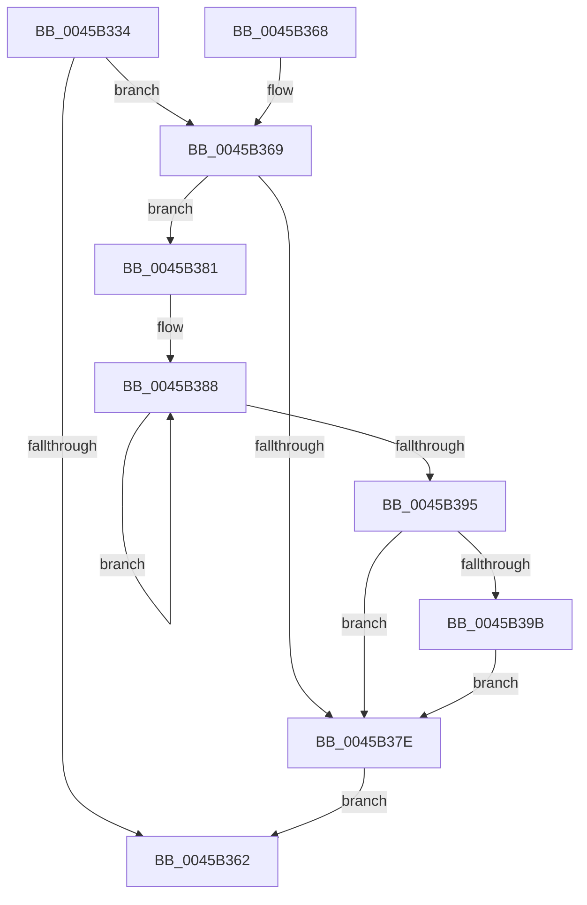

# KiWakeAddressAll

- RVA: `0x0045B334`–`0x0045B3A2` (길이 `110` bytes)
- VA: `0x000000014045B334`
- 실행 섹션: `.text`
- PDB 이름 있음: `예`; PDB Function 태그: `아니요`
- unwind 정보 RVA: `0x0005E698`
- 디코드: `33`개 명령, `110/110` bytes 표시
- 미해석 바이트: `0` (있으면 어셈블리에 `.byte`로 보존)

> 이 문서는 커널 이미지의 기계어와 PDB 기호를 분석해 생성했습니다. 4번과 5번은 함수 원형과 자료형을 바이너리 사용 방식에서 추정한 C 해석이며 원본 소스 복구 결과는 아닙니다.

## 1. Dependencies

- 직접 호출 지점: **3**; 고유 호출 대상: **3**
- 직접 호출자로 확인된 함수: **3**
- RIP 상대 이미지 참조: **1**

### Outgoing calls
- `0x0045B34C` → [KeDisableInterrupts](../21/KeDisableInterrupts_function_00217BE0.md) (function, `0x00217BE0`)
- `0x0045B359` → [KiHaltOnAddressWakeEntireList](../21/KiHaltOnAddressWakeEntireList_function_00217AF4.md) (function, `0x00217AF4`)
- `0x0045B39B` → [KiRemoveSystemWorkPriorityKick](../26/KiRemoveSystemWorkPriorityKick_function_002631D0.md) (function, `0x002631D0`)

### Direct callers
- [KxWaitForLockOwnerShip](../25/KxWaitForLockOwnerShip_function_00257EB0.md) at `0x00257FFD`
- [KxWaitForLockOwnerShipWithIrql](../41/KxWaitForLockOwnerShipWithIrql_function_00414E30.md) at `0x00414F89`
- [KiHaltOnAddress](../4F/KiHaltOnAddress_function_004FBA3C.md) at `0x004FBAD9`

### Static image references
- `0x0045B33D` → RVA `0x00F21B20` (`.data`; read)

## 2. Other-region calls and transfers

- 다른 실행 섹션으로 향하는 call: **0**
- 별도 외부 분기/꼬리 이동을 확인하지 못했습니다.

## 3. Assembly (complete function range)

```asm
0045B334  40 53                           push rbx
0045B336  48 83 EC 20                     sub rsp, 0x20
0045B33A  4C 8B C1                        mov r8, rcx
0045B33D  4C 8D 0D DC 67 AC 00            lea r9, [rip + 0xac67dc]
0045B344  49 C1 E8 05                     shr r8, 5
0045B348  41 83 E0 7F                     and r8d, 0x7f
0045B34C  E8 8F C8 DB FF                  call 0x140217be0
0045B351  33 D2                           xor edx, edx
0045B353  8A D8                           mov bl, al
0045B355  4B 87 14 C1                     xchg qword ptr [r9 + r8*8], rdx
0045B359  E8 96 C7 DB FF                  call 0x140217af4
0045B35E  84 DB                           test bl, bl
0045B360  75 07                           jne 0x14045b369
0045B362  48 83 C4 20                     add rsp, 0x20
0045B366  5B                              pop rbx
0045B367  C3                              ret
0045B368  CC                              int3
0045B369  65 48 8B 0C 25 20 00 00 00      mov rcx, qword ptr gs:[0x20]
0045B372  4C 8B 81 B8 8E 00 00            mov r8, qword ptr [rcx + 0x8eb8]
0045B379  4D 85 C0                        test r8, r8
0045B37C  75 03                           jne 0x14045b381
0045B37E  FB                              sti
0045B37F  EB E1                           jmp 0x14045b362
0045B381  41 0F 0D 08                     prefetchw byte ptr [r8]
0045B385  41 8B 00                        mov eax, dword ptr [r8]
0045B388  8B D0                           mov edx, eax
0045B38A  0F BA F2 15                     btr edx, 0x15
0045B38E  F0 41 0F B1 10                  lock cmpxchg dword ptr [r8], edx
0045B393  75 F3                           jne 0x14045b388
0045B395  0F BA E0 15                     bt eax, 0x15
0045B399  73 E3                           jae 0x14045b37e
0045B39B  E8 30 7E E0 FF                  call 0x1402631d0
0045B3A0  EB DC                           jmp 0x14045b37e
```

## 4. C-style interpretation (structured pseudocode)

```c
__int64 __fastcall KiWakeAddressAll(__int64 a1, int a2)
{
    __int64 result;
    __int64 v_rsp;

    v_rsp = (v_rsp) - (32);
    a3 = (a1) >> (5);
    a3 = (unsigned int)((a3) & (127));
    result = KeDisableInterrupts(a1, a2, a3, v_rip + 11298780);
    a2 = 0;
    result = KiHaltOnAddressWakeEntireList(a1, a2, a3, v_rip + 11298780);
    if ((unsigned __int8)((unsigned __int8)(result)) != 0) goto loc_0045B369;
loc_0045B362:
    v_rsp = (v_rsp) + (32);
    return result;
loc_0045B369:
    if (*(unsigned __int64 *)(*(unsigned __int64 *)(gs_base + (0 + 32)) + 36536) != 0) goto loc_0045B381;
loc_0045B37E:
    goto loc_0045B362;
loc_0045B381:
loc_0045B388:
    if (*(unsigned __int64 *)(*(unsigned __int64 *)(gs_base + (0 + 32)) + 36536) != 0) goto loc_0045B388;
    if (condition_is_above_or_equal) goto loc_0045B37E;
    result = KiRemoveSystemWorkPriorityKick(*(unsigned __int64 *)(gs_base + (0 + 32)), (unsigned int)((unsigned int)((unsigned int)(*(unsigned int *)(*(unsigned __int64 *)(*(unsigned __int64 *)(gs_base + (0 + 32)) + 36536))))), *(unsigned __int64 *)(*(unsigned __int64 *)(gs_base + (0 + 32)) + 36536), v_rip + 11298780);
    goto loc_0045B37E;
}
```

## 5. (Beta) C Style

```c
int64_t KiWakeAddressAll(int64_t Arg1, int32_t Arg2)
{
    int64_t result;
    int64_t local_rsp;

    local_rsp = (local_rsp) - (32);
    a3 = (Arg1) >> (5);
    a3 = (uint32_t)((a3) & (127));
    result = KeDisableInterrupts(Arg1, Arg2, a3, v_rip + 11298780);
    Arg2 = 0;
    result = KiHaltOnAddressWakeEntireList(Arg1, Arg2, a3, v_rip + 11298780);
    if ((uint8_t)((uint8_t)(result)) != 0) goto loc_0045B369;
loc_0045B362:
    local_rsp = (local_rsp) + (32);
    return result;
loc_0045B369:
    if (*(uint64_t *)(*(uint64_t *)(gs_base + (0 + 0x20)) + 0x8EB8) != 0) goto loc_0045B381;
loc_0045B37E:
    goto loc_0045B362;
loc_0045B381:
loc_0045B388:
    if (*(uint64_t *)(*(uint64_t *)(gs_base + (0 + 0x20)) + 0x8EB8) != 0) goto loc_0045B388;
    if (condition_is_above_or_equal) goto loc_0045B37E;
    result = KiRemoveSystemWorkPriorityKick(*(uint64_t *)(gs_base + (0 + 0x20)), (uint32_t)((uint32_t)((uint32_t)(*(uint32_t *)(*(uint64_t *)(*(uint64_t *)(gs_base + (0 + 0x20)) + 0x8EB8))))), *(uint64_t *)(*(uint64_t *)(gs_base + (0 + 0x20)) + 0x8EB8), v_rip + 11298780);
    goto loc_0045B37E;
}
```

## 6. Execution-region graph

[열기: 2D/3D 그래프와 함수 탐색 컨트롤 패널](../../../control-panel.html?section=text&rva=0x0045B334&view=graph)

- 2D 그래프는 위에서 아래로 흐르고, 3D 그래프는 빈 공간을 드래그해 회전합니다. Shift+드래그는 이동, 휠은 확대·축소, 함수 노드 선택은 대상 보고서 이동입니다.

### Static fallback


