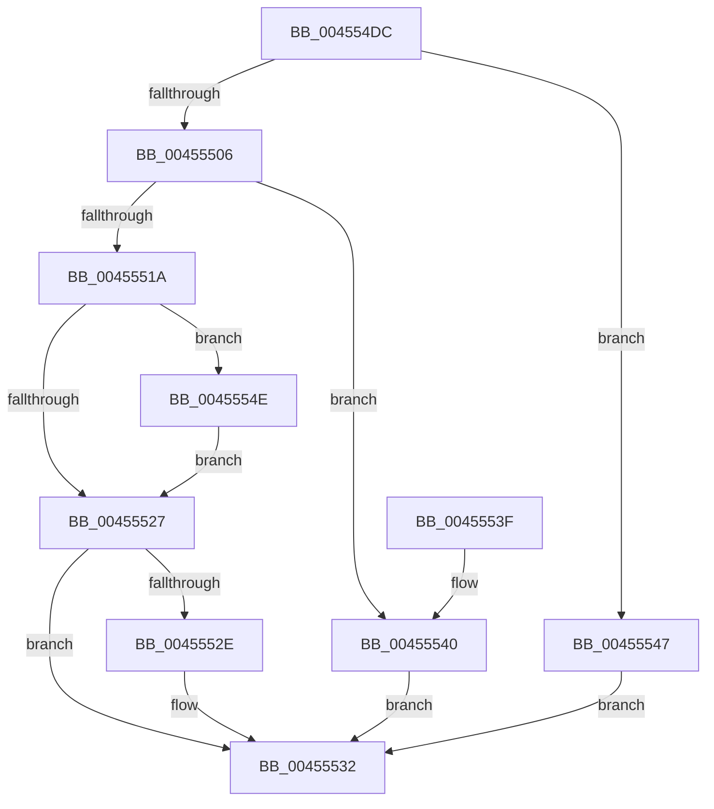

# LdrIsResItemExist

- RVA: `0x004554DC`–`0x00455554` (길이 `120` bytes)
- VA: `0x00000001404554DC`
- 실행 섹션: `.text`
- PDB 이름 있음: `예`; PDB Function 태그: `아니요`
- unwind 정보 RVA: `0x000A7AC0`
- 디코드: `37`개 명령, `120/120` bytes 표시
- 미해석 바이트: `0` (있으면 어셈블리에 `.byte`로 보존)

> 이 문서는 커널 이미지의 기계어와 PDB 기호를 분석해 생성했습니다. 4번과 5번은 함수 원형과 자료형을 바이너리 사용 방식에서 추정한 C 해석이며 원본 소스 복구 결과는 아닙니다.

## 1. Dependencies

- 직접 호출 지점: **2**; 고유 호출 대상: **2**
- 직접 호출자로 확인된 함수: **2**
- RIP 상대 이미지 참조: **0**

### Outgoing calls
- `0x004554F9` → [LdrpGetRcConfig](LdrpGetRcConfig_function_0045555C.md) (function, `0x0045555C`)
- `0x00455511` → [LdrRscIsTypeExist](LdrRscIsTypeExist_function_00455BBC.md) (function, `0x00455BBC`)

### Direct callers
- [LdrpResSearchResourceMappedFile](LdrpResSearchResourceMappedFile_function_00454C98.md) at `0x00455244`
- [LdrpSearchResourceSection_U](../../page/99/LdrpSearchResourceSection_U_function_0099B2DC.md) at `0x0099BB21`

### Static image references
- 디코드된 RIP-relative 메모리 참조가 없습니다.

## 2. Other-region calls and transfers

- 다른 실행 섹션으로 향하는 call: **0**
- 별도 외부 분기/꼬리 이동을 확인하지 못했습니다.

## 3. Assembly (complete function range)

```asm
004554DC  48 89 5C 24 08                  mov qword ptr [rsp + 8], rbx
004554E1  44 89 4C 24 20                  mov dword ptr [rsp + 0x20], r9d
004554E6  57                              push rdi
004554E7  48 83 EC 20                     sub rsp, 0x20
004554EB  83 64 24 48 00                  and dword ptr [rsp + 0x48], 0
004554F0  41 B1 01                        mov r9b, 1
004554F3  45 8A C1                        mov r8b, r9b
004554F6  48 8B FA                        mov rdi, rdx
004554F9  E8 5E 00 00 00                  call 0x14045555c
004554FE  48 8B D8                        mov rbx, rax
00455501  48 85 C0                        test rax, rax
00455504  74 41                           je 0x140455547
00455506  48 8B 17                        mov rdx, qword ptr [rdi]
00455509  4C 8D 4C 24 48                  lea r9, [rsp + 0x48]
0045550E  48 8B C8                        mov rcx, rax
00455511  E8 A6 06 00 00                  call 0x140455bbc
00455516  85 C0                           test eax, eax
00455518  78 26                           js 0x140455540
0045551A  F7 43 14 00 01 00 00            test dword ptr [rbx + 0x14], 0x100
00455521  8B 4C 24 48                     mov ecx, dword ptr [rsp + 0x48]
00455525  75 27                           jne 0x14045554e
00455527  8B 43 10                        mov eax, dword ptr [rbx + 0x10]
0045552A  A8 10                           test al, 0x10
0045552C  74 04                           je 0x140455532
0045552E  0F BA E9 15                     bts ecx, 0x15
00455532  48 8B 5C 24 30                  mov rbx, qword ptr [rsp + 0x30]
00455537  8B C1                           mov eax, ecx
00455539  48 83 C4 20                     add rsp, 0x20
0045553D  5F                              pop rdi
0045553E  C3                              ret
0045553F  CC                              int3
00455540  B9 00 00 06 00                  mov ecx, 0x60000
00455545  EB EB                           jmp 0x140455532
00455547  B9 00 00 08 00                  mov ecx, 0x80000
0045554C  EB E4                           jmp 0x140455532
0045554E  0F BA E9 14                     bts ecx, 0x14
00455552  EB D3                           jmp 0x140455527
```

## 4. C-style interpretation (structured pseudocode)

```c
__int64 __fastcall LdrIsResItemExist(__int64 a1, __int64 a2, __int64 a3, int a4)
{
    __int64 result;
    __int64 v_rsp;
    unsigned int v_stack_p20;
    unsigned __int64 v_stack_p8;

    v_stack_p8 = v_rbx;
    v_stack_p20 = a4;
    v_rsp = (v_rsp) - (32);
    result = LdrpGetRcConfig(a1, a2, 1, 1);
    if (result == 0) goto loc_00455547;
    result = LdrRscIsTypeExist(result, *(unsigned __int64 *)(a2), 1, v_stack_p20);
    if (sign_flag) goto loc_00455540;
    if (((*(unsigned int *)(result + 20)) & (256)) != 0) goto loc_0045554E;
loc_00455527:
    if ((((unsigned __int8)((unsigned int)(*(unsigned int *)(result + 16)))) & (16)) != 0) {
    }
    v_rsp = (v_rsp) + (32);
    return (unsigned int)((unsigned int)((unsigned int)(v_stack_p20)));
loc_00455540:
    goto loc_00455532;
loc_00455547:
    goto loc_00455532;
loc_0045554E:
    goto loc_00455527;
}
```

## 5. (Beta) C Style

```c
int64_t LdrIsResItemExist(int64_t Arg1, void *Arg2, int64_t Arg3, int32_t Arg4)
{
    uint8_t *arg2 = (uint8_t *)Arg2;

    int64_t result;
    int64_t local_rsp;
    uint32_t v_stack_p20;
    uint64_t v_stack_p8;

    v_stack_p8 = local_rbx;
    v_stack_p20 = Arg4;
    local_rsp = (local_rsp) - (32);
    result = LdrpGetRcConfig(Arg1, Arg2, 1, 1);
    if (result == 0) goto loc_00455547;
    result = LdrRscIsTypeExist(result, *(uint64_t *)(arg2), 1, v_stack_p20);
    if (sign_flag) goto loc_00455540;
    if (((*(uint32_t *)(result + 0x14)) & (256)) != 0) goto loc_0045554E;
loc_00455527:
    if ((((uint8_t)((uint32_t)(*(uint32_t *)(result + 0x10)))) & (16)) != 0) {
    }
    local_rsp = (local_rsp) + (32);
    return (uint32_t)((uint32_t)((uint32_t)(v_stack_p20)));
loc_00455540:
    goto loc_00455532;
loc_00455547:
    goto loc_00455532;
loc_0045554E:
    goto loc_00455527;
}
```

### 관측된 메모리 오프셋

구조체 형식이 확인되지 않은 접근은 인자 기준의 오프셋으로만 기록했습니다.

| 기준 인자 | 오프셋 표현 | 폭 (bit) | 접근 |
|---|---:|---:|---|
| `Arg2` | `+ 0x0` | `64` | `R` |

## 6. Execution-region graph

[열기: 2D/3D 그래프와 함수 탐색 컨트롤 패널](../../../control-panel.html?section=text&rva=0x004554DC&view=graph)

- 2D 그래프는 위에서 아래로 흐르고, 3D 그래프는 빈 공간을 드래그해 회전합니다. Shift+드래그는 이동, 휠은 확대·축소, 함수 노드 선택은 대상 보고서 이동입니다.

### Static fallback


