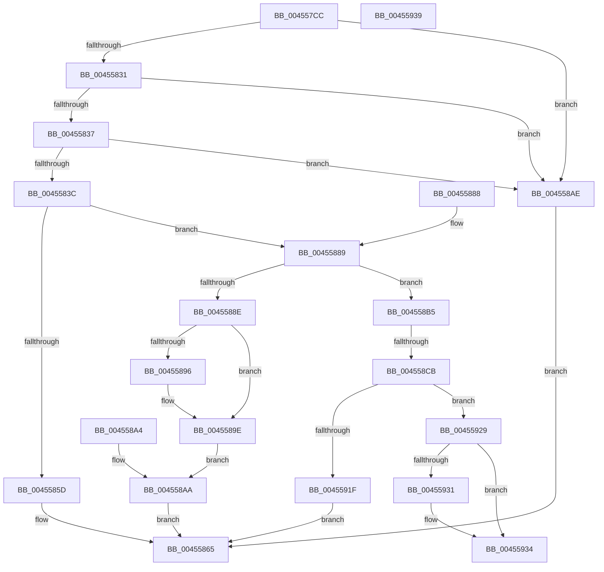

# LdrLoadAlternateResourceModuleEx

- RVA: `0x004557CC`–`0x00455940` (길이 `372` bytes)
- VA: `0x00000001404557CC`
- 실행 섹션: `.text`
- PDB 이름 있음: `예`; PDB Function 태그: `예`
- unwind 정보 RVA: `0x000A7B08`
- 디코드: `103`개 명령, `372/372` bytes 표시
- 미해석 바이트: `0` (있으면 어셈블리에 `.byte`로 보존)

> 이 문서는 커널 이미지의 기계어와 PDB 기호를 분석해 생성했습니다. 4번과 5번은 함수 원형과 자료형을 바이너리 사용 방식에서 추정한 C 해석이며 원본 소스 복구 결과는 아닙니다.

## 1. Dependencies

- 직접 호출 지점: **5**; 고유 호출 대상: **5**
- 직접 호출자로 확인된 함수: **3**
- RIP 상대 이미지 참조: **1**

### Outgoing calls
- `0x00455822` → [memset](../6C/memset_function_006C6C40.md) (function, `0x006C6C40`)
- `0x0045584C` → [LdrpGetFromMUIMemCache](LdrpGetFromMUIMemCache_function_00455948.md) (function, `0x00455948`)
- `0x00455870` → [_security_check_cookie](../6A/_security_check_cookie_function_006AC640.md) (function, `0x006AC640`)
- `0x004558B8` → [LdrpKrnGetDataTableEntry](LdrpKrnGetDataTableEntry_function_004563B4.md) (function, `0x004563B4`)
- `0x0045590F` → [LdrpSetAlternateResourceModuleHandle](LdrpSetAlternateResourceModuleHandle_function_00455EBC.md) (function, `0x00455EBC`)

### Direct callers
- [LdrpResSearchResourceMappedFile](LdrpResSearchResourceMappedFile_function_00454C98.md) at `0x00455197`
- [LdrpLoadResourceFromAlternativeModule](LdrpLoadResourceFromAlternativeModule_function_00455698.md) at `0x004556E7`
- [sub_00B2B9CE](../../page/B2/Unknown_function_00B2B9CE.md) at `0x00B2B9EC`

### Static image references
- `0x004557DF` → RVA `0x00E0A740` (`.data`; read)

## 2. Other-region calls and transfers

- 다른 실행 섹션으로 향하는 call: **0**
- call이 아닌 외부 분기/꼬리 이동: **3**
  - `0x004558C5` → [sub_006F1946](../6F/Unknown_function_006F1946.md) (`tail-transfer`)
  - `0x00455934` → [sub_006F1946 + 0x11C](../6F/Unknown_function_006F1946.md) (`tail-transfer`)
  - `0x0045593B` → [sub_006F1946 + 0x11C](../6F/Unknown_function_006F1946.md) (`tail-transfer`)

## 3. Assembly (complete function range)

```asm
004557CC  40 53                           push rbx
004557CE  56                              push rsi
004557CF  57                              push rdi
004557D0  41 54                           push r12
004557D2  41 55                           push r13
004557D4  41 56                           push r14
004557D6  41 57                           push r15
004557D8  48 81 EC 50 03 00 00            sub rsp, 0x350
004557DF  48 8B 05 5A 4F 9B 00            mov rax, qword ptr [rip + 0x9b4f5a]
004557E6  48 33 C4                        xor rax, rsp
004557E9  48 89 84 24 40 03 00 00         mov qword ptr [rsp + 0x340], rax
004557F1  4D 8B F9                        mov r15, r9
004557F4  4D 8B F0                        mov r14, r8
004557F7  44 0F B7 EA                     movzx r13d, dx
004557FB  4C 8B E1                        mov r12, rcx
004557FE  33 DB                           xor ebx, ebx
00455800  48 89 5C 24 40                  mov qword ptr [rsp + 0x40], rbx
00455805  48 89 5C 24 50                  mov qword ptr [rsp + 0x50], rbx
0045580A  0F 57 C0                        xorps xmm0, xmm0
0045580D  0F 11 44 24 60                  movups xmmword ptr [rsp + 0x60], xmm0
00455812  33 D2                           xor edx, edx
00455814  41 B8 AA 00 00 00               mov r8d, 0xaa
0045581A  48 8D 8C 24 80 00 00 00         lea rcx, [rsp + 0x80]
00455822  E8 19 14 27 00                  call 0x1406c6c40
00455827  48 89 5C 24 48                  mov qword ptr [rsp + 0x48], rbx
0045582C  4D 85 E4                        test r12, r12
0045582F  74 7D                           je 0x1404558ae
00455831  66 45 85 ED                     test r13w, r13w
00455835  74 77                           je 0x1404558ae
00455837  4D 85 F6                        test r14, r14
0045583A  74 72                           je 0x1404558ae
0045583C  44 8D 4B 04                     lea r9d, [rbx + 4]
00455840  4C 8D 44 24 48                  lea r8, [rsp + 0x48]
00455845  41 0F B7 D5                     movzx edx, r13w
00455849  49 8B CC                        mov rcx, r12
0045584C  E8 F7 00 00 00                  call 0x140455948
00455851  48 8B F0                        mov rsi, rax
00455854  48 83 C8 FF                     or rax, 0xffffffffffffffff
00455858  48 3B F0                        cmp rsi, rax
0045585B  75 2C                           jne 0x140455889
0045585D  49 89 1E                        mov qword ptr [r14], rbx
00455860  B8 06 00 0B C0                  mov eax, 0xc00b0006
00455865  48 8B 8C 24 40 03 00 00         mov rcx, qword ptr [rsp + 0x340]
0045586D  48 33 CC                        xor rcx, rsp
00455870  E8 CB 6D 25 00                  call 0x1406ac640
00455875  48 81 C4 50 03 00 00            add rsp, 0x350
0045587C  41 5F                           pop r15
0045587E  41 5E                           pop r14
00455880  41 5D                           pop r13
00455882  41 5C                           pop r12
00455884  5F                              pop rdi
00455885  5E                              pop rsi
00455886  5B                              pop rbx
00455887  C3                              ret
00455888  CC                              int3
00455889  48 85 F6                        test rsi, rsi
0045588C  74 27                           je 0x1404558b5
0045588E  49 89 36                        mov qword ptr [r14], rsi
00455891  4D 85 FF                        test r15, r15
00455894  74 08                           je 0x14045589e
00455896  48 8B 44 24 48                  mov rax, qword ptr [rsp + 0x48]
0045589B  49 89 07                        mov qword ptr [r15], rax
0045589E  89 5C 24 58                     mov dword ptr [rsp + 0x58], ebx
004558A2  EB 06                           jmp 0x1404558aa
004558A4  8B D8                           mov ebx, eax
004558A6  89 44 24 58                     mov dword ptr [rsp + 0x58], eax
004558AA  8B C3                           mov eax, ebx
004558AC  EB B7                           jmp 0x140455865
004558AE  B8 0D 00 00 C0                  mov eax, 0xc000000d
004558B3  EB B0                           jmp 0x140455865
004558B5  49 8B CC                        mov rcx, r12
004558B8  E8 F7 0A 00 00                  call 0x1404563b4
004558BD  48 89 44 24 78                  mov qword ptr [rsp + 0x78], rax
004558C2  48 85 C0                        test rax, rax
004558C5  0F 85 7B C0 29 00               jne 0x1406f1946
004558CB  BF 01 00 0B C0                  mov edi, 0xc00b0001
004558D0  48 85 F6                        test rsi, rsi
004558D3  48 C7 C0 FF FF FF FF            mov rax, 0xffffffffffffffff
004558DA  48 0F 44 F0                     cmove rsi, rax
004558DE  48 89 74 24 40                  mov qword ptr [rsp + 0x40], rsi
004558E3  48 8B 74 24 48                  mov rsi, qword ptr [rsp + 0x48]
004558E8  48 89 74 24 38                  mov qword ptr [rsp + 0x38], rsi
004558ED  89 7C 24 30                     mov dword ptr [rsp + 0x30], edi
004558F1  C7 44 24 28 01 00 00 00         mov dword ptr [rsp + 0x28], 1
004558F9  66 44 89 6C 24 20               mov word ptr [rsp + 0x20], r13w
004558FF  45 33 C9                        xor r9d, r9d
00455902  4C 8D 44 24 50                  lea r8, [rsp + 0x50]
00455907  48 8D 54 24 40                  lea rdx, [rsp + 0x40]
0045590C  49 8B CC                        mov rcx, r12
0045590F  E8 A8 05 00 00                  call 0x140455ebc
00455914  48 8B 44 24 40                  mov rax, qword ptr [rsp + 0x40]
00455919  48 83 F8 FF                     cmp rax, -1
0045591D  75 0A                           jne 0x140455929
0045591F  49 89 1E                        mov qword ptr [r14], rbx
00455922  8B C7                           mov eax, edi
00455924  E9 3C FF FF FF                  jmp 0x140455865
00455929  49 89 06                        mov qword ptr [r14], rax
0045592C  4D 85 FF                        test r15, r15
0045592F  74 03                           je 0x140455934
00455931  49 89 37                        mov qword ptr [r15], rsi
00455934  E9 29 C1 29 00                  jmp 0x1406f1a62
00455939  33 DB                           xor ebx, ebx
0045593B  E9 22 C1 29 00                  jmp 0x1406f1a62
```

## 4. C-style interpretation (structured pseudocode)

```c
__int64 __fastcall LdrLoadAlternateResourceModuleEx(__int64 a1, int a2, __int64 a3, __int64 a4)
{
    __int64 result;
    __int64 v_rbx;
    __int64 v_rsi;
    __int64 v_rsp;
    unsigned __int64 v_stack_m308;
    unsigned __int64 v_stack_m328;
    unsigned __int64 v_stack_m338;
    unsigned __int64 v_stack_m340;
    unsigned __int64 v_stack_m348;
    unsigned __int64 v_stack_m48;
    unsigned __int16 v_stack_p20;
    unsigned int v_stack_p28;
    unsigned int v_stack_p30;
    unsigned __int64 v_stack_p38;
    unsigned __int64 v_stack_p40;
    unsigned __int64 v_stack_p48;
    unsigned __int64 v_stack_p50;
    unsigned int v_stack_p58;
    unsigned __int64 v_stack_p78;

    v_rsp = (v_rsp) - (848);
    result = (*(unsigned __int64 *)(v_rip + 10178394)) ^ (v_rsp);
    v_stack_m48 = result;
    v_rbx = 0;
    v_stack_m348 = 0;
    v_stack_m338 = 0;
    v_stack_m328 = v_xmm0;
    a2 = 0;
    result = memset(v_stack_m308, a2, 170, a4);
    v_stack_m340 = 0;
    if (a1 == 0) goto loc_004558AE;
    if ((unsigned __int16)((unsigned __int16)(a2)) == 0) goto loc_004558AE;
    if (a3 == 0) goto loc_004558AE;
    result = LdrpGetFromMUIMemCache(a1, (unsigned __int16)((unsigned __int16)(a2)), v_stack_m340, v_rbx + 4);
    result = (result) | (-1);
    if (result != result) goto loc_00455889;
    *(unsigned __int64 *)(a3) = 0;
loc_00455865:
    a1 = (v_stack_m48) ^ (v_rsp);
    result = _security_check_cookie(a1, (unsigned __int16)((unsigned __int16)(a2)), v_stack_m340, v_rbx + 4);
    v_rsp = (v_rsp) + (848);
    return result;
loc_00455889:
    if (result == 0) goto loc_004558B5;
    *(unsigned __int64 *)(a3) = result;
    if (a4 != 0) {
        result = v_stack_p48;
        *(unsigned __int64 *)(a4) = result;
    }
    v_stack_p58 = 0;
    goto loc_004558AA;
loc_004558AA:
    goto loc_00455865;
loc_004558AE:
    goto loc_00455865;
loc_004558B5:
    result = LdrpKrnGetDataTableEntry(a1, (unsigned __int16)((unsigned __int16)(a2)), v_stack_m340, v_rbx + 4);
    v_stack_p78 = result;
    v_rsi = result;
    if (result == 0) { v_rsi = -1; }
    v_stack_p40 = v_rsi;
    v_stack_p38 = v_stack_p48;
    v_stack_p30 = (unsigned int)((unsigned int)(0xC00B0001ULL));
    v_stack_p28 = 1;
    v_stack_p20 = (unsigned __int16)((unsigned __int16)(a2));
    a4 = 0;
    result = LdrpSetAlternateResourceModuleHandle(a1, v_stack_p40, v_stack_p50, a4);
    if (v_stack_p40 != -1) goto loc_00455929;
    *(unsigned __int64 *)(a3) = 0;
    goto loc_00455865;
loc_00455929:
    *(unsigned __int64 *)(a3) = (unsigned int)((unsigned int)((unsigned int)(0xC00B0001ULL)));
    if (0 != 0) {
        *(unsigned __int64 *)(a4) = v_stack_p48;
    }
}
```

## 5. (Beta) C Style

```c
int64_t LdrLoadAlternateResourceModuleEx(int64_t Arg1, int32_t Arg2, int64_t Arg3, int64_t Arg4)
{
    int64_t result;
    int64_t local_rbx;
    int64_t local_rsi;
    int64_t local_rsp;
    uint64_t v_stack_m308;
    uint64_t v_stack_m328;
    uint64_t v_stack_m338;
    uint64_t v_stack_m340;
    uint64_t v_stack_m348;
    uint64_t v_stack_m48;
    uint16_t v_stack_p20;
    uint32_t v_stack_p28;
    uint32_t v_stack_p30;
    uint64_t v_stack_p38;
    uint64_t v_stack_p40;
    uint64_t v_stack_p48;
    uint64_t v_stack_p50;
    uint32_t v_stack_p58;
    uint64_t v_stack_p78;

    local_rsp = (local_rsp) - (848);
    result = (*(uint64_t *)(v_rip + 0x9B4F5A)) ^ (local_rsp);
    v_stack_m48 = result;
    local_rbx = 0;
    v_stack_m348 = 0;
    v_stack_m338 = 0;
    v_stack_m328 = v_xmm0;
    Arg2 = 0;
    result = memset(v_stack_m308, Arg2, 170, Arg4);
    v_stack_m340 = 0;
    if (Arg1 == 0) goto loc_004558AE;
    if ((uint16_t)((uint16_t)(Arg2)) == 0) goto loc_004558AE;
    if (Arg3 == 0) goto loc_004558AE;
    result = LdrpGetFromMUIMemCache(Arg1, (uint16_t)((uint16_t)(Arg2)), v_stack_m340, local_rbx + 4);
    result = (result) | (-1);
    if (result != result) goto loc_00455889;
    *(uint64_t *)(Arg3) = 0;
loc_00455865:
    Arg1 = (v_stack_m48) ^ (local_rsp);
    result = _security_check_cookie(Arg1, (uint16_t)((uint16_t)(Arg2)), v_stack_m340, local_rbx + 4);
    local_rsp = (local_rsp) + (848);
    return result;
loc_00455889:
    if (result == 0) goto loc_004558B5;
    *(uint64_t *)(Arg3) = result;
    if (Arg4 != 0) {
        result = v_stack_p48;
        *(uint64_t *)(Arg4) = result;
    }
    v_stack_p58 = 0;
    goto loc_004558AA;
loc_004558AA:
    goto loc_00455865;
loc_004558AE:
    goto loc_00455865;
loc_004558B5:
    result = LdrpKrnGetDataTableEntry(Arg1, (uint16_t)((uint16_t)(Arg2)), v_stack_m340, local_rbx + 4);
    v_stack_p78 = result;
    local_rsi = result;
    if (result == 0) { local_rsi = -1; }
    v_stack_p40 = local_rsi;
    v_stack_p38 = v_stack_p48;
    v_stack_p30 = (uint32_t)((uint32_t)(0xC00B0001ULL));
    v_stack_p28 = 1;
    v_stack_p20 = (uint16_t)((uint16_t)(Arg2));
    Arg4 = 0;
    result = LdrpSetAlternateResourceModuleHandle(Arg1, v_stack_p40, v_stack_p50, Arg4);
    if (v_stack_p40 != -1) goto loc_00455929;
    *(uint64_t *)(Arg3) = 0;
    goto loc_00455865;
loc_00455929:
    *(uint64_t *)(Arg3) = (uint32_t)((uint32_t)((uint32_t)(0xC00B0001ULL)));
    if (0 != 0) {
        *(uint64_t *)(Arg4) = v_stack_p48;
    }
}
```

## 6. Execution-region graph

[열기: 2D/3D 그래프와 함수 탐색 컨트롤 패널](../../../control-panel.html?section=text&rva=0x004557CC&view=graph)

- 2D 그래프는 위에서 아래로 흐르고, 3D 그래프는 빈 공간을 드래그해 회전합니다. Shift+드래그는 이동, 휠은 확대·축소, 함수 노드 선택은 대상 보고서 이동입니다.

### Static fallback


