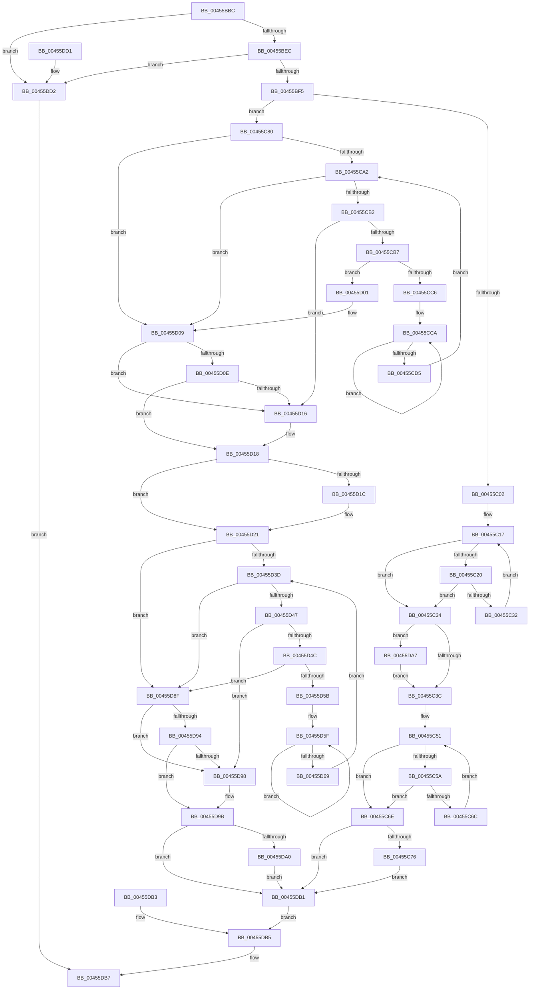

# LdrRscIsTypeExist

- RVA: `0x00455BBC`–`0x00455DD9` (길이 `541` bytes)
- VA: `0x0000000140455BBC`
- 실행 섹션: `.text`
- PDB 이름 있음: `예`; PDB Function 태그: `아니요`
- unwind 정보 RVA: `0x000A7BA0`
- 디코드: `159`개 명령, `541/541` bytes 표시
- 미해석 바이트: `0` (있으면 어셈블리에 `.byte`로 보존)

> 이 문서는 커널 이미지의 기계어와 PDB 기호를 분석해 생성했습니다. 4번과 5번은 함수 원형과 자료형을 바이너리 사용 방식에서 추정한 C 해석이며 원본 소스 복구 결과는 아닙니다.

## 1. Dependencies

- 직접 호출 지점: **2**; 고유 호출 대상: **1**
- 직접 호출자로 확인된 함수: **1**
- RIP 상대 이미지 참조: **0**

### Outgoing calls
- `0x00455CBD` → [wcsicmp](../50/wcsicmp_function_00500080.md) (function, `0x00500080`)
- `0x00455D52` → [wcsicmp](../50/wcsicmp_function_00500080.md) (function, `0x00500080`)

### Direct callers
- [LdrIsResItemExist](LdrIsResItemExist_function_004554DC.md) at `0x00455511`

### Static image references
- 디코드된 RIP-relative 메모리 참조가 없습니다.

## 2. Other-region calls and transfers

- 다른 실행 섹션으로 향하는 call: **0**
- 별도 외부 분기/꼬리 이동을 확인하지 못했습니다.

## 3. Assembly (complete function range)

```asm
00455BBC  48 89 5C 24 18                  mov qword ptr [rsp + 0x18], rbx
00455BC1  48 89 74 24 20                  mov qword ptr [rsp + 0x20], rsi
00455BC6  48 89 54 24 10                  mov qword ptr [rsp + 0x10], rdx
00455BCB  57                              push rdi
00455BCC  41 54                           push r12
00455BCE  41 55                           push r13
00455BD0  41 56                           push r14
00455BD2  41 57                           push r15
00455BD4  48 83 EC 60                     sub rsp, 0x60
00455BD8  4D 8B F1                        mov r14, r9
00455BDB  4C 8B C2                        mov r8, rdx
00455BDE  48 8B F9                        mov rdi, rcx
00455BE1  33 DB                           xor ebx, ebx
00455BE3  48 85 C9                        test rcx, rcx
00455BE6  0F 84 E6 01 00 00               je 0x140455dd2
00455BEC  4D 85 C9                        test r9, r9
00455BEF  0F 84 DD 01 00 00               je 0x140455dd2
00455BF5  44 8D 7B 01                     lea r15d, [rbx + 1]
00455BF9  48 81 FA 00 00 01 00            cmp rdx, 0x10000
00455C00  73 7E                           jae 0x140455c80
00455C02  8B 49 60                        mov ecx, dword ptr [rcx + 0x60]
00455C05  C1 E9 02                        shr ecx, 2
00455C08  89 4C 24 30                     mov dword ptr [rsp + 0x30], ecx
00455C0C  8B 57 5C                        mov edx, dword ptr [rdi + 0x5c]
00455C0F  48 03 D7                        add rdx, rdi
00455C12  48 89 54 24 48                  mov qword ptr [rsp + 0x48], rdx
00455C17  41 2B CF                        sub ecx, r15d
00455C1A  89 4C 24 30                     mov dword ptr [rsp + 0x30], ecx
00455C1E  78 14                           js 0x140455c34
00455C20  41 8B C0                        mov eax, r8d
00455C23  2B 02                           sub eax, dword ptr [rdx]
00455C25  48 83 C2 04                     add rdx, 4
00455C29  48 89 54 24 48                  mov qword ptr [rsp + 0x48], rdx
00455C2E  85 C0                           test eax, eax
00455C30  74 02                           je 0x140455c34
00455C32  EB E3                           jmp 0x140455c17
00455C34  85 C9                           test ecx, ecx
00455C36  0F 88 6B 01 00 00               js 0x140455da7
00455C3C  8B 4F 70                        mov ecx, dword ptr [rdi + 0x70]
00455C3F  C1 E9 02                        shr ecx, 2
00455C42  89 4C 24 38                     mov dword ptr [rsp + 0x38], ecx
00455C46  8B 57 6C                        mov edx, dword ptr [rdi + 0x6c]
00455C49  48 03 D7                        add rdx, rdi
00455C4C  48 89 54 24 50                  mov qword ptr [rsp + 0x50], rdx
00455C51  41 2B CF                        sub ecx, r15d
00455C54  89 4C 24 38                     mov dword ptr [rsp + 0x38], ecx
00455C58  78 14                           js 0x140455c6e
00455C5A  41 8B C0                        mov eax, r8d
00455C5D  2B 02                           sub eax, dword ptr [rdx]
00455C5F  48 83 C2 04                     add rdx, 4
00455C63  48 89 54 24 50                  mov qword ptr [rsp + 0x50], rdx
00455C68  85 C0                           test eax, eax
00455C6A  74 02                           je 0x140455c6e
00455C6C  EB E3                           jmp 0x140455c51
00455C6E  85 C9                           test ecx, ecx
00455C70  0F 89 3B 01 00 00               jns 0x140455db1
00455C76  41 0F BA 29 11                  bts dword ptr [r9], 0x11
00455C7B  E9 31 01 00 00                  jmp 0x140455db1
00455C80  44 8B 61 58                     mov r12d, dword ptr [rcx + 0x58]
00455C84  41 D1 EC                        shr r12d, 1
00455C87  44 89 64 24 20                  mov dword ptr [rsp + 0x20], r12d
00455C8C  8B 71 54                        mov esi, dword ptr [rcx + 0x54]
00455C8F  48 03 F7                        add rsi, rdi
00455C92  48 89 B4 24 90 00 00 00         mov qword ptr [rsp + 0x90], rsi
00455C9A  81 FE 00 00 01 00               cmp esi, 0x10000
00455CA0  76 67                           jbe 0x140455d09
00455CA2  48 89 B4 24 90 00 00 00         mov qword ptr [rsp + 0x90], rsi
00455CAA  4C 8B EE                        mov r13, rsi
00455CAD  45 85 E4                        test r12d, r12d
00455CB0  7E 57                           jle 0x140455d09
00455CB2  66 39 1E                        cmp word ptr [rsi], bx
00455CB5  74 5F                           je 0x140455d16
00455CB7  48 8B D6                        mov rdx, rsi
00455CBA  49 8B C8                        mov rcx, r8
00455CBD  E8 BE A3 0A 00                  call 0x140500080
00455CC2  85 C0                           test eax, eax
00455CC4  74 3B                           je 0x140455d01
00455CC6  48 83 C9 FF                     or rcx, 0xffffffffffffffff
00455CCA  48 FF C1                        inc rcx
00455CCD  66 41 39 5C 4D 00               cmp word ptr [r13 + rcx*2], bx
00455CD3  75 F5                           jne 0x140455cca
00455CD5  41 03 CF                        add ecx, r15d
00455CD8  48 63 C1                        movsxd rax, ecx
00455CDB  48 8B 94 24 90 00 00 00         mov rdx, qword ptr [rsp + 0x90]
00455CE3  48 8D 34 42                     lea rsi, [rdx + rax*2]
00455CE7  48 89 B4 24 90 00 00 00         mov qword ptr [rsp + 0x90], rsi
00455CEF  44 2B E1                        sub r12d, ecx
00455CF2  44 89 64 24 20                  mov dword ptr [rsp + 0x20], r12d
00455CF7  4C 8B 84 24 98 00 00 00         mov r8, qword ptr [rsp + 0x98]
00455CFF  EB A1                           jmp 0x140455ca2
00455D01  4C 8B 84 24 98 00 00 00         mov r8, qword ptr [rsp + 0x98]
00455D09  66 39 1E                        cmp word ptr [rsi], bx
00455D0C  74 08                           je 0x140455d16
00455D0E  45 85 E4                        test r12d, r12d
00455D11  41 8A C7                        mov al, r15b
00455D14  7F 02                           jg 0x140455d18
00455D16  8A C3                           mov al, bl
00455D18  84 C0                           test al, al
00455D1A  75 05                           jne 0x140455d21
00455D1C  41 0F BA 2E 12                  bts dword ptr [r14], 0x12
00455D21  8B 77 68                        mov esi, dword ptr [rdi + 0x68]
00455D24  D1 EE                           shr esi, 1
00455D26  89 74 24 28                     mov dword ptr [rsp + 0x28], esi
00455D2A  8B 47 64                        mov eax, dword ptr [rdi + 0x64]
00455D2D  48 03 F8                        add rdi, rax
00455D30  48 89 7C 24 40                  mov qword ptr [rsp + 0x40], rdi
00455D35  81 FF 00 00 01 00               cmp edi, 0x10000
00455D3B  76 52                           jbe 0x140455d8f
00455D3D  4C 8B EF                        mov r13, rdi
00455D40  4C 8B E7                        mov r12, rdi
00455D43  85 F6                           test esi, esi
00455D45  7E 48                           jle 0x140455d8f
00455D47  66 39 1F                        cmp word ptr [rdi], bx
00455D4A  74 4C                           je 0x140455d98
00455D4C  48 8B D7                        mov rdx, rdi
00455D4F  49 8B C8                        mov rcx, r8
00455D52  E8 29 A3 0A 00                  call 0x140500080
00455D57  85 C0                           test eax, eax
00455D59  74 34                           je 0x140455d8f
00455D5B  48 83 C9 FF                     or rcx, 0xffffffffffffffff
00455D5F  48 FF C1                        inc rcx
00455D62  66 41 39 1C 4C                  cmp word ptr [r12 + rcx*2], bx
00455D67  75 F6                           jne 0x140455d5f
00455D69  41 03 CF                        add ecx, r15d
00455D6C  48 63 C1                        movsxd rax, ecx
00455D6F  48 8D 3C 45 00 00 00 00         lea rdi, [rax*2]
00455D77  49 03 FD                        add rdi, r13
00455D7A  48 89 7C 24 40                  mov qword ptr [rsp + 0x40], rdi
00455D7F  2B F1                           sub esi, ecx
00455D81  89 74 24 28                     mov dword ptr [rsp + 0x28], esi
00455D85  4C 8B 84 24 98 00 00 00         mov r8, qword ptr [rsp + 0x98]
00455D8D  EB AE                           jmp 0x140455d3d
00455D8F  66 39 1F                        cmp word ptr [rdi], bx
00455D92  74 04                           je 0x140455d98
00455D94  85 F6                           test esi, esi
00455D96  7F 03                           jg 0x140455d9b
00455D98  44 8A FB                        mov r15b, bl
00455D9B  45 84 FF                        test r15b, r15b
00455D9E  75 11                           jne 0x140455db1
00455DA0  41 0F BA 2E 11                  bts dword ptr [r14], 0x11
00455DA5  EB 0A                           jmp 0x140455db1
00455DA7  41 0F BA 29 12                  bts dword ptr [r9], 0x12
00455DAC  E9 8B FE FF FF                  jmp 0x140455c3c
00455DB1  EB 02                           jmp 0x140455db5
00455DB3  8B D8                           mov ebx, eax
00455DB5  8B C3                           mov eax, ebx
00455DB7  4C 8D 5C 24 60                  lea r11, [rsp + 0x60]
00455DBC  49 8B 5B 40                     mov rbx, qword ptr [r11 + 0x40]
00455DC0  49 8B 73 48                     mov rsi, qword ptr [r11 + 0x48]
00455DC4  49 8B E3                        mov rsp, r11
00455DC7  41 5F                           pop r15
00455DC9  41 5E                           pop r14
00455DCB  41 5D                           pop r13
00455DCD  41 5C                           pop r12
00455DCF  5F                              pop rdi
00455DD0  C3                              ret
00455DD1  CC                              int3
00455DD2  B8 0D 00 00 C0                  mov eax, 0xc000000d
00455DD7  EB DE                           jmp 0x140455db7
```

## 4. C-style interpretation (structured pseudocode)

```c
__int64 __fastcall LdrRscIsTypeExist(__int64 a1, __int64 a2, __int64 a3, __int64 a4)
{
    __int64 result;
    __int64 v_r12;
    __int64 v_r15;
    __int64 v_rbx;
    __int64 v_rdi;
    __int64 v_rsi;
    __int64 v_rsp;
    unsigned __int64 v_stack_m28;
    unsigned __int64 v_stack_m38;
    unsigned __int64 v_stack_m40;
    unsigned __int64 v_stack_m48;
    unsigned int v_stack_m50;
    unsigned int v_stack_m58;
    unsigned int v_stack_m60;
    unsigned int v_stack_m68;
    unsigned __int64 v_stack_p10;
    unsigned __int64 v_stack_p18;
    unsigned __int64 v_stack_p20;
    unsigned __int64 v_stack_p8;

    v_stack_p18 = v_rbx;
    v_stack_p20 = v_rsi;
    v_stack_p10 = a2;
    v_rsp = (v_rsp) - (96);
    v_rbx = 0;
    if (a1 == 0) goto loc_00455DD2;
    if (a4 == 0) goto loc_00455DD2;
    if (a2 >= 0x10000ULL) goto loc_00455C80;
    a1 = (unsigned int)(((unsigned int)(*(unsigned int *)(a1 + 96))) >> (2));
    v_stack_m58 = (unsigned int)(a1);
    a2 = ((unsigned int)(*(unsigned int *)(a1 + 92))) + (a1);
    v_stack_m40 = a2;
loc_00455C17:
    a1 = (unsigned int)((a1) - ((unsigned int)(v_rbx + 1)));
    v_stack_m58 = (unsigned int)(a1);
    if (sign_flag) goto loc_00455C34;
    result = (unsigned int)(((unsigned int)((unsigned int)(a2))) - (*(unsigned int *)(a2)));
    a2 = (a2) + (4);
    v_stack_m40 = a2;
    if ((unsigned int)(result) == 0) goto loc_00455C34;
    goto loc_00455C17;
loc_00455C34:
    if (sign_flag) goto loc_00455DA7;
loc_00455C3C:
    a1 = (unsigned int)(((unsigned int)(*(unsigned int *)(a1 + 112))) >> (2));
    v_stack_m50 = (unsigned int)(a1);
    a2 = ((unsigned int)(*(unsigned int *)(a1 + 108))) + (a1);
    v_stack_m38 = a2;
loc_00455C51:
    a1 = (unsigned int)((a1) - ((unsigned int)(v_rbx + 1)));
    v_stack_m50 = (unsigned int)(a1);
    if (sign_flag) goto loc_00455C6E;
    result = (unsigned int)(((unsigned int)((unsigned int)(a2))) - (*(unsigned int *)(a2)));
    a2 = (a2) + (4);
    v_stack_m38 = a2;
    if ((unsigned int)(result) == 0) goto loc_00455C6E;
    goto loc_00455C51;
loc_00455C6E:
    if (!sign_flag) goto loc_00455DB1;
    goto loc_00455DB1;
loc_00455C80:
    v_r12 = (unsigned int)(((unsigned int)(*(unsigned int *)(a1 + 88))) >> (1));
    v_stack_m68 = (unsigned int)(v_r12);
    v_rsi = ((unsigned int)(*(unsigned int *)(a1 + 84))) + (a1);
    v_stack_p8 = v_rsi;
    if (((unsigned int)(v_rsi)) <= 0x10000ULL) goto loc_00455D09;
loc_00455CA2:
    v_stack_p8 = v_rsi;
    if (condition_is_less_or_equal) goto loc_00455D09;
    if ((*(unsigned __int16 *)(v_rsi)) == 0) goto loc_00455D16;
    result = wcsicmp(a2, v_rsi, a2, a4);
    if ((unsigned int)(result) == 0) goto loc_00455D01;
    a1 = (a2) | (-1);
loc_00455CCA:
    a1 = (a1) + 1;
    if ((*(unsigned __int16 *)(v_rsi + a1 * 2)) != 0) goto loc_00455CCA;
    a1 = (unsigned int)((a1) + ((unsigned int)(v_rbx + 1)));
    v_stack_p8 = v_stack_p8 + (int)((unsigned int)(a1)) * 2;
    v_r12 = (unsigned int)((v_r12) - ((unsigned int)(a1)));
    v_stack_m68 = (unsigned int)(v_r12);
    goto loc_00455CA2;
loc_00455D01:
loc_00455D09:
    if ((*(unsigned __int16 *)(v_stack_p8 + (int)((unsigned int)(a1)) * 2)) == 0) goto loc_00455D16;
    result = (unsigned __int8)(v_rbx + 1);
    if (!(condition_is_greater)) {
        result = 0;
    }
    if ((unsigned __int8)(result) == 0) {
    }
    v_rsi = (unsigned int)(((unsigned int)(*(unsigned int *)(a1 + 104))) >> (1));
    v_stack_m60 = (unsigned int)(v_rsi);
    v_rdi = (a1) + ((unsigned int)(*(unsigned int *)(a1 + 100)));
    v_stack_m48 = v_rdi;
    if (((unsigned int)(v_rdi)) <= 0x10000ULL) goto loc_00455D8F;
loc_00455D3D:
    if (condition_is_less_or_equal) goto loc_00455D8F;
    if ((*(unsigned __int16 *)(v_rdi)) == 0) goto loc_00455D98;
    result = wcsicmp(v_stack_p10, v_rdi, v_stack_p10, a4);
    if ((unsigned int)(result) == 0) goto loc_00455D8F;
    a1 = (v_stack_p10) | (-1);
loc_00455D5F:
    a1 = (a1) + 1;
    if ((*(unsigned __int16 *)(v_rdi + a1 * 2)) != 0) goto loc_00455D5F;
    a1 = (unsigned int)((a1) + ((unsigned int)(v_rbx + 1)));
    v_rdi = ((int)((unsigned int)(a1)) * 2) + (v_rdi);
    v_stack_m48 = v_rdi;
    v_rsi = (unsigned int)((v_rsi) - ((unsigned int)(a1)));
    v_stack_m60 = (unsigned int)(v_rsi);
    goto loc_00455D3D;
loc_00455D8F:
    if ((*(unsigned __int16 *)(v_rdi)) == 0) goto loc_00455D98;
    v_r15 = v_rbx + 1;
    if (!(condition_is_greater)) {
        v_r15 = 0;
    }
    if ((unsigned __int8)(v_r15) != 0) goto loc_00455DB1;
    goto loc_00455DB1;
loc_00455DA7:
    goto loc_00455C3C;
loc_00455DB1:
    goto loc_00455DB5;
loc_00455DB5:
loc_00455DB7:
    return 0;
loc_00455DD2:
    goto loc_00455DB7;
}
```

## 5. (Beta) C Style

```c
int64_t LdrRscIsTypeExist(void *Arg1, int64_t Arg2, int64_t Arg3, void *Arg4)
{
    uint8_t *arg1 = (uint8_t *)Arg1;
    uint8_t *arg4 = (uint8_t *)Arg4;

    int64_t result;
    int64_t local_r12;
    int64_t local_r15;
    int64_t local_rbx;
    int64_t local_rdi;
    int64_t local_rsi;
    int64_t local_rsp;
    uint64_t v_stack_m28;
    uint64_t v_stack_m38;
    uint64_t v_stack_m40;
    uint64_t v_stack_m48;
    uint32_t v_stack_m50;
    uint32_t v_stack_m58;
    uint32_t v_stack_m60;
    uint32_t v_stack_m68;
    uint64_t v_stack_p10;
    uint64_t v_stack_p18;
    uint64_t v_stack_p20;
    uint64_t v_stack_p8;

    v_stack_p18 = local_rbx;
    v_stack_p20 = local_rsi;
    v_stack_p10 = Arg2;
    local_rsp = (local_rsp) - (96);
    local_rbx = 0;
    if (Arg1 == NULL) goto loc_00455DD2;
    if (Arg4 == NULL) goto loc_00455DD2;
    if (Arg2 >= 0x10000ULL) goto loc_00455C80;
    Arg1 = (uint32_t)(((uint32_t)(*(uint32_t *)(arg1 + 0x60))) >> (2));
    v_stack_m58 = (uint32_t)(Arg1);
    Arg2 = ((uint32_t)(*(uint32_t *)(arg1 + 0x5C))) + (Arg1);
    v_stack_m40 = Arg2;
loc_00455C17:
    Arg1 = (uint32_t)((Arg1) - ((uint32_t)(local_rbx + 1)));
    v_stack_m58 = (uint32_t)(Arg1);
    if (sign_flag) goto loc_00455C34;
    result = (uint32_t)(((uint32_t)((uint32_t)(Arg2))) - (*(uint32_t *)(Arg2)));
    Arg2 = (Arg2) + (4);
    v_stack_m40 = Arg2;
    if ((uint32_t)(result) == 0) goto loc_00455C34;
    goto loc_00455C17;
loc_00455C34:
    if (sign_flag) goto loc_00455DA7;
loc_00455C3C:
    Arg1 = (uint32_t)(((uint32_t)(*(uint32_t *)(arg1 + 0x70))) >> (2));
    v_stack_m50 = (uint32_t)(Arg1);
    Arg2 = ((uint32_t)(*(uint32_t *)(arg1 + 0x6C))) + (Arg1);
    v_stack_m38 = Arg2;
loc_00455C51:
    Arg1 = (uint32_t)((Arg1) - ((uint32_t)(local_rbx + 1)));
    v_stack_m50 = (uint32_t)(Arg1);
    if (sign_flag) goto loc_00455C6E;
    result = (uint32_t)(((uint32_t)((uint32_t)(Arg2))) - (*(uint32_t *)(Arg2)));
    Arg2 = (Arg2) + (4);
    v_stack_m38 = Arg2;
    if ((uint32_t)(result) == 0) goto loc_00455C6E;
    goto loc_00455C51;
loc_00455C6E:
    if (!sign_flag) goto loc_00455DB1;
    goto loc_00455DB1;
loc_00455C80:
    local_r12 = (uint32_t)(((uint32_t)(*(uint32_t *)(arg1 + 0x58))) >> (1));
    v_stack_m68 = (uint32_t)(local_r12);
    local_rsi = ((uint32_t)(*(uint32_t *)(arg1 + 0x54))) + (Arg1);
    v_stack_p8 = local_rsi;
    if (((uint32_t)(local_rsi)) <= 0x10000ULL) goto loc_00455D09;
loc_00455CA2:
    v_stack_p8 = local_rsi;
    if (condition_is_less_or_equal) goto loc_00455D09;
    if ((*(uint16_t *)(local_rsi)) == 0) goto loc_00455D16;
    result = wcsicmp(Arg2, local_rsi, Arg2, Arg4);
    if ((uint32_t)(result) == 0) goto loc_00455D01;
    Arg1 = (Arg2) | (-1);
loc_00455CCA:
    Arg1 = (Arg1) + 1;
    if ((*(uint16_t *)(local_rsi + arg1 * 2)) != 0) goto loc_00455CCA;
    Arg1 = (uint32_t)((Arg1) + ((uint32_t)(local_rbx + 1)));
    v_stack_p8 = v_stack_p8 + (int32_t)((uint32_t)(Arg1)) * 2;
    local_r12 = (uint32_t)((local_r12) - ((uint32_t)(Arg1)));
    v_stack_m68 = (uint32_t)(local_r12);
    goto loc_00455CA2;
loc_00455D01:
loc_00455D09:
    if ((*(uint16_t *)(v_stack_p8 + (int32_t)((uint32_t)(arg1)) * 2)) == 0) goto loc_00455D16;
    result = (uint8_t)(local_rbx + 1);
    if (!(condition_is_greater)) {
        result = 0;
    }
    if ((uint8_t)(result) == 0) {
    }
    local_rsi = (uint32_t)(((uint32_t)(*(uint32_t *)(arg1 + 0x68))) >> (1));
    v_stack_m60 = (uint32_t)(local_rsi);
    local_rdi = (Arg1) + ((uint32_t)(*(uint32_t *)(arg1 + 0x64)));
    v_stack_m48 = local_rdi;
    if (((uint32_t)(local_rdi)) <= 0x10000ULL) goto loc_00455D8F;
loc_00455D3D:
    if (condition_is_less_or_equal) goto loc_00455D8F;
    if ((*(uint16_t *)(local_rdi)) == 0) goto loc_00455D98;
    result = wcsicmp(v_stack_p10, local_rdi, v_stack_p10, Arg4);
    if ((uint32_t)(result) == 0) goto loc_00455D8F;
    Arg1 = (v_stack_p10) | (-1);
loc_00455D5F:
    Arg1 = (Arg1) + 1;
    if ((*(uint16_t *)(local_rdi + arg1 * 2)) != 0) goto loc_00455D5F;
    Arg1 = (uint32_t)((Arg1) + ((uint32_t)(local_rbx + 1)));
    local_rdi = ((int32_t)((uint32_t)(Arg1)) * 2) + (local_rdi);
    v_stack_m48 = local_rdi;
    local_rsi = (uint32_t)((local_rsi) - ((uint32_t)(Arg1)));
    v_stack_m60 = (uint32_t)(local_rsi);
    goto loc_00455D3D;
loc_00455D8F:
    if ((*(uint16_t *)(local_rdi)) == 0) goto loc_00455D98;
    local_r15 = local_rbx + 1;
    if (!(condition_is_greater)) {
        local_r15 = 0;
    }
    if ((uint8_t)(local_r15) != 0) goto loc_00455DB1;
    goto loc_00455DB1;
loc_00455DA7:
    goto loc_00455C3C;
loc_00455DB1:
    goto loc_00455DB5;
loc_00455DB5:
loc_00455DB7:
    return 0;
loc_00455DD2:
    goto loc_00455DB7;
}
```

### 관측된 메모리 오프셋

구조체 형식이 확인되지 않은 접근은 인자 기준의 오프셋으로만 기록했습니다.

| 기준 인자 | 오프셋 표현 | 폭 (bit) | 접근 |
|---|---:|---:|---|
| `Arg1` | `+ 0x5C` | `32` | `R` |
| `Arg1` | `+ 0x64` | `32` | `R` |
| `Arg1` | `+ 0x68` | `32` | `R` |
| `Arg1` | `+ 0x6C` | `32` | `R` |
| `Arg1` | `+ 0x70` | `32` | `R` |
| `Arg4` | `+ 0x0` | `32` | `R/W` |

## 6. Execution-region graph

[열기: 2D/3D 그래프와 함수 탐색 컨트롤 패널](../../../control-panel.html?section=text&rva=0x00455BBC&view=graph)

- 2D 그래프는 위에서 아래로 흐르고, 3D 그래프는 빈 공간을 드래그해 회전합니다. Shift+드래그는 이동, 휠은 확대·축소, 함수 노드 선택은 대상 보고서 이동입니다.

### Static fallback


