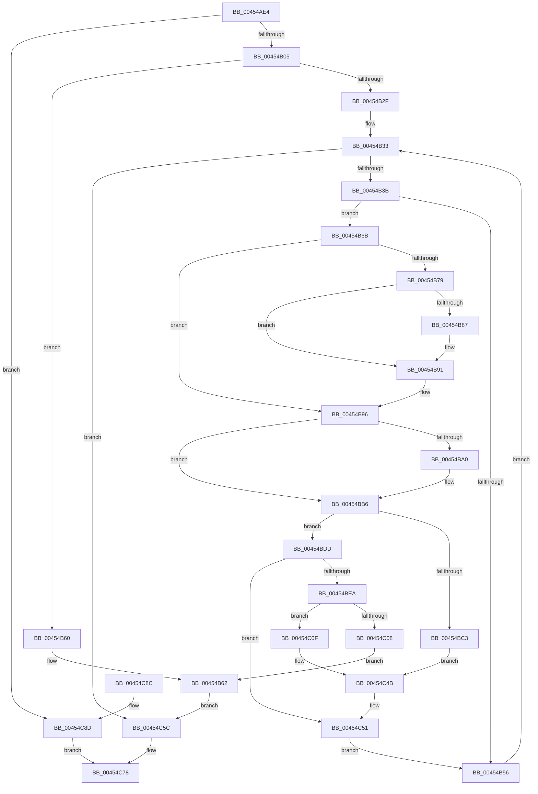

# LdrUnloadAlternateResourceModuleEx

- RVA: `0x00454AE4`–`0x00454C91` (길이 `429` bytes)
- VA: `0x0000000140454AE4`
- 실행 섹션: `.text`
- PDB 이름 있음: `예`; PDB Function 태그: `아니요`
- unwind 정보 RVA: `0x000A79F0`
- 디코드: `113`개 명령, `429/429` bytes 표시
- 미해석 바이트: `0` (있으면 어셈블리에 `.byte`로 보존)

> 이 문서는 커널 이미지의 기계어와 PDB 기호를 분석해 생성했습니다. 4번과 5번은 함수 원형과 자료형을 바이너리 사용 방식에서 추정한 C 해석이며 원본 소스 복구 결과는 아닙니다.

## 1. Dependencies

- 직접 호출 지점: **10**; 고유 호출 대상: **8**
- 직접 호출자로 확인된 함수: **2**
- RIP 상대 이미지 참조: **8**

### Outgoing calls
- `0x00454B05` → [LdrpInitMuiCrits](LdrpInitMuiCrits_function_00455B80.md) (function, `0x00455B80`)
- `0x00454B1F` → [KeWaitForSingleObject](../20/KeWaitForSingleObject_function_0020E6B0.md) (function, `0x0020E6B0`)
- `0x00454B79` → [MmUnmapViewInSessionSpace](../../page/A5/MmUnmapViewInSessionSpace_function_00A5FE60.md) (function, `0x00A5FE60`)
- `0x00454B87` → [ZwClose](../6A/ZwClose_function_006AD2B0.md) (function, `0x006AD2B0`)
- `0x00454BB1` → [memcpy](../6C/memcpy_function_006C6840.md) (function, `0x006C6840`)
- `0x00454BCC` → [ExFreePoolWithTag](../../poolcode/B8/ExFreePoolWithTag_function_00B82870.md) (function, `0x00B82870`)
- `0x00454BFB` → [ExAllocatePool2](../../poolcode/B8/ExAllocatePool2_function_00B820F0.md) (function, `0x00B820F0`)
- `0x00454C28` → [memcpy](../6C/memcpy_function_006C6840.md) (function, `0x006C6840`)
- `0x00454C36` → [ExFreePoolWithTag](../../poolcode/B8/ExFreePoolWithTag_function_00B82870.md) (function, `0x00B82870`)
- `0x00454C71` → [KeReleaseMutantEx](../39/KeReleaseMutantEx_function_00396850.md) (function, `0x00396850`)

### Direct callers
- [LdrUnloadAlternateResourceModule](LdrUnloadAlternateResourceModule_function_00454ACC.md) at `0x00454AD0`
- [LdrpGetFromMUIMemCache](LdrpGetFromMUIMemCache_function_00455948.md) at `0x00455B66`

### Static image references
- `0x00454B18` → RVA `0x00F05C60` (`.data`; read)
- `0x00454B25` → RVA `0x00F05C54` (`.data`; read)
- `0x00454B46` → RVA `0x00F05C58` (`.data`; read)
- `0x00454BB9` → RVA `0x00F05C54` (`.data`; write)
- `0x00454BD1` → RVA `0x00F05C58` (`.data`; read/write)
- `0x00454BDD` → RVA `0x00F05C50` (`.data`; read)
- `0x00454C3B` → RVA `0x00F05C58` (`.data`; write)
- `0x00454C4B` → RVA `0x00F05C50` (`.data`; write)

## 2. Other-region calls and transfers

- 다른 실행 섹션으로 향하는 call: **4**
  - `0x00454B79` → [MmUnmapViewInSessionSpace](../../page/A5/MmUnmapViewInSessionSpace_function_00A5FE60.md) (`.text` → `PAGE`)
  - `0x00454BCC` → [ExFreePoolWithTag](../../poolcode/B8/ExFreePoolWithTag_function_00B82870.md) (`.text` → `POOLCODE`)
  - `0x00454BFB` → [ExAllocatePool2](../../poolcode/B8/ExAllocatePool2_function_00B820F0.md) (`.text` → `POOLCODE`)
  - `0x00454C36` → [ExFreePoolWithTag](../../poolcode/B8/ExFreePoolWithTag_function_00B82870.md) (`.text` → `POOLCODE`)
- 별도 외부 분기/꼬리 이동을 확인하지 못했습니다.

## 3. Assembly (complete function range)

```asm
00454AE4  48 89 5C 24 08                  mov qword ptr [rsp + 8], rbx
00454AE9  48 89 74 24 18                  mov qword ptr [rsp + 0x18], rsi
00454AEE  57                              push rdi
00454AEF  41 56                           push r14
00454AF1  41 57                           push r15
00454AF3  48 83 EC 40                     sub rsp, 0x40
00454AF7  4C 8B F1                        mov r14, rcx
00454AFA  32 DB                           xor bl, bl
00454AFC  48 85 C9                        test rcx, rcx
00454AFF  0F 84 88 01 00 00               je 0x140454c8d
00454B05  E8 76 10 00 00                  call 0x140455b80
00454B0A  48 83 64 24 20 00               and qword ptr [rsp + 0x20], 0
00454B10  45 33 C9                        xor r9d, r9d
00454B13  45 33 C0                        xor r8d, r8d
00454B16  33 D2                           xor edx, edx
00454B18  48 8D 0D 41 11 AB 00            lea rcx, [rip + 0xab1141]
00454B1F  E8 8C 9B DB FF                  call 0x14020e6b0
00454B24  90                              nop
00454B25  8B 3D 29 11 AB 00               mov edi, dword ptr [rip + 0xab1129]
00454B2B  85 FF                           test edi, edi
00454B2D  74 31                           je 0x140454b60
00454B2F  89 7C 24 34                     mov dword ptr [rsp + 0x34], edi
00454B33  85 FF                           test edi, edi
00454B35  0F 8E 21 01 00 00               jle 0x140454c5c
00454B3B  44 8D 7F FF                     lea r15d, [rdi - 1]
00454B3F  49 63 F7                        movsxd rsi, r15d
00454B42  48 C1 E6 06                     shl rsi, 6
00454B46  48 8B 05 0B 11 AB 00            mov rax, qword ptr [rip + 0xab110b]
00454B4D  48 03 F0                        add rsi, rax
00454B50  4C 39 76 08                     cmp qword ptr [rsi + 8], r14
00454B54  74 15                           je 0x140454b6b
00454B56  41 8B FF                        mov edi, r15d
00454B59  44 89 7C 24 34                  mov dword ptr [rsp + 0x34], r15d
00454B5E  EB D3                           jmp 0x140454b33
00454B60  B3 01                           mov bl, 1
00454B62  88 5C 24 30                     mov byte ptr [rsp + 0x30], bl
00454B66  E9 F1 00 00 00                  jmp 0x140454c5c
00454B6B  48 8B 4E 20                     mov rcx, qword ptr [rsi + 0x20]
00454B6F  48 8D 41 FF                     lea rax, [rcx - 1]
00454B73  48 83 F8 FD                     cmp rax, -3
00454B77  77 1D                           ja 0x140454b96
00454B79  E8 E2 B2 60 00                  call 0x140a5fe60
00454B7E  48 8B 4E 28                     mov rcx, qword ptr [rsi + 0x28]
00454B82  48 85 C9                        test rcx, rcx
00454B85  74 0A                           je 0x140454b91
00454B87  E8 24 87 25 00                  call 0x1406ad2b0
00454B8C  48 83 66 28 00                  and qword ptr [rsi + 0x28], 0
00454B91  48 83 66 20 00                  and qword ptr [rsi + 0x20], 0
00454B96  8B 1D B8 10 AB 00               mov ebx, dword ptr [rip + 0xab10b8]
00454B9C  3B FB                           cmp edi, ebx
00454B9E  74 16                           je 0x140454bb6
00454BA0  44 8B C3                        mov r8d, ebx
00454BA3  44 2B C7                        sub r8d, edi
00454BA6  49 C1 E0 06                     shl r8, 6
00454BAA  48 8D 56 40                     lea rdx, [rsi + 0x40]
00454BAE  48 8B CE                        mov rcx, rsi
00454BB1  E8 8A 1C 27 00                  call 0x1406c6840
00454BB6  8D 4B FF                        lea ecx, [rbx - 1]
00454BB9  89 0D 95 10 AB 00               mov dword ptr [rip + 0xab1095], ecx
00454BBF  85 C9                           test ecx, ecx
00454BC1  75 1A                           jne 0x140454bdd
00454BC3  33 D2                           xor edx, edx
00454BC5  48 8B 0D 8C 10 AB 00            mov rcx, qword ptr [rip + 0xab108c]
00454BCC  E8 9F DC 72 00                  call 0x140b82870
00454BD1  48 83 25 7F 10 AB 00 00         and qword ptr [rip + 0xab107f], 0
00454BD9  33 C0                           xor eax, eax
00454BDB  EB 6E                           jmp 0x140454c4b
00454BDD  8B 05 6D 10 AB 00               mov eax, dword ptr [rip + 0xab106d]
00454BE3  83 C0 E0                        add eax, -0x20
00454BE6  3B C8                           cmp ecx, eax
00454BE8  73 67                           jae 0x140454c51
00454BEA  8B D0                           mov edx, eax
00454BEC  48 C1 E2 06                     shl rdx, 6
00454BF0  B9 00 01 00 00                  mov ecx, 0x100
00454BF5  41 B8 72 74 50 69               mov r8d, 0x69507472
00454BFB  E8 F0 D4 72 00                  call 0x140b820f0
00454C00  48 8B F8                        mov rdi, rax
00454C03  48 85 C0                        test rax, rax
00454C06  75 07                           jne 0x140454c0f
00454C08  32 DB                           xor bl, bl
00454C0A  E9 53 FF FF FF                  jmp 0x140454b62
00454C0F  44 8B 05 3A 10 AB 00            mov r8d, dword ptr [rip + 0xab103a]
00454C16  41 83 C0 E0                     add r8d, -0x20
00454C1A  49 C1 E0 06                     shl r8, 6
00454C1E  48 8B 15 33 10 AB 00            mov rdx, qword ptr [rip + 0xab1033]
00454C25  48 8B CF                        mov rcx, rdi
00454C28  E8 13 1C 27 00                  call 0x1406c6840
00454C2D  33 D2                           xor edx, edx
00454C2F  48 8B 0D 22 10 AB 00            mov rcx, qword ptr [rip + 0xab1022]
00454C36  E8 35 DC 72 00                  call 0x140b82870
00454C3B  48 89 3D 16 10 AB 00            mov qword ptr [rip + 0xab1016], rdi
00454C42  8B 05 08 10 AB 00               mov eax, dword ptr [rip + 0xab1008]
00454C48  83 C0 E0                        add eax, -0x20
00454C4B  89 05 FF 0F AB 00               mov dword ptr [rip + 0xab0fff], eax
00454C51  B3 01                           mov bl, 1
00454C53  88 5C 24 30                     mov byte ptr [rsp + 0x30], bl
00454C57  E9 FA FE FF FF                  jmp 0x140454b56
00454C5C  4C 8D 4C 24 68                  lea r9, [rsp + 0x68]
00454C61  BA 01 00 00 00                  mov edx, 1
00454C66  44 8D 42 03                     lea r8d, [rdx + 3]
00454C6A  48 8D 0D EF 0F AB 00            lea rcx, [rip + 0xab0fef]
00454C71  E8 DA 1B F4 FF                  call 0x140396850
00454C76  8A C3                           mov al, bl
00454C78  48 8B 5C 24 60                  mov rbx, qword ptr [rsp + 0x60]
00454C7D  48 8B 74 24 70                  mov rsi, qword ptr [rsp + 0x70]
00454C82  48 83 C4 40                     add rsp, 0x40
00454C86  41 5F                           pop r15
00454C88  41 5E                           pop r14
00454C8A  5F                              pop rdi
00454C8B  C3                              ret
00454C8C  CC                              int3
00454C8D  32 C0                           xor al, al
00454C8F  EB E7                           jmp 0x140454c78
```

## 4. C-style interpretation (structured pseudocode)

```c
__int64 __fastcall LdrUnloadAlternateResourceModuleEx(__int64 a1, int a2, int a3, int a4)
{
    __int64 result;
    __int64 v_rbx;
    __int64 v_rsi;
    __int64 v_rsp;
    unsigned int v_stack_m24;
    unsigned __int8 v_stack_m28;
    unsigned __int64 v_stack_m38;
    unsigned __int64 v_stack_p10;
    unsigned __int64 v_stack_p18;
    unsigned __int64 v_stack_p8;

    v_stack_p8 = v_rbx;
    v_stack_p18 = v_rsi;
    v_rsp = (v_rsp) - (64);
    v_rbx = 0;
    if (a1 == 0) goto loc_00454C8D;
    result = LdrpInitMuiCrits(a1, a2, a3, a4);
    a4 = 0;
    a3 = 0;
    a2 = 0;
    result = KeWaitForSingleObject(v_rip + 11211073, a2, a3, a4);
    if ((unsigned int)((unsigned int)(*(unsigned int *)(v_rip + 11211049))) == 0) goto loc_00454B60;
    v_stack_m24 = (unsigned int)((unsigned int)(*(unsigned int *)(v_rip + 11211049)));
loc_00454B33:
    if (condition_is_less_or_equal) goto loc_00454C5C;
    v_rsi = ((int)((unsigned int)((unsigned int)(*(unsigned int *)(v_rip + 11211049)) - 1))) << (6);
    v_rsi = (v_rsi) + (*(unsigned __int64 *)(v_rip + 11211019));
    if ((*(unsigned __int64 *)(v_rsi + 8)) == a1) goto loc_00454B6B;
loc_00454B56:
    v_stack_m24 = (unsigned int)((unsigned int)(*(unsigned int *)(v_rip + 11211049)) - 1);
    goto loc_00454B33;
loc_00454B60:
loc_00454B62:
    v_stack_m28 = 1;
    goto loc_00454C5C;
loc_00454B6B:
    if ((*(unsigned __int64 *)(v_rsi + 32) - 1) > -3) goto loc_00454B96;
    result = MmUnmapViewInSessionSpace(*(unsigned __int64 *)(v_rsi + 32), a2, a3, a4);
    if (*(unsigned __int64 *)(v_rsi + 40) != 0) {
        result = ZwClose(*(unsigned __int64 *)(v_rsi + 40), a2, a3, a4);
    }
loc_00454B96:
    if (((unsigned int)((unsigned int)((unsigned int)((unsigned int)(*(unsigned int *)(v_rip + 11211049)) - 1)))) != ((unsigned int)((unsigned int)(*(unsigned int *)(v_rip + 11210936))))) {
        a3 = (unsigned int)((unsigned int)(*(unsigned int *)(v_rip + 11210936)));
        a3 = (unsigned int)((a3) - ((unsigned int)((unsigned int)((unsigned int)((unsigned int)(*(unsigned int *)(v_rip + 11211049)) - 1)))));
        a3 = (a3) << (6);
        a2 = v_rsi + 64;
        a1 = v_rsi;
        result = memcpy(a1, a2, a3, a4);
    }
    *(unsigned int *)(v_rip + 11210901) = (unsigned int)((unsigned int)(*(unsigned int *)(v_rip + 11210936)) - 1);
    if ((unsigned int)((unsigned int)(*(unsigned int *)(v_rip + 11210936)) - 1) != 0) goto loc_00454BDD;
    a2 = 0;
    result = ExFreePoolWithTag(*(unsigned __int64 *)(v_rip + 11210892), a2, a3, a4);
    result = 0;
    goto loc_00454C4B;
loc_00454BDD:
    result = (unsigned int)(((unsigned int)(*(unsigned int *)(v_rip + 11210861))) + (-32));
    if (((unsigned int)(*(unsigned __int64 *)(v_rip + 11210892))) >= ((unsigned int)(result))) goto loc_00454C51;
    a2 = ((unsigned int)((unsigned int)(result))) << (6);
    result = ExAllocatePool2(256, a2, (unsigned int)(0x69507472ULL), a4);
    if (result != 0) goto loc_00454C0F;
    v_rbx = 0;
    goto loc_00454B62;
loc_00454C0F:
    a3 = (unsigned int)(((unsigned int)(*(unsigned int *)(v_rip + 11210810))) + (-32));
    a3 = (a3) << (6);
    result = memcpy(result, *(unsigned __int64 *)(v_rip + 11210803), a3, a4);
    a2 = 0;
    result = ExFreePoolWithTag(*(unsigned __int64 *)(v_rip + 11210786), a2, a3, a4);
    *(unsigned __int64 *)(v_rip + 11210774) = result;
    result = (unsigned int)(((unsigned int)(*(unsigned int *)(v_rip + 11210760))) + (-32));
loc_00454C4B:
    *(unsigned int *)(v_rip + 11210751) = (unsigned int)(result);
loc_00454C51:
    v_stack_m28 = 1;
    goto loc_00454B56;
loc_00454C5C:
    result = KeReleaseMutantEx(v_rip + 11210735, 1, 1 + 3, v_stack_p10);
loc_00454C78:
    v_rsp = (v_rsp) + (64);
    return 1;
loc_00454C8D:
    result = 0;
    goto loc_00454C78;
}
```

## 5. (Beta) C Style

```c
int64_t LdrUnloadAlternateResourceModuleEx(int64_t Arg1, int32_t Arg2, int32_t Arg3, int32_t Arg4)
{
    int64_t result;
    int64_t local_rbx;
    int64_t local_rsi;
    int64_t local_rsp;
    uint32_t v_stack_m24;
    uint8_t v_stack_m28;
    uint64_t v_stack_m38;
    uint64_t v_stack_p10;
    uint64_t v_stack_p18;
    uint64_t v_stack_p8;

    v_stack_p8 = local_rbx;
    v_stack_p18 = local_rsi;
    local_rsp = (local_rsp) - (64);
    local_rbx = 0;
    if (Arg1 == 0) goto loc_00454C8D;
    result = LdrpInitMuiCrits(Arg1, Arg2, Arg3, Arg4);
    Arg4 = 0;
    Arg3 = 0;
    Arg2 = 0;
    result = KeWaitForSingleObject(v_rip + 11211073, Arg2, Arg3, Arg4);
    if ((uint32_t)((uint32_t)(*(uint32_t *)(v_rip + 0xAB1129))) == 0) goto loc_00454B60;
    v_stack_m24 = (uint32_t)((uint32_t)(*(uint32_t *)(v_rip + 0xAB1129)));
loc_00454B33:
    if (condition_is_less_or_equal) goto loc_00454C5C;
    local_rsi = ((int32_t)((uint32_t)((uint32_t)(*(uint32_t *)(v_rip + 0xAB1129)) - 1))) << (6);
    local_rsi = (local_rsi) + (*(uint64_t *)(v_rip + 0xAB110B));
    if ((*(uint64_t *)(local_rsi + 0x8)) == Arg1) goto loc_00454B6B;
loc_00454B56:
    v_stack_m24 = (uint32_t)((uint32_t)(*(uint32_t *)(v_rip + 0xAB1129)) - 1);
    goto loc_00454B33;
loc_00454B60:
loc_00454B62:
    v_stack_m28 = 1;
    goto loc_00454C5C;
loc_00454B6B:
    if ((*(uint64_t *)(local_rsi + 0x20) - 1) > -3) goto loc_00454B96;
    result = MmUnmapViewInSessionSpace(*(uint64_t *)(local_rsi + 0x20), Arg2, Arg3, Arg4);
    if (*(uint64_t *)(local_rsi + 0x28) != 0) {
        result = ZwClose(*(uint64_t *)(local_rsi + 0x28), Arg2, Arg3, Arg4);
    }
loc_00454B96:
    if (((uint32_t)((uint32_t)((uint32_t)((uint32_t)(*(uint32_t *)(v_rip + 0xAB1129)) - 1)))) != ((uint32_t)((uint32_t)(*(uint32_t *)(v_rip + 0xAB10B8))))) {
        Arg3 = (uint32_t)((uint32_t)(*(uint32_t *)(v_rip + 0xAB10B8)));
        Arg3 = (uint32_t)((Arg3) - ((uint32_t)((uint32_t)((uint32_t)((uint32_t)(*(uint32_t *)(v_rip + 0xAB1129)) - 1)))));
        Arg3 = (Arg3) << (6);
        Arg2 = local_rsi + 64;
        Arg1 = local_rsi;
        result = memcpy(Arg1, Arg2, Arg3, Arg4);
    }
    *(uint32_t *)(v_rip + 0xAB1095) = (uint32_t)((uint32_t)(*(uint32_t *)(v_rip + 0xAB10B8)) - 1);
    if ((uint32_t)((uint32_t)(*(uint32_t *)(v_rip + 0xAB10B8)) - 1) != 0) goto loc_00454BDD;
    Arg2 = 0;
    result = ExFreePoolWithTag(*(uint64_t *)(v_rip + 0xAB108C), Arg2, Arg3, Arg4);
    result = 0;
    goto loc_00454C4B;
loc_00454BDD:
    result = (uint32_t)(((uint32_t)(*(uint32_t *)(v_rip + 0xAB106D))) + (-32));
    if (((uint32_t)(*(uint64_t *)(v_rip + 0xAB108C))) >= ((uint32_t)(result))) goto loc_00454C51;
    Arg2 = ((uint32_t)((uint32_t)(result))) << (6);
    result = ExAllocatePool2(256, Arg2, (uint32_t)(0x69507472ULL), Arg4);
    if (result != 0) goto loc_00454C0F;
    local_rbx = 0;
    goto loc_00454B62;
loc_00454C0F:
    Arg3 = (uint32_t)(((uint32_t)(*(uint32_t *)(v_rip + 0xAB103A))) + (-32));
    Arg3 = (Arg3) << (6);
    result = memcpy(result, *(uint64_t *)(v_rip + 0xAB1033), Arg3, Arg4);
    Arg2 = 0;
    result = ExFreePoolWithTag(*(uint64_t *)(v_rip + 0xAB1022), Arg2, Arg3, Arg4);
    *(uint64_t *)(v_rip + 0xAB1016) = result;
    result = (uint32_t)(((uint32_t)(*(uint32_t *)(v_rip + 0xAB1008))) + (-32));
loc_00454C4B:
    *(uint32_t *)(v_rip + 0xAB0FFF) = (uint32_t)(result);
loc_00454C51:
    v_stack_m28 = 1;
    goto loc_00454B56;
loc_00454C5C:
    result = KeReleaseMutantEx(v_rip + 11210735, 1, 1 + 3, v_stack_p10);
loc_00454C78:
    local_rsp = (local_rsp) + (64);
    return 1;
loc_00454C8D:
    result = 0;
    goto loc_00454C78;
}
```

## 6. Execution-region graph

[열기: 2D/3D 그래프와 함수 탐색 컨트롤 패널](../../../control-panel.html?section=text&rva=0x00454AE4&view=graph)

- 2D 그래프는 위에서 아래로 흐르고, 3D 그래프는 빈 공간을 드래그해 회전합니다. Shift+드래그는 이동, 휠은 확대·축소, 함수 노드 선택은 대상 보고서 이동입니다.

### Static fallback


