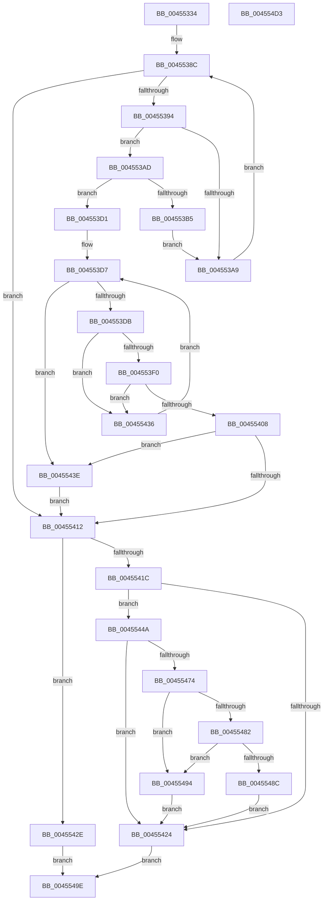

# LdrpGetAlternateResourceModuleHandleEx

- RVA: `0x00455334`–`0x004554D4` (길이 `416` bytes)
- VA: `0x0000000140455334`
- 실행 섹션: `.text`
- PDB 이름 있음: `예`; PDB Function 태그: `아니요`
- unwind 정보 RVA: `0x000A7A84`
- 디코드: `116`개 명령, `416/416` bytes 표시
- 미해석 바이트: `0` (있으면 어셈블리에 `.byte`로 보존)

> 이 문서는 커널 이미지의 기계어와 PDB 기호를 분석해 생성했습니다. 4번과 5번은 함수 원형과 자료형을 바이너리 사용 방식에서 추정한 C 해석이며 원본 소스 복구 결과는 아닙니다.

## 1. Dependencies

- 직접 호출 지점: **5**; 고유 호출 대상: **5**
- 직접 호출자로 확인된 함수: **1**
- RIP 상대 이미지 참조: **3**

### Outgoing calls
- `0x0045535B` → [LdrpInitMuiCrits](LdrpInitMuiCrits_function_00455B80.md) (function, `0x00455B80`)
- `0x00455375` → [KeWaitForSingleObject](../20/KeWaitForSingleObject_function_0020E6B0.md) (function, `0x0020E6B0`)
- `0x004553FF` → [LdrpGetMappingFromCacheEntry](LdrpGetMappingFromCacheEntry_function_00455DE0.md) (function, `0x00455DE0`)
- `0x00455465` → [RtlImageNtHeaderEx](../41/RtlImageNtHeaderEx_function_0041EAA0.md) (function, `0x0041EAA0`)
- `0x004554B3` → [KeReleaseMutantEx](../39/KeReleaseMutantEx_function_00396850.md) (function, `0x00396850`)

### Direct callers
- [LdrpAccessResourceData](../../page/99/LdrpAccessResourceData_function_0099BE1C.md) at `0x0099BE84`

### Static image references
- `0x0045536E` → RVA `0x00F05C60` (`.data`; read)
- `0x0045537F` → RVA `0x00F05C54` (`.data`; read)
- `0x0045539B` → RVA `0x00F05C58` (`.data`; read)

## 2. Other-region calls and transfers

- 다른 실행 섹션으로 향하는 call: **0**
- 별도 외부 분기/꼬리 이동을 확인하지 못했습니다.

## 3. Assembly (complete function range)

```asm
00455334  48 8B C4                        mov rax, rsp
00455337  48 89 58 08                     mov qword ptr [rax + 8], rbx
0045533B  48 89 70 18                     mov qword ptr [rax + 0x18], rsi
0045533F  57                              push rdi
00455340  41 56                           push r14
00455342  41 57                           push r15
00455344  48 83 EC 50                     sub rsp, 0x50
00455348  4D 8B F1                        mov r14, r9
0045534B  4D 8B F8                        mov r15, r8
0045534E  48 8B F1                        mov rsi, rcx
00455351  48 83 60 D8 00                  and qword ptr [rax - 0x28], 0
00455356  48 83 60 D0 00                  and qword ptr [rax - 0x30], 0
0045535B  E8 20 08 00 00                  call 0x140455b80
00455360  48 83 64 24 20 00               and qword ptr [rsp + 0x20], 0
00455366  45 33 C9                        xor r9d, r9d
00455369  45 33 C0                        xor r8d, r8d
0045536C  33 D2                           xor edx, edx
0045536E  48 8D 0D EB 08 AB 00            lea rcx, [rip + 0xab08eb]
00455375  E8 36 93 DB FF                  call 0x14020e6b0
0045537A  90                              nop
0045537B  49 83 26 00                     and qword ptr [r14], 0
0045537F  8B 1D CF 08 AB 00               mov ebx, dword ptr [rip + 0xab08cf]
00455385  89 5C 24 30                     mov dword ptr [rsp + 0x30], ebx
00455389  8D 4B FF                        lea ecx, [rbx - 1]
0045538C  89 4C 24 34                     mov dword ptr [rsp + 0x34], ecx
00455390  85 C9                           test ecx, ecx
00455392  78 7E                           js 0x140455412
00455394  48 63 D1                        movsxd rdx, ecx
00455397  48 C1 E2 06                     shl rdx, 6
0045539B  4C 8B 05 B6 08 AB 00            mov r8, qword ptr [rip + 0xab08b6]
004553A2  4A 39 74 02 08                  cmp qword ptr [rdx + r8 + 8], rsi
004553A7  74 04                           je 0x1404553ad
004553A9  FF C9                           dec ecx
004553AB  EB DF                           jmp 0x14045538c
004553AD  48 83 7C 24 40 00               cmp qword ptr [rsp + 0x40], 0
004553B3  75 1C                           jne 0x1404553d1
004553B5  4A 8B 44 02 20                  mov rax, qword ptr [rdx + r8 + 0x20]
004553BA  48 89 44 24 40                  mov qword ptr [rsp + 0x40], rax
004553BF  4A 8B 44 02 30                  mov rax, qword ptr [rdx + r8 + 0x30]
004553C4  48 89 44 24 38                  mov qword ptr [rsp + 0x38], rax
004553C9  8B D9                           mov ebx, ecx
004553CB  89 4C 24 30                     mov dword ptr [rsp + 0x30], ecx
004553CF  EB D8                           jmp 0x1404553a9
004553D1  8B FB                           mov edi, ebx
004553D3  89 5C 24 34                     mov dword ptr [rsp + 0x34], ebx
004553D7  85 FF                           test edi, edi
004553D9  78 63                           js 0x14045543e
004553DB  48 63 CF                        movsxd rcx, edi
004553DE  48 C1 E1 06                     shl rcx, 6
004553E2  48 8B 05 6F 08 AB 00            mov rax, qword ptr [rip + 0xab086f]
004553E9  48 39 74 01 08                  cmp qword ptr [rcx + rax + 8], rsi
004553EE  75 46                           jne 0x140455436
004553F0  4C 8D 4C 24 38                  lea r9, [rsp + 0x38]
004553F5  4C 8D 44 24 40                  lea r8, [rsp + 0x40]
004553FA  49 8B D7                        mov rdx, r15
004553FD  8B CF                           mov ecx, edi
004553FF  E8 DC 09 00 00                  call 0x140455de0
00455404  84 C0                           test al, al
00455406  74 2E                           je 0x140455436
00455408  8B DF                           mov ebx, edi
0045540A  89 5C 24 30                     mov dword ptr [rsp + 0x30], ebx
0045540E  85 FF                           test edi, edi
00455410  78 2C                           js 0x14045543e
00455412  8B 05 3C 08 AB 00               mov eax, dword ptr [rip + 0xab083c]
00455418  3B D8                           cmp ebx, eax
0045541A  74 12                           je 0x14045542e
0045541C  48 83 7C 24 38 00               cmp qword ptr [rsp + 0x38], 0
00455422  74 26                           je 0x14045544a
00455424  48 8B 44 24 38                  mov rax, qword ptr [rsp + 0x38]
00455429  49 89 06                        mov qword ptr [r14], rax
0045542C  EB 70                           jmp 0x14045549e
0045542E  48 83 64 24 40 00               and qword ptr [rsp + 0x40], 0
00455434  EB 68                           jmp 0x14045549e
00455436  FF CF                           dec edi
00455438  89 7C 24 34                     mov dword ptr [rsp + 0x34], edi
0045543C  EB 99                           jmp 0x1404553d7
0045543E  8B 1D 10 08 AB 00               mov ebx, dword ptr [rip + 0xab0810]
00455444  89 5C 24 30                     mov dword ptr [rsp + 0x30], ebx
00455448  EB C8                           jmp 0x140455412
0045544A  48 8B 54 24 40                  mov rdx, qword ptr [rsp + 0x40]
0045544F  48 83 E2 FC                     and rdx, 0xfffffffffffffffc
00455453  48 83 64 24 48 00               and qword ptr [rsp + 0x48], 0
00455459  4C 8D 4C 24 48                  lea r9, [rsp + 0x48]
0045545E  45 33 C0                        xor r8d, r8d
00455461  41 8D 48 01                     lea ecx, [r8 + 1]
00455465  E8 36 96 FC FF                  call 0x14041eaa0
0045546A  48 8B 44 24 48                  mov rax, qword ptr [rsp + 0x48]
0045546F  48 85 C0                        test rax, rax
00455472  74 B0                           je 0x140455424
00455474  0F B7 48 18                     movzx ecx, word ptr [rax + 0x18]
00455478  BA 0B 01 00 00                  mov edx, 0x10b
0045547D  66 3B CA                        cmp cx, dx
00455480  74 12                           je 0x140455494
00455482  BA 0B 02 00 00                  mov edx, 0x20b
00455487  66 3B CA                        cmp cx, dx
0045548A  74 08                           je 0x140455494
0045548C  48 83 64 24 38 00               and qword ptr [rsp + 0x38], 0
00455492  EB 90                           jmp 0x140455424
00455494  8B 40 50                        mov eax, dword ptr [rax + 0x50]
00455497  48 89 44 24 38                  mov qword ptr [rsp + 0x38], rax
0045549C  EB 86                           jmp 0x140455424
0045549E  4C 8D 4C 24 78                  lea r9, [rsp + 0x78]
004554A3  BA 01 00 00 00                  mov edx, 1
004554A8  44 8D 42 03                     lea r8d, [rdx + 3]
004554AC  48 8D 0D AD 07 AB 00            lea rcx, [rip + 0xab07ad]
004554B3  E8 98 13 F4 FF                  call 0x140396850
004554B8  48 8B 44 24 40                  mov rax, qword ptr [rsp + 0x40]
004554BD  4C 8D 5C 24 50                  lea r11, [rsp + 0x50]
004554C2  49 8B 5B 20                     mov rbx, qword ptr [r11 + 0x20]
004554C6  49 8B 73 30                     mov rsi, qword ptr [r11 + 0x30]
004554CA  49 8B E3                        mov rsp, r11
004554CD  41 5F                           pop r15
004554CF  41 5E                           pop r14
004554D1  5F                              pop rdi
004554D2  C3                              ret
004554D3  CC                              int3
```

## 4. C-style interpretation (structured pseudocode)

```c
__int64 __fastcall LdrpGetAlternateResourceModuleHandleEx(__int64 a1, int a2, __int64 a3, __int64 a4)
{
    __int64 result;
    __int64 v_rdi;
    __int64 v_rsp;
    unsigned __int64 v_stack_m18;
    unsigned __int64 v_stack_m20;
    unsigned __int64 v_stack_m28;
    unsigned __int64 v_stack_m30;
    unsigned int v_stack_m34;
    unsigned int v_stack_m38;
    unsigned __int64 v_stack_m48;
    unsigned __int64 v_stack_p10;

    *(unsigned __int64 *)(v_rsp + 8) = v_rbx;
    *(unsigned __int64 *)(v_rsp + 24) = v_rsi;
    v_rsp = (v_rsp) - (80);
    result = LdrpInitMuiCrits(a1, a2, a3, a4);
    a4 = 0;
    a3 = 0;
    a2 = 0;
    result = KeWaitForSingleObject(v_rip + 11208939, a2, a3, a4);
    v_stack_m38 = (unsigned int)((unsigned int)(*(unsigned int *)(v_rip + 11208911)));
loc_0045538C:
    v_stack_m34 = (unsigned int)((unsigned int)(*(unsigned int *)(v_rip + 11208911)) - 1);
    if (sign_flag) goto loc_00455412;
    a2 = ((int)((unsigned int)((unsigned int)(*(unsigned int *)(v_rip + 11208911)) - 1))) << (6);
    if ((*(unsigned __int64 *)(a2 + *(unsigned __int64 *)(v_rip + 11208886) * 1 + 8)) == a1) goto loc_004553AD;
loc_004553A9:
    a1 = (unsigned int)(((unsigned int)(*(unsigned int *)(v_rip + 11208911)) - 1) - 1);
    goto loc_0045538C;
loc_004553AD:
    if (v_stack_m28 != 0) goto loc_004553D1;
    v_stack_m28 = *(unsigned __int64 *)(a2 + *(unsigned __int64 *)(v_rip + 11208886) * 1 + 32);
    v_stack_m30 = *(unsigned __int64 *)(a2 + *(unsigned __int64 *)(v_rip + 11208886) * 1 + 48);
    v_stack_m38 = (unsigned int)(a1);
    goto loc_004553A9;
loc_004553D1:
    v_stack_m34 = (unsigned int)((unsigned int)((unsigned int)(a1)));
loc_004553D7:
    if (sign_flag) goto loc_0045543E;
    a1 = ((int)((unsigned int)((unsigned int)((unsigned int)((unsigned int)((unsigned int)(a1))))))) << (6);
    if ((*(unsigned __int64 *)(a1 + *(unsigned __int64 *)(v_rip + 11208815) * 1 + 8)) != a1) goto loc_00455436;
    result = LdrpGetMappingFromCacheEntry((unsigned int)((unsigned int)((unsigned int)((unsigned int)((unsigned int)((unsigned int)(a1)))))), 0, v_stack_m28, v_stack_m30);
    if ((unsigned __int8)(result) == 0) goto loc_00455436;
    v_stack_m38 = (unsigned int)((unsigned int)((unsigned int)((unsigned int)((unsigned int)((unsigned int)((unsigned int)(a1)))))));
    if (sign_flag) goto loc_0045543E;
loc_00455412:
    if (((unsigned int)((unsigned int)((unsigned int)((unsigned int)((unsigned int)((unsigned int)((unsigned int)(a1)))))))) == ((unsigned int)((unsigned int)(*(unsigned int *)(v_rip + 11208764))))) goto loc_0045542E;
    if (v_stack_m30 == 0) goto loc_0045544A;
loc_00455424:
    *(unsigned __int64 *)(a4) = v_stack_m30;
    goto loc_0045549E;
loc_0045542E:
    goto loc_0045549E;
loc_00455436:
    v_rdi = (unsigned int)(((unsigned int)((unsigned int)((unsigned int)((unsigned int)(a1))))) - 1);
    v_stack_m34 = (unsigned int)(v_rdi);
    goto loc_004553D7;
loc_0045543E:
    v_stack_m38 = (unsigned int)((unsigned int)(*(unsigned int *)(v_rip + 11208720)));
    goto loc_00455412;
loc_0045544A:
    a2 = (v_stack_m28) & (-4);
    a3 = 0;
    result = RtlImageNtHeaderEx(a3 + 1, a2, a3, v_stack_m20);
    if (v_stack_m20 == 0) goto loc_00455424;
    if (((unsigned __int16)(*(unsigned __int16 *)(v_stack_m20 + 24))) == 267) goto loc_00455494;
    if (((unsigned __int16)(*(unsigned __int16 *)(v_stack_m20 + 24))) == 523) goto loc_00455494;
    goto loc_00455424;
loc_00455494:
    v_stack_m30 = (unsigned int)(*(unsigned int *)(v_stack_m20 + 80));
    goto loc_00455424;
loc_0045549E:
    result = KeReleaseMutantEx(v_rip + 11208621, 1, 1 + 3, v_stack_p10);
    return v_stack_m28;
}
```

## 5. (Beta) C Style

```c
int64_t LdrpGetAlternateResourceModuleHandleEx(int64_t Arg1, int32_t Arg2, int64_t Arg3, void *Arg4)
{
    uint8_t *arg4 = (uint8_t *)Arg4;

    int64_t result;
    int64_t local_rdi;
    int64_t local_rsp;
    uint64_t v_stack_m18;
    uint64_t v_stack_m20;
    uint64_t v_stack_m28;
    uint64_t v_stack_m30;
    uint32_t v_stack_m34;
    uint32_t v_stack_m38;
    uint64_t v_stack_m48;
    uint64_t v_stack_p10;

    *(uint64_t *)(local_rsp + 0x8) = local_rbx;
    *(uint64_t *)(local_rsp + 0x18) = local_rsi;
    local_rsp = (local_rsp) - (80);
    result = LdrpInitMuiCrits(Arg1, Arg2, Arg3, Arg4);
    Arg4 = 0;
    Arg3 = 0;
    Arg2 = 0;
    result = KeWaitForSingleObject(v_rip + 11208939, Arg2, Arg3, Arg4);
    v_stack_m38 = (uint32_t)((uint32_t)(*(uint32_t *)(v_rip + 0xAB08CF)));
loc_0045538C:
    v_stack_m34 = (uint32_t)((uint32_t)(*(uint32_t *)(v_rip + 0xAB08CF)) - 1);
    if (sign_flag) goto loc_00455412;
    Arg2 = ((int32_t)((uint32_t)((uint32_t)(*(uint32_t *)(v_rip + 0xAB08CF)) - 1))) << (6);
    if ((*(uint64_t *)(Arg2 + *(uint64_t *)(v_rip + 0xAB08B6) * 1 + 0x8)) == Arg1) goto loc_004553AD;
loc_004553A9:
    Arg1 = (uint32_t)(((uint32_t)(*(uint32_t *)(v_rip + 0xAB08CF)) - 1) - 1);
    goto loc_0045538C;
loc_004553AD:
    if (v_stack_m28 != 0) goto loc_004553D1;
    v_stack_m28 = *(uint64_t *)(Arg2 + *(uint64_t *)(v_rip + 0xAB08B6) * 1 + 0x20);
    v_stack_m30 = *(uint64_t *)(Arg2 + *(uint64_t *)(v_rip + 0xAB08B6) * 1 + 0x30);
    v_stack_m38 = (uint32_t)(Arg1);
    goto loc_004553A9;
loc_004553D1:
    v_stack_m34 = (uint32_t)((uint32_t)((uint32_t)(Arg1)));
loc_004553D7:
    if (sign_flag) goto loc_0045543E;
    Arg1 = ((int32_t)((uint32_t)((uint32_t)((uint32_t)((uint32_t)((uint32_t)(Arg1))))))) << (6);
    if ((*(uint64_t *)(Arg1 + *(uint64_t *)(v_rip + 0xAB086F) * 1 + 0x8)) != Arg1) goto loc_00455436;
    result = LdrpGetMappingFromCacheEntry((uint32_t)((uint32_t)((uint32_t)((uint32_t)((uint32_t)((uint32_t)(Arg1)))))), 0, v_stack_m28, v_stack_m30);
    if ((uint8_t)(result) == 0) goto loc_00455436;
    v_stack_m38 = (uint32_t)((uint32_t)((uint32_t)((uint32_t)((uint32_t)((uint32_t)((uint32_t)(Arg1)))))));
    if (sign_flag) goto loc_0045543E;
loc_00455412:
    if (((uint32_t)((uint32_t)((uint32_t)((uint32_t)((uint32_t)((uint32_t)((uint32_t)(Arg1)))))))) == ((uint32_t)((uint32_t)(*(uint32_t *)(v_rip + 0xAB083C))))) goto loc_0045542E;
    if (v_stack_m30 == 0) goto loc_0045544A;
loc_00455424:
    *(uint64_t *)(arg4) = v_stack_m30;
    goto loc_0045549E;
loc_0045542E:
    goto loc_0045549E;
loc_00455436:
    local_rdi = (uint32_t)(((uint32_t)((uint32_t)((uint32_t)((uint32_t)(Arg1))))) - 1);
    v_stack_m34 = (uint32_t)(local_rdi);
    goto loc_004553D7;
loc_0045543E:
    v_stack_m38 = (uint32_t)((uint32_t)(*(uint32_t *)(v_rip + 0xAB0810)));
    goto loc_00455412;
loc_0045544A:
    Arg2 = (v_stack_m28) & (-4);
    Arg3 = 0;
    result = RtlImageNtHeaderEx(Arg3 + 1, Arg2, Arg3, v_stack_m20);
    if (v_stack_m20 == 0) goto loc_00455424;
    if (((uint16_t)(*(uint16_t *)(v_stack_m20 + 0x18))) == 267) goto loc_00455494;
    if (((uint16_t)(*(uint16_t *)(v_stack_m20 + 0x18))) == 523) goto loc_00455494;
    goto loc_00455424;
loc_00455494:
    v_stack_m30 = (uint32_t)(*(uint32_t *)(v_stack_m20 + 0x50));
    goto loc_00455424;
loc_0045549E:
    result = KeReleaseMutantEx(v_rip + 11208621, 1, 1 + 3, v_stack_p10);
    return v_stack_m28;
}
```

### 관측된 메모리 오프셋

구조체 형식이 확인되지 않은 접근은 인자 기준의 오프셋으로만 기록했습니다.

| 기준 인자 | 오프셋 표현 | 폭 (bit) | 접근 |
|---|---:|---:|---|
| `Arg4` | `+ 0x0` | `64` | `R/W` |
| `Arg4` | `+ 0x0` | `64` | `W` |

## 6. Execution-region graph

[열기: 2D/3D 그래프와 함수 탐색 컨트롤 패널](../../../control-panel.html?section=text&rva=0x00455334&view=graph)

- 2D 그래프는 위에서 아래로 흐르고, 3D 그래프는 빈 공간을 드래그해 회전합니다. Shift+드래그는 이동, 휠은 확대·축소, 함수 노드 선택은 대상 보고서 이동입니다.

### Static fallback


