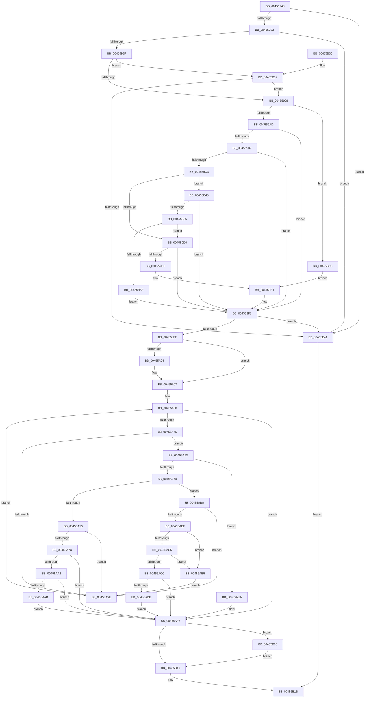

# LdrpGetFromMUIMemCache

- RVA: `0x00455948`–`0x00455B77` (길이 `559` bytes)
- VA: `0x0000000140455948`
- 실행 섹션: `.text`
- PDB 이름 있음: `예`; PDB Function 태그: `아니요`
- unwind 정보 RVA: `0x000A7B60`
- 디코드: `143`개 명령, `559/559` bytes 표시
- 미해석 바이트: `0` (있으면 어셈블리에 `.byte`로 보존)

> 이 문서는 커널 이미지의 기계어와 PDB 기호를 분석해 생성했습니다. 4번과 5번은 함수 원형과 자료형을 바이너리 사용 방식에서 추정한 C 해석이며 원본 소스 복구 결과는 아닙니다.

## 1. Dependencies

- 직접 호출 지점: **4**; 고유 호출 대상: **4**
- 직접 호출자로 확인된 함수: **3**
- RIP 상대 이미지 참조: **3**

### Outgoing calls
- `0x00455A07` → [LdrpInitMuiCrits](LdrpInitMuiCrits_function_00455B80.md) (function, `0x00455B80`)
- `0x00455A20` → [KeWaitForSingleObject](../20/KeWaitForSingleObject_function_0020E6B0.md) (function, `0x0020E6B0`)
- `0x00455B07` → [KeReleaseMutantEx](../39/KeReleaseMutantEx_function_00396850.md) (function, `0x00396850`)
- `0x00455B66` → [LdrUnloadAlternateResourceModuleEx](LdrUnloadAlternateResourceModuleEx_function_00454AE4.md) (function, `0x00454AE4`)

### Direct callers
- [LdrpGetRcConfig](LdrpGetRcConfig_function_0045555C.md) at `0x004555AB`
- [LdrLoadAlternateResourceModuleEx](LdrLoadAlternateResourceModuleEx_function_004557CC.md) at `0x0045584C`
- [LdrResGetRCConfig](../../page/A8/LdrResGetRCConfig_function_00A8035C.md) at `0x00A803E7`

### Static image references
- `0x00455A19` → RVA `0x00F05C60` (`.data`; read)
- `0x00455A26` → RVA `0x00F05C54` (`.data`; read)
- `0x00455A50` → RVA `0x00F05C58` (`.data`; read)

## 2. Other-region calls and transfers

- 다른 실행 섹션으로 향하는 call: **0**
- 별도 외부 분기/꼬리 이동을 확인하지 못했습니다.

## 3. Assembly (complete function range)

```asm
00455948  48 8B C4                        mov rax, rsp
0045594B  48 89 58 08                     mov qword ptr [rax + 8], rbx
0045594F  48 89 70 10                     mov qword ptr [rax + 0x10], rsi
00455953  48 89 78 18                     mov qword ptr [rax + 0x18], rdi
00455957  41 54                           push r12
00455959  41 56                           push r14
0045595B  41 57                           push r15
0045595D  48 83 EC 50                     sub rsp, 0x50
00455961  41 8B D9                        mov ebx, r9d
00455964  49 8B F8                        mov rdi, r8
00455967  44 0F B7 F2                     movzx r14d, dx
0045596B  4C 8B F9                        mov r15, rcx
0045596E  45 33 E4                        xor r12d, r12d
00455971  4C 89 60 D8                     mov qword ptr [rax - 0x28], r12
00455975  44 88 60 20                     mov byte ptr [rax + 0x20], r12b
00455979  41 F6 C1 0C                     test r9b, 0xc
0045597D  0F 84 BE 01 00 00               je 0x140455b41
00455983  F7 C3 F3 FF FF FF               test ebx, 0xfffffff3
00455989  0F 85 B2 01 00 00               jne 0x140455b41
0045598F  F6 C3 04                        test bl, 4
00455992  0F 85 9F 01 00 00               jne 0x140455b37
00455998  49 8B D7                        mov rdx, r15
0045599B  48 83 E2 FC                     and rdx, 0xfffffffffffffffc
0045599F  49 8B CC                        mov rcx, r12
004559A2  4C 89 64 24 38                  mov qword ptr [rsp + 0x38], r12
004559A7  0F 84 C0 01 00 00               je 0x140455b6d
004559AD  B8 4D 5A 00 00                  mov eax, 0x5a4d
004559B2  66 39 02                        cmp word ptr [rdx], ax
004559B5  75 3A                           jne 0x1404559f1
004559B7  8B 42 3C                        mov eax, dword ptr [rdx + 0x3c]
004559BA  48 8D 0C 02                     lea rcx, [rdx + rax]
004559BE  48 3B CA                        cmp rcx, rdx
004559C1  72 2E                           jb 0x1404559f1
004559C3  49 B8 FF FF FE FF FF 7F 00 00   movabs r8, 0x7ffffffeffff
004559CD  49 3B D0                        cmp rdx, r8
004559D0  0F 86 6F 01 00 00               jbe 0x140455b45
004559D6  81 39 50 45 00 00               cmp dword ptr [rcx], 0x4550
004559DC  75 13                           jne 0x1404559f1
004559DE  41 8B D4                        mov edx, r12d
004559E1  48 8B 44 24 38                  mov rax, qword ptr [rsp + 0x38]
004559E6  85 D2                           test edx, edx
004559E8  48 0F 49 C1                     cmovns rax, rcx
004559EC  48 89 44 24 38                  mov qword ptr [rsp + 0x38], rax
004559F1  48 8B 74 24 38                  mov rsi, qword ptr [rsp + 0x38]
004559F6  48 85 F6                        test rsi, rsi
004559F9  0F 84 42 01 00 00               je 0x140455b41
004559FF  48 85 FF                        test rdi, rdi
00455A02  74 03                           je 0x140455a07
00455A04  4C 89 27                        mov qword ptr [rdi], r12
00455A07  E8 74 01 00 00                  call 0x140455b80
00455A0C  4C 89 64 24 20                  mov qword ptr [rsp + 0x20], r12
00455A11  45 33 C9                        xor r9d, r9d
00455A14  45 33 C0                        xor r8d, r8d
00455A17  33 D2                           xor edx, edx
00455A19  48 8D 0D 40 02 AB 00            lea rcx, [rip + 0xab0240]
00455A20  E8 8B 8C DB FF                  call 0x14020e6b0
00455A25  90                              nop
00455A26  44 8B 05 27 02 AB 00            mov r8d, dword ptr [rip + 0xab0227]
00455A2D  41 FF C8                        dec r8d
00455A30  41 8B C8                        mov ecx, r8d
00455A33  41 8B D0                        mov edx, r8d
00455A36  41 8B C0                        mov eax, r8d
00455A39  44 89 44 24 30                  mov dword ptr [rsp + 0x30], r8d
00455A3E  85 C0                           test eax, eax
00455A40  0F 88 AC 00 00 00               js 0x140455af2
00455A46  48 63 C9                        movsxd rcx, ecx
00455A49  48 63 C2                        movsxd rax, edx
00455A4C  48 C1 E0 06                     shl rax, 6
00455A50  48 8B 15 01 02 AB 00            mov rdx, qword ptr [rip + 0xab0201]
00455A57  4C 39 7C 10 08                  cmp qword ptr [rax + rdx + 8], r15
00455A5C  74 05                           je 0x140455a63
00455A5E  41 FF C8                        dec r8d
00455A61  EB CD                           jmp 0x140455a30
00455A63  48 C1 E1 06                     shl rcx, 6
00455A67  8B 46 58                        mov eax, dword ptr [rsi + 0x58]
00455A6A  39 44 11 18                     cmp dword ptr [rcx + rdx + 0x18], eax
00455A6E  75 7A                           jne 0x140455aea
00455A70  F6 C3 08                        test bl, 8
00455A73  74 45                           je 0x140455aba
00455A75  4C 39 64 11 10                  cmp qword ptr [rcx + rdx + 0x10], r12
00455A7A  74 E2                           je 0x140455a5e
00455A7C  0F AE E8                        lfence
00455A7F  48 63 4C 24 30                  movsxd rcx, dword ptr [rsp + 0x30]
00455A84  48 C1 E1 06                     shl rcx, 6
00455A88  48 8B 05 C9 01 AB 00            mov rax, qword ptr [rip + 0xab01c9]
00455A8F  48 8B 54 01 10                  mov rdx, qword ptr [rcx + rax + 0x10]
00455A94  48 89 54 24 40                  mov qword ptr [rsp + 0x40], rdx
00455A99  48 8D 42 FF                     lea rax, [rdx - 1]
00455A9D  48 83 F8 FD                     cmp rax, -3
00455AA1  77 4F                           ja 0x140455af2
00455AA3  81 3A CD FE CD FE               cmp dword ptr [rdx], 0xfecdfecd
00455AA9  74 47                           je 0x140455af2
00455AAB  C6 84 24 88 00 00 00 01         mov byte ptr [rsp + 0x88], 1
00455AB3  4C 89 64 24 40                  mov qword ptr [rsp + 0x40], r12
00455AB8  EB 38                           jmp 0x140455af2
00455ABA  F6 C3 04                        test bl, 4
00455ABD  74 9F                           je 0x140455a5e
00455ABF  66 45 85 F6                     test r14w, r14w
00455AC3  74 20                           je 0x140455ae5
00455AC5  66 44 39 34 11                  cmp word ptr [rcx + rdx], r14w
00455ACA  75 19                           jne 0x140455ae5
00455ACC  48 8B 44 11 20                  mov rax, qword ptr [rcx + rdx + 0x20]
00455AD1  48 89 44 24 40                  mov qword ptr [rsp + 0x40], rax
00455AD6  48 85 FF                        test rdi, rdi
00455AD9  74 17                           je 0x140455af2
00455ADB  48 8B 44 11 30                  mov rax, qword ptr [rcx + rdx + 0x30]
00455AE0  48 89 07                        mov qword ptr [rdi], rax
00455AE3  EB 0D                           jmp 0x140455af2
00455AE5  E9 74 FF FF FF                  jmp 0x140455a5e
00455AEA  C6 84 24 88 00 00 00 01         mov byte ptr [rsp + 0x88], 1
00455AF2  4C 8D 4C 24 38                  lea r9, [rsp + 0x38]
00455AF7  BA 01 00 00 00                  mov edx, 1
00455AFC  44 8D 42 03                     lea r8d, [rdx + 3]
00455B00  48 8D 0D 59 01 AB 00            lea rcx, [rip + 0xab0159]
00455B07  E8 44 0D F4 FF                  call 0x140396850
00455B0C  44 38 A4 24 88 00 00 00         cmp byte ptr [rsp + 0x88], r12b
00455B14  75 4D                           jne 0x140455b63
00455B16  48 8B 44 24 40                  mov rax, qword ptr [rsp + 0x40]
00455B1B  4C 8D 5C 24 50                  lea r11, [rsp + 0x50]
00455B20  49 8B 5B 20                     mov rbx, qword ptr [r11 + 0x20]
00455B24  49 8B 73 28                     mov rsi, qword ptr [r11 + 0x28]
00455B28  49 8B 7B 30                     mov rdi, qword ptr [r11 + 0x30]
00455B2C  49 8B E3                        mov rsp, r11
00455B2F  41 5F                           pop r15
00455B31  41 5E                           pop r14
00455B33  41 5C                           pop r12
00455B35  C3                              ret
00455B36  CC                              int3
00455B37  66 45 85 F6                     test r14w, r14w
00455B3B  0F 85 57 FE FF FF               jne 0x140455998
00455B41  33 C0                           xor eax, eax
00455B43  EB D6                           jmp 0x140455b1b
00455B45  48 8D 81 07 01 00 00            lea rax, [rcx + 0x107]
00455B4C  48 3B C1                        cmp rax, rcx
00455B4F  0F 82 9C FE FF FF               jb 0x1404559f1
00455B55  49 3B C0                        cmp rax, r8
00455B58  0F 86 78 FE FF FF               jbe 0x1404559d6
00455B5E  E9 8E FE FF FF                  jmp 0x1404559f1
00455B63  49 8B CF                        mov rcx, r15
00455B66  E8 79 EF FF FF                  call 0x140454ae4
00455B6B  EB A9                           jmp 0x140455b16
00455B6D  BA 0D 00 00 C0                  mov edx, 0xc000000d
00455B72  E9 6A FE FF FF                  jmp 0x1404559e1
```

## 4. C-style interpretation (structured pseudocode)

```c
__int64 __fastcall LdrpGetFromMUIMemCache(__int64 a1, unsigned __int16 a2, __int64 a3, int a4)
{
    __int64 result;
    __int64 v_r12;
    __int64 v_rsp;
    unsigned __int64 v_stack_m18;
    unsigned __int64 v_stack_m28;
    unsigned __int64 v_stack_m30;
    unsigned int v_stack_m38;
    unsigned __int64 v_stack_m48;
    unsigned __int8 v_stack_p20;

    *(unsigned __int64 *)(v_rsp + 8) = v_rbx;
    *(unsigned __int64 *)(v_rsp + 16) = v_rsi;
    *(unsigned __int64 *)(v_rsp + 24) = v_rdi;
    v_rsp = (v_rsp) - (80);
    v_r12 = 0;
    *(unsigned __int64 *)(v_rsp - 40) = 0;
    *(unsigned __int8 *)(v_rsp + 32) = 0;
    if ((((unsigned __int8)(a4)) & (12)) == 0) goto loc_00455B41;
    if ((((unsigned int)((unsigned int)(a4))) & (0xFFFFFFF3ULL)) != 0) goto loc_00455B41;
    if ((((unsigned __int8)((unsigned int)(a4))) & (4)) != 0) goto loc_00455B37;
loc_00455998:
    a2 = (a1) & (-4);
    v_stack_m30 = 0;
    if (condition_is_equal) goto loc_00455B6D;
    if ((*(unsigned __int16 *)(a2)) != ((unsigned __int16)((unsigned int)(0x5A4DULL)))) goto loc_004559F1;
    if ((a2 + (unsigned int)(*(unsigned int *)(a2 + 60)) * 1) < a2) goto loc_004559F1;
    if (a2 <= a3) goto loc_00455B45;
loc_004559D6:
    if ((*(unsigned int *)(a2 + (unsigned int)(*(unsigned int *)(a2 + 60)) * 1)) != 0x4550ULL) goto loc_004559F1;
loc_004559E1:
    result = v_stack_m30;
    if (!sign_flag) { result = a2 + (unsigned int)(*(unsigned int *)(a2 + 60)) * 1; }
    v_stack_m30 = result;
loc_004559F1:
    if (v_stack_m30 == 0) goto loc_00455B41;
    if (a3 != 0) {
        *(unsigned __int64 *)(a3) = 0;
    }
    result = LdrpInitMuiCrits(a2 + (unsigned int)(*(unsigned int *)(a2 + 60)) * 1, 0, a3, a4);
    v_stack_m48 = 0;
    a4 = 0;
    a3 = 0;
    a2 = 0;
    result = KeWaitForSingleObject(v_rip + 11207232, a2, a3, a4);
    a3 = (unsigned int)(((unsigned int)(*(unsigned int *)(v_rip + 11207207))) - 1);
loc_00455A30:
    v_stack_m38 = (unsigned int)(a3);
    if (sign_flag) goto loc_00455AF2;
    result = ((int)((unsigned int)((unsigned int)((unsigned int)(a3))))) << (6);
    if ((*(unsigned __int64 *)(result + *(unsigned __int64 *)(v_rip + 11207169) * 1 + 8)) == a1) goto loc_00455A63;
loc_00455A5E:
    a3 = (unsigned int)((a3) - 1);
    goto loc_00455A30;
loc_00455A63:
    a1 = ((int)((unsigned int)((unsigned int)((unsigned int)(a3))))) << (6);
    if ((*(unsigned int *)(a1 + *(unsigned __int64 *)(v_rip + 11207169) * 1 + 24)) != ((unsigned int)((unsigned int)(*(unsigned int *)(v_stack_m30 + 88))))) goto loc_00455AEA;
    if ((((unsigned __int8)((unsigned int)(a4))) & (8)) == 0) goto loc_00455ABA;
    if ((*(unsigned __int64 *)(a1 + *(unsigned __int64 *)(v_rip + 11207169) * 1 + 16)) == 0) goto loc_00455A5E;
    a1 = ((int)(v_stack_m38)) << (6);
    v_stack_m28 = *(unsigned __int64 *)(a1 + *(unsigned __int64 *)(v_rip + 11207113) * 1 + 16);
    if ((*(unsigned __int64 *)(a1 + *(unsigned __int64 *)(v_rip + 11207113) * 1 + 16) - 1) > -3) goto loc_00455AF2;
    if ((*(unsigned int *)(*(unsigned __int64 *)(a1 + *(unsigned __int64 *)(v_rip + 11207113) * 1 + 16))) == 0xFECDFECDULL) goto loc_00455AF2;
    v_stack_p20 = 1;
    v_stack_m28 = 0;
    goto loc_00455AF2;
loc_00455ABA:
    if ((((unsigned __int8)((unsigned int)(a4))) & (4)) == 0) goto loc_00455A5E;
    if (0 == 0) goto loc_00455AE5;
    if ((*(unsigned __int16 *)(a1 + *(unsigned __int64 *)(a1 + *(unsigned __int64 *)(v_rip + 11207113) * 1 + 16) * 1)) != 0) goto loc_00455AE5;
    v_stack_m28 = *(unsigned __int64 *)(a1 + *(unsigned __int64 *)(a1 + *(unsigned __int64 *)(v_rip + 11207113) * 1 + 16) * 1 + 32);
    if (a3 == 0) goto loc_00455AF2;
    *(unsigned __int64 *)(a3) = *(unsigned __int64 *)(a1 + *(unsigned __int64 *)(a1 + *(unsigned __int64 *)(v_rip + 11207113) * 1 + 16) * 1 + 48);
    goto loc_00455AF2;
loc_00455AE5:
    goto loc_00455A5E;
loc_00455AEA:
    v_stack_p20 = 1;
loc_00455AF2:
    result = KeReleaseMutantEx(v_rip + 11207001, 1, 1 + 3, v_stack_m30);
    if (v_stack_p20 != 0) goto loc_00455B63;
loc_00455B16:
loc_00455B1B:
    return v_stack_m28;
loc_00455B37:
    if (0 != 0) goto loc_00455998;
loc_00455B41:
    result = 0;
    goto loc_00455B1B;
loc_00455B45:
    if ((v_rip + 11207001 + 263) < (v_rip + 11207001)) goto loc_004559F1;
    if ((v_rip + 11207001 + 263) <= (1 + 3)) goto loc_004559D6;
    goto loc_004559F1;
loc_00455B63:
    result = LdrUnloadAlternateResourceModuleEx(a1, 1, 1 + 3, v_stack_m30);
    goto loc_00455B16;
loc_00455B6D:
    goto loc_004559E1;
}
```

## 5. (Beta) C Style

```c
int64_t LdrpGetFromMUIMemCache(void *Arg1, uint16_t Arg2, int64_t Arg3, int32_t Arg4)
{
    uint8_t *arg1 = (uint8_t *)Arg1;

    int64_t result;
    int64_t local_r12;
    int64_t local_rsp;
    uint64_t v_stack_m18;
    uint64_t v_stack_m28;
    uint64_t v_stack_m30;
    uint32_t v_stack_m38;
    uint64_t v_stack_m48;
    uint8_t v_stack_p20;

    *(uint64_t *)(local_rsp + 0x8) = local_rbx;
    *(uint64_t *)(local_rsp + 0x10) = local_rsi;
    *(uint64_t *)(local_rsp + 0x18) = local_rdi;
    local_rsp = (local_rsp) - (80);
    local_r12 = 0;
    *(uint64_t *)(local_rsp - 0x28) = 0;
    *(uint8_t *)(local_rsp + 0x20) = 0;
    if ((((uint8_t)(Arg4)) & (12)) == 0) goto loc_00455B41;
    if ((((uint32_t)((uint32_t)(Arg4))) & (0xFFFFFFF3ULL)) != 0) goto loc_00455B41;
    if ((((uint8_t)((uint32_t)(Arg4))) & (4)) != 0) goto loc_00455B37;
loc_00455998:
    Arg2 = (Arg1) & (-4);
    v_stack_m30 = 0;
    if (condition_is_equal) goto loc_00455B6D;
    if ((*(uint16_t *)(Arg2)) != ((uint16_t)((uint32_t)(0x5A4DULL)))) goto loc_004559F1;
    if ((Arg2 + (uint32_t)(*(uint32_t *)(Arg2 + 0x3C)) * 1) < Arg2) goto loc_004559F1;
    if (Arg2 <= Arg3) goto loc_00455B45;
loc_004559D6:
    if ((*(uint32_t *)(Arg2 + (uint32_t)(*(uint32_t *)(Arg2 + 0x3C)) * 1)) != 0x4550ULL) goto loc_004559F1;
loc_004559E1:
    result = v_stack_m30;
    if (!sign_flag) { result = Arg2 + (uint32_t)(*(uint32_t *)(Arg2 + 0x3C)) * 1; }
    v_stack_m30 = result;
loc_004559F1:
    if (v_stack_m30 == 0) goto loc_00455B41;
    if (Arg3 != 0) {
        *(uint64_t *)(Arg3) = 0;
    }
    result = LdrpInitMuiCrits(Arg2 + (uint32_t)(*(uint32_t *)(Arg2 + 0x3C)) * 1, 0, Arg3, Arg4);
    v_stack_m48 = 0;
    Arg4 = 0;
    Arg3 = 0;
    Arg2 = 0;
    result = KeWaitForSingleObject(v_rip + 11207232, Arg2, Arg3, Arg4);
    Arg3 = (uint32_t)(((uint32_t)(*(uint32_t *)(v_rip + 0xAB0227))) - 1);
loc_00455A30:
    v_stack_m38 = (uint32_t)(Arg3);
    if (sign_flag) goto loc_00455AF2;
    result = ((int32_t)((uint32_t)((uint32_t)((uint32_t)(Arg3))))) << (6);
    if ((*(uint64_t *)(result + *(uint64_t *)(v_rip + 0xAB0201) * 1 + 0x8)) == Arg1) goto loc_00455A63;
loc_00455A5E:
    Arg3 = (uint32_t)((Arg3) - 1);
    goto loc_00455A30;
loc_00455A63:
    Arg1 = ((int32_t)((uint32_t)((uint32_t)((uint32_t)(Arg3))))) << (6);
    if ((*(uint32_t *)(arg1 + *(uint64_t *)(v_rip + 0xAB0201) * 1 + 0x18)) != ((uint32_t)((uint32_t)(*(uint32_t *)(v_stack_m30 + 0x58))))) goto loc_00455AEA;
    if ((((uint8_t)((uint32_t)(Arg4))) & (8)) == 0) goto loc_00455ABA;
    if ((*(uint64_t *)(arg1 + *(uint64_t *)(v_rip + 0xAB0201) * 1 + 0x10)) == 0) goto loc_00455A5E;
    Arg1 = ((int32_t)(v_stack_m38)) << (6);
    v_stack_m28 = *(uint64_t *)(arg1 + *(uint64_t *)(v_rip + 0xAB01C9) * 1 + 0x10);
    if ((*(uint64_t *)(arg1 + *(uint64_t *)(v_rip + 0xAB01C9) * 1 + 0x10) - 1) > -3) goto loc_00455AF2;
    if ((*(uint32_t *)(*(uint64_t *)(arg1 + *(uint64_t *)(v_rip + 0xAB01C9) * 1 + 0x10))) == 0xFECDFECDULL) goto loc_00455AF2;
    v_stack_p20 = 1;
    v_stack_m28 = 0;
    goto loc_00455AF2;
loc_00455ABA:
    if ((((uint8_t)((uint32_t)(Arg4))) & (4)) == 0) goto loc_00455A5E;
    if (0 == 0) goto loc_00455AE5;
    if ((*(uint16_t *)(arg1 + *(uint64_t *)(arg1 + *(uint64_t *)(v_rip + 0xAB01C9) * 1 + 0x10) * 1)) != 0) goto loc_00455AE5;
    v_stack_m28 = *(uint64_t *)(arg1 + *(uint64_t *)(arg1 + *(uint64_t *)(v_rip + 0xAB01C9) * 1 + 0x10) * 1 + 0x20);
    if (Arg3 == 0) goto loc_00455AF2;
    *(uint64_t *)(Arg3) = *(uint64_t *)(arg1 + *(uint64_t *)(arg1 + *(uint64_t *)(v_rip + 0xAB01C9) * 1 + 0x10) * 1 + 0x30);
    goto loc_00455AF2;
loc_00455AE5:
    goto loc_00455A5E;
loc_00455AEA:
    v_stack_p20 = 1;
loc_00455AF2:
    result = KeReleaseMutantEx(v_rip + 11207001, 1, 1 + 3, v_stack_m30);
    if (v_stack_p20 != 0) goto loc_00455B63;
loc_00455B16:
loc_00455B1B:
    return v_stack_m28;
loc_00455B37:
    if (0 != 0) goto loc_00455998;
loc_00455B41:
    result = 0;
    goto loc_00455B1B;
loc_00455B45:
    if ((v_rip + 11207001 + 263) < (v_rip + 11207001)) goto loc_004559F1;
    if ((v_rip + 11207001 + 263) <= (1 + 3)) goto loc_004559D6;
    goto loc_004559F1;
loc_00455B63:
    result = LdrUnloadAlternateResourceModuleEx(Arg1, 1, 1 + 3, v_stack_m30);
    goto loc_00455B16;
loc_00455B6D:
    goto loc_004559E1;
}
```

### 관측된 메모리 오프셋

구조체 형식이 확인되지 않은 접근은 인자 기준의 오프셋으로만 기록했습니다.

| 기준 인자 | 오프셋 표현 | 폭 (bit) | 접근 |
|---|---:|---:|---|
| `Arg1` | `+ 0x0` | `16` | `R` |
| `Arg1` | `+ 0x0 + rax*1` | `64` | `R` |
| `Arg1` | `+ 0x3C` | `32` | `R` |

## 6. Execution-region graph

[열기: 2D/3D 그래프와 함수 탐색 컨트롤 패널](../../../control-panel.html?section=text&rva=0x00455948&view=graph)

- 2D 그래프는 위에서 아래로 흐르고, 3D 그래프는 빈 공간을 드래그해 회전합니다. Shift+드래그는 이동, 휠은 확대·축소, 함수 노드 선택은 대상 보고서 이동입니다.

### Static fallback


