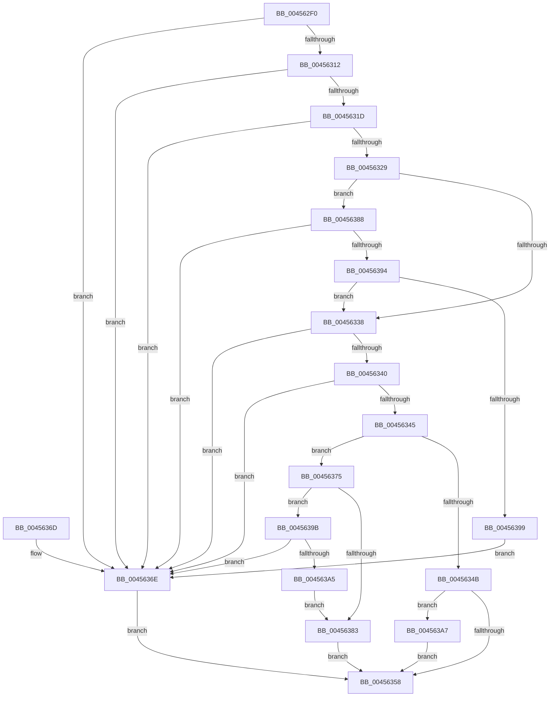

# LdrpGetImageSize

- RVA: `0x004562F0`–`0x004563AC` (길이 `188` bytes)
- VA: `0x00000001404562F0`
- 실행 섹션: `.text`
- PDB 이름 있음: `예`; PDB Function 태그: `아니요`
- unwind 정보 RVA: `0x000A7C3C`
- 디코드: `59`개 명령, `188/188` bytes 표시
- 미해석 바이트: `0` (있으면 어셈블리에 `.byte`로 보존)

> 이 문서는 커널 이미지의 기계어와 PDB 기호를 분석해 생성했습니다. 4번과 5번은 함수 원형과 자료형을 바이너리 사용 방식에서 추정한 C 해석이며 원본 소스 복구 결과는 아닙니다.

## 1. Dependencies

- 직접 호출 지점: **1**; 고유 호출 대상: **1**
- 직접 호출자로 확인된 함수: **2**
- RIP 상대 이미지 참조: **0**

### Outgoing calls
- `0x0045634E` → [LdrpKrnGetDataTableEntry](LdrpKrnGetDataTableEntry_function_004563B4.md) (function, `0x004563B4`)

### Direct callers
- [LdrpAccessResourceData](../../page/99/LdrpAccessResourceData_function_0099BE1C.md) at `0x0099BEE9`
- [LdrpAccessResourceDataNoMultipleLanguage](../../page/99/LdrpAccessResourceDataNoMultipleLanguage_function_0099BF00.md) at `0x0099BF5E`

### Static image references
- 디코드된 RIP-relative 메모리 참조가 없습니다.

## 2. Other-region calls and transfers

- 다른 실행 섹션으로 향하는 call: **0**
- 별도 외부 분기/꼬리 이동을 확인하지 못했습니다.

## 3. Assembly (complete function range)

```asm
004562F0  48 89 5C 24 08                  mov qword ptr [rsp + 8], rbx
004562F5  48 89 74 24 10                  mov qword ptr [rsp + 0x10], rsi
004562FA  57                              push rdi
004562FB  48 83 EC 20                     sub rsp, 0x20
004562FF  33 DB                           xor ebx, ebx
00456301  4C 8B C1                        mov r8, rcx
00456304  48 8B F2                        mov rsi, rdx
00456307  4C 8B C9                        mov r9, rcx
0045630A  8B FB                           mov edi, ebx
0045630C  49 83 E0 FC                     and r8, 0xfffffffffffffffc
00456310  74 5C                           je 0x14045636e
00456312  B8 4D 5A 00 00                  mov eax, 0x5a4d
00456317  66 41 39 00                     cmp word ptr [r8], ax
0045631B  75 51                           jne 0x14045636e
0045631D  41 8B 40 3C                     mov eax, dword ptr [r8 + 0x3c]
00456321  49 03 C0                        add rax, r8
00456324  49 3B C0                        cmp rax, r8
00456327  72 45                           jb 0x14045636e
00456329  48 BA FF FF FE FF FF 7F 00 00   movabs rdx, 0x7ffffffeffff
00456333  4C 3B C2                        cmp r8, rdx
00456336  76 50                           jbe 0x140456388
00456338  81 38 50 45 00 00               cmp dword ptr [rax], 0x4550
0045633E  75 2E                           jne 0x14045636e
00456340  48 85 C0                        test rax, rax
00456343  74 29                           je 0x14045636e
00456345  41 F6 C1 01                     test r9b, 1
00456349  74 2A                           je 0x140456375
0045634B  49 8B C9                        mov rcx, r9
0045634E  E8 61 00 00 00                  call 0x1404563b4
00456353  48 85 C0                        test rax, rax
00456356  75 4F                           jne 0x1404563a7
00456358  48 89 3E                        mov qword ptr [rsi], rdi
0045635B  8B C3                           mov eax, ebx
0045635D  48 8B 5C 24 30                  mov rbx, qword ptr [rsp + 0x30]
00456362  48 8B 74 24 38                  mov rsi, qword ptr [rsp + 0x38]
00456367  48 83 C4 20                     add rsp, 0x20
0045636B  5F                              pop rdi
0045636C  C3                              ret
0045636D  CC                              int3
0045636E  BB 7B 00 00 C0                  mov ebx, 0xc000007b
00456373  EB E3                           jmp 0x140456358
00456375  0F B7 48 18                     movzx ecx, word ptr [rax + 0x18]
00456379  BA 0B 01 00 00                  mov edx, 0x10b
0045637E  66 3B CA                        cmp cx, dx
00456381  75 18                           jne 0x14045639b
00456383  8B 78 50                        mov edi, dword ptr [rax + 0x50]
00456386  EB D0                           jmp 0x140456358
00456388  48 8D 88 07 01 00 00            lea rcx, [rax + 0x107]
0045638F  48 3B C8                        cmp rcx, rax
00456392  72 DA                           jb 0x14045636e
00456394  48 3B CA                        cmp rcx, rdx
00456397  76 9F                           jbe 0x140456338
00456399  EB D3                           jmp 0x14045636e
0045639B  BA 0B 02 00 00                  mov edx, 0x20b
004563A0  66 3B CA                        cmp cx, dx
004563A3  75 C9                           jne 0x14045636e
004563A5  EB DC                           jmp 0x140456383
004563A7  8B 78 40                        mov edi, dword ptr [rax + 0x40]
004563AA  EB AC                           jmp 0x140456358
```

## 4. C-style interpretation (structured pseudocode)

```c
__int64 __fastcall LdrpGetImageSize(__int64 a1, __int64 a2)
{
    __int64 result;
    __int64 v_rbx;
    __int64 v_rsp;
    unsigned __int64 v_stack_p10;
    unsigned __int64 v_stack_p8;

    v_stack_p8 = v_rbx;
    v_stack_p10 = v_rsi;
    v_rsp = (v_rsp) - (32);
    v_rbx = 0;
    a3 = (a1) & (-4);
    if (condition_is_equal) goto loc_0045636E;
    if ((*(unsigned __int16 *)(a3)) != ((unsigned __int16)((unsigned int)(0x5A4DULL)))) goto loc_0045636E;
    result = ((unsigned int)(*(unsigned int *)(a3 + 60))) + (a3);
    if (result < a3) goto loc_0045636E;
    if (a3 <= a2) goto loc_00456388;
loc_00456338:
    if ((*(unsigned int *)(result)) != 0x4550ULL) goto loc_0045636E;
    if (result == 0) goto loc_0045636E;
    if ((((unsigned __int8)(a1)) & (1)) == 0) goto loc_00456375;
    result = LdrpKrnGetDataTableEntry(a1, a2, a3, a1);
    if (result != 0) goto loc_004563A7;
loc_00456358:
    *(unsigned __int64 *)(a2) = 0;
    v_rsp = (v_rsp) + (32);
    return 0;
loc_0045636E:
    goto loc_00456358;
loc_00456375:
    if (((unsigned __int16)(*(unsigned __int16 *)(0 + 24))) != 267) goto loc_0045639B;
loc_00456383:
    goto loc_00456358;
loc_00456388:
    if ((0 + 263) < 0) goto loc_0045636E;
    if ((0 + 263) <= 267) goto loc_00456338;
    goto loc_0045636E;
loc_0045639B:
    if (((unsigned __int16)(0 + 263)) != 523) goto loc_0045636E;
    goto loc_00456383;
loc_004563A7:
    goto loc_00456358;
}
```

## 5. (Beta) C Style

```c
int64_t LdrpGetImageSize(void *Arg1, void *Arg2)
{
    uint8_t *arg1 = (uint8_t *)Arg1;
    uint8_t *arg2 = (uint8_t *)Arg2;

    int64_t result;
    int64_t local_rbx;
    int64_t local_rsp;
    uint64_t v_stack_p10;
    uint64_t v_stack_p8;

    v_stack_p8 = local_rbx;
    v_stack_p10 = local_rsi;
    local_rsp = (local_rsp) - (32);
    local_rbx = 0;
    a3 = (Arg1) & (-4);
    if (condition_is_equal) goto loc_0045636E;
    if ((*(uint16_t *)(a3)) != ((uint16_t)((uint32_t)(0x5A4DULL)))) goto loc_0045636E;
    result = ((uint32_t)(*(uint32_t *)(a3 + 0x3C))) + (a3);
    if (result < a3) goto loc_0045636E;
    if (a3 <= Arg2) goto loc_00456388;
loc_00456338:
    if ((*(uint32_t *)(result)) != 0x4550ULL) goto loc_0045636E;
    if (result == 0) goto loc_0045636E;
    if ((((uint8_t)(Arg1)) & (1)) == 0) goto loc_00456375;
    result = LdrpKrnGetDataTableEntry(Arg1, Arg2, a3, Arg1);
    if (result != 0) goto loc_004563A7;
loc_00456358:
    *(uint64_t *)(arg2) = 0;
    local_rsp = (local_rsp) + (32);
    return 0;
loc_0045636E:
    goto loc_00456358;
loc_00456375:
    if (((uint16_t)(*(uint16_t *)(0 + 0x18))) != 267) goto loc_0045639B;
loc_00456383:
    goto loc_00456358;
loc_00456388:
    if ((0 + 263) < 0) goto loc_0045636E;
    if ((0 + 263) <= 267) goto loc_00456338;
    goto loc_0045636E;
loc_0045639B:
    if (((uint16_t)(0 + 263)) != 523) goto loc_0045636E;
    goto loc_00456383;
loc_004563A7:
    goto loc_00456358;
}
```

### 관측된 메모리 오프셋

구조체 형식이 확인되지 않은 접근은 인자 기준의 오프셋으로만 기록했습니다.

| 기준 인자 | 오프셋 표현 | 폭 (bit) | 접근 |
|---|---:|---:|---|
| `Arg1` | `+ 0x0` | `16` | `R` |
| `Arg1` | `+ 0x3C` | `32` | `R` |
| `Arg2` | `+ 0x0` | `64` | `W` |

## 6. Execution-region graph

[열기: 2D/3D 그래프와 함수 탐색 컨트롤 패널](../../../control-panel.html?section=text&rva=0x004562F0&view=graph)

- 2D 그래프는 위에서 아래로 흐르고, 3D 그래프는 빈 공간을 드래그해 회전합니다. Shift+드래그는 이동, 휠은 확대·축소, 함수 노드 선택은 대상 보고서 이동입니다.

### Static fallback


