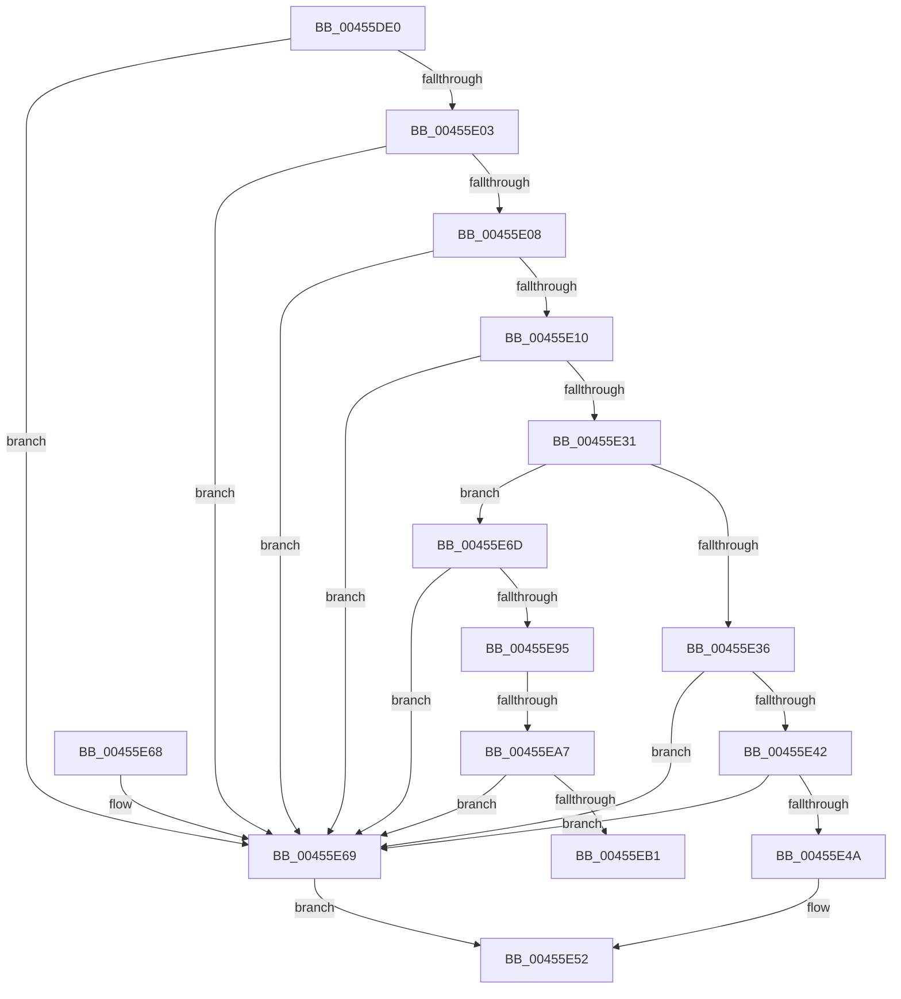

# LdrpGetMappingFromCacheEntry

- RVA: `0x00455DE0`–`0x00455EB6` (길이 `214` bytes)
- VA: `0x0000000140455DE0`
- 실행 섹션: `.text`
- PDB 이름 있음: `예`; PDB Function 태그: `예`
- unwind 정보 RVA: `0x000A7BD4`
- 디코드: `61`개 명령, `214/214` bytes 표시
- 미해석 바이트: `0` (있으면 어셈블리에 `.byte`로 보존)

> 이 문서는 커널 이미지의 기계어와 PDB 기호를 분석해 생성했습니다. 4번과 5번은 함수 원형과 자료형을 바이너리 사용 방식에서 추정한 C 해석이며 원본 소스 복구 결과는 아닙니다.

## 1. Dependencies

- 직접 호출 지점: **1**; 고유 호출 대상: **1**
- 직접 호출자로 확인된 함수: **1**
- RIP 상대 이미지 참조: **2**

### Outgoing calls
- `0x00455E86` → [RtlImageNtHeaderEx](../41/RtlImageNtHeaderEx_function_0041EAA0.md) (function, `0x0041EAA0`)

### Direct callers
- [LdrpGetAlternateResourceModuleHandleEx](LdrpGetAlternateResourceModuleHandleEx_function_00455334.md) at `0x004553FF`

### Static image references
- `0x00455E08` → RVA `0x00F05C54` (`.data`; read)
- `0x00455E10` → RVA `0x00F05C58` (`.data`; read)

## 2. Other-region calls and transfers

- 다른 실행 섹션으로 향하는 call: **0**
- call이 아닌 외부 분기/꼬리 이동: **2**
  - `0x00455EA1` → [sub_006F1A6A](../6F/Unknown_function_006F1A6A.md) (`tail-transfer`)
  - `0x00455EB1` → [sub_006F1A6A](../6F/Unknown_function_006F1A6A.md) (`tail-transfer`)

## 3. Assembly (complete function range)

```asm
00455DE0  48 89 5C 24 08                  mov qword ptr [rsp + 8], rbx
00455DE5  48 89 74 24 18                  mov qword ptr [rsp + 0x18], rsi
00455DEA  48 89 7C 24 20                  mov qword ptr [rsp + 0x20], rdi
00455DEF  41 56                           push r14
00455DF1  48 83 EC 20                     sub rsp, 0x20
00455DF5  4D 8B F1                        mov r14, r9
00455DF8  49 8B F0                        mov rsi, r8
00455DFB  48 8B FA                        mov rdi, rdx
00455DFE  48 85 D2                        test rdx, rdx
00455E01  74 66                           je 0x140455e69
00455E03  4D 85 C0                        test r8, r8
00455E06  74 61                           je 0x140455e69
00455E08  3B 0D 46 FE AA 00               cmp ecx, dword ptr [rip + 0xaafe46]
00455E0E  73 59                           jae 0x140455e69
00455E10  48 8B 05 41 FE AA 00            mov rax, qword ptr [rip + 0xaafe41]
00455E17  8B C9                           mov ecx, ecx
00455E19  48 C1 E1 06                     shl rcx, 6
00455E1D  48 8B 5C 01 20                  mov rbx, qword ptr [rcx + rax + 0x20]
00455E22  48 8B 54 01 30                  mov rdx, qword ptr [rcx + rax + 0x30]
00455E27  48 8D 43 FF                     lea rax, [rbx - 1]
00455E2B  48 83 F8 FD                     cmp rax, -3
00455E2F  77 38                           ja 0x140455e69
00455E31  48 85 D2                        test rdx, rdx
00455E34  74 37                           je 0x140455e6d
00455E36  48 8B CB                        mov rcx, rbx
00455E39  48 83 E1 FC                     and rcx, 0xfffffffffffffffc
00455E3D  48 3B F9                        cmp rdi, rcx
00455E40  72 27                           jb 0x140455e69
00455E42  48 03 CA                        add rcx, rdx
00455E45  48 3B F9                        cmp rdi, rcx
00455E48  73 1F                           jae 0x140455e69
00455E4A  48 89 1E                        mov qword ptr [rsi], rbx
00455E4D  B0 01                           mov al, 1
00455E4F  49 89 16                        mov qword ptr [r14], rdx
00455E52  48 8B 5C 24 30                  mov rbx, qword ptr [rsp + 0x30]
00455E57  48 8B 74 24 40                  mov rsi, qword ptr [rsp + 0x40]
00455E5C  48 8B 7C 24 48                  mov rdi, qword ptr [rsp + 0x48]
00455E61  48 83 C4 20                     add rsp, 0x20
00455E65  41 5E                           pop r14
00455E67  C3                              ret
00455E68  CC                              int3
00455E69  32 C0                           xor al, al
00455E6B  EB E5                           jmp 0x140455e52
00455E6D  48 83 64 24 38 00               and qword ptr [rsp + 0x38], 0
00455E73  4C 8D 4C 24 38                  lea r9, [rsp + 0x38]
00455E78  45 33 C0                        xor r8d, r8d
00455E7B  48 8B D3                        mov rdx, rbx
00455E7E  48 83 E2 FC                     and rdx, 0xfffffffffffffffc
00455E82  41 8D 48 01                     lea ecx, [r8 + 1]
00455E86  E8 15 8C FC FF                  call 0x14041eaa0
00455E8B  48 8B 44 24 38                  mov rax, qword ptr [rsp + 0x38]
00455E90  48 85 C0                        test rax, rax
00455E93  74 D4                           je 0x140455e69
00455E95  0F B7 48 18                     movzx ecx, word ptr [rax + 0x18]
00455E99  BA 0B 01 00 00                  mov edx, 0x10b
00455E9E  66 3B CA                        cmp cx, dx
00455EA1  0F 84 C3 BB 29 00               je 0x1406f1a6a
00455EA7  BA 0B 02 00 00                  mov edx, 0x20b
00455EAC  66 3B CA                        cmp cx, dx
00455EAF  75 B8                           jne 0x140455e69
00455EB1  E9 B4 BB 29 00                  jmp 0x1406f1a6a
```

## 4. C-style interpretation (structured pseudocode)

```c
__int64 __fastcall LdrpGetMappingFromCacheEntry(int a1, __int64 a2, __int64 a3, __int64 a4)
{
    __int64 result;
    __int64 v_rsp;
    unsigned __int64 v_stack_p18;
    unsigned __int64 v_stack_p20;
    unsigned __int64 v_stack_p38;
    unsigned __int64 v_stack_p8;

    v_stack_p8 = v_rbx;
    v_stack_p18 = v_rsi;
    v_stack_p20 = v_rdi;
    v_rsp = (v_rsp) - (32);
    if (a2 == 0) goto loc_00455E69;
    if (a3 == 0) goto loc_00455E69;
    if (a1 >= (*(unsigned int *)(v_rip + 11206214))) goto loc_00455E69;
    a1 = ((unsigned int)(a1)) << (6);
    if ((*(unsigned __int64 *)(a1 + *(unsigned __int64 *)(v_rip + 11206209) * 1 + 32) - 1) > -3) goto loc_00455E69;
    if (*(unsigned __int64 *)(a1 + *(unsigned __int64 *)(v_rip + 11206209) * 1 + 48) == 0) goto loc_00455E6D;
    a1 = (*(unsigned __int64 *)(a1 + *(unsigned __int64 *)(v_rip + 11206209) * 1 + 32)) & (-4);
    if (a2 < a1) goto loc_00455E69;
    a1 = (a1) + (*(unsigned __int64 *)(a1 + *(unsigned __int64 *)(v_rip + 11206209) * 1 + 48));
    if (a2 >= a1) goto loc_00455E69;
    *(unsigned __int64 *)(a3) = *(unsigned __int64 *)(a1 + *(unsigned __int64 *)(v_rip + 11206209) * 1 + 32);
    *(unsigned __int64 *)(a4) = *(unsigned __int64 *)(a1 + *(unsigned __int64 *)(v_rip + 11206209) * 1 + 48);
loc_00455E52:
    v_rsp = (v_rsp) + (32);
    return 1;
loc_00455E69:
    result = 0;
    goto loc_00455E52;
loc_00455E6D:
    a3 = 0;
    a2 = (v_stack_p8) & (-4);
    result = RtlImageNtHeaderEx(a3 + 1, a2, a3, v_stack_p38);
    if (v_stack_p38 == 0) goto loc_00455E69;
    if (((unsigned __int16)(*(unsigned __int16 *)(v_stack_p38 + 24))) != 523) goto loc_00455E69;
}
```

## 5. (Beta) C Style

```c
int64_t LdrpGetMappingFromCacheEntry(int32_t Arg1, int64_t Arg2, void *Arg3, void *Arg4)
{
    uint8_t *arg3 = (uint8_t *)Arg3;
    uint8_t *arg4 = (uint8_t *)Arg4;

    int64_t result;
    int64_t local_rsp;
    uint64_t v_stack_p18;
    uint64_t v_stack_p20;
    uint64_t v_stack_p38;
    uint64_t v_stack_p8;

    v_stack_p8 = local_rbx;
    v_stack_p18 = local_rsi;
    v_stack_p20 = local_rdi;
    local_rsp = (local_rsp) - (32);
    if (Arg2 == 0) goto loc_00455E69;
    if (Arg3 == NULL) goto loc_00455E69;
    if (Arg1 >= (*(uint32_t *)(v_rip + 0xAAFE46))) goto loc_00455E69;
    Arg1 = ((uint32_t)(Arg1)) << (6);
    if ((*(uint64_t *)(Arg1 + *(uint64_t *)(v_rip + 0xAAFE41) * 1 + 0x20) - 1) > -3) goto loc_00455E69;
    if (*(uint64_t *)(Arg1 + *(uint64_t *)(v_rip + 0xAAFE41) * 1 + 0x30) == 0) goto loc_00455E6D;
    Arg1 = (*(uint64_t *)(Arg1 + *(uint64_t *)(v_rip + 0xAAFE41) * 1 + 0x20)) & (-4);
    if (Arg2 < Arg1) goto loc_00455E69;
    Arg1 = (Arg1) + (*(uint64_t *)(Arg1 + *(uint64_t *)(v_rip + 0xAAFE41) * 1 + 0x30));
    if (Arg2 >= Arg1) goto loc_00455E69;
    *(uint64_t *)(arg3) = *(uint64_t *)(Arg1 + *(uint64_t *)(v_rip + 0xAAFE41) * 1 + 0x20);
    *(uint64_t *)(arg4) = *(uint64_t *)(Arg1 + *(uint64_t *)(v_rip + 0xAAFE41) * 1 + 0x30);
loc_00455E52:
    local_rsp = (local_rsp) + (32);
    return 1;
loc_00455E69:
    result = 0;
    goto loc_00455E52;
loc_00455E6D:
    Arg3 = 0;
    Arg2 = (v_stack_p8) & (-4);
    result = RtlImageNtHeaderEx(Arg3 + 1, Arg2, Arg3, v_stack_p38);
    if (v_stack_p38 == 0) goto loc_00455E69;
    if (((uint16_t)(*(uint16_t *)(v_stack_p38 + 0x18))) != 523) goto loc_00455E69;
}
```

### 관측된 메모리 오프셋

구조체 형식이 확인되지 않은 접근은 인자 기준의 오프셋으로만 기록했습니다.

| 기준 인자 | 오프셋 표현 | 폭 (bit) | 접근 |
|---|---:|---:|---|
| `Arg3` | `+ 0x0` | `64` | `W` |
| `Arg4` | `+ 0x0` | `64` | `W` |

## 6. Execution-region graph

[열기: 2D/3D 그래프와 함수 탐색 컨트롤 패널](../../../control-panel.html?section=text&rva=0x00455DE0&view=graph)

- 2D 그래프는 위에서 아래로 흐르고, 3D 그래프는 빈 공간을 드래그해 회전합니다. Shift+드래그는 이동, 휠은 확대·축소, 함수 노드 선택은 대상 보고서 이동입니다.

### Static fallback


