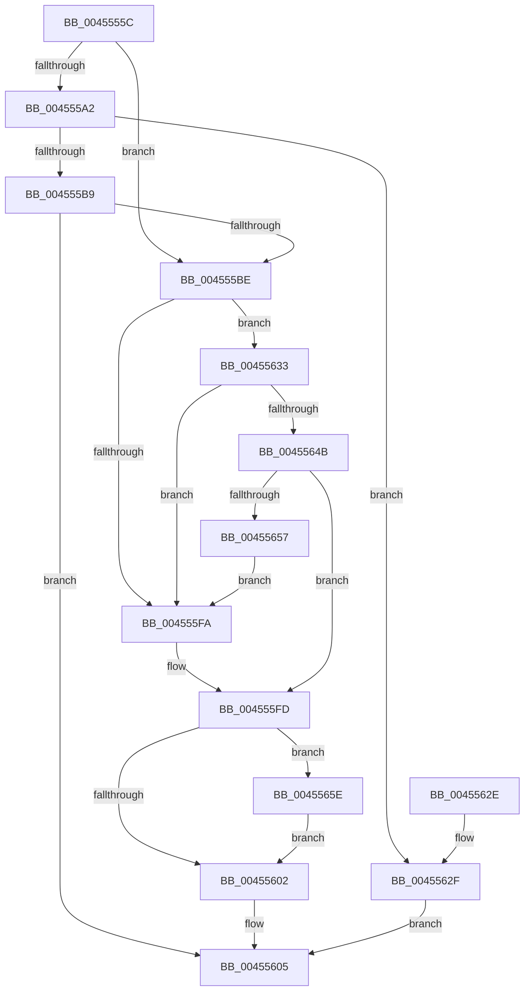

# LdrpGetRcConfig

- RVA: `0x0045555C`–`0x00455691` (길이 `309` bytes)
- VA: `0x000000014045555C`
- 실행 섹션: `.text`
- PDB 이름 있음: `예`; PDB Function 태그: `아니요`
- unwind 정보 RVA: `0x000A7AD0`
- 디코드: `84`개 명령, `309/309` bytes 표시
- 미해석 바이트: `0` (있으면 어셈블리에 `.byte`로 보존)

> 이 문서는 커널 이미지의 기계어와 PDB 기호를 분석해 생성했습니다. 4번과 5번은 함수 원형과 자료형을 바이너리 사용 방식에서 추정한 C 해석이며 원본 소스 복구 결과는 아닙니다.

## 1. Dependencies

- 직접 호출 지점: **5**; 고유 호출 대상: **5**
- 직접 호출자로 확인된 함수: **2**
- RIP 상대 이미지 참조: **2**

### Outgoing calls
- `0x004555AB` → [LdrpGetFromMUIMemCache](LdrpGetFromMUIMemCache_function_00455948.md) (function, `0x00455948`)
- `0x004555F1` → [LdrpSearchResourceSection_U](../../page/99/LdrpSearchResourceSection_U_function_0099B2DC.md) (function, `0x0099B2DC`)
- `0x0045560C` → [_security_check_cookie](../6A/_security_check_cookie_function_006AC640.md) (function, `0x006AC640`)
- `0x00455642` → [LdrpAccessResourceDataNoMultipleLanguage](../../page/99/LdrpAccessResourceDataNoMultipleLanguage_function_0099BF00.md) (function, `0x0099BF00`)
- `0x00455687` → [LdrpSetAlternateResourceModuleHandle](LdrpSetAlternateResourceModuleHandle_function_00455EBC.md) (function, `0x00455EBC`)

### Direct callers
- [LdrIsResItemExist](LdrIsResItemExist_function_004554DC.md) at `0x004554F9`
- [LdrpVerifyAlternateResourceModuleEx](../5E/LdrpVerifyAlternateResourceModuleEx_function_005E5F24.md) at `0x005E5FBE`
- [LdrpVerifyAlternateResourceModuleEx](../5E/LdrpVerifyAlternateResourceModuleEx_function_005E5F24.md) at `0x005E5FD4`

### Static image references
- `0x0045557A` → RVA `0x00E0A740` (`.data`; read)
- `0x004555BE` → RVA `0x006CC5E0` (` ?? ::FNODOBFM::`string'`; read)

## 2. Other-region calls and transfers

- 다른 실행 섹션으로 향하는 call: **2**
  - `0x004555F1` → [LdrpSearchResourceSection_U](../../page/99/LdrpSearchResourceSection_U_function_0099B2DC.md) (`.text` → `PAGE`)
  - `0x00455642` → [LdrpAccessResourceDataNoMultipleLanguage](../../page/99/LdrpAccessResourceDataNoMultipleLanguage_function_0099BF00.md) (`.text` → `PAGE`)
- 별도 외부 분기/꼬리 이동을 확인하지 못했습니다.

## 3. Assembly (complete function range)

```asm
0045555C  48 89 5C 24 10                  mov qword ptr [rsp + 0x10], rbx
00455561  48 89 74 24 18                  mov qword ptr [rsp + 0x18], rsi
00455566  48 89 7C 24 20                  mov qword ptr [rsp + 0x20], rdi
0045556B  55                              push rbp
0045556C  41 56                           push r14
0045556E  41 57                           push r15
00455570  48 8B EC                        mov rbp, rsp
00455573  48 81 EC 80 00 00 00            sub rsp, 0x80
0045557A  48 8B 05 BF 51 9B 00            mov rax, qword ptr [rip + 0x9b51bf]
00455581  48 33 C4                        xor rax, rsp
00455584  48 89 45 F0                     mov qword ptr [rbp - 0x10], rax
00455588  45 33 FF                        xor r15d, r15d
0045558B  48 83 CE FF                     or rsi, 0xffffffffffffffff
0045558F  4C 89 7D C8                     mov qword ptr [rbp - 0x38], r15
00455593  45 8A F0                        mov r14b, r8b
00455596  4C 89 7D C0                     mov qword ptr [rbp - 0x40], r15
0045559A  48 8B F9                        mov rdi, rcx
0045559D  45 84 C9                        test r9b, r9b
004555A0  74 1C                           je 0x1404555be
004555A2  33 D2                           xor edx, edx
004555A4  45 8D 4F 08                     lea r9d, [r15 + 8]
004555A8  45 33 C0                        xor r8d, r8d
004555AB  E8 98 03 00 00                  call 0x140455948
004555B0  48 89 45 C0                     mov qword ptr [rbp - 0x40], rax
004555B4  48 3B C6                        cmp rax, rsi
004555B7  74 76                           je 0x14045562f
004555B9  48 85 C0                        test rax, rax
004555BC  75 47                           jne 0x140455605
004555BE  48 8D 05 1B 70 27 00            lea rax, [rip + 0x27701b]
004555C5  48 C7 45 E0 01 00 00 00         mov qword ptr [rbp - 0x20], 1
004555CD  48 89 45 D8                     mov qword ptr [rbp - 0x28], rax
004555D1  48 8D 55 D8                     lea rdx, [rbp - 0x28]
004555D5  48 8D 45 C8                     lea rax, [rbp - 0x38]
004555D9  4C 89 7D E8                     mov qword ptr [rbp - 0x18], r15
004555DD  41 B9 30 00 00 02               mov r9d, 0x2000030
004555E3  48 89 44 24 20                  mov qword ptr [rsp + 0x20], rax
004555E8  41 B8 03 00 00 00               mov r8d, 3
004555EE  48 8B CF                        mov rcx, rdi
004555F1  E8 E6 5C 54 00                  call 0x14099b2dc
004555F6  85 C0                           test eax, eax
004555F8  79 39                           jns 0x140455633
004555FA  49 8B DF                        mov rbx, r15
004555FD  45 84 F6                        test r14b, r14b
00455600  75 5C                           jne 0x14045565e
00455602  48 8B C3                        mov rax, rbx
00455605  48 8B 4D F0                     mov rcx, qword ptr [rbp - 0x10]
00455609  48 33 CC                        xor rcx, rsp
0045560C  E8 2F 70 25 00                  call 0x1406ac640
00455611  4C 8D 9C 24 80 00 00 00         lea r11, [rsp + 0x80]
00455619  49 8B 5B 28                     mov rbx, qword ptr [r11 + 0x28]
0045561D  49 8B 73 30                     mov rsi, qword ptr [r11 + 0x30]
00455621  49 8B 7B 38                     mov rdi, qword ptr [r11 + 0x38]
00455625  49 8B E3                        mov rsp, r11
00455628  41 5F                           pop r15
0045562A  41 5E                           pop r14
0045562C  5D                              pop rbp
0045562D  C3                              ret
0045562E  CC                              int3
0045562F  33 C0                           xor eax, eax
00455631  EB D2                           jmp 0x140455605
00455633  48 8B 55 C8                     mov rdx, qword ptr [rbp - 0x38]
00455637  4C 8D 4D D0                     lea r9, [rbp - 0x30]
0045563B  4C 8D 45 C0                     lea r8, [rbp - 0x40]
0045563F  48 8B CF                        mov rcx, rdi
00455642  E8 B9 68 54 00                  call 0x14099bf00
00455647  85 C0                           test eax, eax
00455649  78 AF                           js 0x1404555fa
0045564B  48 8B 5D C0                     mov rbx, qword ptr [rbp - 0x40]
0045564F  81 3B CD FE CD FE               cmp dword ptr [rbx], 0xfecdfecd
00455655  74 A6                           je 0x1404555fd
00455657  B8 7B 00 00 C0                  mov eax, 0xc000007b
0045565C  EB 9C                           jmp 0x1404555fa
0045565E  4C 89 7C 24 38                  mov qword ptr [rsp + 0x38], r15
00455663  48 85 DB                        test rbx, rbx
00455666  89 44 24 30                     mov dword ptr [rsp + 0x30], eax
0045566A  48 8B CF                        mov rcx, rdi
0045566D  48 0F 45 F3                     cmovne rsi, rbx
00455671  C7 44 24 28 02 00 00 00         mov dword ptr [rsp + 0x28], 2
00455679  4C 8B CE                        mov r9, rsi
0045567C  66 44 89 7C 24 20               mov word ptr [rsp + 0x20], r15w
00455682  45 33 C0                        xor r8d, r8d
00455685  33 D2                           xor edx, edx
00455687  E8 30 08 00 00                  call 0x140455ebc
0045568C  E9 71 FF FF FF                  jmp 0x140455602
```

## 4. C-style interpretation (structured pseudocode)

```c
__int64 __fastcall LdrpGetRcConfig(__int64 a1, int a2, int a3, unsigned __int8 a4)
{
    __int64 result;
    __int64 v_r15;
    __int64 v_rsi;
    __int64 v_rsp;
    unsigned __int64 v_stack_m18;
    unsigned __int64 v_stack_m28;
    unsigned __int64 v_stack_m30;
    unsigned __int64 v_stack_m38;
    unsigned __int64 v_stack_m40;
    unsigned __int64 v_stack_m48;
    unsigned __int64 v_stack_m50;
    unsigned __int64 v_stack_m58;
    unsigned __int16 v_stack_m60;
    unsigned __int64 v_stack_m78;
    unsigned __int64 v_stack_p10;
    unsigned __int64 v_stack_p18;
    unsigned __int64 v_stack_p20;

    v_stack_p10 = v_rbx;
    v_stack_p18 = v_rsi;
    v_stack_p20 = v_rdi;
    v_rsp = (v_rsp) - (128);
    result = (*(unsigned __int64 *)(v_rip + 10179007)) ^ (v_rsp);
    v_stack_m28 = result;
    v_r15 = 0;
    v_rsi = (v_rsi) | (-1);
    v_stack_m50 = 0;
    v_stack_m58 = 0;
    if (a4 == 0) goto loc_004555BE;
    a2 = 0;
    a3 = 0;
    result = LdrpGetFromMUIMemCache(a1, a2, a3, v_r15 + 8);
    v_stack_m58 = result;
    if (result == v_rsi) goto loc_0045562F;
    if (result != 0) goto loc_00455605;
loc_004555BE:
    v_stack_m38 = 1;
    v_stack_m40 = v_rip + 2584603;
    v_stack_m30 = 0;
    v_stack_m78 = v_stack_m50;
    result = LdrpSearchResourceSection_U(a1, v_stack_m40, 3, (unsigned int)(0x2000030ULL));
    if (!sign_flag) goto loc_00455633;
loc_004555FA:
loc_004555FD:
    if ((unsigned __int8)((unsigned __int8)(a3)) != 0) goto loc_0045565E;
loc_00455602:
loc_00455605:
    a1 = (v_stack_m28) ^ (v_rsp);
    result = _security_check_cookie(a1, v_stack_m40, 3, (unsigned int)(0x2000030ULL));
    return result;
loc_0045562F:
    result = 0;
    goto loc_00455605;
loc_00455633:
    result = LdrpAccessResourceDataNoMultipleLanguage(*(unsigned __int64 *)(v_stack_m18 + 56), v_stack_m50, v_stack_m58, v_stack_m48);
    if (sign_flag) goto loc_004555FA;
    if ((*(unsigned int *)(v_stack_m58)) == 0xFECDFECDULL) goto loc_004555FD;
    goto loc_004555FA;
loc_0045565E:
    v_stack_m48 = 0;
    v_stack_m50 = (unsigned int)((unsigned int)(0xC000007BULL));
    v_rsi = *(unsigned __int64 *)(v_stack_m18 + 48);
    if (v_stack_m58 != 0) { v_rsi = v_stack_m58; }
    v_stack_m58 = 2;
    v_stack_m60 = 0;
    a3 = 0;
    a2 = 0;
    result = LdrpSetAlternateResourceModuleHandle(*(unsigned __int64 *)(v_stack_m18 + 56), a2, a3, v_rsi);
    goto loc_00455602;
}
```

## 5. (Beta) C Style

```c
int64_t LdrpGetRcConfig(int64_t Arg1, int32_t Arg2, int32_t Arg3, uint8_t Arg4)
{
    int64_t result;
    int64_t local_r15;
    int64_t local_rsi;
    int64_t local_rsp;
    uint64_t v_stack_m18;
    uint64_t v_stack_m28;
    uint64_t v_stack_m30;
    uint64_t v_stack_m38;
    uint64_t v_stack_m40;
    uint64_t v_stack_m48;
    uint64_t v_stack_m50;
    uint64_t v_stack_m58;
    uint16_t v_stack_m60;
    uint64_t v_stack_m78;
    uint64_t v_stack_p10;
    uint64_t v_stack_p18;
    uint64_t v_stack_p20;

    v_stack_p10 = local_rbx;
    v_stack_p18 = local_rsi;
    v_stack_p20 = local_rdi;
    local_rsp = (local_rsp) - (128);
    result = (*(uint64_t *)(v_rip + 0x9B51BF)) ^ (local_rsp);
    v_stack_m28 = result;
    local_r15 = 0;
    local_rsi = (local_rsi) | (-1);
    v_stack_m50 = 0;
    v_stack_m58 = 0;
    if (Arg4 == 0) goto loc_004555BE;
    Arg2 = 0;
    Arg3 = 0;
    result = LdrpGetFromMUIMemCache(Arg1, Arg2, Arg3, local_r15 + 8);
    v_stack_m58 = result;
    if (result == local_rsi) goto loc_0045562F;
    if (result != 0) goto loc_00455605;
loc_004555BE:
    v_stack_m38 = 1;
    v_stack_m40 = v_rip + 2584603;
    v_stack_m30 = 0;
    v_stack_m78 = v_stack_m50;
    result = LdrpSearchResourceSection_U(Arg1, v_stack_m40, 3, (uint32_t)(0x2000030ULL));
    if (!sign_flag) goto loc_00455633;
loc_004555FA:
loc_004555FD:
    if ((uint8_t)((uint8_t)(Arg3)) != 0) goto loc_0045565E;
loc_00455602:
loc_00455605:
    Arg1 = (v_stack_m28) ^ (local_rsp);
    result = _security_check_cookie(Arg1, v_stack_m40, 3, (uint32_t)(0x2000030ULL));
    return result;
loc_0045562F:
    result = 0;
    goto loc_00455605;
loc_00455633:
    result = LdrpAccessResourceDataNoMultipleLanguage(*(uint64_t *)(v_stack_m18 + 0x38), v_stack_m50, v_stack_m58, v_stack_m48);
    if (sign_flag) goto loc_004555FA;
    if ((*(uint32_t *)(v_stack_m58)) == 0xFECDFECDULL) goto loc_004555FD;
    goto loc_004555FA;
loc_0045565E:
    v_stack_m48 = 0;
    v_stack_m50 = (uint32_t)((uint32_t)(0xC000007BULL));
    local_rsi = *(uint64_t *)(v_stack_m18 + 0x30);
    if (v_stack_m58 != 0) { local_rsi = v_stack_m58; }
    v_stack_m58 = 2;
    v_stack_m60 = 0;
    Arg3 = 0;
    Arg2 = 0;
    result = LdrpSetAlternateResourceModuleHandle(*(uint64_t *)(v_stack_m18 + 0x38), Arg2, Arg3, local_rsi);
    goto loc_00455602;
}
```

## 6. Execution-region graph

[열기: 2D/3D 그래프와 함수 탐색 컨트롤 패널](../../../control-panel.html?section=text&rva=0x0045555C&view=graph)

- 2D 그래프는 위에서 아래로 흐르고, 3D 그래프는 빈 공간을 드래그해 회전합니다. Shift+드래그는 이동, 휠은 확대·축소, 함수 노드 선택은 대상 보고서 이동입니다.

### Static fallback


