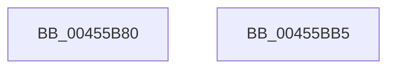

# LdrpInitMuiCrits

- RVA: `0x00455B80`–`0x00455BB6` (길이 `54` bytes)
- VA: `0x0000000140455B80`
- 실행 섹션: `.text`
- PDB 이름 있음: `예`; PDB Function 태그: `아니요`
- unwind 정보 RVA: `0x00085914`
- 디코드: `12`개 명령, `54/54` bytes 표시
- 미해석 바이트: `0` (있으면 어셈블리에 `.byte`로 보존)

> 이 문서는 커널 이미지의 기계어와 PDB 기호를 분석해 생성했습니다. 4번과 5번은 함수 원형과 자료형을 바이너리 사용 방식에서 추정한 C 해석이며 원본 소스 복구 결과는 아닙니다.

## 1. Dependencies

- 직접 호출 지점: **1**; 고유 호출 대상: **1**
- 직접 호출자로 확인된 함수: **4**
- RIP 상대 이미지 참조: **3**

### Outgoing calls
- `0x00455BAB` → [RtlRunOnceExecuteOnce](../../page/95/RtlRunOnceExecuteOnce_function_0095DC00.md) (function, `0x0095DC00`)

### Direct callers
- [LdrUnloadAlternateResourceModuleEx](LdrUnloadAlternateResourceModuleEx_function_00454AE4.md) at `0x00454B05`
- [LdrpGetAlternateResourceModuleHandleEx](LdrpGetAlternateResourceModuleHandleEx_function_00455334.md) at `0x0045535B`
- [LdrpGetFromMUIMemCache](LdrpGetFromMUIMemCache_function_00455948.md) at `0x00455A07`
- [LdrpSetAlternateResourceModuleHandle](LdrpSetAlternateResourceModuleHandle_function_00455EBC.md) at `0x00455F1D`

### Static image references
- `0x00455B89` → RVA `0x00F05C60` (`.data`; read)
- `0x00455B9D` → RVA `0x005E6030` (`NtdllRunOnceInitMuiCrits`; read)
- `0x00455BA4` → RVA `0x00E67B00` (`.data`; read)

## 2. Other-region calls and transfers

- 다른 실행 섹션으로 향하는 call: **1**
  - `0x00455BAB` → [RtlRunOnceExecuteOnce](../../page/95/RtlRunOnceExecuteOnce_function_0095DC00.md) (`.text` → `PAGE`)
- 별도 외부 분기/꼬리 이동을 확인하지 못했습니다.

## 3. Assembly (complete function range)

```asm
00455B80  48 89 54 24 10                  mov qword ptr [rsp + 0x10], rdx
00455B85  48 83 EC 28                     sub rsp, 0x28
00455B89  48 8D 05 D0 00 AB 00            lea rax, [rip + 0xab00d0]
00455B90  45 33 C9                        xor r9d, r9d
00455B93  4C 8D 44 24 38                  lea r8, [rsp + 0x38]
00455B98  48 89 44 24 38                  mov qword ptr [rsp + 0x38], rax
00455B9D  48 8D 15 8C 04 19 00            lea rdx, [rip + 0x19048c]
00455BA4  48 8D 0D 55 1F A1 00            lea rcx, [rip + 0xa11f55]
00455BAB  E8 50 80 50 00                  call 0x14095dc00
00455BB0  48 83 C4 28                     add rsp, 0x28
00455BB4  C3                              ret
00455BB5  CC                              int3
```

## 4. C-style interpretation (structured pseudocode)

```c
__int64 __fastcall LdrpInitMuiCrits(__int64 a1, __int64 a2, __int64 a3, int a4)
{
    __int64 result;
    __int64 v_rsp;
    unsigned __int64 v_stack_p10;

    v_stack_p10 = a2;
    v_rsp = (v_rsp) - (40);
    a4 = 0;
    v_stack_p10 = v_rip + 11206864;
    result = RtlRunOnceExecuteOnce(v_rip + 10559317, v_rip + 1639564, v_stack_p10, a4);
    v_rsp = (v_rsp) + (40);
    return result;
}
```

## 5. (Beta) C Style

```c
int64_t LdrpInitMuiCrits(int64_t Arg1, int64_t Arg2, int64_t Arg3, int32_t Arg4)
{
    int64_t result;
    int64_t local_rsp;
    uint64_t v_stack_p10;

    v_stack_p10 = Arg2;
    local_rsp = (local_rsp) - (40);
    Arg4 = 0;
    v_stack_p10 = v_rip + 11206864;
    result = RtlRunOnceExecuteOnce(v_rip + 10559317, v_rip + 1639564, v_stack_p10, Arg4);
    local_rsp = (local_rsp) + (40);
    return result;
}
```

## 6. Execution-region graph

[열기: 2D/3D 그래프와 함수 탐색 컨트롤 패널](../../../control-panel.html?section=text&rva=0x00455B80&view=graph)

- 2D 그래프는 위에서 아래로 흐르고, 3D 그래프는 빈 공간을 드래그해 회전합니다. Shift+드래그는 이동, 휠은 확대·축소, 함수 노드 선택은 대상 보고서 이동입니다.

### Static fallback


