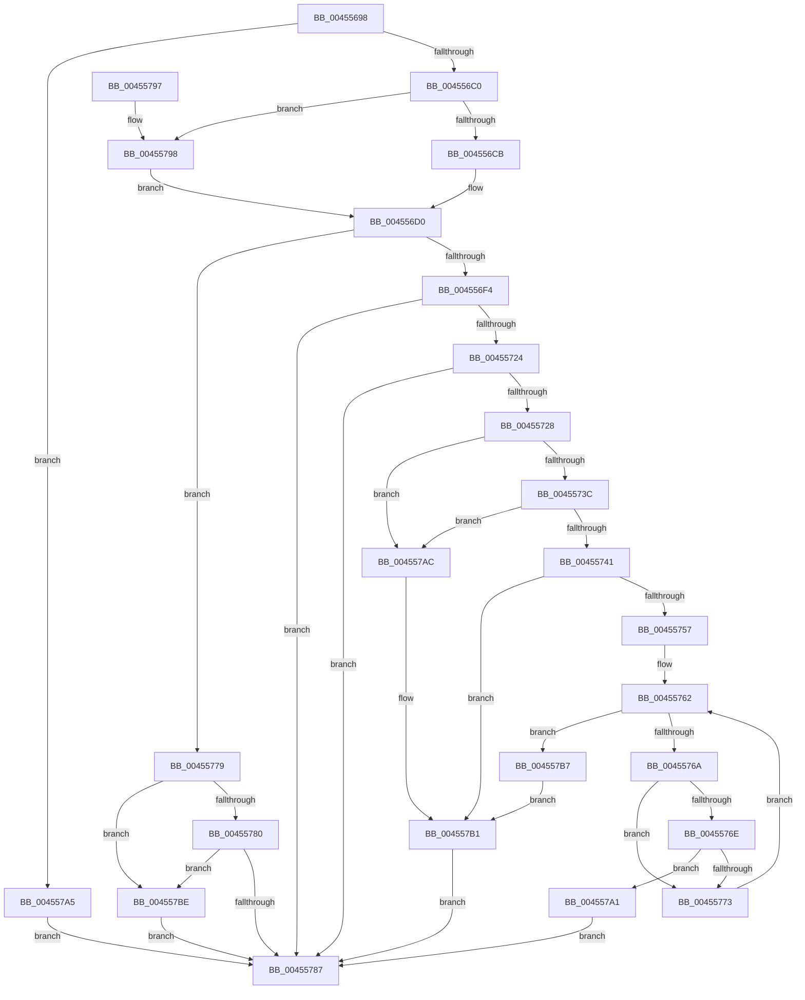

# LdrpLoadResourceFromAlternativeModule

- RVA: `0x00455698`–`0x004557C5` (길이 `301` bytes)
- VA: `0x0000000140455698`
- 실행 섹션: `.text`
- PDB 이름 있음: `예`; PDB Function 태그: `아니요`
- unwind 정보 RVA: `0x000A7AF4`
- 디코드: `83`개 명령, `301/301` bytes 표시
- 미해석 바이트: `0` (있으면 어셈블리에 `.byte`로 보존)

> 이 문서는 커널 이미지의 기계어와 PDB 기호를 분석해 생성했습니다. 4번과 5번은 함수 원형과 자료형을 바이너리 사용 방식에서 추정한 C 해석이며 원본 소스 복구 결과는 아닙니다.

## 1. Dependencies

- 직접 호출 지점: **3**; 고유 호출 대상: **3**
- 직접 호출자로 확인된 함수: **1**
- RIP 상대 이미지 참조: **0**

### Outgoing calls
- `0x004556E7` → [LdrLoadAlternateResourceModuleEx](LdrLoadAlternateResourceModuleEx_function_004557CC.md) (function, `0x004557CC`)
- `0x00455719` → [LdrpSearchResourceSection_U](../../page/99/LdrpSearchResourceSection_U_function_0099B2DC.md) (function, `0x0099B2DC`)
- `0x0045574E` → [LdrpAccessResourceDataNoMultipleLanguage](../../page/99/LdrpAccessResourceDataNoMultipleLanguage_function_0099BF00.md) (function, `0x0099BF00`)

### Direct callers
- [LdrpSearchResourceSection_U](../../page/99/LdrpSearchResourceSection_U_function_0099B2DC.md) at `0x0099B60E`
- [LdrpSearchResourceSection_U](../../page/99/LdrpSearchResourceSection_U_function_0099B2DC.md) at `0x0099B6BB`
- [LdrpSearchResourceSection_U](../../page/99/LdrpSearchResourceSection_U_function_0099B2DC.md) at `0x0099B80A`
- [LdrpSearchResourceSection_U](../../page/99/LdrpSearchResourceSection_U_function_0099B2DC.md) at `0x0099B8BA`
- [LdrpSearchResourceSection_U](../../page/99/LdrpSearchResourceSection_U_function_0099B2DC.md) at `0x0099BA20`
- [LdrpSearchResourceSection_U](../../page/99/LdrpSearchResourceSection_U_function_0099B2DC.md) at `0x0099BCF4`
- [LdrpSearchResourceSection_U](../../page/99/LdrpSearchResourceSection_U_function_0099B2DC.md) at `0x0099BD67`

### Static image references
- 디코드된 RIP-relative 메모리 참조가 없습니다.

## 2. Other-region calls and transfers

- 다른 실행 섹션으로 향하는 call: **2**
  - `0x00455719` → [LdrpSearchResourceSection_U](../../page/99/LdrpSearchResourceSection_U_function_0099B2DC.md) (`.text` → `PAGE`)
  - `0x0045574E` → [LdrpAccessResourceDataNoMultipleLanguage](../../page/99/LdrpAccessResourceDataNoMultipleLanguage_function_0099BF00.md) (`.text` → `PAGE`)
- 별도 외부 분기/꼬리 이동을 확인하지 못했습니다.

## 3. Assembly (complete function range)

```asm
00455698  48 89 5C 24 08                  mov qword ptr [rsp + 8], rbx
0045569D  48 89 74 24 10                  mov qword ptr [rsp + 0x10], rsi
004556A2  57                              push rdi
004556A3  48 83 EC 40                     sub rsp, 0x40
004556A7  48 83 64 24 30 00               and qword ptr [rsp + 0x30], 0
004556AD  41 8D 40 FD                     lea eax, [r8 - 3]
004556B1  41 8B F1                        mov esi, r9d
004556B4  48 8B DA                        mov rbx, rdx
004556B7  83 F8 01                        cmp eax, 1
004556BA  0F 87 E5 00 00 00               ja 0x1404557a5
004556C0  41 0F BA E1 18                  bt r9d, 0x18
004556C5  0F 83 CD 00 00 00               jae 0x140455798
004556CB  BF EE F2 00 00                  mov edi, 0xf2ee
004556D0  48 83 64 24 38 00               and qword ptr [rsp + 0x38], 0
004556D6  4C 8D 4C 24 38                  lea r9, [rsp + 0x38]
004556DB  4C 8D 44 24 30                  lea r8, [rsp + 0x30]
004556E0  89 74 24 20                     mov dword ptr [rsp + 0x20], esi
004556E4  0F B7 D7                        movzx edx, di
004556E7  E8 E0 00 00 00                  call 0x1404557cc
004556EC  85 C0                           test eax, eax
004556EE  0F 88 85 00 00 00               js 0x140455779
004556F4  48 8B 4C 24 30                  mov rcx, qword ptr [rsp + 0x30]
004556F9  41 B9 30 00 00 02               mov r9d, 0x2000030
004556FF  0F B7 C7                        movzx eax, di
00455702  41 B8 03 00 00 00               mov r8d, 3
00455708  48 8B 7C 24 70                  mov rdi, qword ptr [rsp + 0x70]
0045570D  48 8B D3                        mov rdx, rbx
00455710  48 89 7C 24 20                  mov qword ptr [rsp + 0x20], rdi
00455715  48 89 43 10                     mov qword ptr [rbx + 0x10], rax
00455719  E8 BE 5B 54 00                  call 0x14099b2dc
0045571E  40 F6 C6 40                     test sil, 0x40
00455722  74 63                           je 0x140455787
00455724  85 C0                           test eax, eax
00455726  78 5F                           js 0x140455787
00455728  48 83 64 24 38 00               and qword ptr [rsp + 0x38], 0
0045572E  48 83 7C 24 30 00               cmp qword ptr [rsp + 0x30], 0
00455734  8B 5B 18                        mov ebx, dword ptr [rbx + 0x18]
00455737  48 8B 17                        mov rdx, qword ptr [rdi]
0045573A  74 70                           je 0x1404557ac
0045573C  48 85 D2                        test rdx, rdx
0045573F  74 6B                           je 0x1404557ac
00455741  48 8B 4C 24 30                  mov rcx, qword ptr [rsp + 0x30]
00455746  4C 8D 44 24 38                  lea r8, [rsp + 0x38]
0045574B  45 33 C9                        xor r9d, r9d
0045574E  E8 AD 67 54 00                  call 0x14099bf00
00455753  85 C0                           test eax, eax
00455755  78 5A                           js 0x1404557b1
00455757  48 8B 44 24 38                  mov rax, qword ptr [rsp + 0x38]
0045575C  8B 10                           mov edx, dword ptr [rax]
0045575E  48 8D 48 04                     lea rcx, [rax + 4]
00455762  8B C2                           mov eax, edx
00455764  FF CA                           dec edx
00455766  85 C0                           test eax, eax
00455768  74 4D                           je 0x1404557b7
0045576A  3B 19                           cmp ebx, dword ptr [rcx]
0045576C  72 05                           jb 0x140455773
0045576E  3B 59 04                        cmp ebx, dword ptr [rcx + 4]
00455771  76 2E                           jbe 0x1404557a1
00455773  48 83 C1 0C                     add rcx, 0xc
00455777  EB E9                           jmp 0x140455762
00455779  3D 34 00 00 C0                  cmp eax, 0xc0000034
0045577E  74 3E                           je 0x1404557be
00455780  3D 3A 00 00 C0                  cmp eax, 0xc000003a
00455785  74 37                           je 0x1404557be
00455787  48 8B 5C 24 50                  mov rbx, qword ptr [rsp + 0x50]
0045578C  48 8B 74 24 58                  mov rsi, qword ptr [rsp + 0x58]
00455791  48 83 C4 40                     add rsp, 0x40
00455795  5F                              pop rdi
00455796  C3                              ret
00455797  CC                              int3
00455798  0F B7 7A 10                     movzx edi, word ptr [rdx + 0x10]
0045579C  E9 2F FF FF FF                  jmp 0x1404556d0
004557A1  33 C0                           xor eax, eax
004557A3  EB E2                           jmp 0x140455787
004557A5  B8 F1 00 00 C0                  mov eax, 0xc00000f1
004557AA  EB DB                           jmp 0x140455787
004557AC  B8 0D 00 00 C0                  mov eax, 0xc000000d
004557B1  48 83 27 00                     and qword ptr [rdi], 0
004557B5  EB D0                           jmp 0x140455787
004557B7  B8 09 01 00 C0                  mov eax, 0xc0000109
004557BC  EB F3                           jmp 0x1404557b1
004557BE  B8 01 00 0B C0                  mov eax, 0xc00b0001
004557C3  EB C2                           jmp 0x140455787
```

## 4. C-style interpretation (structured pseudocode)

```c
__int64 __fastcall LdrpLoadResourceFromAlternativeModule(__int64 a1, __int64 a2, __int64 a3, int a4, __int64 a5)
{
    __int64 result;
    __int64 v_rsp;
    unsigned __int64 v_stack_m10;
    unsigned __int64 v_stack_m18;
    unsigned int v_stack_m28;
    unsigned __int64 v_stack_p10;
    unsigned __int64 v_stack_p8;

    v_stack_p8 = v_rbx;
    v_stack_p10 = v_rsi;
    v_rsp = (v_rsp) - (64);
    if (((unsigned int)(a3 - 3)) > 1) goto loc_004557A5;
    if (((unsigned int)(a3 - 3)) >= 1) goto loc_00455798;
loc_004556D0:
    v_stack_m28 = (unsigned int)((unsigned int)(a4));
    result = LdrLoadAlternateResourceModuleEx(a1, (unsigned __int16)((unsigned int)(0xF2EEULL)), v_stack_m18, v_stack_m10);
    if (sign_flag) goto loc_00455779;
    v_stack_m28 = a5;
    *(unsigned __int64 *)(a2 + 16) = (unsigned __int16)((unsigned int)(0xF2EEULL));
    result = LdrpSearchResourceSection_U(v_stack_m18, a2, 3, (unsigned int)(0x2000030ULL));
    if ((((unsigned __int8)((unsigned int)(a4))) & (64)) == 0) goto loc_00455787;
    if (sign_flag) goto loc_00455787;
    if (v_stack_m18 == 0) goto loc_004557AC;
    if (*(unsigned __int64 *)(a5) == 0) goto loc_004557AC;
    a4 = 0;
    result = LdrpAccessResourceDataNoMultipleLanguage(v_stack_m18, *(unsigned __int64 *)(a5), v_stack_m10, a4);
    if (sign_flag) goto loc_004557B1;
loc_00455762:
    a2 = (unsigned int)(((unsigned int)(*(unsigned int *)(v_stack_m10))) - 1);
    if ((unsigned int)((unsigned int)((unsigned int)((unsigned int)(*(unsigned int *)(v_stack_m10))))) == 0) goto loc_004557B7;
    if (((unsigned int)((unsigned int)(*(unsigned int *)(a2 + 24)))) < (*(unsigned int *)(v_stack_m10 + 4))) goto loc_00455773;
    if (((unsigned int)((unsigned int)(*(unsigned int *)(a2 + 24)))) <= (*(unsigned int *)(v_stack_m10 + 4 + 4))) goto loc_004557A1;
loc_00455773:
    a1 = (v_stack_m10 + 4) + (12);
    goto loc_00455762;
loc_00455779:
    if (((unsigned int)((unsigned int)((unsigned int)((unsigned int)(*(unsigned int *)(v_stack_m10)))))) == 0xC0000034ULL) goto loc_004557BE;
    if (((unsigned int)((unsigned int)((unsigned int)((unsigned int)(*(unsigned int *)(v_stack_m10)))))) == 0xC000003AULL) goto loc_004557BE;
loc_00455787:
    v_rsp = (v_rsp) + (64);
    return (unsigned int)((unsigned int)((unsigned int)(*(unsigned int *)(v_stack_m10))));
loc_00455798:
    goto loc_004556D0;
loc_004557A1:
    result = 0;
    goto loc_00455787;
loc_004557A5:
    goto loc_00455787;
loc_004557AC:
loc_004557B1:
    goto loc_00455787;
loc_004557B7:
    goto loc_004557B1;
loc_004557BE:
    goto loc_00455787;
}
```

## 5. (Beta) C Style

```c
int64_t LdrpLoadResourceFromAlternativeModule(int64_t Arg1, void *Arg2, void *Arg3, int32_t Arg4, void *Arg5)
{
    uint8_t *arg2 = (uint8_t *)Arg2;
    uint8_t *arg3 = (uint8_t *)Arg3;
    uint8_t *arg5 = (uint8_t *)Arg5;

    int64_t result;
    int64_t local_rsp;
    uint64_t v_stack_m10;
    uint64_t v_stack_m18;
    uint32_t v_stack_m28;
    uint64_t v_stack_p10;
    uint64_t v_stack_p8;

    v_stack_p8 = local_rbx;
    v_stack_p10 = local_rsi;
    local_rsp = (local_rsp) - (64);
    if (((uint32_t)(Arg3 - 3)) > 1) goto loc_004557A5;
    if (((uint32_t)(Arg3 - 3)) >= 1) goto loc_00455798;
loc_004556D0:
    v_stack_m28 = (uint32_t)((uint32_t)(Arg4));
    result = LdrLoadAlternateResourceModuleEx(Arg1, (uint16_t)((uint32_t)(0xF2EEULL)), v_stack_m18, v_stack_m10);
    if (sign_flag) goto loc_00455779;
    v_stack_m28 = Arg5;
    *(uint64_t *)(arg2 + 0x10) = (uint16_t)((uint32_t)(0xF2EEULL));
    result = LdrpSearchResourceSection_U(v_stack_m18, Arg2, 3, (uint32_t)(0x2000030ULL));
    if ((((uint8_t)((uint32_t)(Arg4))) & (64)) == 0) goto loc_00455787;
    if (sign_flag) goto loc_00455787;
    if (v_stack_m18 == 0) goto loc_004557AC;
    if (*(uint64_t *)(arg5) == 0) goto loc_004557AC;
    Arg4 = 0;
    result = LdrpAccessResourceDataNoMultipleLanguage(v_stack_m18, *(uint64_t *)(arg5), v_stack_m10, Arg4);
    if (sign_flag) goto loc_004557B1;
loc_00455762:
    Arg2 = (uint32_t)(((uint32_t)(*(uint32_t *)(v_stack_m10))) - 1);
    if ((uint32_t)((uint32_t)((uint32_t)((uint32_t)(*(uint32_t *)(v_stack_m10))))) == 0) goto loc_004557B7;
    if (((uint32_t)((uint32_t)(*(uint32_t *)(arg2 + 0x18)))) < (*(uint32_t *)(v_stack_m10 + 0x4))) goto loc_00455773;
    if (((uint32_t)((uint32_t)(*(uint32_t *)(arg2 + 0x18)))) <= (*(uint32_t *)(v_stack_m10 + 0x4 + 0x4))) goto loc_004557A1;
loc_00455773:
    Arg1 = (v_stack_m10 + 4) + (12);
    goto loc_00455762;
loc_00455779:
    if (((uint32_t)((uint32_t)((uint32_t)((uint32_t)(*(uint32_t *)(v_stack_m10)))))) == 0xC0000034ULL) goto loc_004557BE;
    if (((uint32_t)((uint32_t)((uint32_t)((uint32_t)(*(uint32_t *)(v_stack_m10)))))) == 0xC000003AULL) goto loc_004557BE;
loc_00455787:
    local_rsp = (local_rsp) + (64);
    return (uint32_t)((uint32_t)((uint32_t)(*(uint32_t *)(v_stack_m10))));
loc_00455798:
    goto loc_004556D0;
loc_004557A1:
    result = 0;
    goto loc_00455787;
loc_004557A5:
    goto loc_00455787;
loc_004557AC:
loc_004557B1:
    goto loc_00455787;
loc_004557B7:
    goto loc_004557B1;
loc_004557BE:
    goto loc_00455787;
}
```

### 관측된 메모리 오프셋

구조체 형식이 확인되지 않은 접근은 인자 기준의 오프셋으로만 기록했습니다.

| 기준 인자 | 오프셋 표현 | 폭 (bit) | 접근 |
|---|---:|---:|---|
| `Arg2` | `+ 0x10` | `16` | `R` |
| `Arg2` | `+ 0x10` | `64` | `W` |
| `Arg2` | `+ 0x18` | `32` | `R` |
| `Arg3` | `- 0x3` | `32` | `R` |
| `Arg5` | `+ 0x0` | `64` | `R` |
| `Arg5` | `+ 0x0` | `64` | `R/W` |

## 6. Execution-region graph

[열기: 2D/3D 그래프와 함수 탐색 컨트롤 패널](../../../control-panel.html?section=text&rva=0x00455698&view=graph)

- 2D 그래프는 위에서 아래로 흐르고, 3D 그래프는 빈 공간을 드래그해 회전합니다. Shift+드래그는 이동, 휠은 확대·축소, 함수 노드 선택은 대상 보고서 이동입니다.

### Static fallback


