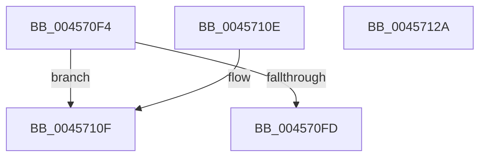

# MiAppendPageChain

- RVA: `0x004570F4`–`0x0045712B` (길이 `55` bytes)
- VA: `0x00000001404570F4`
- 실행 섹션: `.text`
- PDB 이름 있음: `예`; PDB Function 태그: `아니요`
- unwind 정보 RVA: `0x000DB714`
- 디코드: `18`개 명령, `55/55` bytes 표시
- 미해석 바이트: `0` (있으면 어셈블리에 `.byte`로 보존)

> 이 문서는 커널 이미지의 기계어와 PDB 기호를 분석해 생성했습니다. 4번과 5번은 함수 원형과 자료형을 바이너리 사용 방식에서 추정한 C 해석이며 원본 소스 복구 결과는 아닙니다.

## 1. Dependencies

- 직접 호출 지점: **0**; 고유 호출 대상: **0**
- 직접 호출자로 확인된 함수: **2**
- RIP 상대 이미지 참조: **0**

### Outgoing calls
- 직접 디코드된 call 명령이 없습니다.

### Direct callers
- [MiReserveEnclavePages](../3B/MiReserveEnclavePages_function_003BD430.md) at `0x003BD4A7`
- [MiPfPrepareSequentialReadList](../../page/93/MiPfPrepareSequentialReadList_function_0093D8E8.md) at `0x0093DA89`

### Static image references
- 디코드된 RIP-relative 메모리 참조가 없습니다.

## 2. Other-region calls and transfers

- 다른 실행 섹션으로 향하는 call: **0**
- 별도 외부 분기/꼬리 이동을 확인하지 못했습니다.

## 3. Assembly (complete function range)

```asm
004570F4  48 83 39 00                     cmp qword ptr [rcx], 0
004570F8  4C 8B C1                        mov r8, rcx
004570FB  75 12                           jne 0x14045710f
004570FD  0F 10 02                        movups xmm0, xmmword ptr [rdx]
00457100  0F 11 01                        movups xmmword ptr [rcx], xmm0
00457103  F2 0F 10 4A 10                  movsd xmm1, qword ptr [rdx + 0x10]
00457108  F2 0F 11 49 10                  movsd qword ptr [rcx + 0x10], xmm1
0045710D  C3                              ret
0045710E  CC                              int3
0045710F  49 8B 40 08                     mov rax, qword ptr [r8 + 8]
00457113  48 8B 0A                        mov rcx, qword ptr [rdx]
00457116  48 89 08                        mov qword ptr [rax], rcx
00457119  48 8B 42 08                     mov rax, qword ptr [rdx + 8]
0045711D  49 89 40 08                     mov qword ptr [r8 + 8], rax
00457121  48 8B 42 10                     mov rax, qword ptr [rdx + 0x10]
00457125  49 01 40 10                     add qword ptr [r8 + 0x10], rax
00457129  C3                              ret
0045712A  CC                              int3
```

## 4. C-style interpretation (structured pseudocode)

```c
__int64 __fastcall MiAppendPageChain(__int64 a1, __int64 a2)
{
    if ((*(unsigned __int64 *)(a1)) != 0) goto loc_0045710F;
    *(unsigned __int64 *)(a1) = v_xmm0;
    *(unsigned __int64 *)(a1 + 16) = v_xmm1;
    return result;
loc_0045710F:
    *(unsigned __int64 *)(*(unsigned __int64 *)(a1 + 8)) = *(unsigned __int64 *)(a2);
    *(unsigned __int64 *)(a1 + 8) = *(unsigned __int64 *)(a2 + 8);
    return *(unsigned __int64 *)(a2 + 16);
}
```

## 5. (Beta) C Style

```c
int64_t MiAppendPageChain(void *Arg1, void *Arg2)
{
    uint8_t *arg1 = (uint8_t *)Arg1;
    uint8_t *arg2 = (uint8_t *)Arg2;

    if ((*(uint64_t *)(arg1)) != 0) goto loc_0045710F;
    *(uint64_t *)(arg1) = v_xmm0;
    *(uint64_t *)(arg1 + 0x10) = v_xmm1;
    return result;
loc_0045710F:
    *(uint64_t *)(*(uint64_t *)(arg1 + 0x8)) = *(uint64_t *)(arg2);
    *(uint64_t *)(arg1 + 0x8) = *(uint64_t *)(arg2 + 0x8);
    return *(uint64_t *)(arg2 + 0x10);
}
```

### 관측된 메모리 오프셋

구조체 형식이 확인되지 않은 접근은 인자 기준의 오프셋으로만 기록했습니다.

| 기준 인자 | 오프셋 표현 | 폭 (bit) | 접근 |
|---|---:|---:|---|
| `Arg1` | `+ 0x0` | `64` | `R` |
| `Arg1` | `+ 0x0` | `128` | `R` |
| `Arg1` | `+ 0x8` | `64` | `R` |
| `Arg1` | `+ 0x8` | `64` | `W` |
| `Arg1` | `+ 0x10` | `64` | `R/W` |
| `Arg1` | `+ 0x10` | `64` | `W` |
| `Arg2` | `+ 0x0` | `64` | `R` |
| `Arg2` | `+ 0x0` | `128` | `R` |
| `Arg2` | `+ 0x8` | `64` | `R` |
| `Arg2` | `+ 0x10` | `64` | `R` |

## 6. Execution-region graph

[열기: 2D/3D 그래프와 함수 탐색 컨트롤 패널](../../../control-panel.html?section=text&rva=0x004570F4&view=graph)

- 2D 그래프는 위에서 아래로 흐르고, 3D 그래프는 빈 공간을 드래그해 회전합니다. Shift+드래그는 이동, 휠은 확대·축소, 함수 노드 선택은 대상 보고서 이동입니다.

### Static fallback


