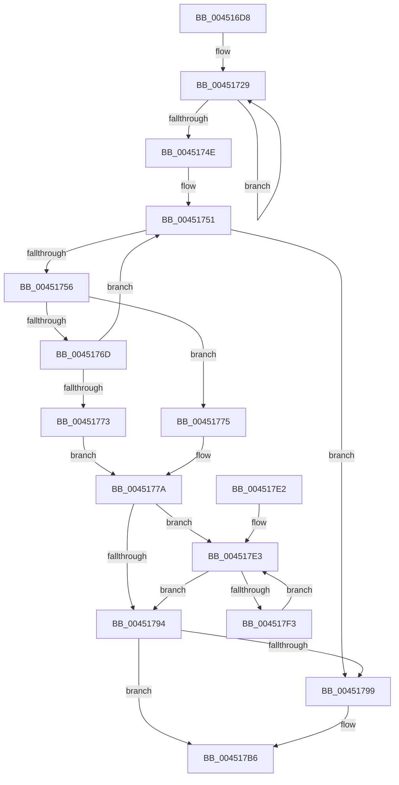

# MiBitmapRangeZeroEx

- RVA: `0x004516D8`–`0x004517F5` (길이 `285` bytes)
- VA: `0x00000001404516D8`
- 실행 섹션: `.text`
- PDB 이름 있음: `예`; PDB Function 태그: `아니요`
- unwind 정보 RVA: `0x000A74A8`
- 디코드: `85`개 명령, `285/285` bytes 표시
- 미해석 바이트: `0` (있으면 어셈블리에 `.byte`로 보존)

> 이 문서는 커널 이미지의 기계어와 PDB 기호를 분석해 생성했습니다. 4번과 5번은 함수 원형과 자료형을 바이너리 사용 방식에서 추정한 C 해석이며 원본 소스 복구 결과는 아닙니다.

## 1. Dependencies

- 직접 호출 지점: **1**; 고유 호출 대상: **1**
- 직접 호출자로 확인된 함수: **1**
- RIP 상대 이미지 참조: **0**

### Outgoing calls
- `0x00451763` → [MI_READ_PTE_LOCK_FREE](../28/MI_READ_PTE_LOCK_FREE_function_002828A0.md) (function, `0x002828A0`)

### Direct callers
- [sub_009E5A2C](../../page/9E/Unknown_function_009E5A2C.md) at `0x009E5B72`

### Static image references
- 디코드된 RIP-relative 메모리 참조가 없습니다.

## 2. Other-region calls and transfers

- 다른 실행 섹션으로 향하는 call: **0**
- 별도 외부 분기/꼬리 이동을 확인하지 못했습니다.

## 3. Assembly (complete function range)

```asm
004516D8  48 8B C4                        mov rax, rsp
004516DB  48 89 58 08                     mov qword ptr [rax + 8], rbx
004516DF  48 89 68 10                     mov qword ptr [rax + 0x10], rbp
004516E3  48 89 70 18                     mov qword ptr [rax + 0x18], rsi
004516E7  48 89 78 20                     mov qword ptr [rax + 0x20], rdi
004516EB  41 54                           push r12
004516ED  41 56                           push r14
004516EF  41 57                           push r15
004516F1  48 83 EC 40                     sub rsp, 0x40
004516F5  33 ED                           xor ebp, ebp
004516F7  49 BC 00 00 00 00 80 F6 FF FF   movabs r12, 0xfffff68000000000
00451701  4C 8B F1                        mov r14, rcx
00451704  0F 57 C0                        xorps xmm0, xmm0
00451707  0F 11 40 C8                     movups xmmword ptr [rax - 0x38], xmm0
0045170B  4D 8B F8                        mov r15, r8
0045170E  0F 11 40 D8                     movups xmmword ptr [rax - 0x28], xmm0
00451712  48 8B C2                        mov rax, rdx
00451715  8D 4D 08                        lea ecx, [rbp + 8]
00451718  48 99                           cqo
0045171A  8D 5D 03                        lea ebx, [rbp + 3]
0045171D  48 F7 F9                        idiv rcx
00451720  48 8B C8                        mov rcx, rax
00451723  49 03 4E 08                     add rcx, qword ptr [r14 + 8]
00451727  33 D2                           xor edx, edx
00451729  48 C1 E9 09                     shr rcx, 9
0045172D  48 B8 F8 FF FF FF 7F 00 00 00   movabs rax, 0x7ffffffff8
00451737  48 23 C8                        and rcx, rax
0045173A  49 8B C4                        mov rax, r12
0045173D  48 03 C8                        add rcx, rax
00451740  48 89 4C D4 20                  mov qword ptr [rsp + rdx*8 + 0x20], rcx
00451745  48 FF C2                        inc rdx
00451748  48 83 FA 04                     cmp rdx, 4
0045174C  7C DB                           jl 0x140451729
0045174E  48 8B FB                        mov rdi, rbx
00451751  48 85 FF                        test rdi, rdi
00451754  74 43                           je 0x140451799
00451756  48 8B 74 FC 18                  mov rsi, qword ptr [rsp + rdi*8 + 0x18]
0045175B  48 FF CF                        dec rdi
0045175E  48 8B CE                        mov rcx, rsi
00451761  FF CB                           dec ebx
00451763  E8 38 11 E3 FF                  call 0x1402828a0
00451768  48 85 C0                        test rax, rax
0045176B  74 08                           je 0x140451775
0045176D  24 81                           and al, 0x81
0045176F  3C 81                           cmp al, 0x81
00451771  75 DE                           jne 0x140451751
00451773  EB 05                           jmp 0x14045177a
00451775  BD 01 00 00 00                  mov ebp, 1
0045177A  49 8B CC                        mov rcx, r12
0045177D  48 C1 E1 19                     shl rcx, 0x19
00451781  48 8D 46 08                     lea rax, [rsi + 8]
00451785  48 C1 E0 19                     shl rax, 0x19
00451789  48 2B C1                        sub rax, rcx
0045178C  48 C1 F8 10                     sar rax, 0x10
00451790  85 DB                           test ebx, ebx
00451792  75 4F                           jne 0x1404517e3
00451794  48 85 C0                        test rax, rax
00451797  75 1D                           jne 0x1404517b6
00451799  48 8B 44 24 20                  mov rax, qword ptr [rsp + 0x20]
0045179E  48 C1 E0 19                     shl rax, 0x19
004517A2  49 8B CC                        mov rcx, r12
004517A5  48 C1 E1 19                     shl rcx, 0x19
004517A9  48 2B C1                        sub rax, rcx
004517AC  48 05 00 00 00 10               add rax, 0x10000000
004517B2  48 C1 F8 10                     sar rax, 0x10
004517B6  49 2B 46 08                     sub rax, qword ptr [r14 + 8]
004517BA  48 8B 5C 24 60                  mov rbx, qword ptr [rsp + 0x60]
004517BF  48 8B 74 24 70                  mov rsi, qword ptr [rsp + 0x70]
004517C4  48 8B 7C 24 78                  mov rdi, qword ptr [rsp + 0x78]
004517C9  48 C1 E0 03                     shl rax, 3
004517CD  49 89 07                        mov qword ptr [r15], rax
004517D0  8B C5                           mov eax, ebp
004517D2  48 8B 6C 24 68                  mov rbp, qword ptr [rsp + 0x68]
004517D7  48 83 C4 40                     add rsp, 0x40
004517DB  41 5F                           pop r15
004517DD  41 5E                           pop r14
004517DF  41 5C                           pop r12
004517E1  C3                              ret
004517E2  CC                              int3
004517E3  48 C1 E0 19                     shl rax, 0x19
004517E7  48 2B C1                        sub rax, rcx
004517EA  48 C1 F8 10                     sar rax, 0x10
004517EE  83 EB 01                        sub ebx, 1
004517F1  74 A1                           je 0x140451794
004517F3  EB EE                           jmp 0x1404517e3
```

## 4. C-style interpretation (structured pseudocode)

```c
__int64 __fastcall MiBitmapRangeZeroEx(__int64 a1, __int64 a2, __int64 a3)
{
    __int64 result;
    __int64 v_rbp;
    __int64 v_rbx;
    __int64 v_rdi;
    __int64 v_rsp;
    unsigned __int64 v_stack_m38;
    unsigned __int64 v_stack_p10;
    unsigned __int64 v_stack_p18;
    unsigned __int64 v_stack_p20;
    unsigned __int64 v_stack_p8;

    *(unsigned __int64 *)(v_rsp + 8) = v_rbx;
    *(unsigned __int64 *)(v_rsp + 16) = v_rbp;
    *(unsigned __int64 *)(v_rsp + 24) = v_rsi;
    *(unsigned __int64 *)(v_rsp + 32) = v_rdi;
    v_rsp = (v_rsp) - (64);
    v_rbp = 0;
    *(unsigned __int64 *)(v_rsp - 56) = v_xmm0;
    *(unsigned __int64 *)(v_rsp - 40) = v_xmm0;
    a1 = (a2) + (*(unsigned __int64 *)(a1 + 8));
    a2 = 0;
loc_00451729:
    a1 = (a1) >> (9);
    a1 = (a1) & (0);
    a1 = (a1) + (v_r12);
    *(unsigned __int64 *)(v_rsp + a2 * 8 + 32) = a1;
    a2 = (a2) + 1;
    if (a2 < 4) goto loc_00451729;
loc_00451751:
    if (v_rbp + 3 == 0) goto loc_00451799;
    v_rdi = (v_rbp + 3) - 1;
    v_rbx = (unsigned int)((v_rbp + 3) - 1);
    result = MI_READ_PTE_LOCK_FREE(*(unsigned __int64 *)(v_rsp + v_rbp + 3 * 8 + 24), a2, a3, a4);
    if (result == 0) goto loc_00451775;
    result = (unsigned __int8)((result) & (129));
    if (((unsigned __int8)(result)) != 129) goto loc_00451751;
    goto loc_0045177A;
loc_00451775:
loc_0045177A:
    a1 = (v_r12) << (25);
    result = (*(unsigned __int64 *)(v_rsp + v_rbp + 3 * 8 + 24) + 8) << (25);
    result = (result) - (a1);
    result = (result) >> (16);
    if ((unsigned int)(v_rbx) != 0) goto loc_004517E3;
loc_00451794:
    if (result == 0) {
        result = v_stack_m38;
        result = (result) << (25);
        a1 = v_r12;
        a1 = (a1) << (25);
        result = (result) - (a1);
        result = (result) + (0x10000000ULL);
        result = (result) >> (16);
    }
    result = (result) - (*(unsigned __int64 *)(a1 + 8));
    result = (result) << (3);
    *(unsigned __int64 *)(a3) = result;
    v_rsp = (v_rsp) + (64);
    return 1;
loc_004517E3:
    result = (1) << (25);
    result = (result) - (a1);
    result = (result) >> (16);
    v_rbx = (unsigned int)((v_stack_p8) - (1));
    if (condition_is_equal) goto loc_00451794;
    goto loc_004517E3;
}
```

## 5. (Beta) C Style

```c
int64_t MiBitmapRangeZeroEx(void *Arg1, int64_t Arg2, void *Arg3)
{
    uint8_t *arg1 = (uint8_t *)Arg1;
    uint8_t *arg3 = (uint8_t *)Arg3;

    int64_t result;
    int64_t local_rbp;
    int64_t local_rbx;
    int64_t local_rdi;
    int64_t local_rsp;
    uint64_t v_stack_m38;
    uint64_t v_stack_p10;
    uint64_t v_stack_p18;
    uint64_t v_stack_p20;
    uint64_t v_stack_p8;

    *(uint64_t *)(local_rsp + 0x8) = local_rbx;
    *(uint64_t *)(local_rsp + 0x10) = local_rbp;
    *(uint64_t *)(local_rsp + 0x18) = local_rsi;
    *(uint64_t *)(local_rsp + 0x20) = local_rdi;
    local_rsp = (local_rsp) - (64);
    local_rbp = 0;
    *(uint64_t *)(local_rsp - 0x38) = v_xmm0;
    *(uint64_t *)(local_rsp - 0x28) = v_xmm0;
    Arg1 = (Arg2) + (*(uint64_t *)(arg1 + 0x8));
    Arg2 = 0;
loc_00451729:
    Arg1 = (Arg1) >> (9);
    Arg1 = (Arg1) & (0);
    Arg1 = (Arg1) + (local_r12);
    *(void **)(local_rsp + Arg2 * 8 + 0x20) = Arg1;
    Arg2 = (Arg2) + 1;
    if (Arg2 < 4) goto loc_00451729;
loc_00451751:
    if (local_rbp + 3 == 0) goto loc_00451799;
    local_rdi = (local_rbp + 3) - 1;
    local_rbx = (uint32_t)((local_rbp + 3) - 1);
    result = MI_READ_PTE_LOCK_FREE(*(uint64_t *)(local_rsp + local_rbp + 0x3 * 8 + 0x18), Arg2, Arg3, a4);
    if (result == 0) goto loc_00451775;
    result = (uint8_t)((result) & (129));
    if (((uint8_t)(result)) != 129) goto loc_00451751;
    goto loc_0045177A;
loc_00451775:
loc_0045177A:
    Arg1 = (local_r12) << (25);
    result = (*(uint64_t *)(local_rsp + local_rbp + 0x3 * 8 + 0x18) + 8) << (25);
    result = (result) - (Arg1);
    result = (result) >> (16);
    if ((uint32_t)(local_rbx) != 0) goto loc_004517E3;
loc_00451794:
    if (result == 0) {
        result = v_stack_m38;
        result = (result) << (25);
        Arg1 = local_r12;
        Arg1 = (Arg1) << (25);
        result = (result) - (Arg1);
        result = (result) + (0x10000000ULL);
        result = (result) >> (16);
    }
    result = (result) - (*(uint64_t *)(arg1 + 0x8));
    result = (result) << (3);
    *(uint64_t *)(arg3) = result;
    local_rsp = (local_rsp) + (64);
    return 1;
loc_004517E3:
    result = (1) << (25);
    result = (result) - (Arg1);
    result = (result) >> (16);
    local_rbx = (uint32_t)((v_stack_p8) - (1));
    if (condition_is_equal) goto loc_00451794;
    goto loc_004517E3;
}
```

### 관측된 메모리 오프셋

구조체 형식이 확인되지 않은 접근은 인자 기준의 오프셋으로만 기록했습니다.

| 기준 인자 | 오프셋 표현 | 폭 (bit) | 접근 |
|---|---:|---:|---|
| `Arg1` | `+ 0x8` | `64` | `R` |
| `Arg3` | `+ 0x0` | `64` | `W` |

## 6. Execution-region graph

[열기: 2D/3D 그래프와 함수 탐색 컨트롤 패널](../../../control-panel.html?section=text&rva=0x004516D8&view=graph)

- 2D 그래프는 위에서 아래로 흐르고, 3D 그래프는 빈 공간을 드래그해 회전합니다. Shift+드래그는 이동, 휠은 확대·축소, 함수 노드 선택은 대상 보고서 이동입니다.

### Static fallback


