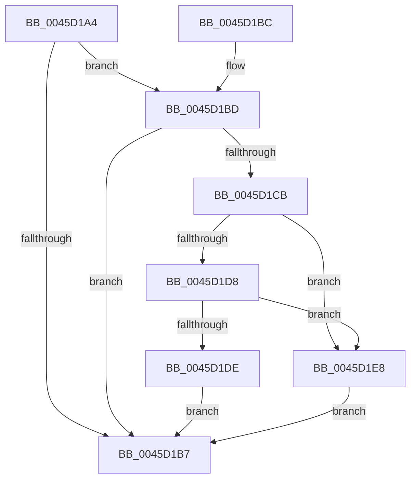

# MiCheckAndProcessCcAccessLog

- RVA: `0x0045D1A4`–`0x0045D1EF` (길이 `75` bytes)
- VA: `0x000000014045D1A4`
- 실행 섹션: `.text`
- PDB 이름 있음: `예`; PDB Function 태그: `아니요`
- unwind 정보 RVA: `0x000A35EC`
- 디코드: `22`개 명령, `75/75` bytes 표시
- 미해석 바이트: `0` (있으면 어셈블리에 `.byte`로 보존)

> 이 문서는 커널 이미지의 기계어와 PDB 기호를 분석해 생성했습니다. 4번과 5번은 함수 원형과 자료형을 바이너리 사용 방식에서 추정한 C 해석이며 원본 소스 복구 결과는 아닙니다.

## 1. Dependencies

- 직접 호출 지점: **2**; 고유 호출 대상: **2**
- 직접 호출자로 확인된 함수: **3**
- RIP 상대 이미지 참조: **1**

### Outgoing calls
- `0x0045D1E1` → [MiReturnCcAccessLog](MiReturnCcAccessLog_function_0045D1F8.md) (function, `0x0045D1F8`)
- `0x0045D1E8` → [MiQueuePageAccessLog](../34/MiQueuePageAccessLog_function_00348EB0.md) (function, `0x00348EB0`)

### Direct callers
- [MiTrimOrAgeWorkingSet](../34/MiTrimOrAgeWorkingSet_function_0034EFC0.md) at `0x0034F260`
- [MiEmptyAccessLogs](../68/MiEmptyAccessLogs_function_00689FF0.md) at `0x0068A102`
- [MiDeletePartitionResources](../../page/80/MiDeletePartitionResources_function_0080D074.md) at `0x0080D123`

### Static image references
- `0x0045D1CF` → RVA `0x00F0F220` (`.data`; read)

## 2. Other-region calls and transfers

- 다른 실행 섹션으로 향하는 call: **0**
- 별도 외부 분기/꼬리 이동을 확인하지 못했습니다.

## 3. Assembly (complete function range)

```asm
0045D1A4  48 83 EC 28                     sub rsp, 0x28
0045D1A8  48 8B 81 00 44 00 00            mov rax, qword ptr [rcx + 0x4400]
0045D1AF  4C 8B CA                        mov r9, rdx
0045D1B2  48 85 C0                        test rax, rax
0045D1B5  75 06                           jne 0x14045d1bd
0045D1B7  48 83 C4 28                     add rsp, 0x28
0045D1BB  C3                              ret
0045D1BC  CC                              int3
0045D1BD  33 D2                           xor edx, edx
0045D1BF  48 87 91 00 44 00 00            xchg qword ptr [rcx + 0x4400], rdx
0045D1C6  48 85 D2                        test rdx, rdx
0045D1C9  74 EC                           je 0x14045d1b7
0045D1CB  4C 2B 4A 10                     sub r9, qword ptr [rdx + 0x10]
0045D1CF  4C 3B 0D 4A 20 AB 00            cmp r9, qword ptr [rip + 0xab204a]
0045D1D6  77 10                           ja 0x14045d1e8
0045D1D8  41 F6 C0 01                     test r8b, 1
0045D1DC  75 0A                           jne 0x14045d1e8
0045D1DE  45 33 C0                        xor r8d, r8d
0045D1E1  E8 12 00 00 00                  call 0x14045d1f8
0045D1E6  EB CF                           jmp 0x14045d1b7
0045D1E8  E8 C3 BC EE FF                  call 0x140348eb0
0045D1ED  EB C8                           jmp 0x14045d1b7
```

## 4. C-style interpretation (structured pseudocode)

```c
__int64 __fastcall MiCheckAndProcessCcAccessLog(__int64 a1, __int64 a2, int a3)
{
    __int64 result;
    __int64 v_rsp;

    v_rsp = (v_rsp) - (40);
    if (*(unsigned __int64 *)(a1 + 17408) != 0) goto loc_0045D1BD;
loc_0045D1B7:
    v_rsp = (v_rsp) + (40);
    return *(unsigned __int64 *)(a1 + 17408);
loc_0045D1BD:
    a2 = 0;
    if (0 == 0) goto loc_0045D1B7;
    a4 = (a2) - (*(unsigned __int64 *)(a2 + 16));
    if (a4 > (*(unsigned __int64 *)(v_rip + 11214922))) goto loc_0045D1E8;
    if ((((unsigned __int8)(a3)) & (1)) != 0) goto loc_0045D1E8;
    a3 = 0;
    result = MiReturnCcAccessLog(a1, a2, a3, a4);
    goto loc_0045D1B7;
loc_0045D1E8:
    result = MiQueuePageAccessLog(a1, a2, a3, a4);
    goto loc_0045D1B7;
}
```

## 5. (Beta) C Style

```c
int64_t MiCheckAndProcessCcAccessLog(void *Arg1, int64_t Arg2, int32_t Arg3)
{
    uint8_t *arg1 = (uint8_t *)Arg1;

    int64_t result;
    int64_t local_rsp;

    local_rsp = (local_rsp) - (40);
    if (*(uint64_t *)(arg1 + 0x4400) != 0) goto loc_0045D1BD;
loc_0045D1B7:
    local_rsp = (local_rsp) + (40);
    return *(uint64_t *)(arg1 + 0x4400);
loc_0045D1BD:
    Arg2 = 0;
    if (0 == 0) goto loc_0045D1B7;
    a4 = (Arg2) - (*(uint64_t *)(Arg2 + 0x10));
    if (a4 > (*(uint64_t *)(v_rip + 0xAB204A))) goto loc_0045D1E8;
    if ((((uint8_t)(Arg3)) & (1)) != 0) goto loc_0045D1E8;
    Arg3 = 0;
    result = MiReturnCcAccessLog(Arg1, Arg2, Arg3, a4);
    goto loc_0045D1B7;
loc_0045D1E8:
    result = MiQueuePageAccessLog(Arg1, Arg2, Arg3, a4);
    goto loc_0045D1B7;
}
```

### 관측된 메모리 오프셋

구조체 형식이 확인되지 않은 접근은 인자 기준의 오프셋으로만 기록했습니다.

| 기준 인자 | 오프셋 표현 | 폭 (bit) | 접근 |
|---|---:|---:|---|
| `Arg1` | `+ 0x4400` | `64` | `R` |
| `Arg1` | `+ 0x4400` | `64` | `R/W` |

## 6. Execution-region graph

[열기: 2D/3D 그래프와 함수 탐색 컨트롤 패널](../../../control-panel.html?section=text&rva=0x0045D1A4&view=graph)

- 2D 그래프는 위에서 아래로 흐르고, 3D 그래프는 빈 공간을 드래그해 회전합니다. Shift+드래그는 이동, 휠은 확대·축소, 함수 노드 선택은 대상 보고서 이동입니다.

### Static fallback


