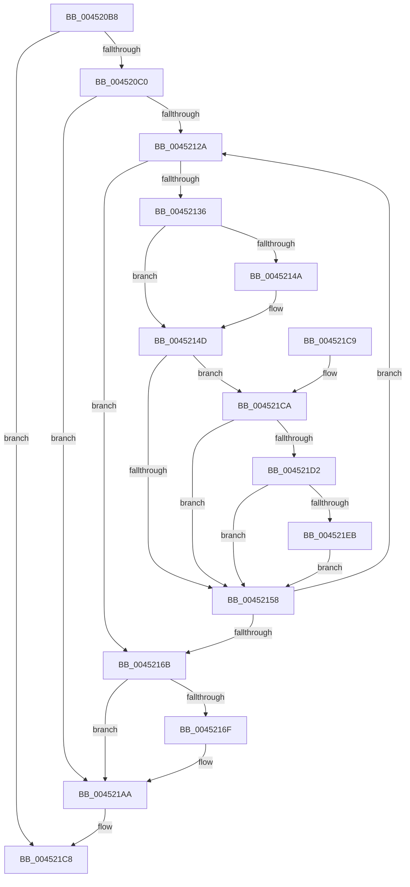

# MiClearPteAccessedBitRange

- RVA: `0x004520B8`–`0x0045220B` (길이 `339` bytes)
- VA: `0x00000001404520B8`
- 실행 섹션: `.text`
- PDB 이름 있음: `예`; PDB Function 태그: `아니요`
- unwind 정보 RVA: `0x000A751C`
- 디코드: `88`개 명령, `339/339` bytes 표시
- 미해석 바이트: `0` (있으면 어셈블리에 `.byte`로 보존)

> 이 문서는 커널 이미지의 기계어와 PDB 기호를 분석해 생성했습니다. 4번과 5번은 함수 원형과 자료형을 바이너리 사용 방식에서 추정한 C 해석이며 원본 소스 복구 결과는 아닙니다.

## 1. Dependencies

- 직접 호출 지점: **6**; 고유 호출 대상: **6**
- 직접 호출자로 확인된 함수: **1**
- RIP 상대 이미지 참조: **1**

### Outgoing calls
- `0x0045216F` → [MiGetProcessorFlushList](../24/MiGetProcessorFlushList_function_00242C90.md) (function, `0x00242C90`)
- `0x0045218D` → [MiInitializeTbFlushList](../29/MiInitializeTbFlushList_function_00294F00.md) (function, `0x00294F00`)
- `0x00452198` → [MiInsertTbFlushEntry](../29/MiInsertTbFlushEntry_function_00293670.md) (function, `0x00293670`)
- `0x004521A0` → [MiFlushTbList](../31/MiFlushTbList_function_00311FC0.md) (function, `0x00311FC0`)
- `0x004521A5` → [MiReleaseProcessorFlushList](../31/MiReleaseProcessorFlushList_function_00313C70.md) (function, `0x00313C70`)
- `0x004521F7` → [MiCheckLinearProtectedPteAccessedBit](../29/MiCheckLinearProtectedPteAccessedBit_function_00292D80.md) (function, `0x00292D80`)

### Direct callers
- [MiInitializeSystemPageTable](MiInitializeSystemPageTable_function_00451C88.md) at `0x00451F38`

### Static image references
- `0x0045213D` → RVA `0x00FC6A88` (`ALMOSTRO`; read)

## 2. Other-region calls and transfers

- 다른 실행 섹션으로 향하는 call: **0**
- 별도 외부 분기/꼬리 이동을 확인하지 못했습니다.

## 3. Assembly (complete function range)

```asm
004520B8  85 D2                           test edx, edx
004520BA  0F 85 08 01 00 00               jne 0x1404521c8
004520C0  48 8B C4                        mov rax, rsp
004520C3  48 89 58 08                     mov qword ptr [rax + 8], rbx
004520C7  48 89 68 10                     mov qword ptr [rax + 0x10], rbp
004520CB  48 89 70 18                     mov qword ptr [rax + 0x18], rsi
004520CF  48 89 78 20                     mov qword ptr [rax + 0x20], rdi
004520D3  41 55                           push r13
004520D5  41 56                           push r14
004520D7  41 57                           push r15
004520D9  48 83 EC 30                     sub rsp, 0x30
004520DD  4D 8B F0                        mov r14, r8
004520E0  48 BA 00 00 00 00 80 F6 FF FF   movabs rdx, 0xfffff68000000000
004520EA  49 C1 E6 19                     shl r14, 0x19
004520EE  49 8B F0                        mov rsi, r8
004520F1  4C 8B E9                        mov r13, rcx
004520F4  48 8B C2                        mov rax, rdx
004520F7  4C 8B B9 80 00 00 00            mov r15, qword ptr [rcx + 0x80]
004520FE  48 C1 E0 19                     shl rax, 0x19
00452102  4C 2B F0                        sub r14, rax
00452105  49 8B C0                        mov rax, r8
00452108  48 25 00 F0 FF FF               and rax, 0xfffffffffffff000
0045210E  49 C1 FE 10                     sar r14, 0x10
00452112  48 05 F8 0F 00 00               add rax, 0xff8
00452118  4C 3B F8                        cmp r15, rax
0045211B  4C 0F 47 F8                     cmova r15, rax
0045211F  33 ED                           xor ebp, ebp
00452121  4D 3B C7                        cmp r8, r15
00452124  0F 87 80 00 00 00               ja 0x1404521aa
0045212A  48 8B 3E                        mov rdi, qword ptr [rsi]
0045212D  40 8A C7                        mov al, dil
00452130  24 21                           and al, 0x21
00452132  3C 21                           cmp al, 0x21
00452134  75 35                           jne 0x14045216b
00452136  48 8B DF                        mov rbx, rdi
00452139  48 83 E3 DF                     and rbx, 0xffffffffffffffdf
0045213D  48 F7 05 40 49 B7 00 00 00 00 02  test qword ptr [rip + 0xb74940], 0x2000000
00452148  74 03                           je 0x14045214d
0045214A  0F AE E8                        lfence
0045214D  48 0F BA 25 32 49 B7 00 24      bt qword ptr [rip + 0xb74932], 0x24
00452156  72 72                           jb 0x1404521ca
00452158  48 8B C7                        mov rax, rdi
0045215B  F0 48 0F B1 1E                  lock cmpxchg qword ptr [rsi], rbx
00452160  FF C5                           inc ebp
00452162  48 83 C6 08                     add rsi, 8
00452166  49 3B F7                        cmp rsi, r15
00452169  76 BF                           jbe 0x14045212a
0045216B  85 ED                           test ebp, ebp
0045216D  74 3B                           je 0x1404521aa
0045216F  E8 1C 0B DF FF                  call 0x140242c90
00452174  49 8B 55 20                     mov rdx, qword ptr [r13 + 0x20]
00452178  45 33 C9                        xor r9d, r9d
0045217B  48 8B C8                        mov rcx, rax
0045217E  C7 44 24 20 02 00 00 00         mov dword ptr [rsp + 0x20], 2
00452186  48 8B D8                        mov rbx, rax
00452189  44 8B 40 0C                     mov r8d, dword ptr [rax + 0xc]
0045218D  E8 6E 2D E4 FF                  call 0x140294f00
00452192  44 8B C5                        mov r8d, ebp
00452195  49 8B D6                        mov rdx, r14
00452198  E8 D3 14 E4 FF                  call 0x140293670
0045219D  48 8B CB                        mov rcx, rbx
004521A0  E8 1B FE EB FF                  call 0x140311fc0
004521A5  E8 C6 1A EC FF                  call 0x140313c70
004521AA  48 8B 5C 24 50                  mov rbx, qword ptr [rsp + 0x50]
004521AF  48 8B 6C 24 58                  mov rbp, qword ptr [rsp + 0x58]
004521B4  48 8B 74 24 60                  mov rsi, qword ptr [rsp + 0x60]
004521B9  48 8B 7C 24 68                  mov rdi, qword ptr [rsp + 0x68]
004521BE  48 83 C4 30                     add rsp, 0x30
004521C2  41 5F                           pop r15
004521C4  41 5E                           pop r14
004521C6  41 5D                           pop r13
004521C8  C3                              ret
004521C9  CC                              int3
004521CA  8A C3                           mov al, bl
004521CC  24 21                           and al, 0x21
004521CE  3C 01                           cmp al, 1
004521D0  75 86                           jne 0x140452158
004521D2  48 8B C2                        mov rax, rdx
004521D5  48 B9 00 00 00 00 40 00 00 00   movabs rcx, 0x4000000000
004521DF  48 03 C1                        add rax, rcx
004521E2  48 3B F0                        cmp rsi, rax
004521E5  0F 82 6D FF FF FF               jb 0x140452158
004521EB  41 B8 80 00 00 00               mov r8d, 0x80
004521F1  48 8B D3                        mov rdx, rbx
004521F4  48 8B CE                        mov rcx, rsi
004521F7  E8 84 0B E4 FF                  call 0x140292d80
004521FC  48 BA 00 00 00 00 80 F6 FF FF   movabs rdx, 0xfffff68000000000
00452206  E9 4D FF FF FF                  jmp 0x140452158
```

## 4. C-style interpretation (structured pseudocode)

```c
__int64 __fastcall MiClearPteAccessedBitRange(__int64 a1, int a2, __int64 a3, int a4)
{
    __int64 result;
    __int64 v_r14;
    __int64 v_r15;
    __int64 v_rbp;
    __int64 v_rbx;
    __int64 v_rsi;
    __int64 v_rsp;
    unsigned int v_stack_m28;
    unsigned __int64 v_stack_p10;
    unsigned __int64 v_stack_p18;
    unsigned __int64 v_stack_p20;
    unsigned __int64 v_stack_p8;

    if (a2 != 0) goto loc_004521C8;
    *(unsigned __int64 *)(v_rsp + 8) = v_rbx;
    *(unsigned __int64 *)(v_rsp + 16) = v_rbp;
    *(unsigned __int64 *)(v_rsp + 24) = v_rsi;
    *(unsigned __int64 *)(v_rsp + 32) = v_rdi;
    v_rsp = (v_rsp) - (48);
    v_r14 = (a3) << (25);
    result = (a2) << (25);
    v_r14 = (v_r14) - (result);
    result = (a3) & (0xFFFFFFFFFFFFF000ULL);
    v_r14 = (v_r14) >> (16);
    result = (result) + (0xFF8ULL);
    v_r15 = *(unsigned __int64 *)(a1 + 128);
    if ((*(unsigned __int64 *)(a1 + 128)) > result) { v_r15 = result; }
    v_rbp = 0;
    if (a3 > v_r15) goto loc_004521AA;
loc_0045212A:
    result = (unsigned __int8)(((unsigned __int8)(*(unsigned __int64 *)(a3))) & (33));
    if (((unsigned __int8)(result)) != 33) goto loc_0045216B;
    v_rbx = (*(unsigned __int64 *)(a3)) & (-33);
    if (((*(unsigned __int64 *)(v_rip + 12011840)) & (0x2000000ULL)) != 0) {
    }
    if (condition_is_below) goto loc_004521CA;
loc_00452158:
    v_rbp = (unsigned int)((v_rbp) + 1);
    v_rsi = (a3) + (8);
    if (v_rsi <= v_r15) goto loc_0045212A;
loc_0045216B:
    result = *(unsigned __int64 *)(a3);
    if ((unsigned int)(v_rbp) != 0) {
        result = MiGetProcessorFlushList(a1, a2, a3, a4);
        a2 = *(unsigned __int64 *)(a1 + 32);
        a4 = 0;
        a1 = result;
        v_stack_m28 = 2;
        v_rbx = result;
        a3 = *(unsigned int *)(result + 12);
        result = MiInitializeTbFlushList(a1, a2, a3, a4);
        a3 = (unsigned int)(v_rbp);
        a2 = v_r14;
        result = MiInsertTbFlushEntry(a1, a2, a3, a4);
        a1 = v_rbx;
        result = MiFlushTbList(a1, a2, a3, a4);
        result = MiReleaseProcessorFlushList(a1, a2, a3, a4);
    }
    v_rsp = (v_rsp) + (48);
loc_004521C8:
    return result;
loc_004521CA:
    result = (unsigned __int8)(((unsigned __int8)(v_stack_p8)) & (33));
    if (((unsigned __int8)(result)) != 1) goto loc_00452158;
    result = (a2) + (a1);
    if (v_stack_p18 < result) goto loc_00452158;
    result = MiCheckLinearProtectedPteAccessedBit(v_stack_p18, v_stack_p8, 128, a4);
    goto loc_00452158;
}
```

## 5. (Beta) C Style

```c
int64_t MiClearPteAccessedBitRange(void *Arg1, int32_t Arg2, int64_t Arg3, int32_t Arg4)
{
    uint8_t *arg1 = (uint8_t *)Arg1;

    int64_t result;
    int64_t local_r14;
    int64_t local_r15;
    int64_t local_rbp;
    int64_t local_rbx;
    int64_t local_rsi;
    int64_t local_rsp;
    uint32_t v_stack_m28;
    uint64_t v_stack_p10;
    uint64_t v_stack_p18;
    uint64_t v_stack_p20;
    uint64_t v_stack_p8;

    if (Arg2 != 0) goto loc_004521C8;
    *(uint64_t *)(local_rsp + 0x8) = local_rbx;
    *(uint64_t *)(local_rsp + 0x10) = local_rbp;
    *(uint64_t *)(local_rsp + 0x18) = local_rsi;
    *(uint64_t *)(local_rsp + 0x20) = local_rdi;
    local_rsp = (local_rsp) - (48);
    local_r14 = (Arg3) << (25);
    result = (Arg2) << (25);
    local_r14 = (local_r14) - (result);
    result = (Arg3) & (0xFFFFFFFFFFFFF000ULL);
    local_r14 = (local_r14) >> (16);
    result = (result) + (0xFF8ULL);
    local_r15 = *(uint64_t *)(arg1 + 0x80);
    if ((*(uint64_t *)(arg1 + 0x80)) > result) { local_r15 = result; }
    local_rbp = 0;
    if (Arg3 > local_r15) goto loc_004521AA;
loc_0045212A:
    result = (uint8_t)(((uint8_t)(*(uint64_t *)(Arg3))) & (33));
    if (((uint8_t)(result)) != 33) goto loc_0045216B;
    local_rbx = (*(uint64_t *)(Arg3)) & (-33);
    if (((*(uint64_t *)(v_rip + 0xB74940)) & (0x2000000ULL)) != 0) {
    }
    if (condition_is_below) goto loc_004521CA;
loc_00452158:
    local_rbp = (uint32_t)((local_rbp) + 1);
    local_rsi = (Arg3) + (8);
    if (local_rsi <= local_r15) goto loc_0045212A;
loc_0045216B:
    result = *(uint64_t *)(Arg3);
    if ((uint32_t)(local_rbp) != 0) {
        result = MiGetProcessorFlushList(Arg1, Arg2, Arg3, Arg4);
        Arg2 = *(uint64_t *)(arg1 + 0x20);
        Arg4 = 0;
        Arg1 = result;
        v_stack_m28 = 2;
        local_rbx = result;
        Arg3 = *(uint32_t *)(result + 0xC);
        result = MiInitializeTbFlushList(Arg1, Arg2, Arg3, Arg4);
        Arg3 = (uint32_t)(local_rbp);
        Arg2 = local_r14;
        result = MiInsertTbFlushEntry(Arg1, Arg2, Arg3, Arg4);
        Arg1 = local_rbx;
        result = MiFlushTbList(Arg1, Arg2, Arg3, Arg4);
        result = MiReleaseProcessorFlushList(Arg1, Arg2, Arg3, Arg4);
    }
    local_rsp = (local_rsp) + (48);
loc_004521C8:
    return result;
loc_004521CA:
    result = (uint8_t)(((uint8_t)(v_stack_p8)) & (33));
    if (((uint8_t)(result)) != 1) goto loc_00452158;
    result = (Arg2) + (Arg1);
    if (v_stack_p18 < result) goto loc_00452158;
    result = MiCheckLinearProtectedPteAccessedBit(v_stack_p18, v_stack_p8, 128, Arg4);
    goto loc_00452158;
}
```

### 관측된 메모리 오프셋

구조체 형식이 확인되지 않은 접근은 인자 기준의 오프셋으로만 기록했습니다.

| 기준 인자 | 오프셋 표현 | 폭 (bit) | 접근 |
|---|---:|---:|---|
| `Arg1` | `+ 0x20` | `64` | `R` |
| `Arg1` | `+ 0x80` | `64` | `R` |

## 6. Execution-region graph

[열기: 2D/3D 그래프와 함수 탐색 컨트롤 패널](../../../control-panel.html?section=text&rva=0x004520B8&view=graph)

- 2D 그래프는 위에서 아래로 흐르고, 3D 그래프는 빈 공간을 드래그해 회전합니다. Shift+드래그는 이동, 휠은 확대·축소, 함수 노드 선택은 대상 보고서 이동입니다.

### Static fallback


