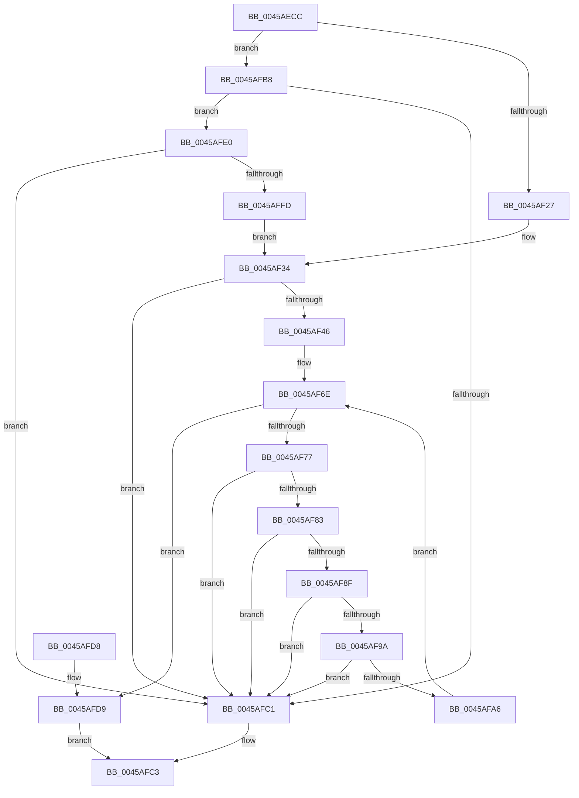

# MiClusterVadFull

- RVA: `0x0045AECC`–`0x0045B00C` (길이 `320` bytes)
- VA: `0x000000014045AECC`
- 실행 섹션: `.text`
- PDB 이름 있음: `예`; PDB Function 태그: `아니요`
- unwind 정보 RVA: `0x000A90C8`
- 디코드: `86`개 명령, `320/320` bytes 표시
- 미해석 바이트: `0` (있으면 어셈블리에 `.byte`로 보존)

> 이 문서는 커널 이미지의 기계어와 PDB 기호를 분석해 생성했습니다. 4번과 5번은 함수 원형과 자료형을 바이너리 사용 방식에서 추정한 C 해석이며 원본 소스 복구 결과는 아닙니다.

## 1. Dependencies

- 직접 호출 지점: **0**; 고유 호출 대상: **0**
- 직접 호출자로 확인된 함수: **2**
- RIP 상대 이미지 참조: **0**

### Outgoing calls
- 직접 디코드된 call 명령이 없습니다.

### Direct callers
- [MiTrimSharedPage](../29/MiTrimSharedPage_function_00297D14.md) at `0x00297F94`
- [MiPfnsWorthTrying](../31/MiPfnsWorthTrying_function_0031B0C0.md) at `0x0031B5A3`

### Static image references
- 디코드된 RIP-relative 메모리 참조가 없습니다.

## 2. Other-region calls and transfers

- 다른 실행 섹션으로 향하는 call: **0**
- 별도 외부 분기/꼬리 이동을 확인하지 못했습니다.

## 3. Assembly (complete function range)

```asm
0045AECC  48 8B C4                        mov rax, rsp
0045AECF  48 89 58 08                     mov qword ptr [rax + 8], rbx
0045AED3  48 89 68 10                     mov qword ptr [rax + 0x10], rbp
0045AED7  48 89 70 18                     mov qword ptr [rax + 0x18], rsi
0045AEDB  48 89 78 20                     mov qword ptr [rax + 0x20], rdi
0045AEDF  4D 8B D8                        mov r11, r8
0045AEE2  48 8B FA                        mov rdi, rdx
0045AEE5  48 8B F1                        mov rsi, rcx
0045AEE8  48 B8 00 00 00 00 00 DE FF FF   movabs rax, 0xffffde0000000000
0045AEF2  48 8B D9                        mov rbx, rcx
0045AEF5  4C 8D 49 08                     lea r9, [rcx + 8]
0045AEF9  4D 8B 01                        mov r8, qword ptr [r9]
0045AEFC  48 2B D8                        sub rbx, rax
0045AEFF  48 C1 FB 04                     sar rbx, 4
0045AF03  48 B8 AB AA AA AA AA AA AA AA   movabs rax, 0xaaaaaaaaaaaaaaab
0045AF0D  48 BD 00 00 00 00 00 00 00 80   movabs rbp, 0x8000000000000000
0045AF17  48 0F AF D8                     imul rbx, rax
0045AF1B  4C 0B C5                        or r8, rbp
0045AF1E  4D 85 DB                        test r11, r11
0045AF21  0F 85 91 00 00 00               jne 0x14045afb8
0045AF27  49 8B D0                        mov rdx, r8
0045AF2A  48 C1 EA 03                     shr rdx, 3
0045AF2E  81 E2 FF 01 00 00               and edx, 0x1ff
0045AF34  48 8D 4F FF                     lea rcx, [rdi - 1]
0045AF38  48 8B C1                        mov rax, rcx
0045AF3B  48 23 CA                        and rcx, rdx
0045AF3E  48 23 C3                        and rax, rbx
0045AF41  48 3B C8                        cmp rcx, rax
0045AF44  75 7B                           jne 0x14045afc1
0045AF46  4C 8B 56 28                     mov r10, qword ptr [rsi + 0x28]
0045AF4A  48 8D 0C 7F                     lea rcx, [rdi + rdi*2]
0045AF4E  48 C1 E1 04                     shl rcx, 4
0045AF52  48 8D 57 FF                     lea rdx, [rdi - 1]
0045AF56  49 BB FF FF FF FF FF 00 00 00   movabs r11, 0xffffffffff
0045AF60  49 8D 14 D0                     lea rdx, [r8 + rdx*8]
0045AF64  48 83 C1 D0                     add rcx, -0x30
0045AF68  4D 23 D3                        and r10, r11
0045AF6B  48 03 CE                        add rcx, rsi
0045AF6E  49 8D 41 F8                     lea rax, [r9 - 8]
0045AF72  48 3B C1                        cmp rax, rcx
0045AF75  73 62                           jae 0x14045afd9
0045AF77  49 8B 41 20                     mov rax, qword ptr [r9 + 0x20]
0045AF7B  49 23 C3                        and rax, r11
0045AF7E  49 3B C2                        cmp rax, r10
0045AF81  75 3E                           jne 0x14045afc1
0045AF83  48 8B 41 28                     mov rax, qword ptr [rcx + 0x28]
0045AF87  49 23 C3                        and rax, r11
0045AF8A  49 3B C2                        cmp rax, r10
0045AF8D  75 32                           jne 0x14045afc1
0045AF8F  49 8B 01                        mov rax, qword ptr [r9]
0045AF92  48 0B C5                        or rax, rbp
0045AF95  49 3B C0                        cmp rax, r8
0045AF98  75 27                           jne 0x14045afc1
0045AF9A  48 8B 41 08                     mov rax, qword ptr [rcx + 8]
0045AF9E  48 0B C5                        or rax, rbp
0045AFA1  48 3B C2                        cmp rax, rdx
0045AFA4  75 1B                           jne 0x14045afc1
0045AFA6  49 83 C1 30                     add r9, 0x30
0045AFAA  48 83 E9 30                     sub rcx, 0x30
0045AFAE  49 83 C0 08                     add r8, 8
0045AFB2  48 83 EA 08                     sub rdx, 8
0045AFB6  EB B6                           jmp 0x14045af6e
0045AFB8  4D 8B 53 08                     mov r10, qword ptr [r11 + 8]
0045AFBC  4D 3B C2                        cmp r8, r10
0045AFBF  73 1F                           jae 0x14045afe0
0045AFC1  33 C0                           xor eax, eax
0045AFC3  48 8B 5C 24 08                  mov rbx, qword ptr [rsp + 8]
0045AFC8  48 8B 6C 24 10                  mov rbp, qword ptr [rsp + 0x10]
0045AFCD  48 8B 74 24 18                  mov rsi, qword ptr [rsp + 0x18]
0045AFD2  48 8B 7C 24 20                  mov rdi, qword ptr [rsp + 0x20]
0045AFD7  C3                              ret
0045AFD8  CC                              int3
0045AFD9  B8 01 00 00 00                  mov eax, 1
0045AFDE  EB E3                           jmp 0x14045afc3
0045AFE0  41 8B 43 34                     mov eax, dword ptr [r11 + 0x34]
0045AFE4  41 8B 53 2C                     mov edx, dword ptr [r11 + 0x2c]
0045AFE8  25 FF FF FF 3F                  and eax, 0x3fffffff
0045AFED  48 6B C0 F8                     imul rax, rax, -8
0045AFF1  49 03 C2                        add rax, r10
0045AFF4  48 8D 0C D0                     lea rcx, [rax + rdx*8]
0045AFF8  4C 3B C1                        cmp r8, rcx
0045AFFB  73 C4                           jae 0x14045afc1
0045AFFD  49 8B D0                        mov rdx, r8
0045B000  49 2B D2                        sub rdx, r10
0045B003  48 C1 FA 03                     sar rdx, 3
0045B007  E9 28 FF FF FF                  jmp 0x14045af34
```

## 4. C-style interpretation (structured pseudocode)

```c
__int64 __fastcall MiClusterVadFull(__int64 a1, __int64 a2, __int64 a3)
{
    __int64 result;
    __int64 v_r10;
    __int64 v_rbx;
    unsigned __int64 v_stack_p10;
    unsigned __int64 v_stack_p18;
    unsigned __int64 v_stack_p20;
    unsigned __int64 v_stack_p8;

    *(unsigned __int64 *)(v_rsp + 8) = v_rbx;
    *(unsigned __int64 *)(v_rsp + 16) = v_rbp;
    *(unsigned __int64 *)(v_rsp + 24) = v_rsi;
    *(unsigned __int64 *)(v_rsp + 32) = v_rdi;
    v_rbx = (a1) - (v_rsp);
    v_rbx = (v_rbx) >> (4);
    v_rbx = (v_rbx) * (v_rsp);
    a3 = (*(unsigned __int64 *)(a1 + 8)) | (v_rbp);
    if (a3 != 0) goto loc_0045AFB8;
    a2 = (a3) >> (3);
    a2 = (unsigned int)((a2) & (511));
loc_0045AF34:
    a1 = (a2 - 1) & (a2);
    result = (a2 - 1) & (v_rbx);
    if (a1 != result) goto loc_0045AFC1;
    a1 = (a2 + a2 * 2) << (4);
    a1 = (a1) + (-48);
    v_r10 = (*(unsigned __int64 *)(a1 + 40)) & (a3);
    a1 = (a1) + (a1);
loc_0045AF6E:
    if ((a1 + 8 - 8) >= a1) goto loc_0045AFD9;
    result = (*(unsigned __int64 *)(a1 + 8 + 32)) & (a3);
    if (result != v_r10) goto loc_0045AFC1;
    result = (*(unsigned __int64 *)(a1 + 40)) & (a3);
    if (result != v_r10) goto loc_0045AFC1;
    result = (*(unsigned __int64 *)(a1 + 8)) | (v_rbp);
    if (result != a3) goto loc_0045AFC1;
    result = (*(unsigned __int64 *)(a1 + 8)) | (v_rbp);
    if (result != (a3 + a2 - 1 * 8)) goto loc_0045AFC1;
    a4 = (a1 + 8) + (48);
    a1 = (a1) - (48);
    a3 = (a3) + (8);
    a2 = (a3 + a2 - 1 * 8) - (8);
    goto loc_0045AF6E;
loc_0045AFB8:
    if (a3 >= (*(unsigned __int64 *)(a3 + 8))) goto loc_0045AFE0;
loc_0045AFC1:
    result = 0;
loc_0045AFC3:
    return result;
loc_0045AFD9:
    goto loc_0045AFC3;
loc_0045AFE0:
    result = (unsigned int)(((unsigned int)(*(unsigned int *)(a3 + 52))) & (0x3FFFFFFFULL));
    result = (result) * (result);
    result = (result) + (*(unsigned __int64 *)(a3 + 8));
    if (a3 >= (result + (unsigned int)(*(unsigned int *)(a3 + 44)) * 8)) goto loc_0045AFC1;
    a2 = (a3) - (*(unsigned __int64 *)(a3 + 8));
    a2 = (a2) >> (3);
    goto loc_0045AF34;
}
```

## 5. (Beta) C Style

```c
int64_t MiClusterVadFull(void *Arg1, void *Arg2, int64_t Arg3)
{
    uint8_t *arg1 = (uint8_t *)Arg1;
    uint8_t *arg2 = (uint8_t *)Arg2;

    int64_t result;
    int64_t local_r10;
    int64_t local_rbx;
    uint64_t v_stack_p10;
    uint64_t v_stack_p18;
    uint64_t v_stack_p20;
    uint64_t v_stack_p8;

    *(uint64_t *)(local_rsp + 0x8) = local_rbx;
    *(uint64_t *)(local_rsp + 0x10) = local_rbp;
    *(uint64_t *)(local_rsp + 0x18) = local_rsi;
    *(uint64_t *)(local_rsp + 0x20) = local_rdi;
    local_rbx = (Arg1) - (local_rsp);
    local_rbx = (local_rbx) >> (4);
    local_rbx = (local_rbx) * (local_rsp);
    Arg3 = (*(uint64_t *)(arg1 + 0x8)) | (local_rbp);
    if (Arg3 != 0) goto loc_0045AFB8;
    Arg2 = (Arg3) >> (3);
    Arg2 = (uint32_t)((Arg2) & (511));
loc_0045AF34:
    Arg1 = (Arg2 - 1) & (Arg2);
    result = (Arg2 - 1) & (local_rbx);
    if (Arg1 != result) goto loc_0045AFC1;
    Arg1 = (Arg2 + Arg2 * 2) << (4);
    Arg1 = (Arg1) + (-48);
    local_r10 = (*(uint64_t *)(arg1 + 0x28)) & (Arg3);
    Arg1 = (Arg1) + (Arg1);
loc_0045AF6E:
    if ((Arg1 + 8 - 8) >= Arg1) goto loc_0045AFD9;
    result = (*(uint64_t *)(arg1 + 0x8 + 0x20)) & (Arg3);
    if (result != local_r10) goto loc_0045AFC1;
    result = (*(uint64_t *)(arg1 + 0x28)) & (Arg3);
    if (result != local_r10) goto loc_0045AFC1;
    result = (*(uint64_t *)(arg1 + 0x8)) | (local_rbp);
    if (result != Arg3) goto loc_0045AFC1;
    result = (*(uint64_t *)(arg1 + 0x8)) | (local_rbp);
    if (result != (Arg3 + Arg2 - 1 * 8)) goto loc_0045AFC1;
    a4 = (Arg1 + 8) + (48);
    Arg1 = (Arg1) - (48);
    Arg3 = (Arg3) + (8);
    Arg2 = (Arg3 + Arg2 - 1 * 8) - (8);
    goto loc_0045AF6E;
loc_0045AFB8:
    if (Arg3 >= (*(uint64_t *)(Arg3 + 0x8))) goto loc_0045AFE0;
loc_0045AFC1:
    result = 0;
loc_0045AFC3:
    return result;
loc_0045AFD9:
    goto loc_0045AFC3;
loc_0045AFE0:
    result = (uint32_t)(((uint32_t)(*(uint32_t *)(Arg3 + 0x34))) & (0x3FFFFFFFULL));
    result = (result) * (result);
    result = (result) + (*(uint64_t *)(Arg3 + 0x8));
    if (Arg3 >= (result + (uint32_t)(*(uint32_t *)(Arg3 + 0x2C)) * 8)) goto loc_0045AFC1;
    Arg2 = (Arg3) - (*(uint64_t *)(Arg3 + 0x8));
    Arg2 = (Arg2) >> (3);
    goto loc_0045AF34;
}
```

### 관측된 메모리 오프셋

구조체 형식이 확인되지 않은 접근은 인자 기준의 오프셋으로만 기록했습니다.

| 기준 인자 | 오프셋 표현 | 폭 (bit) | 접근 |
|---|---:|---:|---|
| `Arg1` | `- 0x8` | `64` | `R` |
| `Arg1` | `+ 0x0` | `64` | `R` |
| `Arg1` | `+ 0x8` | `64` | `R` |
| `Arg1` | `+ 0x20` | `64` | `R` |
| `Arg1` | `+ 0x28` | `64` | `R` |
| `Arg2` | `- 0x1` | `64` | `R` |
| `Arg2` | `+ 0x0 + rdi*2` | `64` | `R` |

## 6. Execution-region graph

[열기: 2D/3D 그래프와 함수 탐색 컨트롤 패널](../../../control-panel.html?section=text&rva=0x0045AECC&view=graph)

- 2D 그래프는 위에서 아래로 흐르고, 3D 그래프는 빈 공간을 드래그해 회전합니다. Shift+드래그는 이동, 휠은 확대·축소, 함수 노드 선택은 대상 보고서 이동입니다.

### Static fallback


