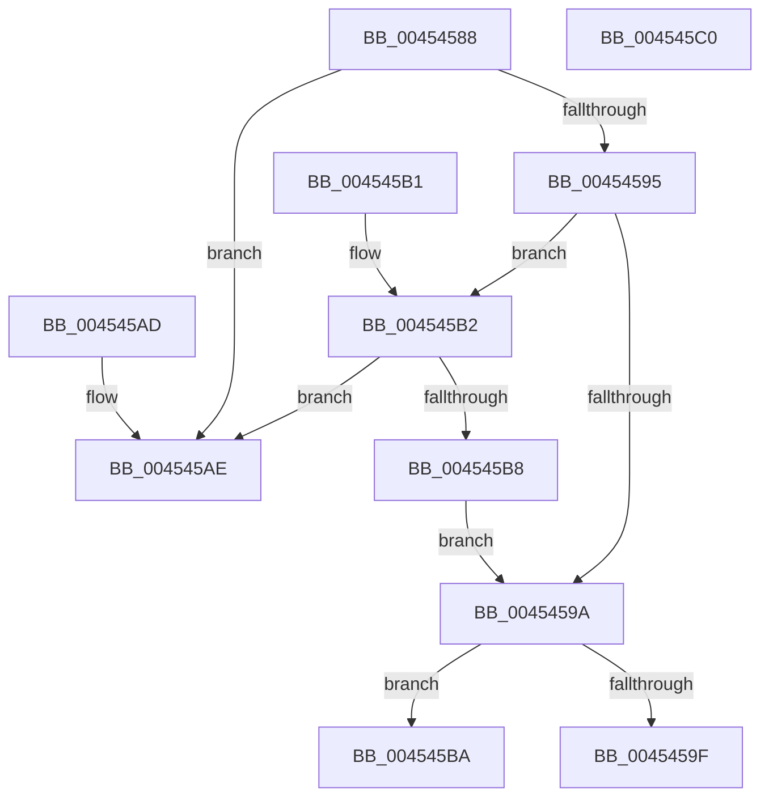

# MiColdPageSizeSupported

- RVA: `0x00454588`–`0x004545C1` (길이 `57` bytes)
- VA: `0x0000000140454588`
- 실행 섹션: `.text`
- PDB 이름 있음: `예`; PDB Function 태그: `아니요`
- unwind 정보 RVA: `0x000DB714`
- 디코드: `22`개 명령, `57/57` bytes 표시
- 미해석 바이트: `0` (있으면 어셈블리에 `.byte`로 보존)

> 이 문서는 커널 이미지의 기계어와 PDB 기호를 분석해 생성했습니다. 4번과 5번은 함수 원형과 자료형을 바이너리 사용 방식에서 추정한 C 해석이며 원본 소스 복구 결과는 아닙니다.

## 1. Dependencies

- 직접 호출 지점: **0**; 고유 호출 대상: **0**
- 직접 호출자로 확인된 함수: **4**
- RIP 상대 이미지 참조: **1**

### Outgoing calls
- 직접 디코드된 call 명령이 없습니다.

### Direct callers
- [sub_0031F9CC](../31/Unknown_function_0031F9CC.md) at `0x0031FAB2`
- [MiCoalesceFreeSmallPages](../33/MiCoalesceFreeSmallPages_function_00336340.md) at `0x003368A9`
- [MiFreeLargePageMemory](../37/MiFreeLargePageMemory_function_00377938.md) at `0x00377A3F`
- [MiSplitDirectMapPage](../4D/MiSplitDirectMapPage_function_004DAAA0.md) at `0x004DAD19`

### Static image references
- `0x00454588` → RVA `0x00FC6AB8` (`ALMOSTRO`; read)

## 2. Other-region calls and transfers

- 다른 실행 섹션으로 향하는 call: **0**
- 별도 외부 분기/꼬리 이동을 확인하지 못했습니다.

## 3. Assembly (complete function range)

```asm
00454588  8B 05 2A 25 B7 00               mov eax, dword ptr [rip + 0xb7252a]
0045458E  A9 00 00 40 08                  test eax, 0x8400000
00454593  74 19                           je 0x1404545ae
00454595  83 F9 01                        cmp ecx, 1
00454598  77 18                           ja 0x1404545b2
0045459A  48 85 D2                        test rdx, rdx
0045459D  74 1B                           je 0x1404545ba
0045459F  8B 82 50 3B 00 00               mov eax, dword ptr [rdx + 0x3b50]
004545A5  D1 E8                           shr eax, 1
004545A7  F7 D0                           not eax
004545A9  83 E0 01                        and eax, 1
004545AC  C3                              ret
004545AD  CC                              int3
004545AE  33 C0                           xor eax, eax
004545B0  C3                              ret
004545B1  CC                              int3
004545B2  0F BA E0 1B                     bt eax, 0x1b
004545B6  72 F6                           jb 0x1404545ae
004545B8  EB E0                           jmp 0x14045459a
004545BA  B8 01 00 00 00                  mov eax, 1
004545BF  C3                              ret
004545C0  CC                              int3
```

## 4. C-style interpretation (structured pseudocode)

```c
__int64 __fastcall MiColdPageSizeSupported(int a1, __int64 a2)
{
    __int64 result;

    if ((((unsigned int)((unsigned int)(*(unsigned int *)(v_rip + 12002602)))) & (0x8400000ULL)) == 0) goto loc_004545AE;
    if (a1 > 1) goto loc_004545B2;
loc_0045459A:
    if (a2 == 0) goto loc_004545BA;
    result = (unsigned int)(((unsigned int)(*(unsigned int *)(a2 + 15184))) >> (1));
    result = (unsigned int)(~(result));
    result = (unsigned int)((result) & (1));
    return result;
loc_004545AE:
    result = 0;
    return result;
loc_004545B2:
    if (condition_is_below) goto loc_004545AE;
    goto loc_0045459A;
loc_004545BA:
    return 1;
}
```

## 5. (Beta) C Style

```c
int64_t MiColdPageSizeSupported(int32_t Arg1, int64_t Arg2)
{
    int64_t result;

    if ((((uint32_t)((uint32_t)(*(uint32_t *)(v_rip + 0xB7252A)))) & (0x8400000ULL)) == 0) goto loc_004545AE;
    if (Arg1 > 1) goto loc_004545B2;
loc_0045459A:
    if (Arg2 == 0) goto loc_004545BA;
    result = (uint32_t)(((uint32_t)(*(uint32_t *)(Arg2 + 0x3B50))) >> (1));
    result = (uint32_t)(~(result));
    result = (uint32_t)((result) & (1));
    return result;
loc_004545AE:
    result = 0;
    return result;
loc_004545B2:
    if (condition_is_below) goto loc_004545AE;
    goto loc_0045459A;
loc_004545BA:
    return 1;
}
```

## 6. Execution-region graph

[열기: 2D/3D 그래프와 함수 탐색 컨트롤 패널](../../../control-panel.html?section=text&rva=0x00454588&view=graph)

- 2D 그래프는 위에서 아래로 흐르고, 3D 그래프는 빈 공간을 드래그해 회전합니다. Shift+드래그는 이동, 휠은 확대·축소, 함수 노드 선택은 대상 보고서 이동입니다.

### Static fallback


