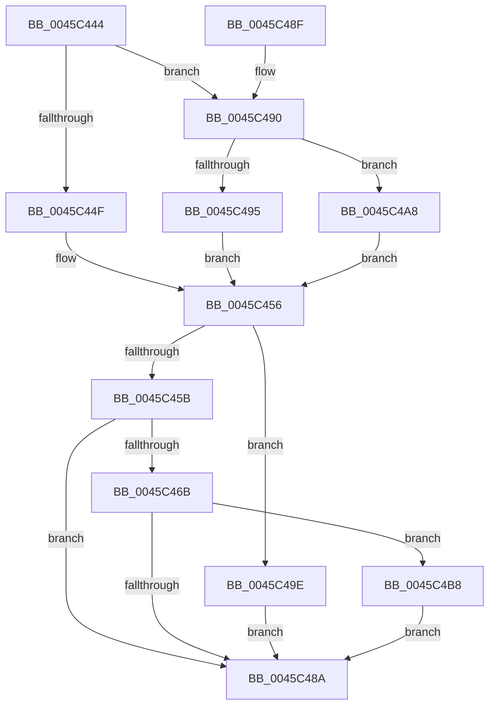

# MiCountSystemPool

- RVA: `0x0045C444`–`0x0045C4C1` (길이 `125` bytes)
- VA: `0x000000014045C444`
- 실행 섹션: `.text`
- PDB 이름 있음: `예`; PDB Function 태그: `아니요`
- unwind 정보 RVA: `0x0005CEF4`
- 디코드: `36`개 명령, `125/125` bytes 표시
- 미해석 바이트: `0` (있으면 어셈블리에 `.byte`로 보존)

> 이 문서는 커널 이미지의 기계어와 PDB 기호를 분석해 생성했습니다. 4번과 5번은 함수 원형과 자료형을 바이너리 사용 방식에서 추정한 C 해석이며 원본 소스 복구 결과는 아닙니다.

## 1. Dependencies

- 직접 호출 지점: **1**; 고유 호출 대상: **1**
- 직접 호출자로 확인된 함수: **1**
- RIP 상대 이미지 참조: **4**

### Outgoing calls
- `0x0045C4BA` → [MiFreeExcessSegments](../32/MiFreeExcessSegments_function_00327F50.md) (function, `0x00327F50`)

### Direct callers
- [MmFreeSecurePoolMemory](../68/MmFreeSecurePoolMemory_function_00682E10.md) at `0x00682EB1`

### Static image references
- `0x0045C44F` → RVA `0x00E2CB48` (`.data`; read)
- `0x0045C46B` → RVA `0x00E2CB40` (`.data`; read)
- `0x0045C495` → RVA `0x00E37650` (`.data`; read)
- `0x0045C4AB` → RVA `0x00E2CB50` (`.data`; read)

## 2. Other-region calls and transfers

- 다른 실행 섹션으로 향하는 call: **0**
- 별도 외부 분기/꼬리 이동을 확인하지 못했습니다.

## 3. Assembly (complete function range)

```asm
0045C444  48 83 EC 28                     sub rsp, 0x28
0045C448  33 C0                           xor eax, eax
0045C44A  83 F9 04                        cmp ecx, 4
0045C44D  75 41                           jne 0x14045c490
0045C44F  4C 8D 0D F2 06 9D 00            lea r9, [rip + 0x9d06f2]
0045C456  45 85 C0                        test r8d, r8d
0045C459  74 43                           je 0x14045c49e
0045C45B  4C 8B C2                        mov r8, rdx
0045C45E  F0 4D 0F C1 01                  lock xadd qword ptr [r9], r8
0045C463  4C 03 C2                        add r8, rdx
0045C466  83 F9 04                        cmp ecx, 4
0045C469  75 1F                           jne 0x14045c48a
0045C46B  48 8B 0D CE 06 9D 00            mov rcx, qword ptr [rip + 0x9d06ce]
0045C472  49 2B C8                        sub rcx, r8
0045C475  4C 3B 05 C4 06 9D 00            cmp r8, qword ptr [rip + 0x9d06c4]
0045C47C  48 1B C0                        sbb rax, rax
0045C47F  48 23 C1                        and rax, rcx
0045C482  48 3D 00 03 00 00               cmp rax, 0x300
0045C488  72 2E                           jb 0x14045c4b8
0045C48A  48 83 C4 28                     add rsp, 0x28
0045C48E  C3                              ret
0045C48F  CC                              int3
0045C490  83 F9 05                        cmp ecx, 5
0045C493  75 13                           jne 0x14045c4a8
0045C495  4C 8D 0D B4 B1 9D 00            lea r9, [rip + 0x9db1b4]
0045C49C  EB B8                           jmp 0x14045c456
0045C49E  48 F7 DA                        neg rdx
0045C4A1  F0 49 0F C1 11                  lock xadd qword ptr [r9], rdx
0045C4A6  EB E2                           jmp 0x14045c48a
0045C4A8  83 F9 0E                        cmp ecx, 0xe
0045C4AB  4C 8D 0D 9E 06 9D 00            lea r9, [rip + 0x9d069e]
0045C4B2  4C 0F 45 C8                     cmovne r9, rax
0045C4B6  EB 9E                           jmp 0x14045c456
0045C4B8  33 C9                           xor ecx, ecx
0045C4BA  E8 91 BA EC FF                  call 0x140327f50
0045C4BF  EB C9                           jmp 0x14045c48a
```

## 4. C-style interpretation (structured pseudocode)

```c
__int64 __fastcall MiCountSystemPool(int a1, __int64 a2, int a3)
{
    __int64 result;
    __int64 v_rsp;

    v_rsp = (v_rsp) - (40);
    result = 0;
    if (a1 != 4) goto loc_0045C490;
loc_0045C456:
    if (a3 == 0) goto loc_0045C49E;
    a3 = (a2) + (a2);
    if (a1 != 4) goto loc_0045C48A;
    a1 = (*(unsigned __int64 *)(v_rip + 10290894)) - (a3);
    result = (result) & (a1);
    if (result < 768) goto loc_0045C4B8;
loc_0045C48A:
    v_rsp = (v_rsp) + (40);
    return result;
loc_0045C490:
    if (a1 != 5) goto loc_0045C4A8;
    goto loc_0045C456;
loc_0045C49E:
    a2 = -(a2);
    goto loc_0045C48A;
loc_0045C4A8:
    a4 = v_rip + 10290846;
    if (a1 != 14) { a4 = result; }
    goto loc_0045C456;
loc_0045C4B8:
    a1 = 0;
    result = MiFreeExcessSegments(a1, a2, a3, a4);
    goto loc_0045C48A;
}
```

## 5. (Beta) C Style

```c
int64_t MiCountSystemPool(int32_t Arg1, int64_t Arg2, int32_t Arg3)
{
    int64_t result;
    int64_t local_rsp;

    local_rsp = (local_rsp) - (40);
    result = 0;
    if (Arg1 != 4) goto loc_0045C490;
loc_0045C456:
    if (Arg3 == 0) goto loc_0045C49E;
    Arg3 = (Arg2) + (Arg2);
    if (Arg1 != 4) goto loc_0045C48A;
    Arg1 = (*(uint64_t *)(v_rip + 0x9D06CE)) - (Arg3);
    result = (result) & (Arg1);
    if (result < 768) goto loc_0045C4B8;
loc_0045C48A:
    local_rsp = (local_rsp) + (40);
    return result;
loc_0045C490:
    if (Arg1 != 5) goto loc_0045C4A8;
    goto loc_0045C456;
loc_0045C49E:
    Arg2 = -(Arg2);
    goto loc_0045C48A;
loc_0045C4A8:
    a4 = v_rip + 10290846;
    if (Arg1 != 14) { a4 = result; }
    goto loc_0045C456;
loc_0045C4B8:
    Arg1 = 0;
    result = MiFreeExcessSegments(Arg1, Arg2, Arg3, a4);
    goto loc_0045C48A;
}
```

## 6. Execution-region graph

[열기: 2D/3D 그래프와 함수 탐색 컨트롤 패널](../../../control-panel.html?section=text&rva=0x0045C444&view=graph)

- 2D 그래프는 위에서 아래로 흐르고, 3D 그래프는 빈 공간을 드래그해 회전합니다. Shift+드래그는 이동, 휠은 확대·축소, 함수 노드 선택은 대상 보고서 이동입니다.

### Static fallback


