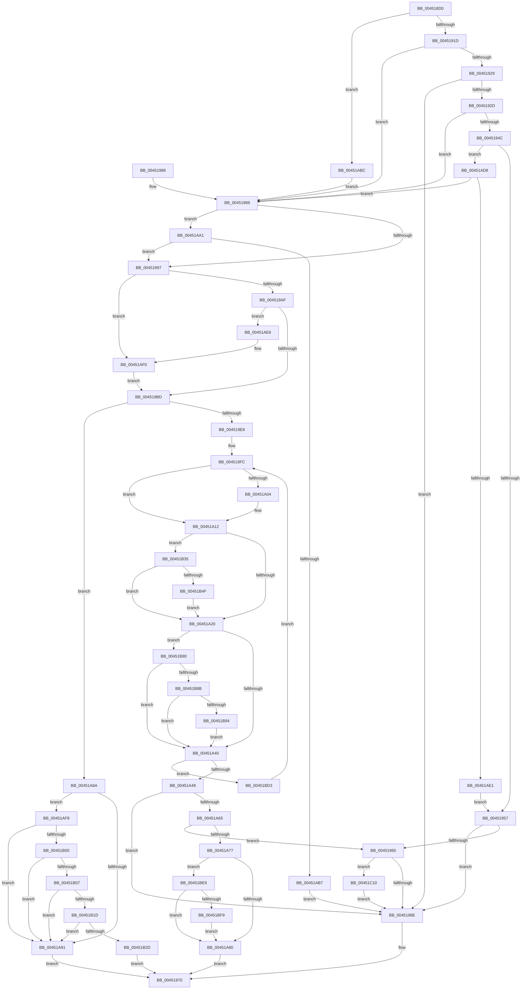

# MiCreateSystemPageTable

- RVA: `0x004518D0`–`0x00451C23` (길이 `851` bytes)
- VA: `0x00000001404518D0`
- 실행 섹션: `.text`
- PDB 이름 있음: `예`; PDB Function 태그: `아니요`
- unwind 정보 RVA: `0x000A74D4`
- 디코드: `206`개 명령, `851/851` bytes 표시
- 미해석 바이트: `0` (있으면 어셈블리에 `.byte`로 보존)

> 이 문서는 커널 이미지의 기계어와 PDB 기호를 분석해 생성했습니다. 4번과 5번은 함수 원형과 자료형을 바이너리 사용 방식에서 추정한 C 해석이며 원본 소스 복구 결과는 아닙니다.

## 1. Dependencies

- 직접 호출 지점: **11**; 고유 호출 대상: **11**
- 직접 호출자로 확인된 함수: **0**
- RIP 상대 이미지 참조: **4**

### Outgoing calls
- `0x00451943` → [MiIsPageAGapPage](MiIsPageAGapPage_function_00451C2C.md) (function, `0x00451C2C`)
- `0x004519DB` → [MiGetPageTablePages](../37/MiGetPageTablePages_function_00376C3C.md) (function, `0x00376C3C`)
- `0x00451A2B` → [MiInitializeSystemPageTable](MiInitializeSystemPageTable_function_00451C88.md) (function, `0x00451C88`)
- `0x00451AAA` → [MiMakeLargePageTable](../4F/MiMakeLargePageTable_function_004F9198.md) (function, `0x004F9198`)
- `0x00451AC3` → [MiFillPteHierarchy](../3F/MiFillPteHierarchy_function_003F7F90.md) (function, `0x003F7F90`)
- `0x00451B76` → [MiArePageContentsZero](../4D/MiArePageContentsZero_function_004D4278.md) (function, `0x004D4278`)
- `0x00451B9B` → [MiLockNestedPageTable](../23/MiLockNestedPageTable_function_0023E890.md) (function, `0x0023E890`)
- `0x00451BC5` → [MiUnlockPageTable](../21/MiUnlockPageTable_function_00216EC0.md) (function, `0x00216EC0`)
- `0x00451BF9` → [MiFlushTbList](../31/MiFlushTbList_function_00311FC0.md) (function, `0x00311FC0`)
- `0x00451BFE` → [MiReleaseProcessorFlushList](../31/MiReleaseProcessorFlushList_function_00313C70.md) (function, `0x00313C70`)
- `0x00451C19` → [MiMakeSystemLeavesNonZero](../4E/MiMakeSystemLeavesNonZero_function_004E26C0.md) (function, `0x004E26C0`)

### Direct callers
- 이 함수 시작 RVA로 연결되는 직접 call은 확인되지 않았습니다. 간접 호출은 완전히 역산할 수 없습니다.

### Static image references
- `0x00451A12` → RVA `0x00FC6A88` (`ALMOSTRO`; read)
- `0x00451B35` → RVA `0x00E30270` (`.data`; read)
- `0x00451B3D` → RVA `0x00FC5054` (`ALMOSTRO`; reference)
- `0x00451B43` → RVA `0x00E30270` (`.data`; write)

## 2. Other-region calls and transfers

- 다른 실행 섹션으로 향하는 call: **0**
- 별도 외부 분기/꼬리 이동을 확인하지 못했습니다.

## 3. Assembly (complete function range)

```asm
004518D0  48 89 5C 24 10                  mov qword ptr [rsp + 0x10], rbx
004518D5  55                              push rbp
004518D6  56                              push rsi
004518D7  57                              push rdi
004518D8  41 54                           push r12
004518DA  41 55                           push r13
004518DC  41 56                           push r14
004518DE  41 57                           push r15
004518E0  48 8B EC                        mov rbp, rsp
004518E3  48 83 EC 60                     sub rsp, 0x60
004518E7  48 8B B1 B8 00 00 00            mov rsi, qword ptr [rcx + 0xb8]
004518EE  33 C0                           xor eax, eax
004518F0  0F 57 C9                        xorps xmm1, xmm1
004518F3  49 63 F8                        movsxd rdi, r8d
004518F6  0F 57 C0                        xorps xmm0, xmm0
004518F9  48 89 45 D8                     mov qword ptr [rbp - 0x28], rax
004518FD  4C 8B FA                        mov r15, rdx
00451900  4C 8B F1                        mov r14, rcx
00451903  0F BA A6 80 00 00 00 0E         bt dword ptr [rsi + 0x80], 0xe
0045190B  0F 11 45 C8                     movups xmmword ptr [rbp - 0x38], xmm0
0045190F  0F 11 4D E0                     movups xmmword ptr [rbp - 0x20], xmm1
00451913  0F 11 4D F0                     movups xmmword ptr [rbp - 0x10], xmm1
00451917  0F 82 9F 01 00 00               jb 0x140451abc
0045191D  48 8B 1A                        mov rbx, qword ptr [rdx]
00451920  48 89 5D C0                     mov qword ptr [rbp - 0x40], rbx
00451924  F6 C3 01                        test bl, 1
00451927  74 60                           je 0x140451989
00451929  84 DB                           test bl, bl
0045192B  78 41                           js 0x14045196e
0045192D  48 B8 FF FF FF FF FF 00 00 00   movabs rax, 0xffffffffff
00451937  48 8B CB                        mov rcx, rbx
0045193A  48 C1 E9 0C                     shr rcx, 0xc
0045193E  8B D7                           mov edx, edi
00451940  48 23 C8                        and rcx, rax
00451943  E8 E4 02 00 00                  call 0x140451c2c
00451948  85 C0                           test eax, eax
0045194A  75 3D                           jne 0x140451989
0045194C  48 0F BA E3 0B                  bt rbx, 0xb
00451951  0F 83 81 01 00 00               jae 0x140451ad8
00451957  41 8B 46 04                     mov eax, dword ptr [r14 + 4]
0045195B  C1 E8 06                        shr eax, 6
0045195E  83 E0 07                        and eax, 7
00451961  3B F8                           cmp edi, eax
00451963  75 09                           jne 0x14045196e
00451965  83 FF 01                        cmp edi, 1
00451968  0F 8F A2 02 00 00               jg 0x140451c10
0045196E  33 C0                           xor eax, eax
00451970  48 8B 9C 24 A8 00 00 00         mov rbx, qword ptr [rsp + 0xa8]
00451978  48 83 C4 60                     add rsp, 0x60
0045197C  41 5F                           pop r15
0045197E  41 5E                           pop r14
00451980  41 5D                           pop r13
00451982  41 5C                           pop r12
00451984  5F                              pop rdi
00451985  5E                              pop rsi
00451986  5D                              pop rbp
00451987  C3                              ret
00451988  CC                              int3
00451989  8B 86 80 00 00 00               mov eax, dword ptr [rsi + 0x80]
0045198F  84 C0                           test al, al
00451991  0F 88 0A 01 00 00               js 0x140451aa1
00451997  BA 01 00 00 00                  mov edx, 1
0045199C  48 89 55 58                     mov qword ptr [rbp + 0x58], rdx
004519A0  8D 4A 01                        lea ecx, [rdx + 1]
004519A3  44 8D 62 02                     lea r12d, [rdx + 2]
004519A7  85 FF                           test edi, edi
004519A9  0F 84 41 01 00 00               je 0x140451af0
004519AF  0F BA A6 80 00 00 00 0E         bt dword ptr [rsi + 0x80], 0xe
004519B7  0F 82 29 01 00 00               jb 0x140451ae6
004519BD  41 B9 00 20 00 00               mov r9d, 0x2000
004519C3  44 8B C1                        mov r8d, ecx
004519C6  45 0B C1                        or r8d, r9d
004519C9  44 85 8E 80 00 00 00            test dword ptr [rsi + 0x80], r9d
004519D0  4C 8D 4D C8                     lea r9, [rbp - 0x38]
004519D4  44 0F 44 C1                     cmove r8d, ecx
004519D8  48 8B CE                        mov rcx, rsi
004519DB  E8 5C 52 F2 FF                  call 0x140376c3c
004519E0  85 C0                           test eax, eax
004519E2  0F 88 A2 00 00 00               js 0x140451a8a
004519E8  4C 8B 65 D8                     mov r12, qword ptr [rbp - 0x28]
004519EC  48 8D 4D E0                     lea rcx, [rbp - 0x20]
004519F0  48 8B 5D C8                     mov rbx, qword ptr [rbp - 0x38]
004519F4  48 8D 0C F9                     lea rcx, [rcx + rdi*8]
004519F8  48 89 4D 40                     mov qword ptr [rbp + 0x40], rcx
004519FC  4C 8B EB                        mov r13, rbx
004519FF  48 85 DB                        test rbx, rbx
00451A02  74 0E                           je 0x140451a12
00451A04  48 8B 1B                        mov rbx, qword ptr [rbx]
00451A07  4C 8B 65 D8                     mov r12, qword ptr [rbp - 0x28]
00451A0B  49 FF CC                        dec r12
00451A0E  4C 89 65 D8                     mov qword ptr [rbp - 0x28], r12
00451A12  8A 05 70 50 B7 00               mov al, byte ptr [rip + 0xb75070]
00451A18  84 C0                           test al, al
00451A1A  0F 88 15 01 00 00               js 0x140451b35
00451A20  4D 8B CD                        mov r9, r13
00451A23  4D 8B C7                        mov r8, r15
00451A26  8B D7                           mov edx, edi
00451A28  49 8B CE                        mov rcx, r14
00451A2B  E8 58 02 00 00                  call 0x140451c88
00451A30  4C 8B AE B0 00 00 00            mov r13, qword ptr [rsi + 0xb0]
00451A37  4D 85 ED                        test r13, r13
00451A3A  0F 85 40 01 00 00               jne 0x140451b80
00451A40  4D 85 E4                        test r12, r12
00451A43  0F 85 8A 01 00 00               jne 0x140451bd3
00451A49  48 8B 45 58                     mov rax, qword ptr [rbp + 0x58]
00451A4D  48 01 46 70                     add qword ptr [rsi + 0x70], rax
00451A51  F7 86 80 00 00 00 00 40 00 00   test dword ptr [rsi + 0x80], 0x4000
00451A5B  48 8B 5D C0                     mov rbx, qword ptr [rbp - 0x40]
00451A5F  0F 85 09 FF FF FF               jne 0x14045196e
00451A65  41 8B 46 04                     mov eax, dword ptr [r14 + 4]
00451A69  C1 E8 06                        shr eax, 6
00451A6C  83 E0 07                        and eax, 7
00451A6F  3B F8                           cmp edi, eax
00451A71  0F 8E EE FE FF FF               jle 0x140451965
00451A77  F6 C3 01                        test bl, 1
00451A7A  0F 85 69 01 00 00               jne 0x140451be9
00451A80  B8 02 00 00 00                  mov eax, 2
00451A85  E9 E6 FE FF FF                  jmp 0x140451970
00451A8A  3D 17 00 00 C0                  cmp eax, 0xc0000017
00451A8F  74 67                           je 0x140451af8
00451A91  89 86 90 00 00 00               mov dword ptr [rsi + 0x90], eax
00451A97  B8 05 00 00 00                  mov eax, 5
00451A9C  E9 CF FE FF FF                  jmp 0x140451970
00451AA1  44 8B C7                        mov r8d, edi
00451AA4  49 8B D7                        mov rdx, r15
00451AA7  49 8B CE                        mov rcx, r14
00451AAA  E8 E9 76 0A 00                  call 0x1404f9198
00451AAF  85 C0                           test eax, eax
00451AB1  0F 84 E0 FE FF FF               je 0x140451997
00451AB7  E9 B2 FE FF FF                  jmp 0x14045196e
00451ABC  48 8D 55 E0                     lea rdx, [rbp - 0x20]
00451AC0  49 8B CF                        mov rcx, r15
00451AC3  E8 C8 64 FA FF                  call 0x1403f7f90
00451AC8  4C 8B 7C FD E0                  mov r15, qword ptr [rbp + rdi*8 - 0x20]
00451ACD  33 DB                           xor ebx, ebx
00451ACF  48 89 5D C0                     mov qword ptr [rbp - 0x40], rbx
00451AD3  E9 B1 FE FF FF                  jmp 0x140451989
00451AD8  F6 C3 42                        test bl, 0x42
00451ADB  0F 84 A8 FE FF FF               je 0x140451989
00451AE1  E9 71 FE FF FF                  jmp 0x140451957
00451AE6  8D 47 01                        lea eax, [rdi + 1]
00451AE9  48 63 D0                        movsxd rdx, eax
00451AEC  48 89 55 58                     mov qword ptr [rbp + 0x58], rdx
00451AF0  41 8B CC                        mov ecx, r12d
00451AF3  E9 C5 FE FF FF                  jmp 0x1404519bd
00451AF8  41 8B 0E                        mov ecx, dword ptr [r14]
00451AFB  F6 C1 02                        test cl, 2
00451AFE  74 91                           je 0x140451a91
00451B00  41 80 7E 09 02                  cmp byte ptr [r14 + 9], 2
00451B05  73 8A                           jae 0x140451a91
00451B07  65 48 8B 0C 25 88 01 00 00      mov rcx, qword ptr gs:[0x188]
00451B10  80 B9 C3 00 00 00 10            cmp byte ptr [rcx + 0xc3], 0x10
00451B17  0F 8D 74 FF FF FF               jge 0x140451a91
00451B1D  F7 86 80 00 00 00 00 04 00 00   test dword ptr [rsi + 0x80], 0x400
00451B27  0F 85 64 FF FF FF               jne 0x140451a91
00451B2D  41 8B C4                        mov eax, r12d
00451B30  E9 3B FE FF FF                  jmp 0x140451970
00451B35  8B 05 35 E7 9D 00               mov eax, dword ptr [rip + 0x9de735]
00451B3B  FF C0                           inc eax
00451B3D  85 05 11 35 B7 00               test dword ptr [rip + 0xb73511], eax
00451B43  89 05 27 E7 9D 00               mov dword ptr [rip + 0x9de727], eax
00451B49  0F 85 D1 FE FF FF               jne 0x140451a20
00451B4F  48 B8 00 00 00 00 00 DE FF FF   movabs rax, 0xffffde0000000000
00451B59  49 8B CD                        mov rcx, r13
00451B5C  BA 01 00 00 00                  mov edx, 1
00451B61  48 2B C8                        sub rcx, rax
00451B64  48 B8 AB AA AA AA AA AA AA AA   movabs rax, 0xaaaaaaaaaaaaaaab
00451B6E  48 C1 F9 04                     sar rcx, 4
00451B72  48 0F AF C8                     imul rcx, rax
00451B76  E8 FD 26 08 00                  call 0x1404d4278
00451B7B  E9 A0 FE FF FF                  jmp 0x140451a20
00451B80  49 83 7D 20 00                  cmp qword ptr [r13 + 0x20], 0
00451B85  0F 84 B5 FE FF FF               je 0x140451a40
00451B8B  83 FF 01                        cmp edi, 1
00451B8E  0F 8C AC FE FF FF               jl 0x140451a40
00451B94  49 8B 4D 00                     mov rcx, qword ptr [r13]
00451B98  49 8B D7                        mov rdx, r15
00451B9B  E8 F0 CC DE FF                  call 0x14023e890
00451BA0  49 8B D7                        mov rdx, r15
00451BA3  48 B8 F8 FF FF FF 7F 00 00 00   movabs rax, 0x7ffffffff8
00451BAD  48 C1 EA 09                     shr rdx, 9
00451BB1  48 23 D0                        and rdx, rax
00451BB4  48 B8 00 00 00 00 80 F6 FF FF   movabs rax, 0xfffff68000000000
00451BBE  49 8B 4D 00                     mov rcx, qword ptr [r13]
00451BC2  48 03 D0                        add rdx, rax
00451BC5  E8 F6 52 DC FF                  call 0x140216ec0
00451BCA  4D 89 7D 20                     mov qword ptr [r13 + 0x20], r15
00451BCE  E9 6D FE FF FF                  jmp 0x140451a40
00451BD3  48 8B 45 40                     mov rax, qword ptr [rbp + 0x40]
00451BD7  FF CF                           dec edi
00451BD9  48 83 E8 08                     sub rax, 8
00451BDD  48 89 45 40                     mov qword ptr [rbp + 0x40], rax
00451BE1  4C 8B 38                        mov r15, qword ptr [rax]
00451BE4  E9 13 FE FF FF                  jmp 0x1404519fc
00451BE9  48 8B 8E 88 00 00 00            mov rcx, qword ptr [rsi + 0x88]
00451BF0  48 85 C9                        test rcx, rcx
00451BF3  0F 84 87 FE FF FF               je 0x140451a80
00451BF9  E8 C2 03 EC FF                  call 0x140311fc0
00451BFE  E8 6D 20 EC FF                  call 0x140313c70
00451C03  48 83 A6 88 00 00 00 00         and qword ptr [rsi + 0x88], 0
00451C0B  E9 70 FE FF FF                  jmp 0x140451a80
00451C10  44 8B C7                        mov r8d, edi
00451C13  49 8B D7                        mov rdx, r15
00451C16  49 8B CE                        mov rcx, r14
00451C19  E8 A2 0A 09 00                  call 0x1404e26c0
00451C1E  E9 4B FD FF FF                  jmp 0x14045196e
```

## 4. C-style interpretation (structured pseudocode)

```c
__int64 __fastcall MiCreateSystemPageTable(__int64 a1, __int64 a2, int a3)
{
    __int64 result;
    __int64 v_r12;
    __int64 v_rbx;
    __int64 v_rdi;
    __int64 v_rsp;
    unsigned __int64 v_stack_m48;
    unsigned __int64 v_stack_m58;
    unsigned __int64 v_stack_m60;
    unsigned __int64 v_stack_m70;
    unsigned __int64 v_stack_m78;
    unsigned __int64 v_stack_p10;
    unsigned __int64 v_stack_p20;
    unsigned __int64 v_stack_p8;

    v_stack_p10 = v_rbx;
    v_rsp = (v_rsp) - (96);
    result = 0;
    v_stack_m60 = 0;
    v_stack_m70 = v_xmm0;
    v_stack_m58 = v_xmm1;
    v_stack_m48 = v_xmm1;
    if (condition_is_below) goto loc_00451ABC;
    v_stack_m78 = *(unsigned __int64 *)(a2);
    if ((((unsigned __int8)(*(unsigned __int64 *)(a2))) & (1)) == 0) goto loc_00451989;
    if (sign_flag) goto loc_0045196E;
    a1 = (*(unsigned __int64 *)(a2)) >> (12);
    a1 = (a1) & (0);
    result = MiIsPageAGapPage(a1, (unsigned int)((unsigned int)((int)(a3))), a3, a4);
    if ((unsigned int)(result) != 0) goto loc_00451989;
    if (condition_is_above_or_equal) goto loc_00451AD8;
loc_00451957:
    result = (unsigned int)(((unsigned int)(*(unsigned int *)(a1 + 4))) >> (6));
    result = (unsigned int)((result) & (7));
    if (((unsigned int)((int)(a3))) != ((unsigned int)(result))) goto loc_0045196E;
loc_00451965:
    if (((unsigned int)((int)(a3))) > 1) goto loc_00451C10;
loc_0045196E:
    result = 0;
loc_00451970:
    v_rsp = (v_rsp) + (96);
    return result;
loc_00451989:
    if (sign_flag) goto loc_00451AA1;
loc_00451997:
    v_stack_p20 = 1;
    if ((unsigned int)((int)(a3)) == 0) goto loc_00451AF0;
    if (condition_is_below) goto loc_00451AE6;
loc_004519BD:
    a3 = (unsigned int)(((unsigned int)((unsigned int)(1 + 1))) | ((unsigned int)((unsigned int)(0x2000ULL))));
    if (((*(unsigned int *)(*(unsigned __int64 *)(a1 + 184) + 128)) & ((unsigned int)((unsigned int)(0x2000ULL)))) == 0) { a3 = (unsigned int)(1 + 1); }
    result = MiGetPageTablePages(*(unsigned __int64 *)(a1 + 184), 1, a3, v_stack_m70);
    if (sign_flag) goto loc_00451A8A;
    v_stack_p8 = v_stack_m58 + (int)(a3) * 8;
loc_004519FC:
    v_rbx = v_stack_m70;
    v_r12 = v_stack_m60;
    if (v_stack_m70 != 0) {
        v_rbx = *(unsigned __int64 *)(v_stack_m70);
        v_r12 = v_stack_m60;
        v_r12 = (v_r12) - 1;
        v_stack_m60 = v_r12;
    }
    if (sign_flag) goto loc_00451B35;
loc_00451A20:
    result = MiInitializeSystemPageTable(a1, (unsigned int)((unsigned int)((int)(a3))), a2, v_stack_m70);
    if (*(unsigned __int64 *)(*(unsigned __int64 *)(a1 + 184) + 176) != 0) goto loc_00451B80;
loc_00451A40:
    if (v_r12 != 0) goto loc_00451BD3;
    if (((*(unsigned int *)(*(unsigned __int64 *)(a1 + 184) + 128)) & (0x4000ULL)) != 0) goto loc_0045196E;
    result = (unsigned int)(((unsigned int)(*(unsigned int *)(a1 + 4))) >> (6));
    result = (unsigned int)((result) & (7));
    if (((unsigned int)((int)(a3))) <= ((unsigned int)(result))) goto loc_00451965;
    if ((((unsigned __int8)(v_stack_m78)) & (1)) != 0) goto loc_00451BE9;
loc_00451A80:
    goto loc_00451970;
loc_00451A8A:
    if (2 == 0xC0000017ULL) goto loc_00451AF8;
loc_00451A91:
    *(unsigned int *)(*(unsigned __int64 *)(a1 + 184) + 144) = 2;
    goto loc_00451970;
loc_00451AA1:
    result = MiMakeLargePageTable(a1, a2, (unsigned int)((unsigned int)((int)(a3))), v_stack_m70);
    if ((unsigned int)(result) == 0) goto loc_00451997;
    goto loc_0045196E;
loc_00451ABC:
    result = MiFillPteHierarchy(a2, v_stack_m58, (unsigned int)((unsigned int)((int)(a3))), v_stack_m70);
    v_rbx = 0;
    v_stack_m78 = 0;
    goto loc_00451989;
loc_00451AD8:
    if (((0) & (66)) == 0) goto loc_00451989;
    goto loc_00451957;
loc_00451AE6:
    v_stack_p20 = (int)((unsigned int)((int)(a3) + 1));
loc_00451AF0:
    goto loc_004519BD;
loc_00451AF8:
    if ((((unsigned __int8)((unsigned int)(*(unsigned int *)(a1)))) & (2)) == 0) goto loc_00451A91;
    if ((*(unsigned __int8 *)(a1 + 9)) >= 2) goto loc_00451A91;
    if ((*(unsigned __int8 *)(*(unsigned __int64 *)(gs_base + (0 + 392)) + 195)) >= 16) goto loc_00451A91;
    if (((*(unsigned int *)(*(unsigned __int64 *)(a1 + 184) + 128)) & (0x400ULL)) != 0) goto loc_00451A91;
    goto loc_00451970;
loc_00451B35:
    result = (unsigned int)(((unsigned int)(*(unsigned int *)(v_rip + 10348341))) + 1);
    *(unsigned int *)(v_rip + 10348327) = (unsigned int)(result);
    if (((*(unsigned int *)(v_rip + 12006673)) & ((unsigned int)(result))) != 0) goto loc_00451A20;
    a1 = (*(unsigned __int64 *)(*(unsigned __int64 *)(a1 + 184) + 176)) - (result);
    a1 = (a1) >> (4);
    a1 = (a1) * (result);
    result = MiArePageContentsZero(a1, 1, (unsigned int)((unsigned int)((int)(a3))), v_stack_m70);
    goto loc_00451A20;
loc_00451B80:
    if ((*(unsigned __int64 *)(*(unsigned __int64 *)(*(unsigned __int64 *)(a1 + 184) + 176) + 32)) == 0) goto loc_00451A40;
    if (((unsigned int)((int)(a3))) < 1) goto loc_00451A40;
    result = MiLockNestedPageTable(*(unsigned __int64 *)(*(unsigned __int64 *)(*(unsigned __int64 *)(a1 + 184) + 176)), *(unsigned __int64 *)(v_rsp + (int)(a3) * 8 - 32), (unsigned int)((unsigned int)((int)(a3))), v_stack_m70);
    a2 = (*(unsigned __int64 *)(v_rsp + (int)(a3) * 8 - 32)) >> (9);
    a2 = (a2) & (result);
    a2 = (a2) + (result);
    result = MiUnlockPageTable(*(unsigned __int64 *)(*(unsigned __int64 *)(*(unsigned __int64 *)(a1 + 184) + 176)), a2, (unsigned int)((unsigned int)((int)(a3))), v_stack_m70);
    *(unsigned __int64 *)(*(unsigned __int64 *)(*(unsigned __int64 *)(a1 + 184) + 176) + 32) = *(unsigned __int64 *)(v_rsp + (int)(a3) * 8 - 32);
    goto loc_00451A40;
loc_00451BD3:
    v_rdi = (unsigned int)(((int)(a3)) - 1);
    result = (v_stack_p8) - (8);
    v_stack_p8 = result;
    goto loc_004519FC;
loc_00451BE9:
    if (*(unsigned __int64 *)(*(unsigned __int64 *)(a1 + 184) + 136) == 0) goto loc_00451A80;
    result = MiFlushTbList(*(unsigned __int64 *)(*(unsigned __int64 *)(a1 + 184) + 136), a2, (unsigned int)((unsigned int)((int)(a3))), v_stack_m70);
    result = MiReleaseProcessorFlushList(*(unsigned __int64 *)(*(unsigned __int64 *)(a1 + 184) + 136), a2, (unsigned int)((unsigned int)((int)(a3))), v_stack_m70);
    goto loc_00451A80;
loc_00451C10:
    result = MiMakeSystemLeavesNonZero(a1, *(unsigned __int64 *)(result), (unsigned int)((unsigned int)(v_rdi)), v_stack_m70);
    goto loc_0045196E;
}
```

## 5. (Beta) C Style

```c
int64_t MiCreateSystemPageTable(void *Arg1, void *Arg2, int32_t Arg3)
{
    uint8_t *arg1 = (uint8_t *)Arg1;
    uint8_t *arg2 = (uint8_t *)Arg2;

    int64_t result;
    int64_t local_r12;
    int64_t local_rbx;
    int64_t local_rdi;
    int64_t local_rsp;
    uint64_t v_stack_m48;
    uint64_t v_stack_m58;
    uint64_t v_stack_m60;
    uint64_t v_stack_m70;
    uint64_t v_stack_m78;
    uint64_t v_stack_p10;
    uint64_t v_stack_p20;
    uint64_t v_stack_p8;

    v_stack_p10 = local_rbx;
    local_rsp = (local_rsp) - (96);
    result = 0;
    v_stack_m60 = 0;
    v_stack_m70 = v_xmm0;
    v_stack_m58 = v_xmm1;
    v_stack_m48 = v_xmm1;
    if (condition_is_below) goto loc_00451ABC;
    v_stack_m78 = *(uint64_t *)(arg2);
    if ((((uint8_t)(*(uint64_t *)(arg2))) & (1)) == 0) goto loc_00451989;
    if (sign_flag) goto loc_0045196E;
    Arg1 = (*(uint64_t *)(arg2)) >> (12);
    Arg1 = (Arg1) & (0);
    result = MiIsPageAGapPage(Arg1, (uint32_t)((uint32_t)((int32_t)(Arg3))), Arg3, a4);
    if ((uint32_t)(result) != 0) goto loc_00451989;
    if (condition_is_above_or_equal) goto loc_00451AD8;
loc_00451957:
    result = (uint32_t)(((uint32_t)(*(uint32_t *)(arg1 + 0x4))) >> (6));
    result = (uint32_t)((result) & (7));
    if (((uint32_t)((int32_t)(Arg3))) != ((uint32_t)(result))) goto loc_0045196E;
loc_00451965:
    if (((uint32_t)((int32_t)(Arg3))) > 1) goto loc_00451C10;
loc_0045196E:
    result = 0;
loc_00451970:
    local_rsp = (local_rsp) + (96);
    return result;
loc_00451989:
    if (sign_flag) goto loc_00451AA1;
loc_00451997:
    v_stack_p20 = 1;
    if ((uint32_t)((int32_t)(Arg3)) == 0) goto loc_00451AF0;
    if (condition_is_below) goto loc_00451AE6;
loc_004519BD:
    Arg3 = (uint32_t)(((uint32_t)((uint32_t)(1 + 1))) | ((uint32_t)((uint32_t)(0x2000ULL))));
    if (((*(uint32_t *)(*(uint64_t *)(arg1 + 0xB8) + 0x80)) & ((uint32_t)((uint32_t)(0x2000ULL)))) == 0) { Arg3 = (uint32_t)(1 + 1); }
    result = MiGetPageTablePages(*(uint64_t *)(arg1 + 0xB8), 1, Arg3, v_stack_m70);
    if (sign_flag) goto loc_00451A8A;
    v_stack_p8 = v_stack_m58 + (int32_t)(Arg3) * 8;
loc_004519FC:
    local_rbx = v_stack_m70;
    local_r12 = v_stack_m60;
    if (v_stack_m70 != 0) {
        local_rbx = *(uint64_t *)(v_stack_m70);
        local_r12 = v_stack_m60;
        local_r12 = (local_r12) - 1;
        v_stack_m60 = local_r12;
    }
    if (sign_flag) goto loc_00451B35;
loc_00451A20:
    result = MiInitializeSystemPageTable(Arg1, (uint32_t)((uint32_t)((int32_t)(Arg3))), Arg2, v_stack_m70);
    if (*(uint64_t *)(*(uint64_t *)(arg1 + 0xB8) + 0xB0) != 0) goto loc_00451B80;
loc_00451A40:
    if (local_r12 != 0) goto loc_00451BD3;
    if (((*(uint32_t *)(*(uint64_t *)(arg1 + 0xB8) + 0x80)) & (0x4000ULL)) != 0) goto loc_0045196E;
    result = (uint32_t)(((uint32_t)(*(uint32_t *)(arg1 + 0x4))) >> (6));
    result = (uint32_t)((result) & (7));
    if (((uint32_t)((int32_t)(Arg3))) <= ((uint32_t)(result))) goto loc_00451965;
    if ((((uint8_t)(v_stack_m78)) & (1)) != 0) goto loc_00451BE9;
loc_00451A80:
    goto loc_00451970;
loc_00451A8A:
    if (2 == 0xC0000017ULL) goto loc_00451AF8;
loc_00451A91:
    *(uint32_t *)(*(uint64_t *)(arg1 + 0xB8) + 0x90) = 2;
    goto loc_00451970;
loc_00451AA1:
    result = MiMakeLargePageTable(Arg1, Arg2, (uint32_t)((uint32_t)((int32_t)(Arg3))), v_stack_m70);
    if ((uint32_t)(result) == 0) goto loc_00451997;
    goto loc_0045196E;
loc_00451ABC:
    result = MiFillPteHierarchy(Arg2, v_stack_m58, (uint32_t)((uint32_t)((int32_t)(Arg3))), v_stack_m70);
    local_rbx = 0;
    v_stack_m78 = 0;
    goto loc_00451989;
loc_00451AD8:
    if (((0) & (66)) == 0) goto loc_00451989;
    goto loc_00451957;
loc_00451AE6:
    v_stack_p20 = (int32_t)((uint32_t)((int32_t)(Arg3) + 1));
loc_00451AF0:
    goto loc_004519BD;
loc_00451AF8:
    if ((((uint8_t)((uint32_t)(*(uint32_t *)(arg1)))) & (2)) == 0) goto loc_00451A91;
    if ((*(uint8_t *)(arg1 + 0x9)) >= 2) goto loc_00451A91;
    if ((*(uint8_t *)(*(uint64_t *)(gs_base + (0 + 0x188)) + 0xC3)) >= 16) goto loc_00451A91;
    if (((*(uint32_t *)(*(uint64_t *)(arg1 + 0xB8) + 0x80)) & (0x400ULL)) != 0) goto loc_00451A91;
    goto loc_00451970;
loc_00451B35:
    result = (uint32_t)(((uint32_t)(*(uint32_t *)(v_rip + 0x9DE735))) + 1);
    *(uint32_t *)(v_rip + 0x9DE727) = (uint32_t)(result);
    if (((*(uint32_t *)(v_rip + 0xB73511)) & ((uint32_t)(result))) != 0) goto loc_00451A20;
    Arg1 = (*(uint64_t *)(*(uint64_t *)(arg1 + 0xB8) + 0xB0)) - (result);
    Arg1 = (Arg1) >> (4);
    Arg1 = (Arg1) * (result);
    result = MiArePageContentsZero(Arg1, 1, (uint32_t)((uint32_t)((int32_t)(Arg3))), v_stack_m70);
    goto loc_00451A20;
loc_00451B80:
    if ((*(uint64_t *)(*(uint64_t *)(*(uint64_t *)(arg1 + 0xB8) + 0xB0) + 0x20)) == 0) goto loc_00451A40;
    if (((uint32_t)((int32_t)(Arg3))) < 1) goto loc_00451A40;
    result = MiLockNestedPageTable(*(uint64_t *)(*(uint64_t *)(*(uint64_t *)(arg1 + 0xB8) + 0xB0)), *(uint64_t *)(local_rsp + (int32_t)(Arg3) * 8 - 0x20), (uint32_t)((uint32_t)((int32_t)(Arg3))), v_stack_m70);
    Arg2 = (*(uint64_t *)(local_rsp + (int32_t)(Arg3) * 8 - 0x20)) >> (9);
    Arg2 = (Arg2) & (result);
    Arg2 = (Arg2) + (result);
    result = MiUnlockPageTable(*(uint64_t *)(*(uint64_t *)(*(uint64_t *)(arg1 + 0xB8) + 0xB0)), Arg2, (uint32_t)((uint32_t)((int32_t)(Arg3))), v_stack_m70);
    *(uint64_t *)(*(uint64_t *)(*(uint64_t *)(arg1 + 0xB8) + 0xB0) + 0x20) = *(uint64_t *)(local_rsp + (int32_t)(Arg3) * 8 - 0x20);
    goto loc_00451A40;
loc_00451BD3:
    local_rdi = (uint32_t)(((int32_t)(Arg3)) - 1);
    result = (v_stack_p8) - (8);
    v_stack_p8 = result;
    goto loc_004519FC;
loc_00451BE9:
    if (*(uint64_t *)(*(uint64_t *)(arg1 + 0xB8) + 0x88) == 0) goto loc_00451A80;
    result = MiFlushTbList(*(uint64_t *)(*(uint64_t *)(arg1 + 0xB8) + 0x88), Arg2, (uint32_t)((uint32_t)((int32_t)(Arg3))), v_stack_m70);
    result = MiReleaseProcessorFlushList(*(uint64_t *)(*(uint64_t *)(arg1 + 0xB8) + 0x88), Arg2, (uint32_t)((uint32_t)((int32_t)(Arg3))), v_stack_m70);
    goto loc_00451A80;
loc_00451C10:
    result = MiMakeSystemLeavesNonZero(Arg1, *(uint64_t *)(result), (uint32_t)((uint32_t)(local_rdi)), v_stack_m70);
    goto loc_0045196E;
}
```

### 관측된 메모리 오프셋

구조체 형식이 확인되지 않은 접근은 인자 기준의 오프셋으로만 기록했습니다.

| 기준 인자 | 오프셋 표현 | 폭 (bit) | 접근 |
|---|---:|---:|---|
| `Arg1` | `+ 0x0` | `32` | `R` |
| `Arg1` | `+ 0x4` | `32` | `R` |
| `Arg1` | `+ 0x9` | `8` | `R` |
| `Arg1` | `+ 0xB8` | `64` | `R` |
| `Arg2` | `+ 0x0` | `64` | `R` |

## 6. Execution-region graph

[열기: 2D/3D 그래프와 함수 탐색 컨트롤 패널](../../../control-panel.html?section=text&rva=0x004518D0&view=graph)

- 2D 그래프는 위에서 아래로 흐르고, 3D 그래프는 빈 공간을 드래그해 회전합니다. Shift+드래그는 이동, 휠은 확대·축소, 함수 노드 선택은 대상 보고서 이동입니다.

### Static fallback


