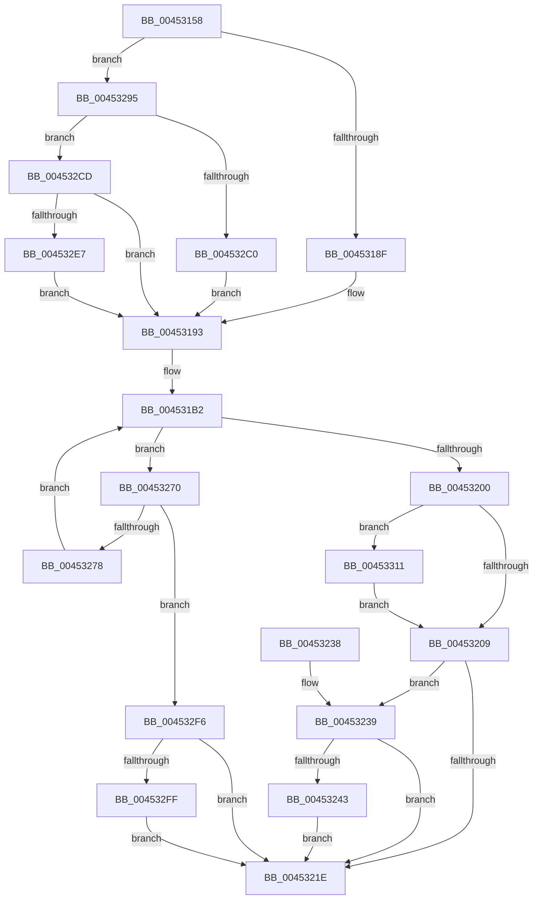

# MiCreateSystemSection

- RVA: `0x00453158`–`0x00453323` (길이 `459` bytes)
- VA: `0x0000000140453158`
- 실행 섹션: `.text`
- PDB 이름 있음: `예`; PDB Function 태그: `아니요`
- unwind 정보 RVA: `0x000A7764`
- 디코드: `113`개 명령, `459/459` bytes 표시
- 미해석 바이트: `0` (있으면 어셈블리에 `.byte`로 보존)

> 이 문서는 커널 이미지의 기계어와 PDB 기호를 분석해 생성했습니다. 4번과 5번은 함수 원형과 자료형을 바이너리 사용 방식에서 추정한 C 해석이며 원본 소스 복구 결과는 아닙니다.

## 1. Dependencies

- 직접 호출 지점: **10**; 고유 호출 대상: **9**
- 직접 호출자로 확인된 함수: **2**
- RIP 상대 이미지 참조: **1**

### Outgoing calls
- `0x004531F5` → [MiCreateSection](../../page/98/MiCreateSection_function_00983EC0.md) (function, `0x00983EC0`)
- `0x00453214` → [MiSectionControlArea](../29/MiSectionControlArea_function_00294CB0.md) (function, `0x00294CB0`)
- `0x00453250` → [MiReferenceControlAreaFileWithTag](../34/MiReferenceControlAreaFileWithTag_function_00348390.md) (function, `0x00348390`)
- `0x0045325B` → [CcZeroEndOfLastPage](CcZeroEndOfLastPage_function_00453584.md) (function, `0x00453584`)
- `0x00453269` → [ObFastDereferenceObjectDeferDelete](../23/ObFastDereferenceObjectDeferDelete_function_002378C0.md) (function, `0x002378C0`)
- `0x00453283` → [KeDelayExecutionThread](../20/KeDelayExecutionThread_function_00209550.md) (function, `0x00209550`)
- `0x004532AB` → [PsReferencePrimaryToken](../../page/9A/PsReferencePrimaryToken_function_009A2CB0.md) (function, `0x009A2CB0`)
- `0x004532D2` → [SeCompareSigningLevels](../../page/A1/SeCompareSigningLevels_function_00A13760.md) (function, `0x00A13760`)
- `0x00453307` → [ObfDereferenceObjectWithTag](../2F/ObfDereferenceObjectWithTag_function_002F78E0.md) (function, `0x002F78E0`)
- `0x00453319` → [ObfDereferenceObjectWithTag](../2F/ObfDereferenceObjectWithTag_function_002F78E0.md) (function, `0x002F78E0`)

### Direct callers
- [MiCreateSectionForDriver](../../page/A2/MiCreateSectionForDriver_function_00A2477C.md) at `0x00A24A17`
- [MiOpenHotPatchFile](../../page/AB/MiOpenHotPatchFile_function_00AB5684.md) at `0x00AB5919`

### Static image references
- `0x00453278` → RVA `0x00014A38` (`.rdata`; read)

## 2. Other-region calls and transfers

- 다른 실행 섹션으로 향하는 call: **3**
  - `0x004531F5` → [MiCreateSection](../../page/98/MiCreateSection_function_00983EC0.md) (`.text` → `PAGE`)
  - `0x004532AB` → [PsReferencePrimaryToken](../../page/9A/PsReferencePrimaryToken_function_009A2CB0.md) (`.text` → `PAGE`)
  - `0x004532D2` → [SeCompareSigningLevels](../../page/A1/SeCompareSigningLevels_function_00A13760.md) (`.text` → `PAGE`)
- 별도 외부 분기/꼬리 이동을 확인하지 못했습니다.

## 3. Assembly (complete function range)

```asm
00453158  4C 8B DC                        mov r11, rsp
0045315B  49 89 5B 08                     mov qword ptr [r11 + 8], rbx
0045315F  4D 89 4B 20                     mov qword ptr [r11 + 0x20], r9
00453163  4D 89 43 18                     mov qword ptr [r11 + 0x18], r8
00453167  55                              push rbp
00453168  56                              push rsi
00453169  57                              push rdi
0045316A  41 54                           push r12
0045316C  41 55                           push r13
0045316E  41 56                           push r14
00453170  41 57                           push r15
00453172  48 83 EC 70                     sub rsp, 0x70
00453176  49 83 63 20 00                  and qword ptr [r11 + 0x20], 0
0045317B  49 8B C0                        mov rax, r8
0045317E  83 BC 24 08 01 00 00 00         cmp dword ptr [rsp + 0x108], 0
00453186  4C 8B F1                        mov r14, rcx
00453189  0F 85 06 01 00 00               jne 0x140453295
0045318F  32 DB                           xor bl, bl
00453191  33 FF                           xor edi, edi
00453193  8B AC 24 00 01 00 00            mov ebp, dword ptr [rsp + 0x100]
0045319A  4C 8B BC 24 E8 00 00 00         mov r15, qword ptr [rsp + 0xe8]
004531A2  44 8B A4 24 E0 00 00 00         mov r12d, dword ptr [rsp + 0xe0]
004531AA  44 8B AC 24 D8 00 00 00         mov r13d, dword ptr [rsp + 0xd8]
004531B2  48 83 64 24 60 00               and qword ptr [rsp + 0x60], 0
004531B8  48 8D 8C 24 C8 00 00 00         lea rcx, [rsp + 0xc8]
004531C0  44 8B 8C 24 D0 00 00 00         mov r9d, dword ptr [rsp + 0xd0]
004531C8  45 33 C0                        xor r8d, r8d
004531CB  89 6C 24 58                     mov dword ptr [rsp + 0x58], ebp
004531CF  48 8B D0                        mov rdx, rax
004531D2  C6 44 24 50 00                  mov byte ptr [rsp + 0x50], 0
004531D7  48 83 64 24 48 00               and qword ptr [rsp + 0x48], 0
004531DD  4C 89 7C 24 40                  mov qword ptr [rsp + 0x40], r15
004531E2  88 5C 24 38                     mov byte ptr [rsp + 0x38], bl
004531E6  48 89 7C 24 30                  mov qword ptr [rsp + 0x30], rdi
004531EB  44 89 64 24 28                  mov dword ptr [rsp + 0x28], r12d
004531F0  44 89 6C 24 20                  mov dword ptr [rsp + 0x20], r13d
004531F5  E8 C6 0C 53 00                  call 0x140983ec0
004531FA  8B F0                           mov esi, eax
004531FC  85 C0                           test eax, eax
004531FE  78 70                           js 0x140453270
00453200  48 85 FF                        test rdi, rdi
00453203  0F 85 08 01 00 00               jne 0x140453311
00453209  48 8B 8C 24 C8 00 00 00         mov rcx, qword ptr [rsp + 0xc8]
00453211  49 89 0E                        mov qword ptr [r14], rcx
00453214  E8 97 1A E4 FF                  call 0x140294cb0
00453219  48 85 C0                        test rax, rax
0045321C  75 1B                           jne 0x140453239
0045321E  48 8B 9C 24 B0 00 00 00         mov rbx, qword ptr [rsp + 0xb0]
00453226  8B C6                           mov eax, esi
00453228  48 83 C4 70                     add rsp, 0x70
0045322C  41 5F                           pop r15
0045322E  41 5E                           pop r14
00453230  41 5D                           pop r13
00453232  41 5C                           pop r12
00453234  5F                              pop rdi
00453235  5E                              pop rsi
00453236  5D                              pop rbp
00453237  C3                              ret
00453238  CC                              int3
00453239  48 8D 78 40                     lea rdi, [rax + 0x40]
0045323D  48 83 3F 00                     cmp qword ptr [rdi], 0
00453241  74 DB                           je 0x14045321e
00453243  BD 4D 6D 53 63                  mov ebp, 0x63536d4d
00453248  45 33 C0                        xor r8d, r8d
0045324B  8B D5                           mov edx, ebp
0045324D  48 8B C8                        mov rcx, rax
00453250  E8 3B 51 EF FF                  call 0x140348390
00453255  48 8B C8                        mov rcx, rax
00453258  48 8B D8                        mov rbx, rax
0045325B  E8 24 03 00 00                  call 0x140453584
00453260  44 8B C5                        mov r8d, ebp
00453263  48 8B D3                        mov rdx, rbx
00453266  48 8B CF                        mov rcx, rdi
00453269  E8 52 46 DE FF                  call 0x1402378c0
0045326E  EB AE                           jmp 0x14045321e
00453270  81 FE 54 00 00 C0               cmp esi, 0xc0000054
00453276  75 7E                           jne 0x1404532f6
00453278  4C 8D 05 B9 17 BC FF            lea r8, [rip - 0x43e847]
0045327F  33 D2                           xor edx, edx
00453281  33 C9                           xor ecx, ecx
00453283  E8 C8 62 DB FF                  call 0x140209550
00453288  48 8B 84 24 C0 00 00 00         mov rax, qword ptr [rsp + 0xc0]
00453290  E9 1D FF FF FF                  jmp 0x1404531b2
00453295  65 48 8B 04 25 88 01 00 00      mov rax, qword ptr gs:[0x188]
0045329E  48 8B 88 B8 00 00 00            mov rcx, qword ptr [rax + 0xb8]
004532A5  8A 99 F9 05 00 00               mov bl, byte ptr [rcx + 0x5f9]
004532AB  E8 00 FA 54 00                  call 0x1409a2cb0
004532B0  40 8A B4 24 10 01 00 00         mov sil, byte ptr [rsp + 0x110]
004532B8  48 8B F8                        mov rdi, rax
004532BB  40 84 F6                        test sil, sil
004532BE  75 0D                           jne 0x1404532cd
004532C0  48 8B 84 24 C0 00 00 00         mov rax, qword ptr [rsp + 0xc0]
004532C8  E9 C6 FE FF FF                  jmp 0x140453193
004532CD  40 8A D6                        mov dl, sil
004532D0  8A CB                           mov cl, bl
004532D2  E8 89 04 5C 00                  call 0x140a13760
004532D7  85 C0                           test eax, eax
004532D9  48 8B 84 24 C0 00 00 00         mov rax, qword ptr [rsp + 0xc0]
004532E1  0F 85 AC FE FF FF               jne 0x140453193
004532E7  80 E3 30                        and bl, 0x30
004532EA  40 80 E6 0F                     and sil, 0xf
004532EE  40 0A DE                        or bl, sil
004532F1  E9 9D FE FF FF                  jmp 0x140453193
004532F6  48 85 FF                        test rdi, rdi
004532F9  0F 84 1F FF FF FF               je 0x14045321e
004532FF  BA 44 66 6C 74                  mov edx, 0x746c6644
00453304  48 8B CF                        mov rcx, rdi
00453307  E8 D4 45 EA FF                  call 0x1402f78e0
0045330C  E9 0D FF FF FF                  jmp 0x14045321e
00453311  BA 44 66 6C 74                  mov edx, 0x746c6644
00453316  48 8B CF                        mov rcx, rdi
00453319  E8 C2 45 EA FF                  call 0x1402f78e0
0045331E  E9 E6 FE FF FF                  jmp 0x140453209
```

## 4. C-style interpretation (structured pseudocode)

```c
__int64 __fastcall MiCreateSystemSection(__int64 a1, __int64 a2, __int64 a3, __int64 a4, unsigned int a5, unsigned int a6, unsigned int a7, __int64 a8, __int64 a9, __int64 a10, unsigned int a11, unsigned int a12, unsigned __int8 a13)
{
    __int64 result;
    __int64 v_rbx;
    __int64 v_rdi;
    __int64 v_rsi;
    __int64 v_rsp;
    unsigned __int64 v_stack_m48;
    unsigned int v_stack_m50;
    unsigned __int8 v_stack_m58;
    unsigned __int64 v_stack_m60;
    unsigned __int64 v_stack_m68;
    unsigned __int8 v_stack_m70;
    unsigned __int64 v_stack_m78;
    unsigned int v_stack_m80;
    unsigned int v_stack_m88;
    unsigned __int64 v_stack_p20;
    unsigned __int64 v_stack_p8;
    unsigned __int64 v_stack_pC0;

    *(unsigned __int64 *)(v_rsp + 8) = v_rbx;
    *(unsigned __int64 *)(v_rsp + 32) = a4;
    *(unsigned __int64 *)(v_rsp + 24) = a3;
    v_rsp = (v_rsp) - (112);
    if (a12 != 0) goto loc_00453295;
    v_rbx = 0;
    v_rdi = 0;
loc_00453193:
loc_004531B2:
    a3 = 0;
    v_stack_m50 = (unsigned int)((unsigned int)(a11));
    v_stack_m58 = 0;
    v_stack_m68 = a8;
    v_stack_m70 = 0;
    v_stack_m78 = 0;
    v_stack_m80 = (unsigned int)((unsigned int)(a7));
    v_stack_m88 = (unsigned int)((unsigned int)(a6));
    result = MiCreateSection(v_stack_p20, 0, a3, (unsigned int)(a5));
    if (sign_flag) goto loc_00453270;
    if (0 != 0) goto loc_00453311;
loc_00453209:
    *(unsigned __int64 *)(a1) = v_stack_p20;
    result = MiSectionControlArea(v_stack_p20, 0, a3, (unsigned int)(a5));
    if (result != 0) goto loc_00453239;
loc_0045321E:
    v_rsp = (v_rsp) + (112);
    return (unsigned int)((unsigned int)((unsigned int)((unsigned int)(result))));
loc_00453239:
    if ((*(unsigned __int64 *)((unsigned int)((unsigned int)((unsigned int)((unsigned int)(result)))) + 64)) == 0) goto loc_0045321E;
    a3 = 0;
    result = MiReferenceControlAreaFileWithTag((unsigned int)((unsigned int)((unsigned int)((unsigned int)(result)))), (unsigned int)((unsigned int)((unsigned int)(0x63536D4DULL))), a3, (unsigned int)(a5));
    result = CcZeroEndOfLastPage(result, (unsigned int)((unsigned int)((unsigned int)(0x63536D4DULL))), a3, (unsigned int)(a5));
    result = ObFastDereferenceObjectDeferDelete((unsigned int)((unsigned int)((unsigned int)((unsigned int)(result)))) + 64, result, (unsigned int)((unsigned int)((unsigned int)(0x63536D4DULL))), (unsigned int)(a5));
    goto loc_0045321E;
loc_00453270:
    if (((unsigned int)((unsigned int)((unsigned int)(result)))) != 0xC0000054ULL) goto loc_004532F6;
    a2 = 0;
    a1 = 0;
    result = KeDelayExecutionThread(a1, a2, v_rip - 4450375, (unsigned int)(a5));
    goto loc_004531B2;
loc_00453295:
    result = PsReferencePrimaryToken(*(unsigned __int64 *)(*(unsigned __int64 *)(gs_base + (0 + 392)) + 184), a2, v_rip - 4450375, (unsigned int)(a5));
    if (a13 != 0) goto loc_004532CD;
    goto loc_00453193;
loc_004532CD:
    result = SeCompareSigningLevels((unsigned __int8)(*(unsigned __int8 *)(*(unsigned __int64 *)(*(unsigned __int64 *)(gs_base + (0 + 392)) + 184) + 1529)), a13, v_rip - 4450375, (unsigned int)(a5));
    if ((unsigned int)(result) != 0) goto loc_00453193;
    v_rbx = (unsigned __int8)((*(unsigned __int8 *)(*(unsigned __int64 *)(*(unsigned __int64 *)(gs_base + (0 + 392)) + 184) + 1529)) & (48));
    v_rsi = (unsigned __int8)((a13) & (15));
    v_rbx = (unsigned __int8)((v_rbx) | ((unsigned __int8)(v_rsi)));
    goto loc_00453193;
loc_004532F6:
    if (result == 0) goto loc_0045321E;
    result = ObfDereferenceObjectWithTag(result, (unsigned int)(0x746C6644ULL), v_rip - 4450375, (unsigned int)(a5));
    goto loc_0045321E;
loc_00453311:
    result = ObfDereferenceObjectWithTag(result, (unsigned int)(0x746C6644ULL), v_rip - 4450375, (unsigned int)(a5));
    goto loc_00453209;
}
```

## 5. (Beta) C Style

```c
int64_t MiCreateSystemSection(void *Arg1, int64_t Arg2, int64_t Arg3, int64_t Arg4, uint32_t Arg5, uint32_t Arg6, uint32_t Arg7, int64_t Arg8, uint64_t Arg9, uint64_t Arg10, uint32_t Arg11, uint32_t Arg12, uint8_t Arg13)
{
    uint8_t *arg1 = (uint8_t *)Arg1;

    int64_t result;
    int64_t local_rbx;
    int64_t local_rdi;
    int64_t local_rsi;
    int64_t local_rsp;
    uint64_t v_stack_m48;
    uint32_t v_stack_m50;
    uint8_t v_stack_m58;
    uint64_t v_stack_m60;
    uint64_t v_stack_m68;
    uint8_t v_stack_m70;
    uint64_t v_stack_m78;
    uint32_t v_stack_m80;
    uint32_t v_stack_m88;
    uint64_t v_stack_p20;
    uint64_t v_stack_p8;
    uint64_t v_stack_pC0;

    *(uint64_t *)(local_rsp + 0x8) = local_rbx;
    *(uint64_t *)(local_rsp + 0x20) = Arg4;
    *(uint64_t *)(local_rsp + 0x18) = Arg3;
    local_rsp = (local_rsp) - (112);
    if (Arg12 != 0) goto loc_00453295;
    local_rbx = 0;
    local_rdi = 0;
loc_00453193:
loc_004531B2:
    Arg3 = 0;
    v_stack_m50 = (uint32_t)((uint32_t)(Arg11));
    v_stack_m58 = 0;
    v_stack_m68 = Arg8;
    v_stack_m70 = 0;
    v_stack_m78 = 0;
    v_stack_m80 = (uint32_t)((uint32_t)(Arg7));
    v_stack_m88 = (uint32_t)((uint32_t)(Arg6));
    result = MiCreateSection(v_stack_p20, 0, Arg3, (uint32_t)(Arg5));
    if (sign_flag) goto loc_00453270;
    if (0 != 0) goto loc_00453311;
loc_00453209:
    *(uint64_t *)(arg1) = v_stack_p20;
    result = MiSectionControlArea(v_stack_p20, 0, Arg3, (uint32_t)(Arg5));
    if (result != 0) goto loc_00453239;
loc_0045321E:
    local_rsp = (local_rsp) + (112);
    return (uint32_t)((uint32_t)((uint32_t)((uint32_t)(result))));
loc_00453239:
    if ((*(uint64_t *)((uint32_t)((uint32_t)((uint32_t)((uint32_t)(result)))) + 0x40)) == 0) goto loc_0045321E;
    Arg3 = 0;
    result = MiReferenceControlAreaFileWithTag((uint32_t)((uint32_t)((uint32_t)((uint32_t)(result)))), (uint32_t)((uint32_t)((uint32_t)(0x63536D4DULL))), Arg3, (uint32_t)(Arg5));
    result = CcZeroEndOfLastPage(result, (uint32_t)((uint32_t)((uint32_t)(0x63536D4DULL))), Arg3, (uint32_t)(Arg5));
    result = ObFastDereferenceObjectDeferDelete((uint32_t)((uint32_t)((uint32_t)((uint32_t)(result)))) + 64, result, (uint32_t)((uint32_t)((uint32_t)(0x63536D4DULL))), (uint32_t)(Arg5));
    goto loc_0045321E;
loc_00453270:
    if (((uint32_t)((uint32_t)((uint32_t)(result)))) != 0xC0000054ULL) goto loc_004532F6;
    Arg2 = 0;
    Arg1 = 0;
    result = KeDelayExecutionThread(Arg1, Arg2, v_rip - 4450375, (uint32_t)(Arg5));
    goto loc_004531B2;
loc_00453295:
    result = PsReferencePrimaryToken(*(uint64_t *)(*(uint64_t *)(gs_base + (0 + 0x188)) + 0xB8), Arg2, v_rip - 4450375, (uint32_t)(Arg5));
    if (Arg13 != 0) goto loc_004532CD;
    goto loc_00453193;
loc_004532CD:
    result = SeCompareSigningLevels((uint8_t)(*(uint8_t *)(*(uint64_t *)(*(uint64_t *)(gs_base + (0 + 0x188)) + 0xB8) + 0x5F9)), Arg13, v_rip - 4450375, (uint32_t)(Arg5));
    if ((uint32_t)(result) != 0) goto loc_00453193;
    local_rbx = (uint8_t)((*(uint8_t *)(*(uint64_t *)(*(uint64_t *)(gs_base + (0 + 0x188)) + 0xB8) + 0x5F9)) & (48));
    local_rsi = (uint8_t)((Arg13) & (15));
    local_rbx = (uint8_t)((local_rbx) | ((uint8_t)(local_rsi)));
    goto loc_00453193;
loc_004532F6:
    if (result == 0) goto loc_0045321E;
    result = ObfDereferenceObjectWithTag(result, (uint32_t)(0x746C6644ULL), v_rip - 4450375, (uint32_t)(Arg5));
    goto loc_0045321E;
loc_00453311:
    result = ObfDereferenceObjectWithTag(result, (uint32_t)(0x746C6644ULL), v_rip - 4450375, (uint32_t)(Arg5));
    goto loc_00453209;
}
```

### 관측된 메모리 오프셋

구조체 형식이 확인되지 않은 접근은 인자 기준의 오프셋으로만 기록했습니다.

| 기준 인자 | 오프셋 표현 | 폭 (bit) | 접근 |
|---|---:|---:|---|
| `Arg1` | `+ 0x0` | `64` | `W` |

## 6. Execution-region graph

[열기: 2D/3D 그래프와 함수 탐색 컨트롤 패널](../../../control-panel.html?section=text&rva=0x00453158&view=graph)

- 2D 그래프는 위에서 아래로 흐르고, 3D 그래프는 빈 공간을 드래그해 회전합니다. Shift+드래그는 이동, 휠은 확대·축소, 함수 노드 선택은 대상 보고서 이동입니다.

### Static fallback


