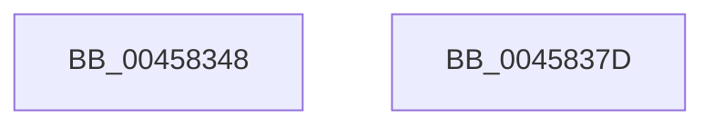

# MiDereferenceControlAreaBySection

- RVA: `0x00458348`–`0x0045837E` (길이 `54` bytes)
- VA: `0x0000000140458348`
- 실행 섹션: `.text`
- PDB 이름 있음: `예`; PDB Function 태그: `아니요`
- unwind 정보 RVA: `0x0005CAAC`
- 디코드: `17`개 명령, `54/54` bytes 표시
- 미해석 바이트: `0` (있으면 어셈블리에 `.byte`로 보존)

> 이 문서는 커널 이미지의 기계어와 PDB 기호를 분석해 생성했습니다. 4번과 5번은 함수 원형과 자료형을 바이너리 사용 방식에서 추정한 C 해석이며 원본 소스 복구 결과는 아닙니다.

## 1. Dependencies

- 직접 호출 지점: **2**; 고유 호출 대상: **2**
- 직접 호출자로 확인된 함수: **5**
- RIP 상대 이미지 참조: **0**

### Outgoing calls
- `0x0045835B` → [ExAcquireSpinLockExclusive](../24/ExAcquireSpinLockExclusive_function_00248690.md) (function, `0x00248690`)
- `0x0045836D` → [MiCheckControlArea](../28/MiCheckControlArea_function_002861B0.md) (function, `0x002861B0`)

### Direct callers
- [MmGetImageFileSignatureInformation](MmGetImageFileSignatureInformation_function_004582B0.md) at `0x00458316`
- [MiApplyImageHotPatchRequest](../../page/80/MiApplyImageHotPatchRequest_function_008025AC.md) at `0x00802AD3`
- [MiApplyImageHotPatchRequest](../../page/80/MiApplyImageHotPatchRequest_function_008025AC.md) at `0x00802B68`
- [sub_00984D37](../../page/98/Unknown_function_00984D37.md) at `0x00984E0B`
- [MiSectionDelete](../../page/A2/MiSectionDelete_function_00A2ECA0.md) at `0x00A2ED2A`
- [MiDereferenceFailedControlArea](../../page/A9/MiDereferenceFailedControlArea_function_00A99228.md) at `0x00A9924E`

### Static image references
- 디코드된 RIP-relative 메모리 참조가 없습니다.

## 2. Other-region calls and transfers

- 다른 실행 섹션으로 향하는 call: **0**
- 별도 외부 분기/꼬리 이동을 확인하지 못했습니다.

## 3. Assembly (complete function range)

```asm
00458348  48 89 5C 24 08                  mov qword ptr [rsp + 8], rbx
0045834D  57                              push rdi
0045834E  48 83 EC 20                     sub rsp, 0x20
00458352  48 8B F9                        mov rdi, rcx
00458355  8B DA                           mov ebx, edx
00458357  48 83 C1 48                     add rcx, 0x48
0045835B  E8 30 03 DF FF                  call 0x140248690
00458360  48 FF 4F 18                     dec qword ptr [rdi + 0x18]
00458364  8A D0                           mov dl, al
00458366  48 29 5F 30                     sub qword ptr [rdi + 0x30], rbx
0045836A  48 8B CF                        mov rcx, rdi
0045836D  E8 3E DE E2 FF                  call 0x1402861b0
00458372  48 8B 5C 24 30                  mov rbx, qword ptr [rsp + 0x30]
00458377  48 83 C4 20                     add rsp, 0x20
0045837B  5F                              pop rdi
0045837C  C3                              ret
0045837D  CC                              int3
```

## 4. C-style interpretation (structured pseudocode)

```c
__int64 __fastcall MiDereferenceControlAreaBySection(__int64 a1, int a2)
{
    __int64 result;
    __int64 v_rsp;
    unsigned __int64 v_stack_p8;

    v_stack_p8 = v_rbx;
    v_rsp = (v_rsp) - (32);
    a1 = (a1) + (72);
    result = ExAcquireSpinLockExclusive(a1, a2, a3, a4);
    result = MiCheckControlArea(a1, (unsigned __int8)(result), a3, a4);
    v_rsp = (v_rsp) + (32);
    return result;
}
```

## 5. (Beta) C Style

```c
int64_t MiDereferenceControlAreaBySection(void *Arg1, int32_t Arg2)
{
    uint8_t *arg1 = (uint8_t *)Arg1;

    int64_t result;
    int64_t local_rsp;
    uint64_t v_stack_p8;

    v_stack_p8 = local_rbx;
    local_rsp = (local_rsp) - (32);
    Arg1 = (Arg1) + (72);
    result = ExAcquireSpinLockExclusive(Arg1, Arg2, a3, a4);
    result = MiCheckControlArea(Arg1, (uint8_t)(result), a3, a4);
    local_rsp = (local_rsp) + (32);
    return result;
}
```

### 관측된 메모리 오프셋

구조체 형식이 확인되지 않은 접근은 인자 기준의 오프셋으로만 기록했습니다.

| 기준 인자 | 오프셋 표현 | 폭 (bit) | 접근 |
|---|---:|---:|---|
| `Arg1` | `+ 0x18` | `64` | `R/W` |
| `Arg1` | `+ 0x30` | `64` | `R/W` |

## 6. Execution-region graph

[열기: 2D/3D 그래프와 함수 탐색 컨트롤 패널](../../../control-panel.html?section=text&rva=0x00458348&view=graph)

- 2D 그래프는 위에서 아래로 흐르고, 3D 그래프는 빈 공간을 드래그해 회전합니다. Shift+드래그는 이동, 휠은 확대·축소, 함수 노드 선택은 대상 보고서 이동입니다.

### Static fallback


