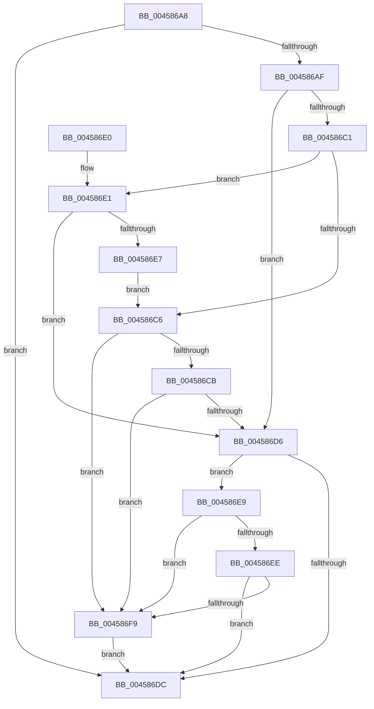

# MiDetermineNewPfnHeatState

- RVA: `0x004586A8`–`0x004586FE` (길이 `86` bytes)
- VA: `0x00000001404586A8`
- 실행 섹션: `.text`
- PDB 이름 있음: `예`; PDB Function 태그: `아니요`
- unwind 정보 RVA: `0x000DB714`
- 디코드: `29`개 명령, `86/86` bytes 표시
- 미해석 바이트: `0` (있으면 어셈블리에 `.byte`로 보존)

> 이 문서는 커널 이미지의 기계어와 PDB 기호를 분석해 생성했습니다. 4번과 5번은 함수 원형과 자료형을 바이너리 사용 방식에서 추정한 C 해석이며 원본 소스 복구 결과는 아닙니다.

## 1. Dependencies

- 직접 호출 지점: **0**; 고유 호출 대상: **0**
- 직접 호출자로 확인된 함수: **4**
- RIP 상대 이미지 참조: **1**

### Outgoing calls
- 직접 디코드된 call 명령이 없습니다.

### Direct callers
- [MiInitializeNewPfns](../67/MiInitializeNewPfns_function_00670E94.md) at `0x00670FA0`
- [MiEnableNewPfns](../67/MiEnableNewPfns_function_00671DD0.md) at `0x00671EB4`
- [MiEnableNewPfns](../67/MiEnableNewPfns_function_00671DD0.md) at `0x00671F8D`
- [MxInsertFreePages](../../init/C6/MxInsertFreePages_function_00C63AD0.md) at `0x00C63BAB`
- [MxInsertEnclaveBootPages](../../init/C6/MxInsertEnclaveBootPages_function_00C68CB0.md) at `0x00C68D46`

### Static image references
- `0x004586AF` → RVA `0x00FC6AB8` (`ALMOSTRO`; read)

## 2. Other-region calls and transfers

- 다른 실행 섹션으로 향하는 call: **0**
- 별도 외부 분기/꼬리 이동을 확인하지 못했습니다.

## 3. Assembly (complete function range)

```asm
004586A8  45 33 C9                        xor r9d, r9d
004586AB  85 C9                           test ecx, ecx
004586AD  75 2D                           jne 0x1404586dc
004586AF  8B 0D 03 E4 B6 00               mov ecx, dword ptr [rip + 0xb6e403]
004586B5  45 8D 51 01                     lea r10d, [r9 + 1]
004586B9  F7 C1 00 00 40 08               test ecx, 0x8400000
004586BF  74 15                           je 0x1404586d6
004586C1  41 3B D2                        cmp edx, r10d
004586C4  77 1B                           ja 0x1404586e1
004586C6  4D 85 C0                        test r8, r8
004586C9  74 2E                           je 0x1404586f9
004586CB  41 8B 80 50 3B 00 00            mov eax, dword ptr [r8 + 0x3b50]
004586D2  A8 02                           test al, 2
004586D4  74 23                           je 0x1404586f9
004586D6  0F BA E1 15                     bt ecx, 0x15
004586DA  72 0D                           jb 0x1404586e9
004586DC  41 8B C1                        mov eax, r9d
004586DF  C3                              ret
004586E0  CC                              int3
004586E1  0F BA E1 1B                     bt ecx, 0x1b
004586E5  72 EF                           jb 0x1404586d6
004586E7  EB DD                           jmp 0x1404586c6
004586E9  4D 85 C0                        test r8, r8
004586EC  74 0B                           je 0x1404586f9
004586EE  41 8B 80 50 3B 00 00            mov eax, dword ptr [r8 + 0x3b50]
004586F5  A8 02                           test al, 2
004586F7  75 E3                           jne 0x1404586dc
004586F9  45 8B CA                        mov r9d, r10d
004586FC  EB DE                           jmp 0x1404586dc
```

## 4. C-style interpretation (structured pseudocode)

```c
__int64 __fastcall MiDetermineNewPfnHeatState(int a1, int a2, __int64 a3, int a4)
{
    a4 = 0;
    if (a1 != 0) goto loc_004586DC;
    if ((((unsigned int)((unsigned int)(*(unsigned int *)(v_rip + 11985923)))) & (0x8400000ULL)) == 0) goto loc_004586D6;
    if (a2 > ((unsigned int)(a4 + 1))) goto loc_004586E1;
loc_004586C6:
    if (a3 == 0) goto loc_004586F9;
    if ((((unsigned __int8)((unsigned int)(*(unsigned int *)(a3 + 15184)))) & (2)) == 0) goto loc_004586F9;
loc_004586D6:
    if (condition_is_below) goto loc_004586E9;
loc_004586DC:
    return 0;
loc_004586E1:
    if (condition_is_below) goto loc_004586D6;
    goto loc_004586C6;
loc_004586E9:
    if (a3 == 0) goto loc_004586F9;
    if ((((unsigned __int8)((unsigned int)(*(unsigned int *)(a3 + 15184)))) & (2)) != 0) goto loc_004586DC;
loc_004586F9:
    goto loc_004586DC;
}
```

## 5. (Beta) C Style

```c
int64_t MiDetermineNewPfnHeatState(int32_t Arg1, int32_t Arg2, int64_t Arg3, int32_t Arg4)
{
    Arg4 = 0;
    if (Arg1 != 0) goto loc_004586DC;
    if ((((uint32_t)((uint32_t)(*(uint32_t *)(v_rip + 0xB6E403)))) & (0x8400000ULL)) == 0) goto loc_004586D6;
    if (Arg2 > ((uint32_t)(Arg4 + 1))) goto loc_004586E1;
loc_004586C6:
    if (Arg3 == 0) goto loc_004586F9;
    if ((((uint8_t)((uint32_t)(*(uint32_t *)(Arg3 + 0x3B50)))) & (2)) == 0) goto loc_004586F9;
loc_004586D6:
    if (condition_is_below) goto loc_004586E9;
loc_004586DC:
    return 0;
loc_004586E1:
    if (condition_is_below) goto loc_004586D6;
    goto loc_004586C6;
loc_004586E9:
    if (Arg3 == 0) goto loc_004586F9;
    if ((((uint8_t)((uint32_t)(*(uint32_t *)(Arg3 + 0x3B50)))) & (2)) != 0) goto loc_004586DC;
loc_004586F9:
    goto loc_004586DC;
}
```

## 6. Execution-region graph

[열기: 2D/3D 그래프와 함수 탐색 컨트롤 패널](../../../control-panel.html?section=text&rva=0x004586A8&view=graph)

- 2D 그래프는 위에서 아래로 흐르고, 3D 그래프는 빈 공간을 드래그해 회전합니다. Shift+드래그는 이동, 휠은 확대·축소, 함수 노드 선택은 대상 보고서 이동입니다.

### Static fallback


