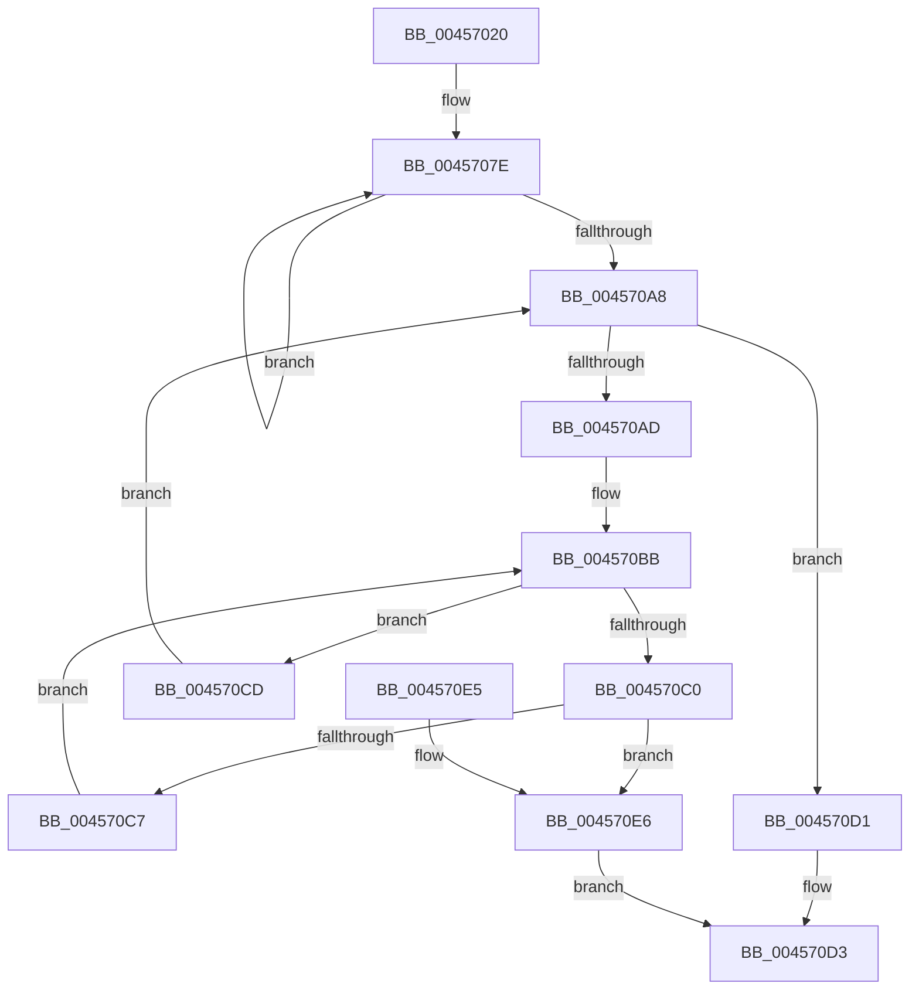

# MiFindLargeMapping

- RVA: `0x00457020`–`0x004570ED` (길이 `205` bytes)
- VA: `0x0000000140457020`
- 실행 섹션: `.text`
- PDB 이름 있음: `예`; PDB Function 태그: `아니요`
- unwind 정보 RVA: `0x000A80E8`
- 디코드: `56`개 명령, `205/205` bytes 표시
- 미해석 바이트: `0` (있으면 어셈블리에 `.byte`로 보존)

> 이 문서는 커널 이미지의 기계어와 PDB 기호를 분석해 생성했습니다. 4번과 5번은 함수 원형과 자료형을 바이너리 사용 방식에서 추정한 C 해석이며 원본 소스 복구 결과는 아닙니다.

## 1. Dependencies

- 직접 호출 지점: **1**; 고유 호출 대상: **1**
- 직접 호출자로 확인된 함수: **1**
- RIP 상대 이미지 참조: **1**

### Outgoing calls
- `0x004570DB` → [_security_check_cookie](../6A/_security_check_cookie_function_006AC640.md) (function, `0x006AC640`)

### Direct callers
- [MmProtectPool](../26/MmProtectPool_function_002697AC.md) at `0x0026986B`

### Static image references
- `0x00457024` → RVA `0x00E0A740` (`.data`; read)

## 2. Other-region calls and transfers

- 다른 실행 섹션으로 향하는 call: **0**
- 별도 외부 분기/꼬리 이동을 확인하지 못했습니다.

## 3. Assembly (complete function range)

```asm
00457020  48 83 EC 48                     sub rsp, 0x48
00457024  48 8B 05 15 37 9B 00            mov rax, qword ptr [rip + 0x9b3715]
0045702B  48 33 C4                        xor rax, rsp
0045702E  48 89 44 24 30                  mov qword ptr [rsp + 0x30], rax
00457033  4C 8B C1                        mov r8, rcx
00457036  41 B9 F8 FF FF 3F               mov r9d, 0x3ffffff8
0045703C  49 C1 E8 12                     shr r8, 0x12
00457040  4D 23 C1                        and r8, r9
00457043  48 B9 00 00 00 40 FB F6 FF FF   movabs rcx, 0xfffff6fb40000000
0045704D  48 8B C1                        mov rax, rcx
00457050  48 C1 EA 12                     shr rdx, 0x12
00457054  4C 03 C0                        add r8, rax
00457057  49 23 D1                        and rdx, r9
0045705A  48 8B C1                        mov rax, rcx
0045705D  48 03 D0                        add rdx, rax
00457060  49 BA 00 00 00 00 80 F6 FF FF   movabs r10, 0xfffff68000000000
0045706A  B9 03 00 00 00                  mov ecx, 3
0045706F  4C 8D 4C 24 38                  lea r9, [rsp + 0x38]
00457074  49 BB F8 FF FF FF 7F 00 00 00   movabs r11, 0x7ffffffff8
0045707E  4D 8D 49 F0                     lea r9, [r9 - 0x10]
00457082  4D 89 41 F8                     mov qword ptr [r9 - 8], r8
00457086  49 C1 E8 09                     shr r8, 9
0045708A  4D 23 C3                        and r8, r11
0045708D  49 89 11                        mov qword ptr [r9], rdx
00457090  49 8B C2                        mov rax, r10
00457093  48 C1 EA 09                     shr rdx, 9
00457097  4C 03 C0                        add r8, rax
0045709A  49 23 D3                        and rdx, r11
0045709D  49 8B C2                        mov rax, r10
004570A0  48 03 D0                        add rdx, rax
004570A3  83 C1 FF                        add ecx, -1
004570A6  75 D6                           jne 0x14045707e
004570A8  83 F9 03                        cmp ecx, 3
004570AB  73 24                           jae 0x1404570d1
004570AD  8B C1                           mov eax, ecx
004570AF  48 03 C0                        add rax, rax
004570B2  48 8B 14 C4                     mov rdx, qword ptr [rsp + rax*8]
004570B6  4C 8B 44 C4 08                  mov r8, qword ptr [rsp + rax*8 + 8]
004570BB  49 3B D0                        cmp rdx, r8
004570BE  77 0D                           ja 0x1404570cd
004570C0  48 8B 02                        mov rax, qword ptr [rdx]
004570C3  84 C0                           test al, al
004570C5  78 1F                           js 0x1404570e6
004570C7  48 83 C2 08                     add rdx, 8
004570CB  EB EE                           jmp 0x1404570bb
004570CD  FF C1                           inc ecx
004570CF  EB D7                           jmp 0x1404570a8
004570D1  33 C0                           xor eax, eax
004570D3  48 8B 4C 24 30                  mov rcx, qword ptr [rsp + 0x30]
004570D8  48 33 CC                        xor rcx, rsp
004570DB  E8 60 55 25 00                  call 0x1406ac640
004570E0  48 83 C4 48                     add rsp, 0x48
004570E4  C3                              ret
004570E5  CC                              int3
004570E6  B8 01 00 00 00                  mov eax, 1
004570EB  EB E6                           jmp 0x1404570d3
```

## 4. C-style interpretation (structured pseudocode)

```c
__int64 __fastcall MiFindLargeMapping(__int64 a1, __int64 a2)
{
    __int64 result;
    __int64 v_rsp;
    unsigned __int64 v_stack_m10;
    unsigned __int64 v_stack_m18;

    v_rsp = (v_rsp) - (72);
    result = (*(unsigned __int64 *)(v_rip + 10172181)) ^ (v_rsp);
    v_stack_m18 = result;
    a3 = (a1) >> (18);
    a3 = (a3) & ((unsigned int)(0x3FFFFFF8ULL));
    a2 = (a2) >> (18);
    a3 = (a3) + (a1);
    a2 = (a2) & ((unsigned int)(0x3FFFFFF8ULL));
    a2 = (a2) + (a1);
loc_0045707E:
    *(unsigned __int64 *)(v_stack_m10 - 16 - 8) = a3;
    a3 = (a3) >> (9);
    a3 = (a3) & (v_r11);
    *(unsigned __int64 *)(v_stack_m10 - 16) = a2;
    a2 = (a2) >> (9);
    a3 = (a3) + (v_r10);
    a2 = (a2) & (v_r11);
    a2 = (a2) + (v_r10);
    a1 = (unsigned int)((3) + (-1));
    if (condition_is_not_equal) goto loc_0045707E;
loc_004570A8:
    if (((unsigned int)(a1)) >= 3) goto loc_004570D1;
    result = ((unsigned int)((unsigned int)(a1))) + ((unsigned int)((unsigned int)(a1)));
loc_004570BB:
    if ((*(unsigned __int64 *)(v_rsp + result * 8)) > (*(unsigned __int64 *)(v_rsp + result * 8 + 8))) goto loc_004570CD;
    if (sign_flag) goto loc_004570E6;
    a2 = (*(unsigned __int64 *)(v_rsp + result * 8)) + (8);
    goto loc_004570BB;
loc_004570CD:
    a1 = (unsigned int)((a1) + 1);
    goto loc_004570A8;
loc_004570D1:
    result = 0;
loc_004570D3:
    a1 = (v_stack_m18) ^ (v_rsp);
    result = _security_check_cookie(a1, a2, *(unsigned __int64 *)(v_rsp + result * 8 + 8), v_stack_m10 - 16);
    v_rsp = (v_rsp) + (72);
    return result;
loc_004570E6:
    goto loc_004570D3;
}
```

## 5. (Beta) C Style

```c
int64_t MiFindLargeMapping(int64_t Arg1, int64_t Arg2)
{
    int64_t result;
    int64_t local_rsp;
    uint64_t v_stack_m10;
    uint64_t v_stack_m18;

    local_rsp = (local_rsp) - (72);
    result = (*(uint64_t *)(v_rip + 0x9B3715)) ^ (local_rsp);
    v_stack_m18 = result;
    a3 = (Arg1) >> (18);
    a3 = (a3) & ((uint32_t)(0x3FFFFFF8ULL));
    Arg2 = (Arg2) >> (18);
    a3 = (a3) + (Arg1);
    Arg2 = (Arg2) & ((uint32_t)(0x3FFFFFF8ULL));
    Arg2 = (Arg2) + (Arg1);
loc_0045707E:
    *(uint64_t *)(v_stack_m10 - 0x10 - 0x8) = a3;
    a3 = (a3) >> (9);
    a3 = (a3) & (local_r11);
    *(uint64_t *)(v_stack_m10 - 0x10) = Arg2;
    Arg2 = (Arg2) >> (9);
    a3 = (a3) + (local_r10);
    Arg2 = (Arg2) & (local_r11);
    Arg2 = (Arg2) + (local_r10);
    Arg1 = (uint32_t)((3) + (-1));
    if (condition_is_not_equal) goto loc_0045707E;
loc_004570A8:
    if (((uint32_t)(Arg1)) >= 3) goto loc_004570D1;
    result = ((uint32_t)((uint32_t)(Arg1))) + ((uint32_t)((uint32_t)(Arg1)));
loc_004570BB:
    if ((*(uint64_t *)(local_rsp + result * 8)) > (*(uint64_t *)(local_rsp + result * 8 + 0x8))) goto loc_004570CD;
    if (sign_flag) goto loc_004570E6;
    Arg2 = (*(uint64_t *)(local_rsp + result * 8)) + (8);
    goto loc_004570BB;
loc_004570CD:
    Arg1 = (uint32_t)((Arg1) + 1);
    goto loc_004570A8;
loc_004570D1:
    result = 0;
loc_004570D3:
    Arg1 = (v_stack_m18) ^ (local_rsp);
    result = _security_check_cookie(Arg1, Arg2, *(uint64_t *)(local_rsp + result * 8 + 0x8), v_stack_m10 - 16);
    local_rsp = (local_rsp) + (72);
    return result;
loc_004570E6:
    goto loc_004570D3;
}
```

## 6. Execution-region graph

[열기: 2D/3D 그래프와 함수 탐색 컨트롤 패널](../../../control-panel.html?section=text&rva=0x00457020&view=graph)

- 2D 그래프는 위에서 아래로 흐르고, 3D 그래프는 빈 공간을 드래그해 회전합니다. Shift+드래그는 이동, 휠은 확대·축소, 함수 노드 선택은 대상 보고서 이동입니다.

### Static fallback


