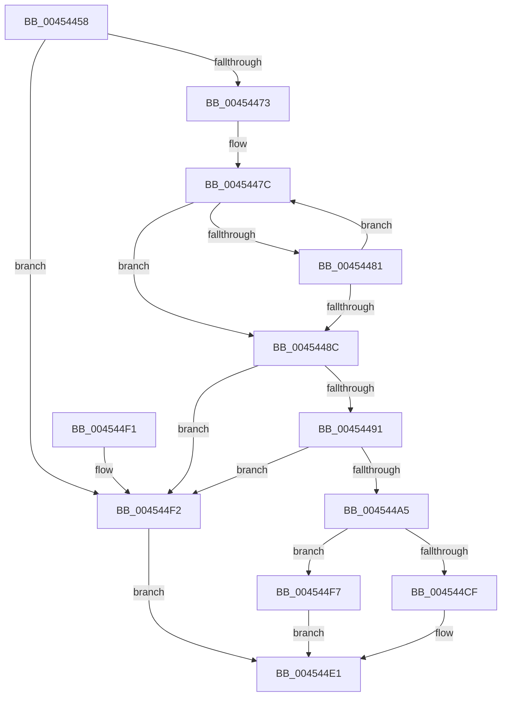

# MiFindNextLowerLargePageCandidate

- RVA: `0x00454458`–`0x004544FB` (길이 `163` bytes)
- VA: `0x0000000140454458`
- 실행 섹션: `.text`
- PDB 이름 있음: `예`; PDB Function 태그: `아니요`
- unwind 정보 RVA: `0x00068908`
- 디코드: `49`개 명령, `163/163` bytes 표시
- 미해석 바이트: `0` (있으면 어셈블리에 `.byte`로 보존)

> 이 문서는 커널 이미지의 기계어와 PDB 기호를 분석해 생성했습니다. 4번과 5번은 함수 원형과 자료형을 바이너리 사용 방식에서 추정한 C 해석이며 원본 소스 복구 결과는 아닙니다.

## 1. Dependencies

- 직접 호출 지점: **1**; 고유 호출 대상: **1**
- 직접 호출자로 확인된 함수: **2**
- RIP 상대 이미지 참조: **2**

### Outgoing calls
- `0x004544C1` → [RtlFindNextClearBitBackwardsEx](RtlFindNextClearBitBackwardsEx_function_00454504.md) (function, `0x00454504`)

### Direct callers
- [MiPfnsWorthTrying](../31/MiPfnsWorthTrying_function_0031B0C0.md) at `0x0031B860`
- [MiPfnsWorthTrying](../31/MiPfnsWorthTrying_function_0031B0C0.md) at `0x0031B98F`
- [MiPfnsWorthTrying](../31/MiPfnsWorthTrying_function_0031B0C0.md) at `0x0031B9FE`
- [MiFindBestLargePageStealCandidates](MiFindBestLargePageStealCandidates_function_00453EEC.md) at `0x004542D0`

### Static image references
- `0x00454475` → RVA `0x00011C60` (`.rdata`; read)
- `0x004544A5` → RVA `0x000135E8` (`.rdata`; read)

## 2. Other-region calls and transfers

- 다른 실행 섹션으로 향하는 call: **0**
- 별도 외부 분기/꼬리 이동을 확인하지 못했습니다.

## 3. Assembly (complete function range)

```asm
00454458  48 89 5C 24 08                  mov qword ptr [rsp + 8], rbx
0045445D  48 89 74 24 10                  mov qword ptr [rsp + 0x10], rsi
00454462  57                              push rdi
00454463  48 83 EC 20                     sub rsp, 0x20
00454467  80 B9 E6 3E 00 00 00            cmp byte ptr [rcx + 0x3ee6], 0
0045446E  48 8B DA                        mov rbx, rdx
00454471  74 7F                           je 0x1404544f2
00454473  33 C0                           xor eax, eax
00454475  4C 8D 0D E4 D7 BB FF            lea r9, [rip - 0x44281c]
0045447C  4D 39 01                        cmp qword ptr [r9], r8
0045447F  74 0B                           je 0x14045448c
00454481  FF C0                           inc eax
00454483  49 83 C1 08                     add r9, 8
00454487  83 F8 03                        cmp eax, 3
0045448A  72 F0                           jb 0x14045447c
0045448C  83 F8 01                        cmp eax, 1
0045448F  77 61                           ja 0x1404544f2
00454491  44 8B C0                        mov r8d, eax
00454494  49 C1 E0 04                     shl r8, 4
00454498  4C 03 C1                        add r8, rcx
0045449B  49 83 B8 C8 3F 00 00 00         cmp qword ptr [r8 + 0x3fc8], 0
004544A3  74 4D                           je 0x1404544f2
004544A5  48 8D 35 3C F1 BB FF            lea rsi, [rip - 0x440ec4]
004544AC  48 8B FB                        mov rdi, rbx
004544AF  8B 34 86                        mov esi, dword ptr [rsi + rax*4]
004544B2  8B CE                           mov ecx, esi
004544B4  48 D3 EF                        shr rdi, cl
004544B7  49 8D 88 C8 3F 00 00            lea rcx, [r8 + 0x3fc8]
004544BE  48 8B D7                        mov rdx, rdi
004544C1  E8 3E 00 00 00                  call 0x140454504
004544C6  4C 8B D8                        mov r11, rax
004544C9  48 83 F8 FF                     cmp rax, -1
004544CD  74 28                           je 0x1404544f7
004544CF  49 FF C3                        inc r11
004544D2  8B CE                           mov ecx, esi
004544D4  49 8B C3                        mov rax, r11
004544D7  48 D3 E0                        shl rax, cl
004544DA  4C 3B DF                        cmp r11, rdi
004544DD  48 0F 43 C3                     cmovae rax, rbx
004544E1  48 8B 5C 24 30                  mov rbx, qword ptr [rsp + 0x30]
004544E6  48 8B 74 24 38                  mov rsi, qword ptr [rsp + 0x38]
004544EB  48 83 C4 20                     add rsp, 0x20
004544EF  5F                              pop rdi
004544F0  C3                              ret
004544F1  CC                              int3
004544F2  48 8B C3                        mov rax, rbx
004544F5  EB EA                           jmp 0x1404544e1
004544F7  33 C0                           xor eax, eax
004544F9  EB E6                           jmp 0x1404544e1
```

## 4. C-style interpretation (structured pseudocode)

```c
__int64 __fastcall MiFindNextLowerLargePageCandidate(__int64 a1, __int64 a2, __int64 a3)
{
    __int64 result;
    __int64 v_r11;
    __int64 v_rdi;
    __int64 v_rsp;
    unsigned __int64 v_stack_p10;
    unsigned __int64 v_stack_p8;

    v_stack_p8 = v_rbx;
    v_stack_p10 = v_rsi;
    v_rsp = (v_rsp) - (32);
    if ((*(unsigned __int8 *)(a1 + 16102)) == 0) goto loc_004544F2;
    result = 0;
loc_0045447C:
    if ((*(unsigned __int64 *)(v_rip - 4466716)) == a3) goto loc_0045448C;
    result = (unsigned int)((result) + 1);
    a4 = (v_rip - 4466716) + (8);
    if (((unsigned int)(result)) < 3) goto loc_0045447C;
loc_0045448C:
    if (((unsigned int)(result)) > 1) goto loc_004544F2;
    a3 = ((unsigned int)((unsigned int)(result))) << (4);
    a3 = (a3) + (a1);
    if ((*(unsigned __int64 *)(a3 + 16328)) == 0) goto loc_004544F2;
    v_rdi = (a2) >> ((unsigned __int8)((unsigned int)((unsigned int)((unsigned int)(*(unsigned int *)(v_rip - 4460228 + result * 4))))));
    result = RtlFindNextClearBitBackwardsEx(a3 + 16328, v_rdi, a3, a4);
    if (result == -1) goto loc_004544F7;
    v_r11 = (result) + 1;
    result = (v_r11) << ((unsigned __int8)((unsigned int)((unsigned int)((unsigned int)(*(unsigned int *)(v_rip - 4460228 + result * 4))))));
    if (v_r11 >= v_rdi) { result = a2; }
loc_004544E1:
    v_rsp = (v_rsp) + (32);
    return result;
loc_004544F2:
    goto loc_004544E1;
loc_004544F7:
    result = 0;
    goto loc_004544E1;
}
```

## 5. (Beta) C Style

```c
int64_t MiFindNextLowerLargePageCandidate(void *Arg1, int64_t Arg2, int64_t Arg3)
{
    uint8_t *arg1 = (uint8_t *)Arg1;

    int64_t result;
    int64_t local_r11;
    int64_t local_rdi;
    int64_t local_rsp;
    uint64_t v_stack_p10;
    uint64_t v_stack_p8;

    v_stack_p8 = local_rbx;
    v_stack_p10 = local_rsi;
    local_rsp = (local_rsp) - (32);
    if ((*(uint8_t *)(arg1 + 0x3EE6)) == 0) goto loc_004544F2;
    result = 0;
loc_0045447C:
    if ((*(uint64_t *)(v_rip - 0x44281C)) == Arg3) goto loc_0045448C;
    result = (uint32_t)((result) + 1);
    a4 = (v_rip - 4466716) + (8);
    if (((uint32_t)(result)) < 3) goto loc_0045447C;
loc_0045448C:
    if (((uint32_t)(result)) > 1) goto loc_004544F2;
    Arg3 = ((uint32_t)((uint32_t)(result))) << (4);
    Arg3 = (Arg3) + (Arg1);
    if ((*(uint64_t *)(Arg3 + 0x3FC8)) == 0) goto loc_004544F2;
    local_rdi = (Arg2) >> ((uint8_t)((uint32_t)((uint32_t)((uint32_t)(*(uint32_t *)(v_rip - 0x440EC4 + result * 4))))));
    result = RtlFindNextClearBitBackwardsEx(Arg3 + 16328, local_rdi, Arg3, a4);
    if (result == -1) goto loc_004544F7;
    local_r11 = (result) + 1;
    result = (local_r11) << ((uint8_t)((uint32_t)((uint32_t)((uint32_t)(*(uint32_t *)(v_rip - 0x440EC4 + result * 4))))));
    if (local_r11 >= local_rdi) { result = Arg2; }
loc_004544E1:
    local_rsp = (local_rsp) + (32);
    return result;
loc_004544F2:
    goto loc_004544E1;
loc_004544F7:
    result = 0;
    goto loc_004544E1;
}
```

### 관측된 메모리 오프셋

구조체 형식이 확인되지 않은 접근은 인자 기준의 오프셋으로만 기록했습니다.

| 기준 인자 | 오프셋 표현 | 폭 (bit) | 접근 |
|---|---:|---:|---|
| `Arg1` | `+ 0x3EE6` | `8` | `R` |

## 6. Execution-region graph

[열기: 2D/3D 그래프와 함수 탐색 컨트롤 패널](../../../control-panel.html?section=text&rva=0x00454458&view=graph)

- 2D 그래프는 위에서 아래로 흐르고, 3D 그래프는 빈 공간을 드래그해 회전합니다. Shift+드래그는 이동, 휠은 확대·축소, 함수 노드 선택은 대상 보고서 이동입니다.

### Static fallback


