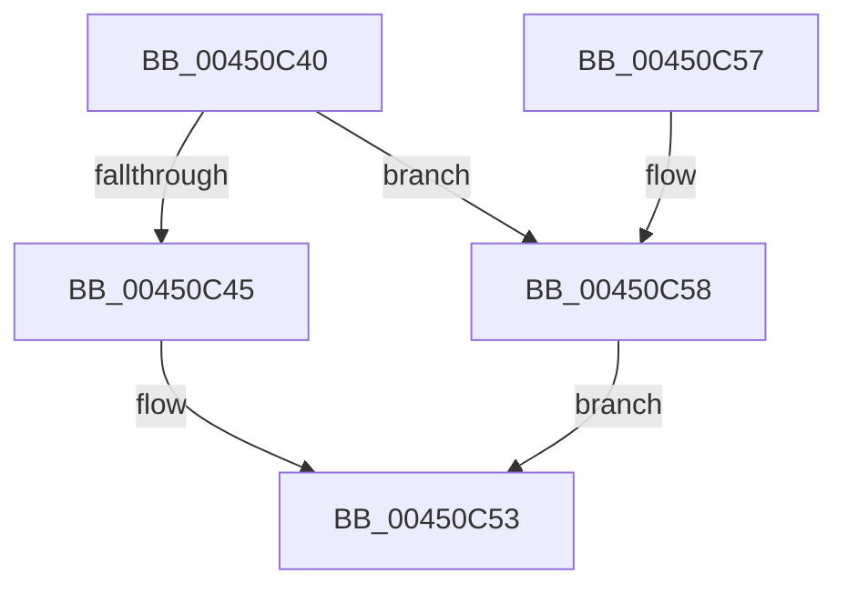

# MiFreePoolPagesLeft

- RVA: `0x00450C40`–`0x00450C68` (길이 `40` bytes)
- VA: `0x0000000140450C40`
- 실행 섹션: `.text`
- PDB 이름 있음: `예`; PDB Function 태그: `아니요`
- unwind 정보 RVA: `0x000DB714`
- 디코드: `10`개 명령, `40/40` bytes 표시
- 미해석 바이트: `0` (있으면 어셈블리에 `.byte`로 보존)

> 이 문서는 커널 이미지의 기계어와 PDB 기호를 분석해 생성했습니다. 4번과 5번은 함수 원형과 자료형을 바이너리 사용 방식에서 추정한 C 해석이며 원본 소스 복구 결과는 아닙니다.

## 1. Dependencies

- 직접 호출 지점: **0**; 고유 호출 대상: **0**
- 직접 호출자로 확인된 함수: **2**
- RIP 상대 이미지 참조: **4**

### Outgoing calls
- 직접 디코드된 call 명령이 없습니다.

### Direct callers
- [ExpQuerySystemPerformanceInformation](../../page/9D/ExpQuerySystemPerformanceInformation_function_009D648C.md) at `0x009D67D0`
- [MiInitializePagedPoolEvents](../../init/C6/MiInitializePagedPoolEvents_function_00C64C44.md) at `0x00C64C9F`

### Static image references
- `0x00450C45` → RVA `0x00E2CB48` (`.data`; read)
- `0x00450C4C` → RVA `0x00E2CB40` (`.data`; read)
- `0x00450C58` → RVA `0x00E37650` (`.data`; read)
- `0x00450C5F` → RVA `0x00E37660` (`.data`; read)

## 2. Other-region calls and transfers

- 다른 실행 섹션으로 향하는 call: **0**
- 별도 외부 분기/꼬리 이동을 확인하지 못했습니다.

## 3. Assembly (complete function range)

```asm
00450C40  83 F9 04                        cmp ecx, 4
00450C43  75 13                           jne 0x140450c58
00450C45  48 8B 0D FC BE 9D 00            mov rcx, qword ptr [rip + 0x9dbefc]
00450C4C  48 8B 05 ED BE 9D 00            mov rax, qword ptr [rip + 0x9dbeed]
00450C53  48 2B C1                        sub rax, rcx
00450C56  C3                              ret
00450C57  CC                              int3
00450C58  48 8B 0D F1 69 9E 00            mov rcx, qword ptr [rip + 0x9e69f1]
00450C5F  48 8B 05 FA 69 9E 00            mov rax, qword ptr [rip + 0x9e69fa]
00450C66  EB EB                           jmp 0x140450c53
```

## 4. C-style interpretation (structured pseudocode)

```c
__int64 __fastcall MiFreePoolPagesLeft(int a1)
{
    __int64 result;

    if (a1 != 4) goto loc_00450C58;
loc_00450C53:
    result = (*(unsigned __int64 *)(v_rip + 10338029)) - (*(unsigned __int64 *)(v_rip + 10338044));
    return result;
loc_00450C58:
    goto loc_00450C53;
}
```

## 5. (Beta) C Style

```c
int64_t MiFreePoolPagesLeft(int32_t Arg1)
{
    int64_t result;

    if (Arg1 != 4) goto loc_00450C58;
loc_00450C53:
    result = (*(uint64_t *)(v_rip + 0x9DBEED)) - (*(uint64_t *)(v_rip + 0x9DBEFC));
    return result;
loc_00450C58:
    goto loc_00450C53;
}
```

## 6. Execution-region graph

[열기: 2D/3D 그래프와 함수 탐색 컨트롤 패널](../../../control-panel.html?section=text&rva=0x00450C40&view=graph)

- 2D 그래프는 위에서 아래로 흐르고, 3D 그래프는 빈 공간을 드래그해 회전합니다. Shift+드래그는 이동, 휠은 확대·축소, 함수 노드 선택은 대상 보고서 이동입니다.

### Static fallback


