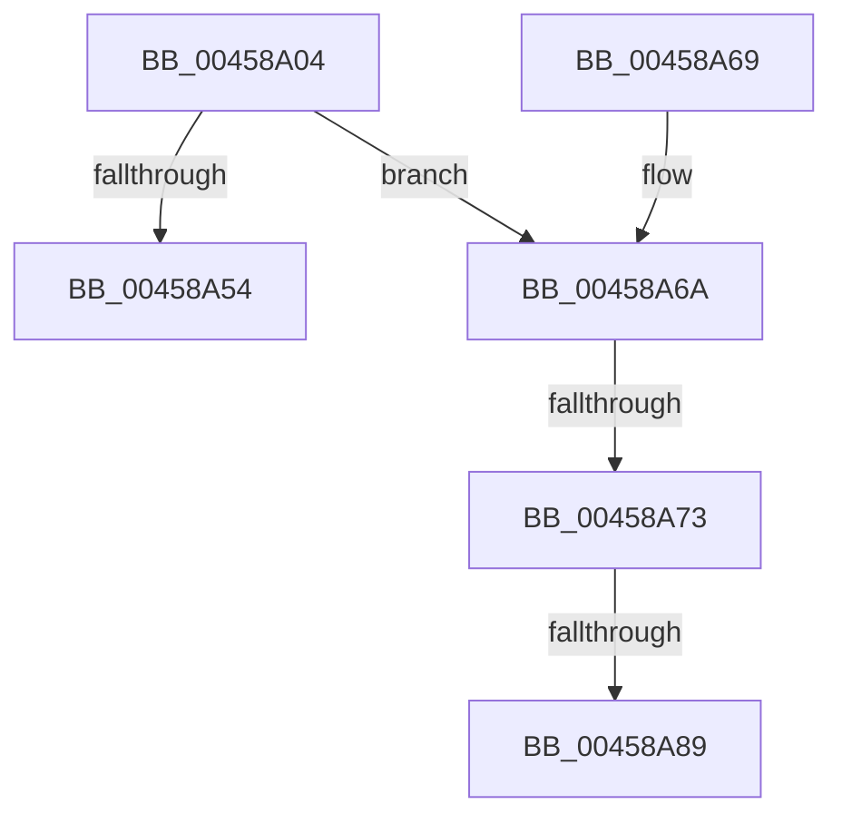

# MiGetSubsectionCharges

- RVA: `0x00458A04`–`0x00458A93` (길이 `143` bytes)
- VA: `0x0000000140458A04`
- 실행 섹션: `.text`
- PDB 이름 있음: `예`; PDB Function 태그: `예`
- unwind 정보 RVA: `0x000814C4`
- 디코드: `39`개 명령, `143/143` bytes 표시
- 미해석 바이트: `0` (있으면 어셈블리에 `.byte`로 보존)

> 이 문서는 커널 이미지의 기계어와 PDB 기호를 분석해 생성했습니다. 4번과 5번은 함수 원형과 자료형을 바이너리 사용 방식에서 추정한 C 해석이며 원본 소스 복구 결과는 아닙니다.

## 1. Dependencies

- 직접 호출 지점: **2**; 고유 호출 대상: **2**
- 직접 호출자로 확인된 함수: **4**
- RIP 상대 이미지 참조: **1**

### Outgoing calls
- `0x00458A4B` → [MiGetCrossPartitionCharges](../32/MiGetCrossPartitionCharges_function_00325BFC.md) (function, `0x00325BFC`)
- `0x00458A7C` → [MiChargeCommit](../28/MiChargeCommit_function_00286EB0.md) (function, `0x00286EB0`)

### Direct callers
- [MiCreatePrototypePtes](../29/MiCreatePrototypePtes_function_002950FC.md) at `0x0029558C`
- [MiUpdateLastSubsectionSize](MiUpdateLastSubsectionSize_function_0045876C.md) at `0x004588AD`
- [MiChargeSegmentCommit](../../page/8C/MiChargeSegmentCommit_function_008CEDE4.md) at `0x008CF0CA`
- [MiExtendSection](../../page/98/MiExtendSection_function_00982FDC.md) at `0x009833B1`
- [MiExtendSection](../../page/98/MiExtendSection_function_00982FDC.md) at `0x009833F9`

### Static image references
- `0x00458A2B` → RVA `0x00E30088` (`.data`; read)

## 2. Other-region calls and transfers

- 다른 실행 섹션으로 향하는 call: **0**
- call이 아닌 외부 분기/꼬리 이동: **3**
  - `0x00458A6D` → [sub_006F1BC0](../6F/Unknown_function_006F1BC0.md) (`tail-transfer`)
  - `0x00458A83` → [sub_006F1BC0](../6F/Unknown_function_006F1BC0.md) (`tail-transfer`)
  - `0x00458A8E` → [sub_006F1BC0 + 0x2A](../6F/Unknown_function_006F1BC0.md) (`tail-transfer`)

## 3. Assembly (complete function range)

```asm
00458A04  48 89 5C 24 08                  mov qword ptr [rsp + 8], rbx
00458A09  48 89 6C 24 10                  mov qword ptr [rsp + 0x10], rbp
00458A0E  48 89 74 24 18                  mov qword ptr [rsp + 0x18], rsi
00458A13  57                              push rdi
00458A14  48 83 EC 20                     sub rsp, 0x20
00458A18  48 8B 01                        mov rax, qword ptr [rcx]
00458A1B  33 ED                           xor ebp, ebp
00458A1D  48 8B DA                        mov rbx, rdx
00458A20  4C 8B CA                        mov r9, rdx
00458A23  0F B7 48 3C                     movzx ecx, word ptr [rax + 0x3c]
00458A27  48 8B 70 40                     mov rsi, qword ptr [rax + 0x40]
00458A2B  48 8B 05 56 76 9D 00            mov rax, qword ptr [rip + 0x9d7656]
00458A32  48 85 F6                        test rsi, rsi
00458A35  40 0F 95 C5                     setne bpl
00458A39  81 E1 FF 03 00 00               and ecx, 0x3ff
00458A3F  44 8B C5                        mov r8d, ebp
00458A42  33 D2                           xor edx, edx
00458A44  48 8B 3C C8                     mov rdi, qword ptr [rax + rcx*8]
00458A48  48 8B CF                        mov rcx, rdi
00458A4B  E8 AC D1 EC FF                  call 0x140325bfc
00458A50  85 C0                           test eax, eax
00458A52  79 16                           jns 0x140458a6a
00458A54  48 8B 5C 24 30                  mov rbx, qword ptr [rsp + 0x30]
00458A59  48 8B 6C 24 38                  mov rbp, qword ptr [rsp + 0x38]
00458A5E  48 8B 74 24 40                  mov rsi, qword ptr [rsp + 0x40]
00458A63  48 83 C4 20                     add rsp, 0x20
00458A67  5F                              pop rdi
00458A68  C3                              ret
00458A69  CC                              int3
00458A6A  48 85 F6                        test rsi, rsi
00458A6D  0F 84 4D 91 29 00               je 0x1406f1bc0
00458A73  45 33 C0                        xor r8d, r8d
00458A76  48 8B D3                        mov rdx, rbx
00458A79  48 8B CF                        mov rcx, rdi
00458A7C  E8 2F E4 E2 FF                  call 0x140286eb0
00458A81  85 C0                           test eax, eax
00458A83  0F 85 37 91 29 00               jne 0x1406f1bc0
00458A89  BE 2D 01 00 C0                  mov esi, 0xc000012d
00458A8E  E9 57 91 29 00                  jmp 0x1406f1bea
```

## 4. C-style interpretation (structured pseudocode)

```c
__int64 __fastcall MiGetSubsectionCharges(__int64 a1, __int64 a2)
{
    __int64 result;
    __int64 v_rbp;
    __int64 v_rsp;
    unsigned __int64 v_stack_p10;
    unsigned __int64 v_stack_p18;
    unsigned __int64 v_stack_p8;

    v_stack_p8 = v_rbx;
    v_stack_p10 = v_rbp;
    v_stack_p18 = v_rsi;
    v_rsp = (v_rsp) - (32);
    v_rbp = 0;
    v_rbp = (*(unsigned __int64 *)(*(unsigned __int64 *)(a1) + 64) != 0) ? 1 : 0;
    a1 = (unsigned int)((*(unsigned __int16 *)(*(unsigned __int64 *)(a1) + 60)) & (0x3FFULL));
    a2 = 0;
    result = MiGetCrossPartitionCharges(*(unsigned __int64 *)(*(unsigned __int64 *)(v_rip + 10319446) + a1 * 8), a2, (unsigned int)((unsigned int)(v_rbp)), a2);
    if (!sign_flag) goto loc_00458A6A;
    v_rsp = (v_rsp) + (32);
    return result;
loc_00458A6A:
    a3 = 0;
    result = MiChargeCommit(*(unsigned __int64 *)(*(unsigned __int64 *)(v_rip + 10319446) + a1 * 8), v_stack_p8, a3, a2);
}
```

## 5. (Beta) C Style

```c
int64_t MiGetSubsectionCharges(void *Arg1, int64_t Arg2)
{
    uint8_t *arg1 = (uint8_t *)Arg1;

    int64_t result;
    int64_t local_rbp;
    int64_t local_rsp;
    uint64_t v_stack_p10;
    uint64_t v_stack_p18;
    uint64_t v_stack_p8;

    v_stack_p8 = local_rbx;
    v_stack_p10 = local_rbp;
    v_stack_p18 = local_rsi;
    local_rsp = (local_rsp) - (32);
    local_rbp = 0;
    local_rbp = (*(uint64_t *)(*(uint64_t *)(arg1) + 0x40) != 0) ? 1 : 0;
    Arg1 = (uint32_t)((*(uint16_t *)(*(uint64_t *)(arg1) + 0x3C)) & (0x3FFULL));
    Arg2 = 0;
    result = MiGetCrossPartitionCharges(*(uint64_t *)(*(uint64_t *)(v_rip + 0x9D7656) + arg1 * 8), Arg2, (uint32_t)((uint32_t)(local_rbp)), Arg2);
    if (!sign_flag) goto loc_00458A6A;
    local_rsp = (local_rsp) + (32);
    return result;
loc_00458A6A:
    a3 = 0;
    result = MiChargeCommit(*(uint64_t *)(*(uint64_t *)(v_rip + 0x9D7656) + arg1 * 8), v_stack_p8, a3, Arg2);
}
```

### 관측된 메모리 오프셋

구조체 형식이 확인되지 않은 접근은 인자 기준의 오프셋으로만 기록했습니다.

| 기준 인자 | 오프셋 표현 | 폭 (bit) | 접근 |
|---|---:|---:|---|
| `Arg1` | `+ 0x0` | `64` | `R` |

## 6. Execution-region graph

[열기: 2D/3D 그래프와 함수 탐색 컨트롤 패널](../../../control-panel.html?section=text&rva=0x00458A04&view=graph)

- 2D 그래프는 위에서 아래로 흐르고, 3D 그래프는 빈 공간을 드래그해 회전합니다. Shift+드래그는 이동, 휠은 확대·축소, 함수 노드 선택은 대상 보고서 이동입니다.

### Static fallback


