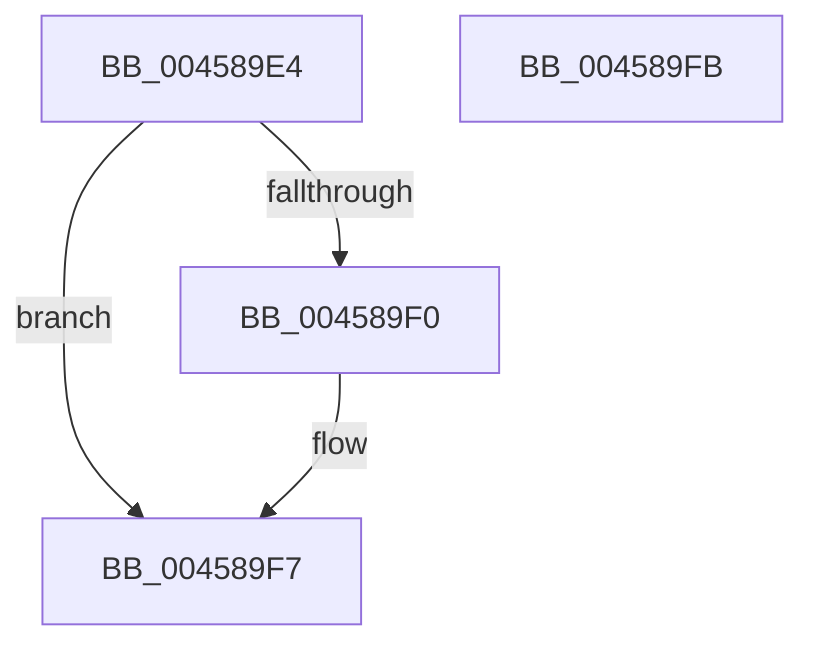

# MiGetSubsectionHoldingCrossPartitionReferences

- RVA: `0x004589E4`–`0x004589FC` (길이 `24` bytes)
- VA: `0x00000001404589E4`
- 실행 섹션: `.text`
- PDB 이름 있음: `예`; PDB Function 태그: `아니요`
- unwind 정보 RVA: `0x000DB714`
- 디코드: `9`개 명령, `24/24` bytes 표시
- 미해석 바이트: `0` (있으면 어셈블리에 `.byte`로 보존)

> 이 문서는 커널 이미지의 기계어와 PDB 기호를 분석해 생성했습니다. 4번과 5번은 함수 원형과 자료형을 바이너리 사용 방식에서 추정한 C 해석이며 원본 소스 복구 결과는 아닙니다.

## 1. Dependencies

- 직접 호출 지점: **0**; 고유 호출 대상: **0**
- 직접 호출자로 확인된 함수: **13**
- RIP 상대 이미지 참조: **0**

### Outgoing calls
- 직접 디코드된 call 명령이 없습니다.

### Direct callers
- [sub_002492F6](../24/Unknown_function_002492F6.md) at `0x00249377`
- [sub_002492F6](../24/Unknown_function_002492F6.md) at `0x00249382`
- [sub_00249543](../24/Unknown_function_00249543.md) at `0x002495EA`
- [sub_00249543](../24/Unknown_function_00249543.md) at `0x002495F5`
- [sub_002860AF](../28/Unknown_function_002860AF.md) at `0x002860F9`
- [sub_002860AF](../28/Unknown_function_002860AF.md) at `0x00286104`
- [MiFlushRelease](../29/MiFlushRelease_function_002982C0.md) at `0x00298612`
- [MiFlushRelease](../29/MiFlushRelease_function_002982C0.md) at `0x0029861D`
- [MiFlushRelease](../29/MiFlushRelease_function_002982C0.md) at `0x0029866C`
- [MiFlushRelease](../29/MiFlushRelease_function_002982C0.md) at `0x00298677`
- [MiRemoveViewsFromSectionWithPfn](../29/MiRemoveViewsFromSectionWithPfn_function_002986D4.md) at `0x002988B5`
- [MiRemoveViewsFromSectionWithPfn](../29/MiRemoveViewsFromSectionWithPfn_function_002986D4.md) at `0x002988C0`
- [MiRemoveViewsFromSection](../29/MiRemoveViewsFromSection_function_00298960.md) at `0x00298AF6`
- [MiRemoveViewsFromSection](../29/MiRemoveViewsFromSection_function_00298960.md) at `0x00298B01`
- [MiDecrementSubsections](../29/MiDecrementSubsections_function_00298B50.md) at `0x00298CFC`
- [MiDecrementSubsections](../29/MiDecrementSubsections_function_00298B50.md) at `0x00298D07`
- [MiDecrementSubsectionViewCount](../29/MiDecrementSubsectionViewCount_function_00298E90.md) at `0x00298F94`
- [MiDecrementSubsectionViewCount](../29/MiDecrementSubsectionViewCount_function_00298E90.md) at `0x00298F9F`
- [sub_002E10F7](../2E/Unknown_function_002E10F7.md) at `0x002E1106`
- [sub_002E10F7](../2E/Unknown_function_002E10F7.md) at `0x002E1111`
- [MiReferenceActiveSubsection](../32/MiReferenceActiveSubsection_function_00325060.md) at `0x00325214`
- [MiReferenceActiveSubsection](../32/MiReferenceActiveSubsection_function_00325060.md) at `0x0032521F`
- [MiUpdateLastSubsectionSize](MiUpdateLastSubsectionSize_function_0045876C.md) at `0x004587B3`
- [MiUpdateLastSubsectionSize](MiUpdateLastSubsectionSize_function_0045876C.md) at `0x004587BB`
- [MiUpdateControlAreaCommitCount](MiUpdateControlAreaCommitCount_function_004588E8.md) at `0x00458964`
- [MiGetSubsectionCrossPartitionReferences](MiGetSubsectionCrossPartitionReferences_function_004589C4.md) at `0x004589C8`

### Static image references
- 디코드된 RIP-relative 메모리 참조가 없습니다.

## 2. Other-region calls and transfers

- 다른 실행 섹션으로 향하는 call: **0**
- 별도 외부 분기/꼬리 이동을 확인하지 못했습니다.

## 3. Assembly (complete function range)

```asm
004589E4  48 8B 11                        mov rdx, qword ptr [rcx]
004589E7  8B 42 38                        mov eax, dword ptr [rdx + 0x38]
004589EA  24 A0                           and al, 0xa0
004589EC  3C 80                           cmp al, 0x80
004589EE  74 07                           je 0x1404589f7
004589F0  48 8D 8A 80 00 00 00            lea rcx, [rdx + 0x80]
004589F7  48 8B C1                        mov rax, rcx
004589FA  C3                              ret
004589FB  CC                              int3
```

## 4. C-style interpretation (structured pseudocode)

```c
__int64 __fastcall MiGetSubsectionHoldingCrossPartitionReferences(__int64 a1)
{
    __int64 result;

    result = (unsigned __int8)(((unsigned int)(*(unsigned int *)(*(unsigned __int64 *)(a1) + 56))) & (160));
    if (((unsigned __int8)(result)) != 128) {
        a1 = *(unsigned __int64 *)(a1) + 128;
    }
    return a1;
}
```

## 5. (Beta) C Style

```c
void *MiGetSubsectionHoldingCrossPartitionReferences(void *Arg1)
{
    uint8_t *arg1 = (uint8_t *)Arg1;

    int64_t result;

    result = (uint8_t)(((uint32_t)(*(uint32_t *)(*(uint64_t *)(arg1) + 0x38))) & (160));
    if (((uint8_t)(result)) != 128) {
        Arg1 = *(uint64_t *)(arg1) + 128;
    }
    return Arg1;
}
```

### 관측된 메모리 오프셋

구조체 형식이 확인되지 않은 접근은 인자 기준의 오프셋으로만 기록했습니다.

| 기준 인자 | 오프셋 표현 | 폭 (bit) | 접근 |
|---|---:|---:|---|
| `Arg1` | `+ 0x0` | `64` | `R` |

## 6. Execution-region graph

[열기: 2D/3D 그래프와 함수 탐색 컨트롤 패널](../../../control-panel.html?section=text&rva=0x004589E4&view=graph)

- 2D 그래프는 위에서 아래로 흐르고, 3D 그래프는 빈 공간을 드래그해 회전합니다. Shift+드래그는 이동, 휠은 확대·축소, 함수 노드 선택은 대상 보고서 이동입니다.

### Static fallback


