# MiInitializeSystemPageTable

- RVA: `0x00451C88`–`0x004520B2` (길이 `1,066` bytes)
- VA: `0x0000000140451C88`
- 실행 섹션: `.text`
- PDB 이름 있음: `예`; PDB Function 태그: `예`
- unwind 정보 RVA: `0x000A74F0`
- 디코드: `247`개 명령, `1,066/1,066` bytes 표시
- 미해석 바이트: `0` (있으면 어셈블리에 `.byte`로 보존)

> 이 문서는 커널 이미지의 기계어와 PDB 기호를 분석해 생성했습니다. 4번과 5번은 함수 원형과 자료형을 바이너리 사용 방식에서 추정한 C 해석이며 원본 소스 복구 결과는 아닙니다.

## 1. Dependencies

- 직접 호출 지점: **14**; 고유 호출 대상: **14**
- 직접 호출자로 확인된 함수: **1**
- RIP 상대 이미지 참조: **10**

### Outgoing calls
- `0x00451D45` → [MiGetLeafVa](../27/MiGetLeafVa_function_0027C0A0.md) (function, `0x0027C0A0`)
- `0x00451D8F` → [MiGetContainingPageTable](../34/MiGetContainingPageTable_function_003467F0.md) (function, `0x003467F0`)
- `0x00451DBC` → [MiMakeValidPte](../2C/MiMakeValidPte_function_002C5590.md) (function, `0x002C5590`)
- `0x00451E06` → [MiInitializePfnForOtherProcess](../38/MiInitializePfnForOtherProcess_function_00382A20.md) (function, `0x00382A20`)
- `0x00451F08` → [MiCheckLinearProtectedPteAccessedBit](../29/MiCheckLinearProtectedPteAccessedBit_function_00292D80.md) (function, `0x00292D80`)
- `0x00451F38` → [MiClearPteAccessedBitRange](MiClearPteAccessedBitRange_function_004520B8.md) (function, `0x004520B8`)
- `0x00451F50` → [MiTransformValidPteInPlace](../37/MiTransformValidPteInPlace_function_003765E0.md) (function, `0x003765E0`)
- `0x00451F73` → [MiGetProcessorFlushList](../24/MiGetProcessorFlushList_function_00242C90.md) (function, `0x00242C90`)
- `0x00451F8F` → [MiInitializeTbFlushList](../29/MiInitializeTbFlushList_function_00294F00.md) (function, `0x00294F00`)
- `0x00451FC1` → [MiArePageContentsZero](../4D/MiArePageContentsZero_function_004D4278.md) (function, `0x004D4278`)
- `0x00452012` → [MI_GET_DIRECTORY_FRAME_FROM_PROCESS_PDE](../68/MI_GET_DIRECTORY_FRAME_FROM_PROCESS_PDE_function_0068A278.md) (function, `0x0068A278`)
- `0x00452049` → [MiIsPageAGapPage](MiIsPageAGapPage_function_00451C2C.md) (function, `0x00451C2C`)
- `0x00452070` → [MiLockNestedPageTable](../23/MiLockNestedPageTable_function_0023E890.md) (function, `0x0023E890`)
- `0x00452082` → [ExAcquireSpinLockExclusiveAtDpcLevel](../24/ExAcquireSpinLockExclusiveAtDpcLevel_function_00248E80.md) (function, `0x00248E80`)

### Direct callers
- [MiCreateSystemPageTable](MiCreateSystemPageTable_function_004518D0.md) at `0x00451A2B`

### Static image references
- `0x00451D0E` → RVA `0x00FC6A88` (`ALMOSTRO`; read)
- `0x00451D5D` → RVA `0x00E2F380` (`.data`; read)
- `0x00451E69` → RVA `0x00E2F390` (`.data`; read)
- `0x00451E8B` → RVA `0x00E2DBC9` (`.data`; reference)
- `0x00451FA0` → RVA `0x00E30270` (`.data`; read)
- `0x00451FA9` → RVA `0x00FC5054` (`ALMOSTRO`; reference)
- `0x00451FAF` → RVA `0x00E30270` (`.data`; write)
- `0x00451FE0` → RVA `0x00E37440` (`.data`; read)
- `0x00452008` → RVA `0x00FC6AB0` (`ALMOSTRO`; read)
- `0x0045207B` → RVA `0x00E374C0` (`.data`; read)

## 2. Other-region calls and transfers

- 다른 실행 섹션으로 향하는 call: **0**
- call이 아닌 외부 분기/꼬리 이동: **9**
  - `0x00451D3C` → [sub_006F15CE + 0x17](../6F/Unknown_function_006F15CE.md) (`tail-transfer`)
  - `0x00451F6D` → [sub_006F15CE + 0x13F](../6F/Unknown_function_006F15CE.md) (`tail-transfer`)
  - `0x00451F9B` → [sub_006F15CE + 0x13F](../6F/Unknown_function_006F15CE.md) (`tail-transfer`)
  - `0x00451FD3` → [sub_006F15CE](../6F/Unknown_function_006F15CE.md) (`tail-transfer`)
  - `0x00451FF0` → [sub_006F15CE + 0x7](../6F/Unknown_function_006F15CE.md) (`tail-transfer`)
  - `0x00452063` → [sub_006F15CE + 0xC4](../6F/Unknown_function_006F15CE.md) (`tail-transfer`)
  - `0x00452076` → [sub_006F15CE + 0xC4](../6F/Unknown_function_006F15CE.md) (`tail-transfer`)
  - `0x00452091` → [sub_006F15CE + 0x14C](../6F/Unknown_function_006F15CE.md) (`tail-transfer`)
  - `0x004520AD` → [sub_006F15CE + 0x171](../6F/Unknown_function_006F15CE.md) (`tail-transfer`)

## 3. Assembly (complete function range)

```asm
00451C88  48 89 4C 24 08                  mov qword ptr [rsp + 8], rcx
00451C8D  53                              push rbx
00451C8E  55                              push rbp
00451C8F  56                              push rsi
00451C90  57                              push rdi
00451C91  41 54                           push r12
00451C93  41 55                           push r13
00451C95  41 56                           push r14
00451C97  41 57                           push r15
00451C99  48 83 EC 48                     sub rsp, 0x48
00451C9D  48 8B 89 B8 00 00 00            mov rcx, qword ptr [rcx + 0xb8]
00451CA4  49 8B F8                        mov rdi, r8
00451CA7  49 8B 18                        mov rbx, qword ptr [r8]
00451CAA  4D 8B F9                        mov r15, r9
00451CAD  48 89 4C 24 30                  mov qword ptr [rsp + 0x30], rcx
00451CB2  4D 8B F0                        mov r14, r8
00451CB5  48 C1 E7 19                     shl rdi, 0x19
00451CB9  8B EA                           mov ebp, edx
00451CBB  33 F6                           xor esi, esi
00451CBD  48 B8 00 00 00 00 80 F6 FF FF   movabs rax, 0xfffff68000000000
00451CC7  48 8B C0                        mov rax, rax
00451CCA  48 C1 E0 19                     shl rax, 0x19
00451CCE  48 2B F8                        sub rdi, rax
00451CD1  8B C2                           mov eax, edx
00451CD3  48 C1 FF 10                     sar rdi, 0x10
00451CD7  F7 D8                           neg eax
00451CD9  1B C0                           sbb eax, eax
00451CDB  83 E0 02                        and eax, 2
00451CDE  83 C0 04                        add eax, 4
00451CE1  89 84 24 98 00 00 00            mov dword ptr [rsp + 0x98], eax
00451CE8  48 B8 00 00 00 00 00 DE FF FF   movabs rax, 0xffffde0000000000
00451CF2  4D 8B E9                        mov r13, r9
00451CF5  44 8D 66 01                     lea r12d, [rsi + 1]
00451CF9  4C 2B E8                        sub r13, rax
00451CFC  48 B8 AB AA AA AA AA AA AA AA   movabs rax, 0xaaaaaaaaaaaaaaab
00451D06  49 C1 FD 04                     sar r13, 4
00451D0A  4C 0F AF E8                     imul r13, rax
00451D0E  8A 05 74 4D B7 00               mov al, byte ptr [rip + 0xb74d74]
00451D14  4C 89 6C 24 38                  mov qword ptr [rsp + 0x38], r13
00451D19  84 C0                           test al, al
00451D1B  0F 88 7F 02 00 00               js 0x140451fa0
00451D21  48 8B C3                        mov rax, rbx
00451D24  48 BA FF FF FF FF FF 00 00 00   movabs rdx, 0xffffffffff
00451D2E  49 23 C4                        and rax, r12
00451D31  85 ED                           test ebp, ebp
00451D33  0F 84 97 02 00 00               je 0x140451fd0
00451D39  48 85 C0                        test rax, rax
00451D3C  0F 85 A3 F8 29 00               jne 0x1406f15e5
00451D42  49 8B CE                        mov rcx, r14
00451D45  E8 56 A3 E2 FF                  call 0x14027c0a0
00451D4A  48 B9 FF FF FE FF FF 7F 00 00   movabs rcx, 0x7ffffffeffff
00451D54  48 3B C1                        cmp rax, rcx
00451D57  0F 86 19 01 00 00               jbe 0x140451e76
00451D5D  48 3B 05 1C D6 9D 00            cmp rax, qword ptr [rip + 0x9dd61c]
00451D64  0F 83 FF 00 00 00               jae 0x140451e69
00451D6A  48 B9 00 00 00 00 80 F6 FF FF   movabs rcx, 0xfffff68000000000
00451D74  48 8B C9                        mov rcx, rcx
00451D77  48 3B C1                        cmp rax, rcx
00451D7A  0F 83 3A 01 00 00               jae 0x140451eba
00451D80  BB 02 00 00 00                  mov ebx, 2
00451D85  49 8B CE                        mov rcx, r14
00451D88  49 C7 07 00 00 00 00            mov qword ptr [r15], 0
00451D8F  E8 5C 4A EF FF                  call 0x1403467f0
00451D94  4C 8B E0                        mov r12, rax
00451D97  8B 84 24 98 00 00 00            mov eax, dword ptr [rsp + 0x98]
00451D9E  44 8B C0                        mov r8d, eax
00451DA1  41 81 C8 00 00 00 90            or r8d, 0x90000000
00451DA8  85 ED                           test ebp, ebp
00451DAA  74 0A                           je 0x140451db6
00451DAC  44 8B C0                        mov r8d, eax
00451DAF  41 81 C8 00 00 00 98            or r8d, 0x98000000
00451DB6  49 8B D5                        mov rdx, r13
00451DB9  49 8B CE                        mov rcx, r14
00451DBC  E8 CF 37 E7 FF                  call 0x1402c5590
00451DC1  48 8B F8                        mov rdi, rax
00451DC4  48 8B 05 BD 4C B7 00            mov rax, qword ptr [rip + 0xb74cbd]
00451DCB  48 0F BA E0 19                  bt rax, 0x19
00451DD0  0F 83 AC 00 00 00               jae 0x140451e82
00451DD6  83 FD 03                        cmp ebp, 3
00451DD9  0F 84 16 02 00 00               je 0x140451ff5
00451DDF  49 8B 1E                        mov rbx, qword ptr [r14]
00451DE2  83 FD 03                        cmp ebp, 3
00451DE5  0F 85 B5 00 00 00               jne 0x140451ea0
00451DEB  48 8B F3                        mov rsi, rbx
00451DEE  41 B9 00 02 00 00               mov r9d, 0x200
00451DF4  83 E6 01                        and esi, 1
00451DF7  0F 85 25 02 00 00               jne 0x140452022
00451DFD  4D 8B C4                        mov r8, r12
00451E00  49 8B D6                        mov rdx, r14
00451E03  49 8B CD                        mov rcx, r13
00451E06  E8 15 0C F3 FF                  call 0x140382a20
00451E0B  49 BC FF FF FF FF FF FF FF 7F   movabs r12, 0x7fffffffffffffff
00451E15  85 ED                           test ebp, ebp
00451E17  74 12                           je 0x140451e2b
00451E19  48 85 F6                        test rsi, rsi
00451E1C  0F 85 11 02 00 00               jne 0x140452033
00451E22  83 FD 03                        cmp ebp, 3
00451E25  0F 84 50 02 00 00               je 0x14045207b
00451E2B  F6 C3 01                        test bl, 1
00451E2E  0F 85 DE 00 00 00               jne 0x140451f12
00451E34  48 0F BA 25 4B 4C B7 00 24      bt qword ptr [rip + 0xb74c4b], 0x24
00451E3D  0F 82 8C 00 00 00               jb 0x140451ecf
00451E43  49 89 3E                        mov qword ptr [r14], rdi
00451E46  83 FD 03                        cmp ebp, 3
00451E49  0F 84 3D 02 00 00               je 0x14045208c
00451E4F  85 ED                           test ebp, ebp
00451E51  0F 84 3F 02 00 00               je 0x140452096
00451E57  48 83 C4 48                     add rsp, 0x48
00451E5B  41 5F                           pop r15
00451E5D  41 5E                           pop r14
00451E5F  41 5D                           pop r13
00451E61  41 5C                           pop r12
00451E63  5F                              pop rdi
00451E64  5E                              pop rsi
00451E65  5D                              pop rbp
00451E66  5B                              pop rbx
00451E67  C3                              ret
00451E68  CC                              int3
00451E69  48 3B 05 20 D5 9D 00            cmp rax, qword ptr [rip + 0x9dd520]
00451E70  0F 87 F4 FE FF FF               ja 0x140451d6a
00451E76  BB 02 00 00 00                  mov ebx, 2
00451E7B  8B F3                           mov esi, ebx
00451E7D  E9 03 FF FF FF                  jmp 0x140451d85
00451E82  8B CD                           mov ecx, ebp
00451E84  BA 01 00 00 00                  mov edx, 1
00451E89  D3 E2                           shl edx, cl
00451E8B  84 15 38 BD 9D 00               test byte ptr [rip + 0x9dbd38], dl
00451E91  0F 84 3F FF FF FF               je 0x140451dd6
00451E97  48 83 E7 DF                     and rdi, 0xffffffffffffffdf
00451E9B  E9 36 FF FF FF                  jmp 0x140451dd6
00451EA0  48 85 DB                        test rbx, rbx
00451EA3  0F 85 42 FF FF FF               jne 0x140451deb
00451EA9  48 8B F3                        mov rsi, rbx
00451EAC  41 B9 00 12 00 00               mov r9d, 0x1200
00451EB2  83 E6 01                        and esi, 1
00451EB5  E9 43 FF FF FF                  jmp 0x140451dfd
00451EBA  48 B9 FF FF FF FF FF F6 FF FF   movabs rcx, 0xfffff6ffffffffff
00451EC4  48 3B C1                        cmp rax, rcx
00451EC7  0F 87 B3 FE FF FF               ja 0x140451d80
00451ECD  EB A7                           jmp 0x140451e76
00451ECF  40 F6 C7 20                     test dil, 0x20
00451ED3  0F 85 6A FF FF FF               jne 0x140451e43
00451ED9  48 B8 00 00 00 00 80 F6 FF FF   movabs rax, 0xfffff68000000000
00451EE3  48 8B C0                        mov rax, rax
00451EE6  48 B9 00 00 00 00 40 00 00 00   movabs rcx, 0x4000000000
00451EF0  48 03 C1                        add rax, rcx
00451EF3  4C 3B F0                        cmp r14, rax
00451EF6  0F 82 47 FF FF FF               jb 0x140451e43
00451EFC  41 B8 80 00 00 00               mov r8d, 0x80
00451F02  48 8B D7                        mov rdx, rdi
00451F05  49 8B CE                        mov rcx, r14
00451F08  E8 73 0E E4 FF                  call 0x140292d80
00451F0D  E9 31 FF FF FF                  jmp 0x140451e43
00451F12  48 8B B4 24 90 00 00 00         mov rsi, qword ptr [rsp + 0x90]
00451F1A  F6 C3 20                        test bl, 0x20
00451F1D  74 1E                           je 0x140451f3d
00451F1F  8B CD                           mov ecx, ebp
00451F21  BA 01 00 00 00                  mov edx, 1
00451F26  D3 E2                           shl edx, cl
00451F28  84 15 9B BC 9D 00               test byte ptr [rip + 0x9dbc9b], dl
00451F2E  74 0D                           je 0x140451f3d
00451F30  4D 8B C6                        mov r8, r14
00451F33  8B D5                           mov edx, ebp
00451F35  48 8B CE                        mov rcx, rsi
00451F38  E8 7B 01 00 00                  call 0x1404520b8
00451F3D  41 B9 40 00 00 00               mov r9d, 0x40
00451F43  89 6C 24 20                     mov dword ptr [rsp + 0x20], ebp
00451F47  4C 8B C7                        mov r8, rdi
00451F4A  49 8B D6                        mov rdx, r14
00451F4D  49 8B CE                        mov rcx, r14
00451F50  E8 8B 46 F2 FF                  call 0x1403765e0
00451F55  83 FD 03                        cmp ebp, 3
00451F58  0F 85 F1 FE FF FF               jne 0x140451e4f
00451F5E  48 8B 5C 24 30                  mov rbx, qword ptr [rsp + 0x30]
00451F63  48 8B 8B 88 00 00 00            mov rcx, qword ptr [rbx + 0x88]
00451F6A  48 85 C9                        test rcx, rcx
00451F6D  0F 85 9A F7 29 00               jne 0x1406f170d
00451F73  E8 18 0D DF FF                  call 0x140242c90
00451F78  48 8B 56 20                     mov rdx, qword ptr [rsi + 0x20]
00451F7C  44 8D 4D 05                     lea r9d, [rbp + 5]
00451F80  48 8B C8                        mov rcx, rax
00451F83  C7 44 24 20 74 00 00 00         mov dword ptr [rsp + 0x20], 0x74
00451F8B  44 8B 40 0C                     mov r8d, dword ptr [rax + 0xc]
00451F8F  E8 6C 2F E4 FF                  call 0x140294f00
00451F94  48 89 8B 88 00 00 00            mov qword ptr [rbx + 0x88], rcx
00451F9B  E9 6D F7 29 00                  jmp 0x1406f170d
00451FA0  8B 05 CA E2 9D 00               mov eax, dword ptr [rip + 0x9de2ca]
00451FA6  41 03 C4                        add eax, r12d
00451FA9  85 05 A5 30 B7 00               test dword ptr [rip + 0xb730a5], eax
00451FAF  89 05 BB E2 9D 00               mov dword ptr [rip + 0x9de2bb], eax
00451FB5  0F 85 66 FD FF FF               jne 0x140451d21
00451FBB  49 8B D4                        mov rdx, r12
00451FBE  49 8B CD                        mov rcx, r13
00451FC1  E8 B2 22 08 00                  call 0x1404d4278
00451FC6  48 8B 4C 24 30                  mov rcx, qword ptr [rsp + 0x30]
00451FCB  E9 51 FD FF FF                  jmp 0x140451d21
00451FD0  48 85 C0                        test rax, rax
00451FD3  0F 84 F5 F5 29 00               je 0x1406f15ce
00451FD9  48 C1 EB 0C                     shr rbx, 0xc
00451FDD  48 23 DA                        and rbx, rdx
00451FE0  48 3B 1D 59 54 9E 00            cmp rbx, qword ptr [rip + 0x9e5459]
00451FE7  0F 84 55 FD FF FF               je 0x140451d42
00451FED  4C 8B 0F                        mov r9, qword ptr [rdi]
00451FF0  E9 E0 F5 29 00                  jmp 0x1406f15d5
00451FF5  A8 30                           test al, 0x30
00451FF7  0F 95 C1                        setne cl
00451FFA  40 84 F3                        test bl, sil
00451FFD  0F 94 C0                        sete al
00452000  84 C8                           test al, cl
00452002  0F 84 D7 FD FF FF               je 0x140451ddf
00452008  48 8B 0D A1 4A B7 00            mov rcx, qword ptr [rip + 0xb74aa1]
0045200F  49 8B D6                        mov rdx, r14
00452012  E8 61 82 23 00                  call 0x14068a278
00452017  49 8B 1E                        mov rbx, qword ptr [r14]
0045201A  4C 8B E0                        mov r12, rax
0045201D  E9 C9 FD FF FF                  jmp 0x140451deb
00452022  4D 3B E5                        cmp r12, r13
00452025  B8 00 0A 00 00                  mov eax, 0xa00
0045202A  44 0F 45 C8                     cmovne r9d, eax
0045202E  E9 CA FD FF FF                  jmp 0x140451dfd
00452033  48 B8 FF FF FF FF FF 00 00 00   movabs rax, 0xffffffffff
0045203D  48 8B CB                        mov rcx, rbx
00452040  48 C1 E9 0C                     shr rcx, 0xc
00452044  8B D5                           mov edx, ebp
00452046  48 23 C8                        and rcx, rax
00452049  E8 DE FB FF FF                  call 0x140451c2c
0045204E  85 C0                           test eax, eax
00452050  0F 84 CC FD FF FF               je 0x140451e22
00452056  4C 8B 8C 24 90 00 00 00         mov r9, qword ptr [rsp + 0x90]
0045205E  41 8B 01                        mov eax, dword ptr [r9]
00452061  A8 04                           test al, 4
00452063  0F 84 29 F6 29 00               je 0x1406f1692
00452069  49 8B 49 20                     mov rcx, qword ptr [r9 + 0x20]
0045206D  49 8B D6                        mov rdx, r14
00452070  E8 1B C8 DE FF                  call 0x14023e890
00452075  90                              nop
00452076  E9 17 F6 29 00                  jmp 0x1406f1692
0045207B  48 8D 0D 3E 54 9E 00            lea rcx, [rip + 0x9e543e]
00452082  E8 F9 6D DF FF                  call 0x140248e80
00452087  E9 9F FD FF FF                  jmp 0x140451e2b
0045208C  48 8B 5C 24 30                  mov rbx, qword ptr [rsp + 0x30]
00452091  E9 84 F6 29 00                  jmp 0x1406f171a
00452096  48 8B 5C 24 30                  mov rbx, qword ptr [rsp + 0x30]
0045209B  83 7B 78 03                     cmp dword ptr [rbx + 0x78], 3
0045209F  0F 85 B2 FD FF FF               jne 0x140451e57
004520A5  83 A4 24 A8 00 00 00 00         and dword ptr [rsp + 0xa8], 0
004520AD  E9 8D F6 29 00                  jmp 0x1406f173f
```

## 4. C-style interpretation (structured pseudocode)

```c
__int64 __fastcall MiInitializeSystemPageTable(__int64 a1, int a2, __int64 a3, __int64 a4)
{
    __int64 result;
    __int64 v_r13;
    __int64 v_rbx;
    __int64 v_rdi;
    __int64 v_rsi;
    __int64 v_rsp;
    unsigned __int64 v_stack_m50;
    unsigned __int64 v_stack_m58;
    unsigned int v_stack_p10;
    unsigned int v_stack_p20;
    unsigned __int64 v_stack_p30;
    unsigned __int64 v_stack_p8;
    unsigned __int64 v_stack_p90;
    unsigned int v_stack_pA8;

    v_stack_p8 = a1;
    v_rsp = (v_rsp) - (72);
    v_stack_m58 = *(unsigned __int64 *)(a1 + 184);
    v_rdi = (a3) << (25);
    v_rsi = 0;
    result = (result) << (25);
    v_rdi = (v_rdi) - (result);
    v_rdi = (v_rdi) >> (16);
    result = (unsigned int)(-((unsigned int)(a2)));
    result = (unsigned int)((result) & (2));
    result = (unsigned int)((result) + (4));
    v_stack_p10 = (unsigned int)(result);
    v_r13 = (a4) - (result);
    v_r13 = (v_r13) >> (4);
    v_r13 = (v_r13) * (result);
    v_stack_m50 = v_r13;
    if (sign_flag) goto loc_00451FA0;
loc_00451D21:
    result = (*(unsigned __int64 *)(a3)) & (v_rsi + 1);
    if ((unsigned int)((unsigned int)(a2)) == 0) goto loc_00451FD0;
loc_00451D42:
    result = MiGetLeafVa(a3, a2, a3, a4);
    if (result <= a3) goto loc_00451E76;
    if (result >= (*(unsigned __int64 *)(v_rip + 10343964))) goto loc_00451E69;
loc_00451D6A:
    if (result >= a3) goto loc_00451EBA;
loc_00451D80:
loc_00451D85:
    *(unsigned __int64 *)(a4) = 0;
    result = MiGetContainingPageTable(a3, a2, a3, a4);
    a3 = (unsigned int)(((unsigned int)((unsigned int)((unsigned int)(v_stack_p10)))) | (0x90000000ULL));
    if ((unsigned int)((unsigned int)(a2)) != 0) {
        a3 = (unsigned int)((unsigned int)(v_stack_p10));
        a3 = (unsigned int)((a3) | (0x98000000ULL));
    }
    result = MiMakeValidPte(a3, v_r13, a3, a4);
    if (condition_is_above_or_equal) goto loc_00451E82;
loc_00451DD6:
    if (((unsigned int)((unsigned int)(a2))) == 3) goto loc_00451FF5;
loc_00451DDF:
    if (((unsigned int)((unsigned int)(a2))) != 3) goto loc_00451EA0;
loc_00451DEB:
    v_rsi = (unsigned int)((*(unsigned __int64 *)(a3)) & (1));
    if (condition_is_not_equal) goto loc_00452022;
loc_00451DFD:
    result = MiInitializePfnForOtherProcess(v_r13, a3, result, 512);
    if ((unsigned int)((unsigned int)(a2)) == 0) goto loc_00451E2B;
    if (v_rsi != 0) goto loc_00452033;
loc_00451E22:
    if (((unsigned int)((unsigned int)(a2))) == 3) goto loc_0045207B;
loc_00451E2B:
    if ((((unsigned __int8)(*(unsigned __int64 *)(a3))) & (1)) != 0) goto loc_00451F12;
    if (condition_is_below) goto loc_00451ECF;
loc_00451E43:
    *(unsigned __int64 *)(a3) = result;
    if (((unsigned int)((unsigned int)(a2))) == 3) goto loc_0045208C;
loc_00451E4F:
    if ((unsigned int)((unsigned int)(a2)) == 0) goto loc_00452096;
loc_00451E57:
    v_rsp = (v_rsp) + (72);
    return result;
loc_00451E69:
    if (result > (*(unsigned __int64 *)(v_rip + 10343712))) goto loc_00451D6A;
loc_00451E76:
    goto loc_00451D85;
loc_00451E82:
    a2 = (unsigned int)((1) << ((unsigned __int8)((unsigned int)((unsigned int)((unsigned int)(a2))))));
    if (((*(unsigned __int8 *)(v_rip + 10337592)) & ((unsigned __int8)(a2))) == 0) goto loc_00451DD6;
    v_rdi = (result) & (-33);
    goto loc_00451DD6;
loc_00451EA0:
    if (2 != 0) goto loc_00451DEB;
    v_rsi = (unsigned int)((2) & (1));
    goto loc_00451DFD;
loc_00451EBA:
    if (result > ((unsigned int)((unsigned int)((unsigned int)(a2))))) goto loc_00451D80;
    goto loc_00451E76;
loc_00451ECF:
    if ((((unsigned __int8)(v_rdi)) & (32)) != 0) goto loc_00451E43;
    result = (result) + ((unsigned int)((unsigned int)((unsigned int)(a2))));
    if (a3 < result) goto loc_00451E43;
    result = MiCheckLinearProtectedPteAccessedBit(a3, v_rdi, 128, (unsigned int)(0x1200ULL));
    goto loc_00451E43;
loc_00451F12:
    if (((2) & (32)) == 0) goto loc_00451F3D;
    a2 = (unsigned int)((1) << ((unsigned __int8)((unsigned int)((unsigned int)((unsigned int)(a2))))));
    if (((*(unsigned __int8 *)(v_rip + 10337435)) & ((unsigned __int8)(a2))) != 0) {
        a3 = a3;
        a2 = (unsigned int)((unsigned int)(a2));
        a1 = v_stack_p90;
        result = MiClearPteAccessedBitRange(a1, a2, a3, (unsigned int)(0x1200ULL));
    }
    v_stack_p20 = (unsigned int)((unsigned int)(a2));
    result = MiTransformValidPteInPlace(a3, a3, v_rdi, 64);
    if (((unsigned int)((unsigned int)(a2))) != 3) goto loc_00451E4F;
    result = MiGetProcessorFlushList(*(unsigned __int64 *)(v_stack_p30 + 136), a3, v_rdi, 64);
    v_stack_p20 = 116;
    result = MiInitializeTbFlushList(result, *(unsigned __int64 *)(v_stack_p90 + 32), (unsigned int)(*(unsigned int *)(result + 12)), (unsigned int)(a2) + 5);
    *(unsigned __int64 *)(v_stack_p30 + 136) = result;
loc_00451FA0:
    result = (unsigned int)(((unsigned int)(*(unsigned int *)(v_rip + 10347210))) + ((unsigned int)(result)));
    *(unsigned int *)(v_rip + 10347195) = (unsigned int)(result);
    if (((*(unsigned int *)(v_rip + 12005541)) & ((unsigned int)(result))) != 0) goto loc_00451D21;
    result = MiArePageContentsZero(v_r13, result, (unsigned int)(*(unsigned int *)(result + 12)), (unsigned int)(a2) + 5);
    goto loc_00451D21;
loc_00451FD0:
    v_rbx = (v_stack_p30) >> (12);
    v_rbx = (v_rbx) & (result);
    if (v_rbx == (*(unsigned __int64 *)(v_rip + 10376281))) goto loc_00451D42;
loc_00451FF5:
    a1 = ((((unsigned __int8)(result)) & (48)) != 0) ? 1 : 0;
    result = ((((unsigned __int8)(v_rbx)) & ((unsigned __int8)(v_stack_p90))) == 0) ? 1 : 0;
    if ((((unsigned __int8)(result)) & ((unsigned __int8)(a1))) == 0) goto loc_00451DDF;
    result = MI_GET_DIRECTORY_FRAME_FROM_PROCESS_PDE(*(unsigned __int64 *)(v_rip + 12012193), a3, (unsigned int)(*(unsigned int *)(result + 12)), *(unsigned __int64 *)(v_rdi));
    goto loc_00451DEB;
loc_00452022:
    a4 = *(unsigned __int64 *)(v_rdi);
    if (result != v_r13) { a4 = (unsigned int)((unsigned int)(0xA00ULL)); }
    goto loc_00451DFD;
loc_00452033:
    a1 = (*(unsigned __int64 *)(a3)) >> (12);
    a1 = (a1) & ((unsigned int)(0xA00ULL));
    result = MiIsPageAGapPage(a1, (unsigned int)((unsigned int)((unsigned int)(a2))), (unsigned int)(*(unsigned int *)(result + 12)), a4);
    if ((unsigned int)(result) == 0) goto loc_00451E22;
    result = MiLockNestedPageTable(*(unsigned __int64 *)(v_stack_p90 + 32), a3, (unsigned int)(*(unsigned int *)(result + 12)), v_stack_p90);
loc_0045207B:
    result = ExAcquireSpinLockExclusiveAtDpcLevel(v_rip + 10376254, a3, (unsigned int)(*(unsigned int *)(result + 12)), v_stack_p90);
    goto loc_00451E2B;
loc_0045208C:
loc_00452096:
    if ((*(unsigned int *)(v_stack_p30 + 120)) != 3) goto loc_00451E57;
}
```

## 5. (Beta) C Style

```c
int64_t MiInitializeSystemPageTable(void *Arg1, int32_t Arg2, void *Arg3, void *Arg4)
{
    uint8_t *arg1 = (uint8_t *)Arg1;
    uint8_t *arg3 = (uint8_t *)Arg3;
    uint8_t *arg4 = (uint8_t *)Arg4;

    int64_t result;
    int64_t local_r13;
    int64_t local_rbx;
    int64_t local_rdi;
    int64_t local_rsi;
    int64_t local_rsp;
    uint64_t v_stack_m50;
    uint64_t v_stack_m58;
    uint32_t v_stack_p10;
    uint32_t v_stack_p20;
    uint64_t v_stack_p30;
    uint64_t v_stack_p8;
    uint64_t v_stack_p90;
    uint32_t v_stack_pA8;

    v_stack_p8 = Arg1;
    local_rsp = (local_rsp) - (72);
    v_stack_m58 = *(uint64_t *)(arg1 + 0xB8);
    local_rdi = (Arg3) << (25);
    local_rsi = 0;
    result = (result) << (25);
    local_rdi = (local_rdi) - (result);
    local_rdi = (local_rdi) >> (16);
    result = (uint32_t)(-((uint32_t)(Arg2)));
    result = (uint32_t)((result) & (2));
    result = (uint32_t)((result) + (4));
    v_stack_p10 = (uint32_t)(result);
    local_r13 = (Arg4) - (result);
    local_r13 = (local_r13) >> (4);
    local_r13 = (local_r13) * (result);
    v_stack_m50 = local_r13;
    if (sign_flag) goto loc_00451FA0;
loc_00451D21:
    result = (*(uint64_t *)(arg3)) & (local_rsi + 1);
    if ((uint32_t)((uint32_t)(Arg2)) == 0) goto loc_00451FD0;
loc_00451D42:
    result = MiGetLeafVa(Arg3, Arg2, Arg3, Arg4);
    if (result <= Arg3) goto loc_00451E76;
    if (result >= (*(uint64_t *)(v_rip + 0x9DD61C))) goto loc_00451E69;
loc_00451D6A:
    if (result >= Arg3) goto loc_00451EBA;
loc_00451D80:
loc_00451D85:
    *(uint64_t *)(arg4) = 0;
    result = MiGetContainingPageTable(Arg3, Arg2, Arg3, Arg4);
    Arg3 = (uint32_t)(((uint32_t)((uint32_t)((uint32_t)(v_stack_p10)))) | (0x90000000ULL));
    if ((uint32_t)((uint32_t)(Arg2)) != 0) {
        Arg3 = (uint32_t)((uint32_t)(v_stack_p10));
        Arg3 = (uint32_t)((Arg3) | (0x98000000ULL));
    }
    result = MiMakeValidPte(Arg3, local_r13, Arg3, Arg4);
    if (condition_is_above_or_equal) goto loc_00451E82;
loc_00451DD6:
    if (((uint32_t)((uint32_t)(Arg2))) == 3) goto loc_00451FF5;
loc_00451DDF:
    if (((uint32_t)((uint32_t)(Arg2))) != 3) goto loc_00451EA0;
loc_00451DEB:
    local_rsi = (uint32_t)((*(uint64_t *)(arg3)) & (1));
    if (condition_is_not_equal) goto loc_00452022;
loc_00451DFD:
    result = MiInitializePfnForOtherProcess(local_r13, Arg3, result, 512);
    if ((uint32_t)((uint32_t)(Arg2)) == 0) goto loc_00451E2B;
    if (local_rsi != 0) goto loc_00452033;
loc_00451E22:
    if (((uint32_t)((uint32_t)(Arg2))) == 3) goto loc_0045207B;
loc_00451E2B:
    if ((((uint8_t)(*(uint64_t *)(arg3))) & (1)) != 0) goto loc_00451F12;
    if (condition_is_below) goto loc_00451ECF;
loc_00451E43:
    *(uint64_t *)(arg3) = result;
    if (((uint32_t)((uint32_t)(Arg2))) == 3) goto loc_0045208C;
loc_00451E4F:
    if ((uint32_t)((uint32_t)(Arg2)) == 0) goto loc_00452096;
loc_00451E57:
    local_rsp = (local_rsp) + (72);
    return result;
loc_00451E69:
    if (result > (*(uint64_t *)(v_rip + 0x9DD520))) goto loc_00451D6A;
loc_00451E76:
    goto loc_00451D85;
loc_00451E82:
    Arg2 = (uint32_t)((1) << ((uint8_t)((uint32_t)((uint32_t)((uint32_t)(Arg2))))));
    if (((*(uint8_t *)(v_rip + 0x9DBD38)) & ((uint8_t)(Arg2))) == 0) goto loc_00451DD6;
    local_rdi = (result) & (-33);
    goto loc_00451DD6;
loc_00451EA0:
    if (2 != 0) goto loc_00451DEB;
    local_rsi = (uint32_t)((2) & (1));
    goto loc_00451DFD;
loc_00451EBA:
    if (result > ((uint32_t)((uint32_t)((uint32_t)(Arg2))))) goto loc_00451D80;
    goto loc_00451E76;
loc_00451ECF:
    if ((((uint8_t)(local_rdi)) & (32)) != 0) goto loc_00451E43;
    result = (result) + ((uint32_t)((uint32_t)((uint32_t)(Arg2))));
    if (Arg3 < result) goto loc_00451E43;
    result = MiCheckLinearProtectedPteAccessedBit(Arg3, local_rdi, 128, (uint32_t)(0x1200ULL));
    goto loc_00451E43;
loc_00451F12:
    if (((2) & (32)) == 0) goto loc_00451F3D;
    Arg2 = (uint32_t)((1) << ((uint8_t)((uint32_t)((uint32_t)((uint32_t)(Arg2))))));
    if (((*(uint8_t *)(v_rip + 0x9DBC9B)) & ((uint8_t)(Arg2))) != 0) {
        Arg3 = Arg3;
        Arg2 = (uint32_t)((uint32_t)(Arg2));
        Arg1 = v_stack_p90;
        result = MiClearPteAccessedBitRange(Arg1, Arg2, Arg3, (uint32_t)(0x1200ULL));
    }
    v_stack_p20 = (uint32_t)((uint32_t)(Arg2));
    result = MiTransformValidPteInPlace(Arg3, Arg3, local_rdi, 64);
    if (((uint32_t)((uint32_t)(Arg2))) != 3) goto loc_00451E4F;
    result = MiGetProcessorFlushList(*(uint64_t *)(v_stack_p30 + 0x88), Arg3, local_rdi, 64);
    v_stack_p20 = 116;
    result = MiInitializeTbFlushList(result, *(uint64_t *)(v_stack_p90 + 0x20), (uint32_t)(*(uint32_t *)(result + 0xC)), (uint32_t)(Arg2) + 5);
    *(uint64_t *)(v_stack_p30 + 0x88) = result;
loc_00451FA0:
    result = (uint32_t)(((uint32_t)(*(uint32_t *)(v_rip + 0x9DE2CA))) + ((uint32_t)(result)));
    *(uint32_t *)(v_rip + 0x9DE2BB) = (uint32_t)(result);
    if (((*(uint32_t *)(v_rip + 0xB730A5)) & ((uint32_t)(result))) != 0) goto loc_00451D21;
    result = MiArePageContentsZero(local_r13, result, (uint32_t)(*(uint32_t *)(result + 0xC)), (uint32_t)(Arg2) + 5);
    goto loc_00451D21;
loc_00451FD0:
    local_rbx = (v_stack_p30) >> (12);
    local_rbx = (local_rbx) & (result);
    if (local_rbx == (*(uint64_t *)(v_rip + 0x9E5459))) goto loc_00451D42;
loc_00451FF5:
    Arg1 = ((((uint8_t)(result)) & (48)) != 0) ? 1 : 0;
    result = ((((uint8_t)(local_rbx)) & ((uint8_t)(v_stack_p90))) == 0) ? 1 : 0;
    if ((((uint8_t)(result)) & ((uint8_t)(Arg1))) == 0) goto loc_00451DDF;
    result = MI_GET_DIRECTORY_FRAME_FROM_PROCESS_PDE(*(uint64_t *)(v_rip + 0xB74AA1), Arg3, (uint32_t)(*(uint32_t *)(result + 0xC)), *(uint64_t *)(local_rdi));
    goto loc_00451DEB;
loc_00452022:
    Arg4 = *(uint64_t *)(local_rdi);
    if (result != local_r13) { Arg4 = (uint32_t)((uint32_t)(0xA00ULL)); }
    goto loc_00451DFD;
loc_00452033:
    Arg1 = (*(uint64_t *)(arg3)) >> (12);
    Arg1 = (Arg1) & ((uint32_t)(0xA00ULL));
    result = MiIsPageAGapPage(Arg1, (uint32_t)((uint32_t)((uint32_t)(Arg2))), (uint32_t)(*(uint32_t *)(result + 0xC)), Arg4);
    if ((uint32_t)(result) == 0) goto loc_00451E22;
    result = MiLockNestedPageTable(*(uint64_t *)(v_stack_p90 + 0x20), Arg3, (uint32_t)(*(uint32_t *)(result + 0xC)), v_stack_p90);
loc_0045207B:
    result = ExAcquireSpinLockExclusiveAtDpcLevel(v_rip + 10376254, Arg3, (uint32_t)(*(uint32_t *)(result + 0xC)), v_stack_p90);
    goto loc_00451E2B;
loc_0045208C:
loc_00452096:
    if ((*(uint32_t *)(v_stack_p30 + 0x78)) != 3) goto loc_00451E57;
}
```

### 관측된 메모리 오프셋

구조체 형식이 확인되지 않은 접근은 인자 기준의 오프셋으로만 기록했습니다.

| 기준 인자 | 오프셋 표현 | 폭 (bit) | 접근 |
|---|---:|---:|---|
| `Arg1` | `+ 0xB8` | `64` | `R` |
| `Arg3` | `+ 0x0` | `64` | `R` |
| `Arg4` | `+ 0x0` | `64` | `W` |

## 6. Execution-region graph

[열기: 2D/3D 그래프와 함수 탐색 컨트롤 패널](../../../control-panel.html?section=text&rva=0x00451C88&view=graph)

- 2D 그래프는 위에서 아래로 흐르고, 3D 그래프는 빈 공간을 드래그해 회전합니다. Shift+드래그는 이동, 휠은 확대·축소, 함수 노드 선택은 대상 보고서 이동입니다.

### Static fallback

```mermaid
flowchart TD
  bb_00451C88[BB_00451C88]
  bb_00451D21[BB_00451D21]
  bb_00451D39[BB_00451D39]
  bb_00451D42[BB_00451D42]
  bb_00451D5D[BB_00451D5D]
  bb_00451D6A[BB_00451D6A]
  bb_00451D80[BB_00451D80]
  bb_00451D85[BB_00451D85]
  bb_00451DAC[BB_00451DAC]
  bb_00451DB6[BB_00451DB6]
  bb_00451DD6[BB_00451DD6]
  bb_00451DDF[BB_00451DDF]
  bb_00451DEB[BB_00451DEB]
  bb_00451DFD[BB_00451DFD]
  bb_00451E19[BB_00451E19]
  bb_00451E22[BB_00451E22]
  bb_00451E2B[BB_00451E2B]
  bb_00451E34[BB_00451E34]
  bb_00451E43[BB_00451E43]
  bb_00451E4F[BB_00451E4F]
  bb_00451E57[BB_00451E57]
  bb_00451E68[BB_00451E68]
  bb_00451E69[BB_00451E69]
  bb_00451E76[BB_00451E76]
  bb_00451E82[BB_00451E82]
  bb_00451E97[BB_00451E97]
  bb_00451EA0[BB_00451EA0]
  bb_00451EA9[BB_00451EA9]
  bb_00451EBA[BB_00451EBA]
  bb_00451ECD[BB_00451ECD]
  bb_00451ECF[BB_00451ECF]
  bb_00451ED9[BB_00451ED9]
  bb_00451EFC[BB_00451EFC]
  bb_00451F12[BB_00451F12]
  bb_00451F1F[BB_00451F1F]
  bb_00451F30[BB_00451F30]
  bb_00451F3D[BB_00451F3D]
  bb_00451F5E[BB_00451F5E]
  bb_00451F73[BB_00451F73]
  bb_00451FA0[BB_00451FA0]
  bb_00451FBB[BB_00451FBB]
  bb_00451FD0[BB_00451FD0]
  bb_00451FD9[BB_00451FD9]
  bb_00451FED[BB_00451FED]
  bb_00451FF5[BB_00451FF5]
  bb_00452008[BB_00452008]
  bb_00452022[BB_00452022]
  bb_00452033[BB_00452033]
  bb_00452056[BB_00452056]
  bb_00452069[BB_00452069]
  bb_0045207B[BB_0045207B]
  bb_0045208C[BB_0045208C]
  bb_00452096[BB_00452096]
  bb_004520A5[BB_004520A5]
  bb_00451C88 -->|branch| bb_00451FA0
  bb_00451C88 -->|fallthrough| bb_00451D21
  bb_00451D21 -->|branch| bb_00451FD0
  bb_00451D21 -->|fallthrough| bb_00451D39
  bb_00451D39 -->|fallthrough| bb_00451D42
  bb_00451D42 -->|branch| bb_00451E76
  bb_00451D42 -->|fallthrough| bb_00451D5D
  bb_00451D5D -->|branch| bb_00451E69
  bb_00451D5D -->|fallthrough| bb_00451D6A
  bb_00451D6A -->|branch| bb_00451EBA
  bb_00451D6A -->|fallthrough| bb_00451D80
  bb_00451D80 -->|flow| bb_00451D85
  bb_00451D85 -->|branch| bb_00451DB6
  bb_00451D85 -->|fallthrough| bb_00451DAC
  bb_00451DAC -->|flow| bb_00451DB6
  bb_00451DB6 -->|branch| bb_00451E82
  bb_00451DB6 -->|fallthrough| bb_00451DD6
  bb_00451DD6 -->|branch| bb_00451FF5
  bb_00451DD6 -->|fallthrough| bb_00451DDF
  bb_00451DDF -->|branch| bb_00451EA0
  bb_00451DDF -->|fallthrough| bb_00451DEB
  bb_00451DEB -->|branch| bb_00452022
  bb_00451DEB -->|fallthrough| bb_00451DFD
  bb_00451DFD -->|branch| bb_00451E2B
  bb_00451DFD -->|fallthrough| bb_00451E19
  bb_00451E19 -->|branch| bb_00452033
  bb_00451E19 -->|fallthrough| bb_00451E22
  bb_00451E22 -->|branch| bb_0045207B
  bb_00451E22 -->|fallthrough| bb_00451E2B
  bb_00451E2B -->|branch| bb_00451F12
  bb_00451E2B -->|fallthrough| bb_00451E34
  bb_00451E34 -->|branch| bb_00451ECF
  bb_00451E34 -->|fallthrough| bb_00451E43
  bb_00451E43 -->|branch| bb_0045208C
  bb_00451E43 -->|fallthrough| bb_00451E4F
  bb_00451E4F -->|branch| bb_00452096
  bb_00451E4F -->|fallthrough| bb_00451E57
  bb_00451E68 -->|flow| bb_00451E69
  bb_00451E69 -->|branch| bb_00451D6A
  bb_00451E69 -->|fallthrough| bb_00451E76
  bb_00451E76 -->|branch| bb_00451D85
  bb_00451E82 -->|branch| bb_00451DD6
  bb_00451E82 -->|fallthrough| bb_00451E97
  bb_00451E97 -->|branch| bb_00451DD6
  bb_00451EA0 -->|branch| bb_00451DEB
  bb_00451EA0 -->|fallthrough| bb_00451EA9
  bb_00451EA9 -->|branch| bb_00451DFD
  bb_00451EBA -->|branch| bb_00451D80
  bb_00451EBA -->|fallthrough| bb_00451ECD
  bb_00451ECD -->|branch| bb_00451E76
  bb_00451ECF -->|branch| bb_00451E43
  bb_00451ECF -->|fallthrough| bb_00451ED9
  bb_00451ED9 -->|branch| bb_00451E43
  bb_00451ED9 -->|fallthrough| bb_00451EFC
  bb_00451EFC -->|branch| bb_00451E43
  bb_00451F12 -->|branch| bb_00451F3D
  bb_00451F12 -->|fallthrough| bb_00451F1F
  bb_00451F1F -->|branch| bb_00451F3D
  bb_00451F1F -->|fallthrough| bb_00451F30
  bb_00451F30 -->|flow| bb_00451F3D
  bb_00451F3D -->|branch| bb_00451E4F
  bb_00451F3D -->|fallthrough| bb_00451F5E
  bb_00451F5E -->|fallthrough| bb_00451F73
  bb_00451FA0 -->|branch| bb_00451D21
  bb_00451FA0 -->|fallthrough| bb_00451FBB
  bb_00451FBB -->|branch| bb_00451D21
  bb_00451FD0 -->|fallthrough| bb_00451FD9
  bb_00451FD9 -->|branch| bb_00451D42
  bb_00451FD9 -->|fallthrough| bb_00451FED
  bb_00451FF5 -->|branch| bb_00451DDF
  bb_00451FF5 -->|fallthrough| bb_00452008
  bb_00452008 -->|branch| bb_00451DEB
  bb_00452022 -->|branch| bb_00451DFD
  bb_00452033 -->|branch| bb_00451E22
  bb_00452033 -->|fallthrough| bb_00452056
  bb_00452056 -->|fallthrough| bb_00452069
  bb_0045207B -->|branch| bb_00451E2B
  bb_00452096 -->|branch| bb_00451E57
  bb_00452096 -->|fallthrough| bb_004520A5
```


