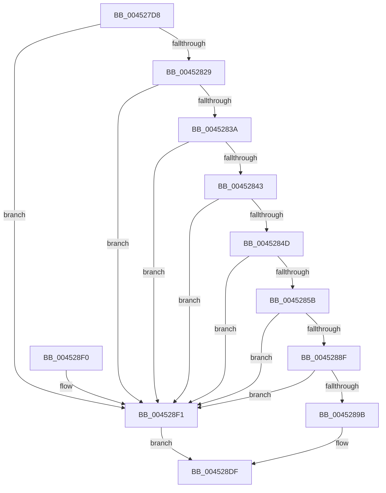

# MiInsertProtectedStandbyPage

- RVA: `0x004527D8`–`0x004528FE` (길이 `294` bytes)
- VA: `0x00000001404527D8`
- 실행 섹션: `.text`
- PDB 이름 있음: `예`; PDB Function 태그: `아니요`
- unwind 정보 RVA: `0x000A7650`
- 디코드: `67`개 명령, `294/294` bytes 표시
- 미해석 바이트: `0` (있으면 어셈블리에 `.byte`로 보존)

> 이 문서는 커널 이미지의 기계어와 PDB 기호를 분석해 생성했습니다. 4번과 5번은 함수 원형과 자료형을 바이너리 사용 방식에서 추정한 C 해석이며 원본 소스 복구 결과는 아닙니다.

## 1. Dependencies

- 직접 호출 지점: **5**; 고유 호출 대상: **5**
- 직접 호출자로 확인된 함수: **5**
- RIP 상대 이미지 참조: **1**

### Outgoing calls
- `0x004527F6` → [memset](../6C/memset_function_006C6C40.md) (function, `0x006C6C40`)
- `0x0045282C` → [MiGetPfnSlabType](../28/MiGetPfnSlabType_function_0028E2D0.md) (function, `0x0028E2D0`)
- `0x004528CE` → [MiAddPageToInsertList](../24/MiAddPageToInsertList_function_0024A950.md) (function, `0x0024A950`)
- `0x004528DA` → [MiInsertPagesInList](../33/MiInsertPagesInList_function_0033E270.md) (function, `0x0033E270`)
- `0x004528F7` → [MiPfnReferenceCountIsZero](../2B/MiPfnReferenceCountIsZero_function_002B9E40.md) (function, `0x002B9E40`)

### Direct callers
- [MiHardFaultPageRelease](../2B/MiHardFaultPageRelease_function_002B5728.md) at `0x002B585A`
- [MiPfnShareCountIsZero](../33/MiPfnShareCountIsZero_function_00330930.md) at `0x00330C39`
- [sub_003341DB](../33/Unknown_function_003341DB.md) at `0x003342EE`
- [MiWalkEntireImage](../36/MiWalkEntireImage_function_00365D70.md) at `0x0036647B`
- [sub_00370B5B](../37/Unknown_function_00370B5B.md) at `0x00370CF2`

### Static image references
- `0x00452865` → RVA `0x00E30088` (`.data`; read)

## 2. Other-region calls and transfers

- 다른 실행 섹션으로 향하는 call: **0**
- 별도 외부 분기/꼬리 이동을 확인하지 못했습니다.

## 3. Assembly (complete function range)

```asm
004527D8  48 89 5C 24 08                  mov qword ptr [rsp + 8], rbx
004527DD  57                              push rdi
004527DE  48 81 EC 90 00 00 00            sub rsp, 0x90
004527E5  48 8B DA                        mov rbx, rdx
004527E8  48 8B F9                        mov rdi, rcx
004527EB  33 D2                           xor edx, edx
004527ED  48 8D 4C 24 20                  lea rcx, [rsp + 0x20]
004527F2  44 8D 42 68                     lea r8d, [rdx + 0x68]
004527F6  E8 45 44 27 00                  call 0x1406c6c40
004527FB  48 B8 00 00 00 00 00 DE FF FF   movabs rax, 0xffffde0000000000
00452805  4C 8B C3                        mov r8, rbx
00452808  4C 2B C0                        sub r8, rax
0045280B  48 B8 AB AA AA AA AA AA AA AA   movabs rax, 0xaaaaaaaaaaaaaaab
00452815  49 C1 F8 04                     sar r8, 4
00452819  4C 0F AF C0                     imul r8, rax
0045281D  48 0F BA 63 28 35               bt qword ptr [rbx + 0x28], 0x35
00452823  0F 82 C8 00 00 00               jb 0x1404528f1
00452829  48 8B CB                        mov rcx, rbx
0045282C  E8 9F BA E3 FF                  call 0x14028e2d0
00452831  83 F8 09                        cmp eax, 9
00452834  0F 85 B7 00 00 00               jne 0x1404528f1
0045283A  48 85 FF                        test rdi, rdi
0045283D  0F 84 AE 00 00 00               je 0x1404528f1
00452843  F6 43 23 10                     test byte ptr [rbx + 0x23], 0x10
00452847  0F 85 A4 00 00 00               jne 0x1404528f1
0045284D  8B 43 20                        mov eax, dword ptr [rbx + 0x20]
00452850  C1 E8 18                        shr eax, 0x18
00452853  A8 40                           test al, 0x40
00452855  0F 85 96 00 00 00               jne 0x1404528f1
0045285B  48 8B 43 28                     mov rax, qword ptr [rbx + 0x28]
0045285F  41 B9 FF 03 00 00               mov r9d, 0x3ff
00452865  48 8B 0D 1C D8 9D 00            mov rcx, qword ptr [rip + 0x9dd81c]
0045286C  48 C1 E8 2B                     shr rax, 0x2b
00452870  49 23 C1                        and rax, r9
00452873  48 8B 14 C1                     mov rdx, qword ptr [rcx + rax*8]
00452877  48 8B 47 28                     mov rax, qword ptr [rdi + 0x28]
0045287B  48 8B 0D 06 D8 9D 00            mov rcx, qword ptr [rip + 0x9dd806]
00452882  48 C1 E8 2B                     shr rax, 0x2b
00452886  49 23 C1                        and rax, r9
00452889  48 39 14 C1                     cmp qword ptr [rcx + rax*8], rdx
0045288D  75 62                           jne 0x1404528f1
0045288F  8B 43 20                        mov eax, dword ptr [rbx + 0x20]
00452892  C1 E8 18                        shr eax, 0x18
00452895  24 07                           and al, 7
00452897  3C 05                           cmp al, 5
00452899  73 56                           jae 0x1404528f1
0045289B  48 B8 FF FF FF FF 3F 00 00 00   movabs rax, 0x3fffffffff
004528A5  C7 84 24 80 00 00 00 03 00 00 00  mov dword ptr [rsp + 0x80], 3
004528B0  48 89 44 24 30                  mov qword ptr [rsp + 0x30], rax
004528B5  48 8D 4C 24 20                  lea rcx, [rsp + 0x20]
004528BA  48 89 44 24 38                  mov qword ptr [rsp + 0x38], rax
004528BF  33 D2                           xor edx, edx
004528C1  C7 44 24 40 00 00 00 00         mov dword ptr [rsp + 0x40], 0
004528C9  48 89 7C 24 78                  mov qword ptr [rsp + 0x78], rdi
004528CE  E8 7D 80 DF FF                  call 0x14024a950
004528D3  33 D2                           xor edx, edx
004528D5  48 8D 4C 24 20                  lea rcx, [rsp + 0x20]
004528DA  E8 91 B9 EE FF                  call 0x14033e270
004528DF  48 8B 9C 24 A0 00 00 00         mov rbx, qword ptr [rsp + 0xa0]
004528E7  48 81 C4 90 00 00 00            add rsp, 0x90
004528EE  5F                              pop rdi
004528EF  C3                              ret
004528F0  CC                              int3
004528F1  49 8B D0                        mov rdx, r8
004528F4  48 8B CB                        mov rcx, rbx
004528F7  E8 44 75 E6 FF                  call 0x1402b9e40
004528FC  EB E1                           jmp 0x1404528df
```

## 4. C-style interpretation (structured pseudocode)

```c
__int64 __fastcall MiInsertProtectedStandbyPage(__int64 a1, __int64 a2)
{
    __int64 result;
    __int64 v_rsp;
    unsigned int v_stack_m18;
    unsigned __int64 v_stack_m20;
    unsigned int v_stack_m58;
    unsigned __int64 v_stack_m60;
    unsigned __int64 v_stack_m68;
    unsigned __int64 v_stack_m78;
    unsigned __int64 v_stack_p8;

    v_stack_p8 = v_rbx;
    v_rsp = (v_rsp) - (144);
    a2 = 0;
    result = memset(v_stack_m78, a2, a2 + 104, a4);
    a3 = (0) - (result);
    a3 = (a3) >> (4);
    a3 = (a3) * (result);
    if (condition_is_below) goto loc_004528F1;
    result = MiGetPfnSlabType(0, a2, a3, a4);
    if (((unsigned int)(result)) != 9) goto loc_004528F1;
    if (a1 == 0) goto loc_004528F1;
    if (((*(unsigned __int8 *)(a2 + 35)) & (16)) != 0) goto loc_004528F1;
    result = (unsigned int)(((unsigned int)(*(unsigned int *)(a2 + 32))) >> (24));
    if ((((unsigned __int8)(result)) & (64)) != 0) goto loc_004528F1;
    result = (*(unsigned __int64 *)(a2 + 40)) >> (43);
    result = (result) & ((unsigned int)(0x3FFULL));
    result = (*(unsigned __int64 *)(a1 + 40)) >> (43);
    result = (result) & ((unsigned int)(0x3FFULL));
    if ((*(unsigned __int64 *)(*(unsigned __int64 *)(v_rip + 10344454) + result * 8)) != (*(unsigned __int64 *)(*(unsigned __int64 *)(v_rip + 10344476) + result * 8))) goto loc_004528F1;
    result = (unsigned int)(((unsigned int)(*(unsigned int *)(a2 + 32))) >> (24));
    result = (unsigned __int8)((result) & (7));
    if (((unsigned __int8)(result)) >= 5) goto loc_004528F1;
    v_stack_m18 = 3;
    v_stack_m68 = result;
    v_stack_m60 = result;
    a2 = 0;
    v_stack_m58 = 0;
    v_stack_m20 = a1;
    result = MiAddPageToInsertList(v_stack_m78, a2, a3, (unsigned int)(0x3FFULL));
    a2 = 0;
    result = MiInsertPagesInList(v_stack_m78, a2, a3, (unsigned int)(0x3FFULL));
loc_004528DF:
    v_rsp = (v_rsp) + (144);
    return result;
loc_004528F1:
    result = MiPfnReferenceCountIsZero(v_stack_p8, a3, a3, (unsigned int)(0x3FFULL));
    goto loc_004528DF;
}
```

## 5. (Beta) C Style

```c
int64_t MiInsertProtectedStandbyPage(int64_t Arg1, void *Arg2)
{
    uint8_t *arg2 = (uint8_t *)Arg2;

    int64_t result;
    int64_t local_rsp;
    uint32_t v_stack_m18;
    uint64_t v_stack_m20;
    uint32_t v_stack_m58;
    uint64_t v_stack_m60;
    uint64_t v_stack_m68;
    uint64_t v_stack_m78;
    uint64_t v_stack_p8;

    v_stack_p8 = local_rbx;
    local_rsp = (local_rsp) - (144);
    Arg2 = 0;
    result = memset(v_stack_m78, Arg2, Arg2 + 104, a4);
    a3 = (0) - (result);
    a3 = (a3) >> (4);
    a3 = (a3) * (result);
    if (condition_is_below) goto loc_004528F1;
    result = MiGetPfnSlabType(0, Arg2, a3, a4);
    if (((uint32_t)(result)) != 9) goto loc_004528F1;
    if (Arg1 == 0) goto loc_004528F1;
    if (((*(uint8_t *)(arg2 + 0x23)) & (16)) != 0) goto loc_004528F1;
    result = (uint32_t)(((uint32_t)(*(uint32_t *)(arg2 + 0x20))) >> (24));
    if ((((uint8_t)(result)) & (64)) != 0) goto loc_004528F1;
    result = (*(uint64_t *)(arg2 + 0x28)) >> (43);
    result = (result) & ((uint32_t)(0x3FFULL));
    result = (*(uint64_t *)(Arg1 + 0x28)) >> (43);
    result = (result) & ((uint32_t)(0x3FFULL));
    if ((*(uint64_t *)(*(uint64_t *)(v_rip + 0x9DD806) + result * 8)) != (*(uint64_t *)(*(uint64_t *)(v_rip + 0x9DD81C) + result * 8))) goto loc_004528F1;
    result = (uint32_t)(((uint32_t)(*(uint32_t *)(arg2 + 0x20))) >> (24));
    result = (uint8_t)((result) & (7));
    if (((uint8_t)(result)) >= 5) goto loc_004528F1;
    v_stack_m18 = 3;
    v_stack_m68 = result;
    v_stack_m60 = result;
    Arg2 = 0;
    v_stack_m58 = 0;
    v_stack_m20 = Arg1;
    result = MiAddPageToInsertList(v_stack_m78, Arg2, a3, (uint32_t)(0x3FFULL));
    Arg2 = 0;
    result = MiInsertPagesInList(v_stack_m78, Arg2, a3, (uint32_t)(0x3FFULL));
loc_004528DF:
    local_rsp = (local_rsp) + (144);
    return result;
loc_004528F1:
    result = MiPfnReferenceCountIsZero(v_stack_p8, a3, a3, (uint32_t)(0x3FFULL));
    goto loc_004528DF;
}
```

### 관측된 메모리 오프셋

구조체 형식이 확인되지 않은 접근은 인자 기준의 오프셋으로만 기록했습니다.

| 기준 인자 | 오프셋 표현 | 폭 (bit) | 접근 |
|---|---:|---:|---|
| `Arg2` | `+ 0x20` | `32` | `R` |
| `Arg2` | `+ 0x23` | `8` | `R` |
| `Arg2` | `+ 0x28` | `64` | `R` |

## 6. Execution-region graph

[열기: 2D/3D 그래프와 함수 탐색 컨트롤 패널](../../../control-panel.html?section=text&rva=0x004527D8&view=graph)

- 2D 그래프는 위에서 아래로 흐르고, 3D 그래프는 빈 공간을 드래그해 회전합니다. Shift+드래그는 이동, 휠은 확대·축소, 함수 노드 선택은 대상 보고서 이동입니다.

### Static fallback


