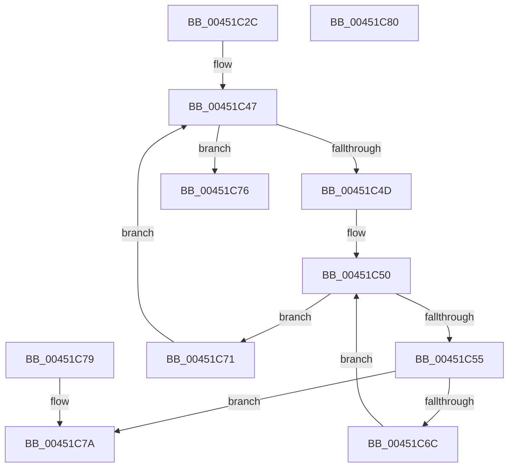

# MiIsPageAGapPage

- RVA: `0x00451C2C`–`0x00451C81` (길이 `85` bytes)
- VA: `0x0000000140451C2C`
- 실행 섹션: `.text`
- PDB 이름 있음: `예`; PDB Function 태그: `아니요`
- unwind 정보 RVA: `0x000DB714`
- 디코드: `30`개 명령, `85/85` bytes 표시
- 미해석 바이트: `0` (있으면 어셈블리에 `.byte`로 보존)

> 이 문서는 커널 이미지의 기계어와 PDB 기호를 분석해 생성했습니다. 4번과 5번은 함수 원형과 자료형을 바이너리 사용 방식에서 추정한 C 해석이며 원본 소스 복구 결과는 아닙니다.

## 1. Dependencies

- 직접 호출 지점: **0**; 고유 호출 대상: **0**
- 직접 호출자로 확인된 함수: **3**
- RIP 상대 이미지 참조: **1**

### Outgoing calls
- 직접 디코드된 call 명령이 없습니다.

### Direct callers
- [sub_0027B90E](../27/Unknown_function_0027B90E.md) at `0x0027BA6B`
- [MiCreateSystemPageTable](MiCreateSystemPageTable_function_004518D0.md) at `0x00451943`
- [MiInitializeSystemPageTable](MiInitializeSystemPageTable_function_00451C88.md) at `0x00452049`

### Static image references
- `0x00451C5C` → RVA `0x00E37440` (`.data`; read)

## 2. Other-region calls and transfers

- 다른 실행 섹션으로 향하는 call: **0**
- 별도 외부 분기/꼬리 이동을 확인하지 못했습니다.

## 3. Assembly (complete function range)

```asm
00451C2C  45 33 C0                        xor r8d, r8d
00451C2F  4C 8B D9                        mov r11, rcx
00451C32  41 8D 40 03                     lea eax, [r8 + 3]
00451C36  3B D0                           cmp edx, eax
00451C38  0F 4E C2                        cmovle eax, edx
00451C3B  4C 63 C8                        movsxd r9, eax
00451C3E  41 8B C0                        mov eax, r8d
00451C41  0F 4E C2                        cmovle eax, edx
00451C44  4C 63 D0                        movsxd r10, eax
00451C47  41 83 F8 02                     cmp r8d, 2
00451C4B  73 29                           jae 0x140451c76
00451C4D  49 8B D2                        mov rdx, r10
00451C50  49 3B D1                        cmp rdx, r9
00451C53  7F 1C                           jg 0x140451c71
00451C55  41 8B C0                        mov eax, r8d
00451C58  48 6B C8 07                     imul rcx, rax, 7
00451C5C  48 8D 05 DD 57 9E 00            lea rax, [rip + 0x9e57dd]
00451C63  48 03 CA                        add rcx, rdx
00451C66  4C 3B 1C C8                     cmp r11, qword ptr [rax + rcx*8]
00451C6A  74 0E                           je 0x140451c7a
00451C6C  48 FF C2                        inc rdx
00451C6F  EB DF                           jmp 0x140451c50
00451C71  41 FF C0                        inc r8d
00451C74  EB D1                           jmp 0x140451c47
00451C76  33 C0                           xor eax, eax
00451C78  C3                              ret
00451C79  CC                              int3
00451C7A  B8 01 00 00 00                  mov eax, 1
00451C7F  C3                              ret
00451C80  CC                              int3
```

## 4. C-style interpretation (structured pseudocode)

```c
__int64 __fastcall MiIsPageAGapPage(__int64 a1, int a2, int a3)
{
    __int64 result;

    a3 = 0;
    result = a3 + 3;
    if (a2 <= ((unsigned int)(a3 + 3))) { result = a2; }
    result = 0;
    if (a2 <= ((unsigned int)(a3 + 3))) { result = a2; }
loc_00451C47:
    if (0 >= 2) goto loc_00451C76;
loc_00451C50:
    if (((int)((unsigned int)(result))) > ((int)((unsigned int)(result)))) goto loc_00451C71;
    a1 = (a1) * (0);
    a1 = (a1) + ((int)((unsigned int)(result)));
    if (a1 == (*(unsigned __int64 *)(v_rip + 10377181 + a1 * 8))) goto loc_00451C7A;
    a2 = ((int)((unsigned int)(result))) + 1;
    goto loc_00451C50;
loc_00451C71:
    a3 = (unsigned int)((a3) + 1);
    goto loc_00451C47;
loc_00451C76:
    result = 0;
    return result;
loc_00451C7A:
    return 1;
}
```

## 5. (Beta) C Style

```c
int64_t MiIsPageAGapPage(int64_t Arg1, int32_t Arg2, int32_t Arg3)
{
    int64_t result;

    Arg3 = 0;
    result = Arg3 + 3;
    if (Arg2 <= ((uint32_t)(Arg3 + 3))) { result = Arg2; }
    result = 0;
    if (Arg2 <= ((uint32_t)(Arg3 + 3))) { result = Arg2; }
loc_00451C47:
    if (0 >= 2) goto loc_00451C76;
loc_00451C50:
    if (((int32_t)((uint32_t)(result))) > ((int32_t)((uint32_t)(result)))) goto loc_00451C71;
    Arg1 = (Arg1) * (0);
    Arg1 = (Arg1) + ((int32_t)((uint32_t)(result)));
    if (Arg1 == (*(uint64_t *)(v_rip + 0x9E57DD + Arg1 * 8))) goto loc_00451C7A;
    Arg2 = ((int32_t)((uint32_t)(result))) + 1;
    goto loc_00451C50;
loc_00451C71:
    Arg3 = (uint32_t)((Arg3) + 1);
    goto loc_00451C47;
loc_00451C76:
    result = 0;
    return result;
loc_00451C7A:
    return 1;
}
```

## 6. Execution-region graph

[열기: 2D/3D 그래프와 함수 탐색 컨트롤 패널](../../../control-panel.html?section=text&rva=0x00451C2C&view=graph)

- 2D 그래프는 위에서 아래로 흐르고, 3D 그래프는 빈 공간을 드래그해 회전합니다. Shift+드래그는 이동, 휠은 확대·축소, 함수 노드 선택은 대상 보고서 이동입니다.

### Static fallback


