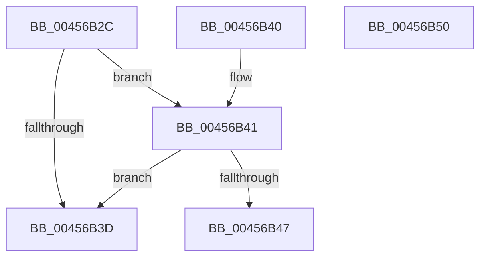

# MiIsSoftwareEnclave

- RVA: `0x00456B2C`–`0x00456B51` (길이 `37` bytes)
- VA: `0x0000000140456B2C`
- 실행 섹션: `.text`
- PDB 이름 있음: `예`; PDB Function 태그: `아니요`
- unwind 정보 RVA: `0x000DB714`
- 디코드: `15`개 명령, `37/37` bytes 표시
- 미해석 바이트: `0` (있으면 어셈블리에 `.byte`로 보존)

> 이 문서는 커널 이미지의 기계어와 PDB 기호를 분석해 생성했습니다. 4번과 5번은 함수 원형과 자료형을 바이너리 사용 방식에서 추정한 C 해석이며 원본 소스 복구 결과는 아닙니다.

## 1. Dependencies

- 직접 호출 지점: **0**; 고유 호출 대상: **0**
- 직접 호출자로 확인된 함수: **1**
- RIP 상대 이미지 참조: **0**

### Outgoing calls
- 직접 디코드된 call 명령이 없습니다.

### Direct callers
- [MmQueryVirtualMemory](../../page/9D/MmQueryVirtualMemory_function_009D9280.md) at `0x009D9A95`

### Static image references
- 디코드된 RIP-relative 메모리 참조가 없습니다.

## 2. Other-region calls and transfers

- 다른 실행 섹션으로 향하는 call: **0**
- 별도 외부 분기/꼬리 이동을 확인하지 못했습니다.

## 3. Assembly (complete function range)

```asm
00456B2C  8B 51 30                        mov edx, dword ptr [rcx + 0x30]
00456B2F  8B C2                           mov eax, edx
00456B31  25 00 00 20 04                  and eax, 0x4200000
00456B36  3D 00 00 20 00                  cmp eax, 0x200000
00456B3B  74 04                           je 0x140456b41
00456B3D  33 C0                           xor eax, eax
00456B3F  C3                              ret
00456B40  CC                              int3
00456B41  0F BA E2 1B                     bt edx, 0x1b
00456B45  73 F6                           jae 0x140456b3d
00456B47  8B 41 40                        mov eax, dword ptr [rcx + 0x40]
00456B4A  F7 D0                           not eax
00456B4C  83 E0 01                        and eax, 1
00456B4F  C3                              ret
00456B50  CC                              int3
```

## 4. C-style interpretation (structured pseudocode)

```c
__int64 __fastcall MiIsSoftwareEnclave(__int64 a1)
{
    __int64 result;

    result = (unsigned int)(((unsigned int)((unsigned int)((unsigned int)(*(unsigned int *)(a1 + 48))))) & (0x4200000ULL));
    if (((unsigned int)(result)) == 0x200000ULL) goto loc_00456B41;
loc_00456B3D:
    result = 0;
    return result;
loc_00456B41:
    if (condition_is_above_or_equal) goto loc_00456B3D;
    result = (unsigned int)(~((unsigned int)(*(unsigned int *)(a1 + 64))));
    result = (unsigned int)((result) & (1));
    return result;
}
```

## 5. (Beta) C Style

```c
int64_t MiIsSoftwareEnclave(void *Arg1)
{
    uint8_t *arg1 = (uint8_t *)Arg1;

    int64_t result;

    result = (uint32_t)(((uint32_t)((uint32_t)((uint32_t)(*(uint32_t *)(arg1 + 0x30))))) & (0x4200000ULL));
    if (((uint32_t)(result)) == 0x200000ULL) goto loc_00456B41;
loc_00456B3D:
    result = 0;
    return result;
loc_00456B41:
    if (condition_is_above_or_equal) goto loc_00456B3D;
    result = (uint32_t)(~((uint32_t)(*(uint32_t *)(arg1 + 0x40))));
    result = (uint32_t)((result) & (1));
    return result;
}
```

### 관측된 메모리 오프셋

구조체 형식이 확인되지 않은 접근은 인자 기준의 오프셋으로만 기록했습니다.

| 기준 인자 | 오프셋 표현 | 폭 (bit) | 접근 |
|---|---:|---:|---|
| `Arg1` | `+ 0x30` | `32` | `R` |
| `Arg1` | `+ 0x40` | `32` | `R` |

## 6. Execution-region graph

[열기: 2D/3D 그래프와 함수 탐색 컨트롤 패널](../../../control-panel.html?section=text&rva=0x00456B2C&view=graph)

- 2D 그래프는 위에서 아래로 흐르고, 3D 그래프는 빈 공간을 드래그해 회전합니다. Shift+드래그는 이동, 휠은 확대·축소, 함수 노드 선택은 대상 보고서 이동입니다.

### Static fallback


