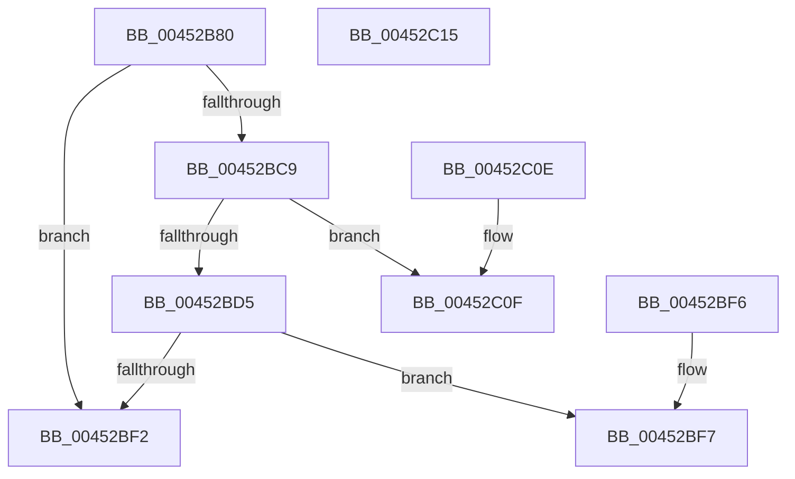

# MiModifiedWriterNoReservationSort

- RVA: `0x00452B80`–`0x00452C16` (길이 `150` bytes)
- VA: `0x0000000140452B80`
- 실행 섹션: `.text`
- PDB 이름 있음: `예`; PDB Function 태그: `아니요`
- unwind 정보 RVA: `0x000DB714`
- 디코드: `44`개 명령, `150/150` bytes 표시
- 미해석 바이트: `0` (있으면 어셈블리에 `.byte`로 보존)

> 이 문서는 커널 이미지의 기계어와 PDB 기호를 분석해 생성했습니다. 4번과 5번은 함수 원형과 자료형을 바이너리 사용 방식에서 추정한 C 해석이며 원본 소스 복구 결과는 아닙니다.

## 1. Dependencies

- 직접 호출 지점: **0**; 고유 호출 대상: **0**
- 직접 호출자로 확인된 함수: **0**
- RIP 상대 이미지 참조: **0**

### Outgoing calls
- 직접 디코드된 call 명령이 없습니다.

### Direct callers
- 이 함수 시작 RVA로 연결되는 직접 call은 확인되지 않았습니다. 간접 호출은 완전히 역산할 수 없습니다.

### Static image references
- 디코드된 RIP-relative 메모리 참조가 없습니다.

## 2. Other-region calls and transfers

- 다른 실행 섹션으로 향하는 call: **0**
- 별도 외부 분기/꼬리 이동을 확인하지 못했습니다.

## 3. Assembly (complete function range)

```asm
00452B80  48 8B 01                        mov rax, qword ptr [rcx]
00452B83  48 B9 00 00 00 00 00 DE FF FF   movabs rcx, 0xffffde0000000000
00452B8D  4C 8D 0C 40                     lea r9, [rax + rax*2]
00452B91  49 C1 E1 04                     shl r9, 4
00452B95  48 8B C1                        mov rax, rcx
00452B98  4C 03 C8                        add r9, rax
00452B9B  48 8B 02                        mov rax, qword ptr [rdx]
00452B9E  4C 8D 04 40                     lea r8, [rax + rax*2]
00452BA2  49 C1 E0 04                     shl r8, 4
00452BA6  48 8B C1                        mov rax, rcx
00452BA9  49 8B 49 28                     mov rcx, qword ptr [r9 + 0x28]
00452BAD  4C 03 C0                        add r8, rax
00452BB0  48 BA FF FF FF FF FF 00 00 00   movabs rdx, 0xffffffffff
00452BBA  48 23 CA                        and rcx, rdx
00452BBD  49 8B 40 28                     mov rax, qword ptr [r8 + 0x28]
00452BC1  48 23 C2                        and rax, rdx
00452BC4  48 3B C8                        cmp rcx, rax
00452BC7  72 29                           jb 0x140452bf2
00452BC9  49 8B 40 28                     mov rax, qword ptr [r8 + 0x28]
00452BCD  48 23 C2                        and rax, rdx
00452BD0  48 3B C8                        cmp rcx, rax
00452BD3  77 3A                           ja 0x140452c0f
00452BD5  49 8B 49 08                     mov rcx, qword ptr [r9 + 8]
00452BD9  49 BA 00 00 00 00 00 00 00 80   movabs r10, 0x8000000000000000
00452BE3  49 8B 40 08                     mov rax, qword ptr [r8 + 8]
00452BE7  49 0B CA                        or rcx, r10
00452BEA  49 0B C2                        or rax, r10
00452BED  48 3B C8                        cmp rcx, rax
00452BF0  73 05                           jae 0x140452bf7
00452BF2  83 C8 FF                        or eax, 0xffffffff
00452BF5  C3                              ret
00452BF6  CC                              int3
00452BF7  49 8B 51 08                     mov rdx, qword ptr [r9 + 8]
00452BFB  33 C0                           xor eax, eax
00452BFD  49 8B 48 08                     mov rcx, qword ptr [r8 + 8]
00452C01  49 0B D2                        or rdx, r10
00452C04  49 0B CA                        or rcx, r10
00452C07  48 3B D1                        cmp rdx, rcx
00452C0A  0F 97 C0                        seta al
00452C0D  C3                              ret
00452C0E  CC                              int3
00452C0F  B8 01 00 00 00                  mov eax, 1
00452C14  C3                              ret
00452C15  CC                              int3
```

## 4. C-style interpretation (structured pseudocode)

```c
__int64 __fastcall MiModifiedWriterNoReservationSort(__int64 a1, __int64 a2)
{
    __int64 result;

    a4 = (*(unsigned __int64 *)(a1) + *(unsigned __int64 *)(a1) * 2) << (4);
    a4 = (a4) + (a1);
    a3 = (*(unsigned __int64 *)(a2) + *(unsigned __int64 *)(a2) * 2) << (4);
    a3 = (a3) + (a1);
    a1 = (*(unsigned __int64 *)(a4 + 40)) & (a2);
    result = (*(unsigned __int64 *)(a3 + 40)) & (a2);
    if (a1 < result) goto loc_00452BF2;
    result = (*(unsigned __int64 *)(a3 + 40)) & (a2);
    if (a1 > result) goto loc_00452C0F;
    a1 = (*(unsigned __int64 *)(a4 + 8)) | (v_r10);
    result = (*(unsigned __int64 *)(a3 + 8)) | (v_r10);
    if (a1 >= result) goto loc_00452BF7;
loc_00452BF2:
    result = (unsigned int)((result) | (0xFFFFFFFFULL));
    return result;
loc_00452BF7:
    result = 0;
    a2 = (*(unsigned __int64 *)(a4 + 8)) | (v_r10);
    a1 = (*(unsigned __int64 *)(a3 + 8)) | (v_r10);
    result = (a2 > a1) ? 1 : 0;
    return result;
loc_00452C0F:
    return 1;
}
```

## 5. (Beta) C Style

```c
int64_t MiModifiedWriterNoReservationSort(void *Arg1, void *Arg2)
{
    uint8_t *arg1 = (uint8_t *)Arg1;
    uint8_t *arg2 = (uint8_t *)Arg2;

    int64_t result;

    a4 = (*(uint64_t *)(arg1) + *(uint64_t *)(arg1) * 2) << (4);
    a4 = (a4) + (Arg1);
    a3 = (*(uint64_t *)(arg2) + *(uint64_t *)(arg2) * 2) << (4);
    a3 = (a3) + (Arg1);
    Arg1 = (*(uint64_t *)(a4 + 0x28)) & (Arg2);
    result = (*(uint64_t *)(a3 + 0x28)) & (Arg2);
    if (Arg1 < result) goto loc_00452BF2;
    result = (*(uint64_t *)(a3 + 0x28)) & (Arg2);
    if (Arg1 > result) goto loc_00452C0F;
    Arg1 = (*(uint64_t *)(a4 + 0x8)) | (local_r10);
    result = (*(uint64_t *)(a3 + 0x8)) | (local_r10);
    if (Arg1 >= result) goto loc_00452BF7;
loc_00452BF2:
    result = (uint32_t)((result) | (0xFFFFFFFFULL));
    return result;
loc_00452BF7:
    result = 0;
    Arg2 = (*(uint64_t *)(a4 + 0x8)) | (local_r10);
    Arg1 = (*(uint64_t *)(a3 + 0x8)) | (local_r10);
    result = (Arg2 > Arg1) ? 1 : 0;
    return result;
loc_00452C0F:
    return 1;
}
```

### 관측된 메모리 오프셋

구조체 형식이 확인되지 않은 접근은 인자 기준의 오프셋으로만 기록했습니다.

| 기준 인자 | 오프셋 표현 | 폭 (bit) | 접근 |
|---|---:|---:|---|
| `Arg1` | `+ 0x0` | `64` | `R` |
| `Arg2` | `+ 0x0` | `64` | `R` |

## 6. Execution-region graph

[열기: 2D/3D 그래프와 함수 탐색 컨트롤 패널](../../../control-panel.html?section=text&rva=0x00452B80&view=graph)

- 2D 그래프는 위에서 아래로 흐르고, 3D 그래프는 빈 공간을 드래그해 회전합니다. Shift+드래그는 이동, 휠은 확대·축소, 함수 노드 선택은 대상 보고서 이동입니다.

### Static fallback


