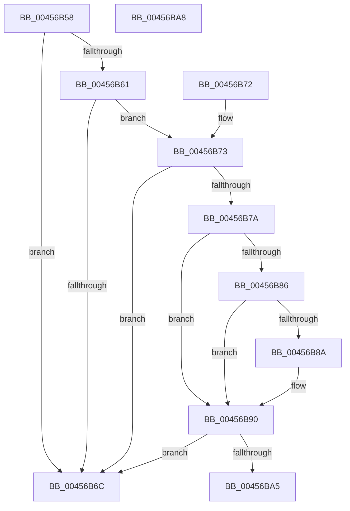

# MiPageChargedCommit

- RVA: `0x00456B58`–`0x00456BA9` (길이 `81` bytes)
- VA: `0x0000000140456B58`
- 실행 섹션: `.text`
- PDB 이름 있음: `예`; PDB Function 태그: `아니요`
- unwind 정보 RVA: `0x000DB714`
- 디코드: `28`개 명령, `81/81` bytes 표시
- 미해석 바이트: `0` (있으면 어셈블리에 `.byte`로 보존)

> 이 문서는 커널 이미지의 기계어와 PDB 기호를 분석해 생성했습니다. 4번과 5번은 함수 원형과 자료형을 바이너리 사용 방식에서 추정한 C 해석이며 원본 소스 복구 결과는 아닙니다.

## 1. Dependencies

- 직접 호출 지점: **0**; 고유 호출 대상: **0**
- 직접 호출자로 확인된 함수: **1**
- RIP 상대 이미지 참조: **1**

### Outgoing calls
- 직접 디코드된 call 명령이 없습니다.

### Direct callers
- [MiDecommitSharedPageTail](../37/MiDecommitSharedPageTail_function_00370240.md) at `0x00370458`

### Static image references
- `0x00456B7A` → RVA `0x00E2DC80` (`.data`; read)

## 2. Other-region calls and transfers

- 다른 실행 섹션으로 향하는 call: **0**
- 별도 외부 분기/꼬리 이동을 확인하지 못했습니다.

## 3. Assembly (complete function range)

```asm
00456B58  48 8B 41 28                     mov rax, qword ptr [rcx + 0x28]
00456B5C  48 85 C0                        test rax, rax
00456B5F  79 0B                           jns 0x140456b6c
00456B61  48 8B 41 10                     mov rax, qword ptr [rcx + 0x10]
00456B65  48 0F BA E0 0A                  bt rax, 0xa
00456B6A  72 07                           jb 0x140456b73
00456B6C  B8 01 00 00 00                  mov eax, 1
00456B71  C3                              ret
00456B72  CC                              int3
00456B73  48 0F BA E2 09                  bt rdx, 9
00456B78  72 F2                           jb 0x140456b6c
00456B7A  48 8B 0D FF 70 9D 00            mov rcx, qword ptr [rip + 0x9d70ff]
00456B81  48 85 C9                        test rcx, rcx
00456B84  74 0A                           je 0x140456b90
00456B86  A8 10                           test al, 0x10
00456B88  75 06                           jne 0x140456b90
00456B8A  48 F7 D1                        not rcx
00456B8D  48 23 C1                        and rax, rcx
00456B90  48 C1 F8 10                     sar rax, 0x10
00456B94  48 8B 08                        mov rcx, qword ptr [rax]
00456B97  8B 41 38                        mov eax, dword ptr [rcx + 0x38]
00456B9A  B9 20 08 00 00                  mov ecx, 0x820
00456B9F  23 C1                           and eax, ecx
00456BA1  3B C1                           cmp eax, ecx
00456BA3  74 C7                           je 0x140456b6c
00456BA5  33 C0                           xor eax, eax
00456BA7  C3                              ret
00456BA8  CC                              int3
```

## 4. C-style interpretation (structured pseudocode)

```c
__int64 __fastcall MiPageChargedCommit(__int64 a1, __int64 a2)
{
    __int64 result;

    if (!sign_flag) goto loc_00456B6C;
    if (condition_is_below) goto loc_00456B73;
loc_00456B6C:
    return 1;
loc_00456B73:
    if (condition_is_below) goto loc_00456B6C;
    if (*(unsigned __int64 *)(v_rip + 10318079) == 0) goto loc_00456B90;
    result = 1;
    if (((1) & (16)) == 0) {
        a1 = ~(*(unsigned __int64 *)(v_rip + 10318079));
        result = (1) & (a1);
    }
    result = (result) >> (16);
    result = (unsigned int)(((unsigned int)(*(unsigned int *)(*(unsigned __int64 *)(result) + 56))) & ((unsigned int)((unsigned int)(0x820ULL))));
    if (((unsigned int)(result)) == ((unsigned int)((unsigned int)(0x820ULL)))) goto loc_00456B6C;
    result = 0;
    return result;
}
```

## 5. (Beta) C Style

```c
int64_t MiPageChargedCommit(void *Arg1, int64_t Arg2)
{
    uint8_t *arg1 = (uint8_t *)Arg1;

    int64_t result;

    if (!sign_flag) goto loc_00456B6C;
    if (condition_is_below) goto loc_00456B73;
loc_00456B6C:
    return 1;
loc_00456B73:
    if (condition_is_below) goto loc_00456B6C;
    if (*(uint64_t *)(v_rip + 0x9D70FF) == 0) goto loc_00456B90;
    result = 1;
    if (((1) & (16)) == 0) {
        Arg1 = ~(*(uint64_t *)(v_rip + 0x9D70FF));
        result = (1) & (Arg1);
    }
    result = (result) >> (16);
    result = (uint32_t)(((uint32_t)(*(uint32_t *)(*(uint64_t *)(result) + 0x38))) & ((uint32_t)((uint32_t)(0x820ULL))));
    if (((uint32_t)(result)) == ((uint32_t)((uint32_t)(0x820ULL)))) goto loc_00456B6C;
    result = 0;
    return result;
}
```

### 관측된 메모리 오프셋

구조체 형식이 확인되지 않은 접근은 인자 기준의 오프셋으로만 기록했습니다.

| 기준 인자 | 오프셋 표현 | 폭 (bit) | 접근 |
|---|---:|---:|---|
| `Arg1` | `+ 0x10` | `64` | `R` |
| `Arg1` | `+ 0x28` | `64` | `R` |

## 6. Execution-region graph

[열기: 2D/3D 그래프와 함수 탐색 컨트롤 패널](../../../control-panel.html?section=text&rva=0x00456B58&view=graph)

- 2D 그래프는 위에서 아래로 흐르고, 3D 그래프는 빈 공간을 드래그해 회전합니다. Shift+드래그는 이동, 휠은 확대·축소, 함수 노드 선택은 대상 보고서 이동입니다.

### Static fallback


