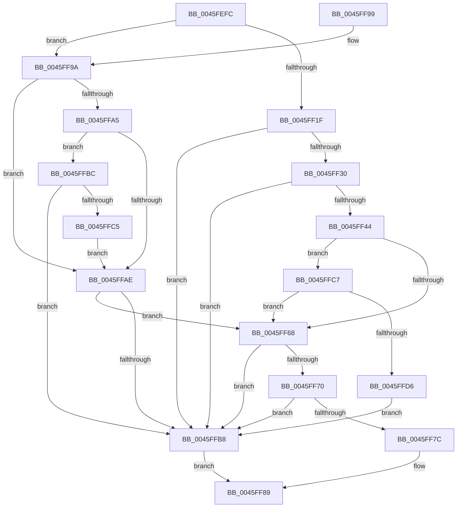

# MiPageMightBeZero

- RVA: `0x0045FEFC`–`0x0045FFD8` (길이 `220` bytes)
- VA: `0x000000014045FEFC`
- 실행 섹션: `.text`
- PDB 이름 있음: `예`; PDB Function 태그: `아니요`
- unwind 정보 RVA: `0x000A7C3C`
- 디코드: `67`개 명령, `220/220` bytes 표시
- 미해석 바이트: `0` (있으면 어셈블리에 `.byte`로 보존)

> 이 문서는 커널 이미지의 기계어와 PDB 기호를 분석해 생성했습니다. 4번과 5번은 함수 원형과 자료형을 바이너리 사용 방식에서 추정한 C 해석이며 원본 소스 복구 결과는 아닙니다.

## 1. Dependencies

- 직접 호출 지점: **1**; 고유 호출 대상: **1**
- 직접 호출자로 확인된 함수: **1**
- RIP 상대 이미지 참조: **0**

### Outgoing calls
- `0x0045FF38` → [MiGetPagePrivilege](../28/MiGetPagePrivilege_function_00285420.md) (function, `0x00285420`)

### Direct callers
- [MiSharePages](../31/MiSharePages_function_00315110.md) at `0x003157DD`

### Static image references
- 디코드된 RIP-relative 메모리 참조가 없습니다.

## 2. Other-region calls and transfers

- 다른 실행 섹션으로 향하는 call: **0**
- 별도 외부 분기/꼬리 이동을 확인하지 못했습니다.

## 3. Assembly (complete function range)

```asm
0045FEFC  48 89 5C 24 08                  mov qword ptr [rsp + 8], rbx
0045FF01  48 89 74 24 10                  mov qword ptr [rsp + 0x10], rsi
0045FF06  57                              push rdi
0045FF07  48 83 EC 20                     sub rsp, 0x20
0045FF0B  48 8B 42 28                     mov rax, qword ptr [rdx + 0x28]
0045FF0F  49 8B F8                        mov rdi, r8
0045FF12  48 8B DA                        mov rbx, rdx
0045FF15  BE 01 00 00 00                  mov esi, 1
0045FF1A  48 85 C0                        test rax, rax
0045FF1D  78 7B                           js 0x14045ff9a
0045FF1F  8B 81 B8 00 00 00               mov eax, dword ptr [rcx + 0xb8]
0045FF25  24 0F                           and al, 0xf
0045FF27  40 3A C6                        cmp al, sil
0045FF2A  0F 83 88 00 00 00               jae 0x14045ffb8
0045FF30  45 33 C0                        xor r8d, r8d
0045FF33  33 D2                           xor edx, edx
0045FF35  48 8B CB                        mov rcx, rbx
0045FF38  E8 E3 54 E2 FF                  call 0x140285420
0045FF3D  A9 FD FF FF FF                  test eax, 0xfffffffd
0045FF42  75 74                           jne 0x14045ffb8
0045FF44  48 C1 E7 19                     shl rdi, 0x19
0045FF48  48 B9 00 00 00 00 80 F6 FF FF   movabs rcx, 0xfffff68000000000
0045FF52  48 8B C1                        mov rax, rcx
0045FF55  48 C1 E0 19                     shl rax, 0x19
0045FF59  48 2B F8                        sub rdi, rax
0045FF5C  48 C1 FF 10                     sar rdi, 0x10
0045FF60  48 8B C1                        mov rax, rcx
0045FF63  48 3B F8                        cmp rdi, rax
0045FF66  73 5F                           jae 0x14045ffc7
0045FF68  8B 43 20                        mov eax, dword ptr [rbx + 0x20]
0045FF6B  66 3B C6                        cmp ax, si
0045FF6E  75 48                           jne 0x14045ffb8
0045FF70  8B 43 20                        mov eax, dword ptr [rbx + 0x20]
0045FF73  C1 E8 10                        shr eax, 0x10
0045FF76  24 C0                           and al, 0xc0
0045FF78  3C 40                           cmp al, 0x40
0045FF7A  75 3C                           jne 0x14045ffb8
0045FF7C  8B 43 20                        mov eax, dword ptr [rbx + 0x20]
0045FF7F  C1 E8 18                        shr eax, 0x18
0045FF82  F6 D0                           not al
0045FF84  C1 E8 06                        shr eax, 6
0045FF87  23 C6                           and eax, esi
0045FF89  48 8B 5C 24 30                  mov rbx, qword ptr [rsp + 0x30]
0045FF8E  48 8B 74 24 38                  mov rsi, qword ptr [rsp + 0x38]
0045FF93  48 83 C4 20                     add rsp, 0x20
0045FF97  5F                              pop rdi
0045FF98  C3                              ret
0045FF99  CC                              int3
0045FF9A  48 8B 42 28                     mov rax, qword ptr [rdx + 0x28]
0045FF9E  48 0F BA E0 28                  bt rax, 0x28
0045FFA3  72 09                           jb 0x14045ffae
0045FFA5  48 8B 42 08                     mov rax, qword ptr [rdx + 8]
0045FFA9  48 85 C0                        test rax, rax
0045FFAC  79 0E                           jns 0x14045ffbc
0045FFAE  8B 42 10                        mov eax, dword ptr [rdx + 0x10]
0045FFB1  48 0F BA E0 0A                  bt rax, 0xa
0045FFB6  73 B0                           jae 0x14045ff68
0045FFB8  33 C0                           xor eax, eax
0045FFBA  EB CD                           jmp 0x14045ff89
0045FFBC  48 8B 42 08                     mov rax, qword ptr [rdx + 8]
0045FFC0  48 85 C0                        test rax, rax
0045FFC3  75 F3                           jne 0x14045ffb8
0045FFC5  EB E7                           jmp 0x14045ffae
0045FFC7  48 B8 FF FF FF FF FF F6 FF FF   movabs rax, 0xfffff6ffffffffff
0045FFD1  48 3B F8                        cmp rdi, rax
0045FFD4  77 92                           ja 0x14045ff68
0045FFD6  EB E0                           jmp 0x14045ffb8
```

## 4. C-style interpretation (structured pseudocode)

```c
__int64 __fastcall MiPageMightBeZero(__int64 a1, __int64 a2, __int64 a3)
{
    __int64 result;
    __int64 v_rdi;
    __int64 v_rsp;
    unsigned __int64 v_stack_p10;
    unsigned __int64 v_stack_p8;

    v_stack_p8 = v_rbx;
    v_stack_p10 = v_rsi;
    v_rsp = (v_rsp) - (32);
    if (sign_flag) goto loc_0045FF9A;
    result = (unsigned __int8)(((unsigned int)(*(unsigned int *)(a1 + 184))) & (15));
    if (((unsigned __int8)(result)) >= 1) goto loc_0045FFB8;
    a3 = 0;
    a2 = 0;
    result = MiGetPagePrivilege(0, a2, a3, a4);
    if ((((unsigned int)(result)) & (0xFFFFFFFDULL)) != 0) goto loc_0045FFB8;
    v_rdi = (a3) << (25);
    result = (0) << (25);
    v_rdi = (v_rdi) - (result);
    v_rdi = (v_rdi) >> (16);
    if (v_rdi >= 0) goto loc_0045FFC7;
loc_0045FF68:
    if (((unsigned __int16)((unsigned int)(*(unsigned int *)(a2 + 32)))) != 1) goto loc_0045FFB8;
    result = (unsigned int)(((unsigned int)(*(unsigned int *)(a2 + 32))) >> (16));
    result = (unsigned __int8)((result) & (192));
    if (((unsigned __int8)(result)) != 64) goto loc_0045FFB8;
    result = (unsigned int)(((unsigned int)(*(unsigned int *)(a2 + 32))) >> (24));
    result = (unsigned __int8)(~(result));
    result = (unsigned int)((result) >> (6));
    result = (unsigned int)((result) & (1));
loc_0045FF89:
    v_rsp = (v_rsp) + (32);
    return result;
loc_0045FF9A:
    if (condition_is_below) goto loc_0045FFAE;
    if (!sign_flag) goto loc_0045FFBC;
loc_0045FFAE:
    if (condition_is_above_or_equal) goto loc_0045FF68;
loc_0045FFB8:
    result = 0;
    goto loc_0045FF89;
loc_0045FFBC:
    if (*(unsigned __int64 *)(a2 + 8) != 0) goto loc_0045FFB8;
    goto loc_0045FFAE;
loc_0045FFC7:
    if (v_rdi > (*(unsigned __int64 *)(a2 + 8))) goto loc_0045FF68;
    goto loc_0045FFB8;
}
```

## 5. (Beta) C Style

```c
int64_t MiPageMightBeZero(void *Arg1, void *Arg2, int64_t Arg3)
{
    uint8_t *arg1 = (uint8_t *)Arg1;
    uint8_t *arg2 = (uint8_t *)Arg2;

    int64_t result;
    int64_t local_rdi;
    int64_t local_rsp;
    uint64_t v_stack_p10;
    uint64_t v_stack_p8;

    v_stack_p8 = local_rbx;
    v_stack_p10 = local_rsi;
    local_rsp = (local_rsp) - (32);
    if (sign_flag) goto loc_0045FF9A;
    result = (uint8_t)(((uint32_t)(*(uint32_t *)(arg1 + 0xB8))) & (15));
    if (((uint8_t)(result)) >= 1) goto loc_0045FFB8;
    Arg3 = 0;
    Arg2 = 0;
    result = MiGetPagePrivilege(0, Arg2, Arg3, a4);
    if ((((uint32_t)(result)) & (0xFFFFFFFDULL)) != 0) goto loc_0045FFB8;
    local_rdi = (Arg3) << (25);
    result = (0) << (25);
    local_rdi = (local_rdi) - (result);
    local_rdi = (local_rdi) >> (16);
    if (local_rdi >= 0) goto loc_0045FFC7;
loc_0045FF68:
    if (((uint16_t)((uint32_t)(*(uint32_t *)(arg2 + 0x20)))) != 1) goto loc_0045FFB8;
    result = (uint32_t)(((uint32_t)(*(uint32_t *)(arg2 + 0x20))) >> (16));
    result = (uint8_t)((result) & (192));
    if (((uint8_t)(result)) != 64) goto loc_0045FFB8;
    result = (uint32_t)(((uint32_t)(*(uint32_t *)(arg2 + 0x20))) >> (24));
    result = (uint8_t)(~(result));
    result = (uint32_t)((result) >> (6));
    result = (uint32_t)((result) & (1));
loc_0045FF89:
    local_rsp = (local_rsp) + (32);
    return result;
loc_0045FF9A:
    if (condition_is_below) goto loc_0045FFAE;
    if (!sign_flag) goto loc_0045FFBC;
loc_0045FFAE:
    if (condition_is_above_or_equal) goto loc_0045FF68;
loc_0045FFB8:
    result = 0;
    goto loc_0045FF89;
loc_0045FFBC:
    if (*(uint64_t *)(arg2 + 0x8) != 0) goto loc_0045FFB8;
    goto loc_0045FFAE;
loc_0045FFC7:
    if (local_rdi > (*(uint64_t *)(arg2 + 0x8))) goto loc_0045FF68;
    goto loc_0045FFB8;
}
```

### 관측된 메모리 오프셋

구조체 형식이 확인되지 않은 접근은 인자 기준의 오프셋으로만 기록했습니다.

| 기준 인자 | 오프셋 표현 | 폭 (bit) | 접근 |
|---|---:|---:|---|
| `Arg1` | `+ 0xB8` | `32` | `R` |
| `Arg2` | `+ 0x8` | `64` | `R` |
| `Arg2` | `+ 0x10` | `32` | `R` |
| `Arg2` | `+ 0x20` | `32` | `R` |
| `Arg2` | `+ 0x28` | `64` | `R` |

## 6. Execution-region graph

[열기: 2D/3D 그래프와 함수 탐색 컨트롤 패널](../../../control-panel.html?section=text&rva=0x0045FEFC&view=graph)

- 2D 그래프는 위에서 아래로 흐르고, 3D 그래프는 빈 공간을 드래그해 회전합니다. Shift+드래그는 이동, 휠은 확대·축소, 함수 노드 선택은 대상 보고서 이동입니다.

### Static fallback


