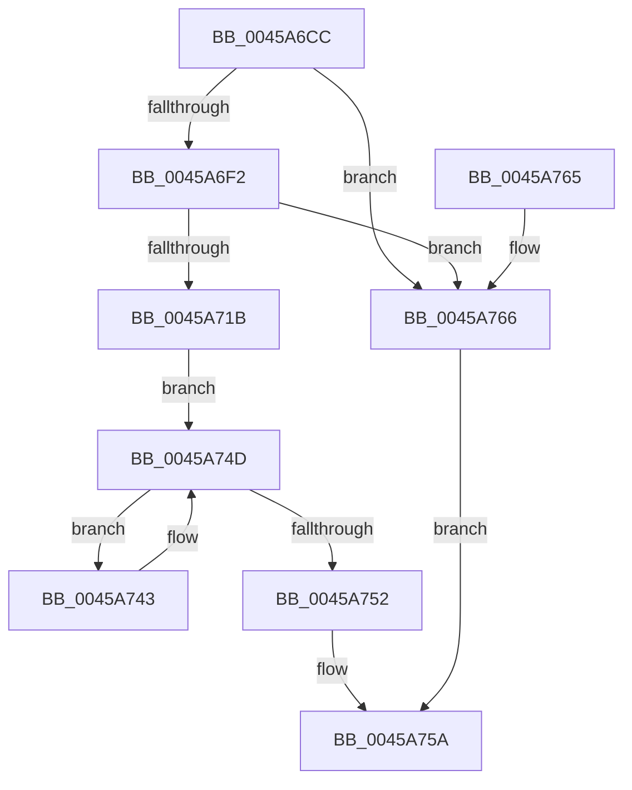

# MiPrefetchNormally

- RVA: `0x0045A6CC`–`0x0045A76A` (길이 `158` bytes)
- VA: `0x000000014045A6CC`
- 실행 섹션: `.text`
- PDB 이름 있음: `예`; PDB Function 태그: `아니요`
- unwind 정보 RVA: `0x0005FC94`
- 디코드: `41`개 명령, `158/158` bytes 표시
- 미해석 바이트: `0` (있으면 어셈블리에 `.byte`로 보존)

> 이 문서는 커널 이미지의 기계어와 PDB 기호를 분석해 생성했습니다. 4번과 5번은 함수 원형과 자료형을 바이너리 사용 방식에서 추정한 C 해석이며 원본 소스 복구 결과는 아닙니다.

## 1. Dependencies

- 직접 호출 지점: **0**; 고유 호출 대상: **0**
- 직접 호출자로 확인된 함수: **2**
- RIP 상대 이미지 참조: **0**

### Outgoing calls
- 직접 디코드된 call 명령이 없습니다.

### Direct callers
- [MiPrefetchPagesViable](MiPrefetchPagesViable_function_0045A644.md) at `0x0045A65F`
- [MiPfPrepareReadList](../../page/93/MiPfPrepareReadList_function_0093CD5C.md) at `0x0093D196`

### Static image references
- 디코드된 RIP-relative 메모리 참조가 없습니다.

## 2. Other-region calls and transfers

- 다른 실행 섹션으로 향하는 call: **0**
- 별도 외부 분기/꼬리 이동을 확인하지 못했습니다.

## 3. Assembly (complete function range)

```asm
0045A6CC  48 89 5C 24 08                  mov qword ptr [rsp + 8], rbx
0045A6D1  48 89 7C 24 10                  mov qword ptr [rsp + 0x10], rdi
0045A6D6  4C 8B 89 40 49 00 00            mov r9, qword ptr [rcx + 0x4940]
0045A6DD  48 8D 82 9F 00 00 00            lea rax, [rdx + 0x9f]
0045A6E4  41 8B F8                        mov edi, r8d
0045A6E7  48 8B DA                        mov rbx, rdx
0045A6EA  4C 8B D9                        mov r11, rcx
0045A6ED  4C 3B C8                        cmp r9, rax
0045A6F0  7C 74                           jl 0x14045a766
0045A6F2  4C 8B 91 98 4C 00 00            mov r10, qword ptr [rcx + 0x4c98]
0045A6F9  4C 8B 89 40 4B 00 00            mov r9, qword ptr [rcx + 0x4b40]
0045A700  49 8B C2                        mov rax, r10
0045A703  49 2B C1                        sub rax, r9
0045A706  4D 3B CA                        cmp r9, r10
0045A709  48 1B C9                        sbb rcx, rcx
0045A70C  48 23 C8                        and rcx, rax
0045A70F  48 8D 82 7F 10 00 00            lea rax, [rdx + 0x107f]
0045A716  48 3B C8                        cmp rcx, rax
0045A719  72 4B                           jb 0x14045a766
0045A71B  49 8B 8B C0 0B 00 00            mov rcx, qword ptr [r11 + 0xbc0]
0045A722  49 8D 93 C0 0C 00 00            lea rdx, [r11 + 0xcc0]
0045A729  4D 8B 83 40 0B 00 00            mov r8, qword ptr [r11 + 0xb40]
0045A730  4C 6B CF 58                     imul r9, rdi, 0x58
0045A734  4C 03 C1                        add r8, rcx
0045A737  49 81 C1 C0 0C 00 00            add r9, 0xcc0
0045A73E  4D 03 CB                        add r9, r11
0045A741  EB 0A                           jmp 0x14045a74d
0045A743  48 8B 02                        mov rax, qword ptr [rdx]
0045A746  4C 03 C0                        add r8, rax
0045A749  48 83 C2 58                     add rdx, 0x58
0045A74D  49 3B D1                        cmp rdx, r9
0045A750  72 F1                           jb 0x14045a743
0045A752  33 C0                           xor eax, eax
0045A754  4C 3B C3                        cmp r8, rbx
0045A757  0F 93 C0                        setae al
0045A75A  48 8B 5C 24 08                  mov rbx, qword ptr [rsp + 8]
0045A75F  48 8B 7C 24 10                  mov rdi, qword ptr [rsp + 0x10]
0045A764  C3                              ret
0045A765  CC                              int3
0045A766  33 C0                           xor eax, eax
0045A768  EB F0                           jmp 0x14045a75a
```

## 4. C-style interpretation (structured pseudocode)

```c
__int64 __fastcall MiPrefetchNormally(__int64 a1, __int64 a2, int a3)
{
    __int64 result;
    unsigned __int64 v_stack_p10;
    unsigned __int64 v_stack_p8;

    v_stack_p8 = v_rbx;
    v_stack_p10 = v_rdi;
    if ((*(unsigned __int64 *)(a1 + 18752)) < (a2 + 159)) goto loc_0045A766;
    result = (*(unsigned __int64 *)(a1 + 19608)) - (*(unsigned __int64 *)(a1 + 19264));
    a1 = (a1) & (result);
    if (a1 < (a2 + 4223)) goto loc_0045A766;
    a4 = (*(unsigned __int64 *)(a1 + 19264)) * ((unsigned int)(a3));
    a3 = (*(unsigned __int64 *)(a1 + 2880)) + (*(unsigned __int64 *)(a1 + 3008));
    a4 = (a4) + (0xCC0ULL);
    a4 = (a4) + (a1);
    goto loc_0045A74D;
loc_0045A743:
    a3 = (a3) + (*(unsigned __int64 *)(a1 + 3264));
    a2 = (a1 + 3264) + (88);
loc_0045A74D:
    if (a2 < a4) goto loc_0045A743;
    result = 0;
    result = (a3 >= a2) ? 1 : 0;
loc_0045A75A:
    return result;
loc_0045A766:
    result = 0;
    goto loc_0045A75A;
}
```

## 5. (Beta) C Style

```c
int64_t MiPrefetchNormally(void *Arg1, void *Arg2, int32_t Arg3)
{
    uint8_t *arg1 = (uint8_t *)Arg1;
    uint8_t *arg2 = (uint8_t *)Arg2;

    int64_t result;
    uint64_t v_stack_p10;
    uint64_t v_stack_p8;

    v_stack_p8 = local_rbx;
    v_stack_p10 = local_rdi;
    if ((*(uint64_t *)(arg1 + 0x4940)) < (Arg2 + 159)) goto loc_0045A766;
    result = (*(uint64_t *)(arg1 + 0x4C98)) - (*(uint64_t *)(arg1 + 0x4B40));
    Arg1 = (Arg1) & (result);
    if (Arg1 < (Arg2 + 4223)) goto loc_0045A766;
    a4 = (*(uint64_t *)(arg1 + 0x4B40)) * ((uint32_t)(Arg3));
    Arg3 = (*(uint64_t *)(arg1 + 0xB40)) + (*(uint64_t *)(arg1 + 0xBC0));
    a4 = (a4) + (0xCC0ULL);
    a4 = (a4) + (Arg1);
    goto loc_0045A74D;
loc_0045A743:
    Arg3 = (Arg3) + (*(uint64_t *)(arg1 + 0xCC0));
    Arg2 = (Arg1 + 3264) + (88);
loc_0045A74D:
    if (Arg2 < a4) goto loc_0045A743;
    result = 0;
    result = (Arg3 >= Arg2) ? 1 : 0;
loc_0045A75A:
    return result;
loc_0045A766:
    result = 0;
    goto loc_0045A75A;
}
```

### 관측된 메모리 오프셋

구조체 형식이 확인되지 않은 접근은 인자 기준의 오프셋으로만 기록했습니다.

| 기준 인자 | 오프셋 표현 | 폭 (bit) | 접근 |
|---|---:|---:|---|
| `Arg1` | `+ 0xB40` | `64` | `R` |
| `Arg1` | `+ 0xBC0` | `64` | `R` |
| `Arg1` | `+ 0xCC0` | `64` | `R` |
| `Arg1` | `+ 0x4940` | `64` | `R` |
| `Arg1` | `+ 0x4B40` | `64` | `R` |
| `Arg1` | `+ 0x4C98` | `64` | `R` |
| `Arg2` | `+ 0x9F` | `64` | `R` |
| `Arg2` | `+ 0x107F` | `64` | `R` |

## 6. Execution-region graph

[열기: 2D/3D 그래프와 함수 탐색 컨트롤 패널](../../../control-panel.html?section=text&rva=0x0045A6CC&view=graph)

- 2D 그래프는 위에서 아래로 흐르고, 3D 그래프는 빈 공간을 드래그해 회전합니다. Shift+드래그는 이동, 휠은 확대·축소, 함수 노드 선택은 대상 보고서 이동입니다.

### Static fallback


