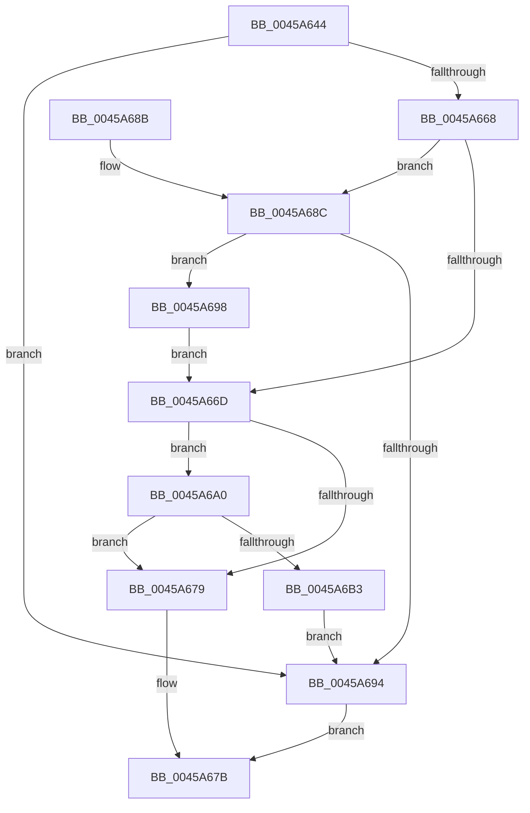

# MiPrefetchPagesViable

- RVA: `0x0045A644`–`0x0045A6C3` (길이 `127` bytes)
- VA: `0x000000014045A644`
- 실행 섹션: `.text`
- PDB 이름 있음: `예`; PDB Function 태그: `아니요`
- unwind 정보 RVA: `0x00064CD0`
- 디코드: `42`개 명령, `127/127` bytes 표시
- 미해석 바이트: `0` (있으면 어셈블리에 `.byte`로 보존)

> 이 문서는 커널 이미지의 기계어와 PDB 기호를 분석해 생성했습니다. 4번과 5번은 함수 원형과 자료형을 바이너리 사용 방식에서 추정한 C 해석이며 원본 소스 복구 결과는 아닙니다.

## 1. Dependencies

- 직접 호출 지점: **3**; 고유 호출 대상: **3**
- 직접 호출자로 확인된 함수: **1**
- RIP 상대 이미지 참조: **0**

### Outgoing calls
- `0x0045A65F` → [MiPrefetchNormally](MiPrefetchNormally_function_0045A6CC.md) (function, `0x0045A6CC`)
- `0x0045A6A9` → [MiObtainFaultCharges](../28/MiObtainFaultCharges_function_0028AEB0.md) (function, `0x0028AEB0`)
- `0x0045A6BC` → [MiReturnFaultCharges](../36/MiReturnFaultCharges_function_0036D928.md) (function, `0x0036D928`)

### Direct callers
- [MiPfPutPagesInTransition](../36/MiPfPutPagesInTransition_function_003640EC.md) at `0x0036466B`
- [MiPfPutPagesInTransition](../36/MiPfPutPagesInTransition_function_003640EC.md) at `0x00364748`

### Static image references
- 디코드된 RIP-relative 메모리 참조가 없습니다.

## 2. Other-region calls and transfers

- 다른 실행 섹션으로 향하는 call: **0**
- 별도 외부 분기/꼬리 이동을 확인하지 못했습니다.

## 3. Assembly (complete function range)

```asm
0045A644  48 89 5C 24 08                  mov qword ptr [rsp + 8], rbx
0045A649  48 89 74 24 10                  mov qword ptr [rsp + 0x10], rsi
0045A64E  57                              push rdi
0045A64F  48 83 EC 20                     sub rsp, 0x20
0045A653  48 8B FA                        mov rdi, rdx
0045A656  49 8B D9                        mov rbx, r9
0045A659  49 8B D1                        mov rdx, r9
0045A65C  48 8B F1                        mov rsi, rcx
0045A65F  E8 68 00 00 00                  call 0x14045a6cc
0045A664  85 C0                           test eax, eax
0045A666  74 2C                           je 0x14045a694
0045A668  48 85 FF                        test rdi, rdi
0045A66B  75 1F                           jne 0x14045a68c
0045A66D  83 7C 24 50 00                  cmp dword ptr [rsp + 0x50], 0
0045A672  BF 01 00 00 00                  mov edi, 1
0045A677  75 27                           jne 0x14045a6a0
0045A679  8B C7                           mov eax, edi
0045A67B  48 8B 5C 24 30                  mov rbx, qword ptr [rsp + 0x30]
0045A680  48 8B 74 24 38                  mov rsi, qword ptr [rsp + 0x38]
0045A685  48 83 C4 20                     add rsp, 0x20
0045A689  5F                              pop rdi
0045A68A  C3                              ret
0045A68B  CC                              int3
0045A68C  48 8B 07                        mov rax, qword ptr [rdi]
0045A68F  48 3B C3                        cmp rax, rbx
0045A692  73 04                           jae 0x14045a698
0045A694  33 C0                           xor eax, eax
0045A696  EB E3                           jmp 0x14045a67b
0045A698  48 2B C3                        sub rax, rbx
0045A69B  48 89 07                        mov qword ptr [rdi], rax
0045A69E  EB CD                           jmp 0x14045a66d
0045A6A0  44 8B C7                        mov r8d, edi
0045A6A3  48 8B D3                        mov rdx, rbx
0045A6A6  48 8B CE                        mov rcx, rsi
0045A6A9  E8 02 08 E3 FF                  call 0x14028aeb0
0045A6AE  48 3B C3                        cmp rax, rbx
0045A6B1  74 C6                           je 0x14045a679
0045A6B3  44 8B C7                        mov r8d, edi
0045A6B6  48 8B D3                        mov rdx, rbx
0045A6B9  48 8B CE                        mov rcx, rsi
0045A6BC  E8 67 32 F1 FF                  call 0x14036d928
0045A6C1  EB D1                           jmp 0x14045a694
```

## 4. C-style interpretation (structured pseudocode)

```c
__int64 __fastcall MiPrefetchPagesViable(__int64 a1, __int64 a2, __int64 a3, __int64 a4, unsigned int a5)
{
    __int64 result;
    __int64 v_rsp;
    unsigned __int64 v_stack_p10;
    unsigned __int64 v_stack_p8;

    v_stack_p8 = v_rbx;
    v_stack_p10 = v_rsi;
    v_rsp = (v_rsp) - (32);
    result = MiPrefetchNormally(a1, a4, a3, a4);
    if ((unsigned int)(result) == 0) goto loc_0045A694;
    if (a2 != 0) goto loc_0045A68C;
loc_0045A66D:
    if (a5 != 0) goto loc_0045A6A0;
loc_0045A679:
loc_0045A67B:
    v_rsp = (v_rsp) + (32);
    return 1;
loc_0045A68C:
    if ((*(unsigned __int64 *)(1)) >= v_stack_p8) goto loc_0045A698;
loc_0045A694:
    result = 0;
    goto loc_0045A67B;
loc_0045A698:
    result = (result) - (v_stack_p8);
    *(unsigned __int64 *)(1) = result;
    goto loc_0045A66D;
loc_0045A6A0:
    result = MiObtainFaultCharges(v_stack_p10, v_stack_p8, 1, a4);
    if (result == v_stack_p8) goto loc_0045A679;
    result = MiReturnFaultCharges(v_stack_p10, v_stack_p8, 1, a4);
    goto loc_0045A694;
}
```

## 5. (Beta) C Style

```c
int64_t MiPrefetchPagesViable(int64_t Arg1, int64_t Arg2, int64_t Arg3, int64_t Arg4, uint32_t Arg5)
{
    int64_t result;
    int64_t local_rsp;
    uint64_t v_stack_p10;
    uint64_t v_stack_p8;

    v_stack_p8 = local_rbx;
    v_stack_p10 = local_rsi;
    local_rsp = (local_rsp) - (32);
    result = MiPrefetchNormally(Arg1, Arg4, Arg3, Arg4);
    if ((uint32_t)(result) == 0) goto loc_0045A694;
    if (Arg2 != 0) goto loc_0045A68C;
loc_0045A66D:
    if (Arg5 != 0) goto loc_0045A6A0;
loc_0045A679:
loc_0045A67B:
    local_rsp = (local_rsp) + (32);
    return 1;
loc_0045A68C:
    if ((*(uint64_t *)(1)) >= v_stack_p8) goto loc_0045A698;
loc_0045A694:
    result = 0;
    goto loc_0045A67B;
loc_0045A698:
    result = (result) - (v_stack_p8);
    *(uint64_t *)(1) = result;
    goto loc_0045A66D;
loc_0045A6A0:
    result = MiObtainFaultCharges(v_stack_p10, v_stack_p8, 1, Arg4);
    if (result == v_stack_p8) goto loc_0045A679;
    result = MiReturnFaultCharges(v_stack_p10, v_stack_p8, 1, Arg4);
    goto loc_0045A694;
}
```

## 6. Execution-region graph

[열기: 2D/3D 그래프와 함수 탐색 컨트롤 패널](../../../control-panel.html?section=text&rva=0x0045A644&view=graph)

- 2D 그래프는 위에서 아래로 흐르고, 3D 그래프는 빈 공간을 드래그해 회전합니다. Shift+드래그는 이동, 휠은 확대·축소, 함수 노드 선택은 대상 보고서 이동입니다.

### Static fallback


