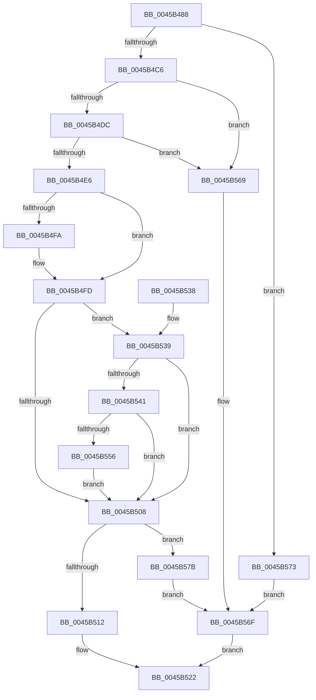

# MiPrepareToTradeUsingAccessedBit

- RVA: `0x0045B488`–`0x0045B583` (길이 `251` bytes)
- VA: `0x000000014045B488`
- 실행 섹션: `.text`
- PDB 이름 있음: `예`; PDB Function 태그: `아니요`
- unwind 정보 RVA: `0x000A9158`
- 디코드: `67`개 명령, `251/251` bytes 표시
- 미해석 바이트: `0` (있으면 어셈블리에 `.byte`로 보존)

> 이 문서는 커널 이미지의 기계어와 PDB 기호를 분석해 생성했습니다. 4번과 5번은 함수 원형과 자료형을 바이너리 사용 방식에서 추정한 C 해석이며 원본 소스 복구 결과는 아닙니다.

## 1. Dependencies

- 직접 호출 지점: **3**; 고유 호출 대상: **3**
- 직접 호출자로 확인된 함수: **1**
- RIP 상대 이미지 참조: **4**

### Outgoing calls
- `0x0045B4C9` → [MI_READ_PTE_LOCK_FREE](../28/MI_READ_PTE_LOCK_FREE_function_002828A0.md) (function, `0x002828A0`)
- `0x0045B51D` → [MiFlushSingleTbEntry](../28/MiFlushSingleTbEntry_function_0028E730.md) (function, `0x0028E730`)
- `0x0045B562` → [MiCheckLinearProtectedPteAccessedBit](../29/MiCheckLinearProtectedPteAccessedBit_function_00292D80.md) (function, `0x00292D80`)

### Direct callers
- [MiStealPage](../2B/MiStealPage_function_002B28D0.md) at `0x002B347E`

### Static image references
- `0x0045B4ED` → RVA `0x00FC6A88` (`ALMOSTRO`; read)
- `0x0045B569` → RVA `0x00EF5170` (`.data`; read/write)
- `0x0045B573` → RVA `0x00EF516C` (`.data`; read/write)
- `0x0045B57B` → RVA `0x00EF5174` (`.data`; read/write)

## 2. Other-region calls and transfers

- 다른 실행 섹션으로 향하는 call: **0**
- 별도 외부 분기/꼬리 이동을 확인하지 못했습니다.

## 3. Assembly (complete function range)

```asm
0045B488  48 89 5C 24 08                  mov qword ptr [rsp + 8], rbx
0045B48D  48 89 6C 24 10                  mov qword ptr [rsp + 0x10], rbp
0045B492  56                              push rsi
0045B493  57                              push rdi
0045B494  41 56                           push r14
0045B496  48 83 EC 20                     sub rsp, 0x20
0045B49A  48 8B EA                        mov rbp, rdx
0045B49D  49 BE 00 00 00 00 80 F6 FF FF   movabs r14, 0xfffff68000000000
0045B4A7  48 C1 E5 19                     shl rbp, 0x19
0045B4AB  48 8B F2                        mov rsi, rdx
0045B4AE  49 8B C6                        mov rax, r14
0045B4B1  48 C1 E0 19                     shl rax, 0x19
0045B4B5  48 2B E8                        sub rbp, rax
0045B4B8  48 C1 FD 10                     sar rbp, 0x10
0045B4BC  F6 41 23 10                     test byte ptr [rcx + 0x23], 0x10
0045B4C0  0F 85 AD 00 00 00               jne 0x14045b573
0045B4C6  48 8B CA                        mov rcx, rdx
0045B4C9  E8 D2 73 E2 FF                  call 0x1402828a0
0045B4CE  48 8B F8                        mov rdi, rax
0045B4D1  48 0F BA E0 09                  bt rax, 9
0045B4D6  0F 82 8D 00 00 00               jb 0x14045b569
0045B4DC  40 F6 C7 20                     test dil, 0x20
0045B4E0  0F 84 83 00 00 00               je 0x14045b569
0045B4E6  48 8B D8                        mov rbx, rax
0045B4E9  48 83 E3 DF                     and rbx, 0xffffffffffffffdf
0045B4ED  48 F7 05 90 B5 B6 00 00 00 00 02  test qword ptr [rip + 0xb6b590], 0x2000000
0045B4F8  74 03                           je 0x14045b4fd
0045B4FA  0F AE E8                        lfence
0045B4FD  48 0F BA 25 82 B5 B6 00 24      bt qword ptr [rip + 0xb6b582], 0x24
0045B506  72 31                           jb 0x14045b539
0045B508  48 8B C7                        mov rax, rdi
0045B50B  F0 48 0F B1 1E                  lock cmpxchg qword ptr [rsi], rbx
0045B510  75 69                           jne 0x14045b57b
0045B512  BA 02 00 00 00                  mov edx, 2
0045B517  48 8B CD                        mov rcx, rbp
0045B51A  44 8B C2                        mov r8d, edx
0045B51D  E8 0E 32 E3 FF                  call 0x14028e730
0045B522  48 8B 6C 24 48                  mov rbp, qword ptr [rsp + 0x48]
0045B527  48 8B C3                        mov rax, rbx
0045B52A  48 8B 5C 24 40                  mov rbx, qword ptr [rsp + 0x40]
0045B52F  48 83 C4 20                     add rsp, 0x20
0045B533  41 5E                           pop r14
0045B535  5F                              pop rdi
0045B536  5E                              pop rsi
0045B537  C3                              ret
0045B538  CC                              int3
0045B539  8A C3                           mov al, bl
0045B53B  24 21                           and al, 0x21
0045B53D  3C 01                           cmp al, 1
0045B53F  75 C7                           jne 0x14045b508
0045B541  49 8B C6                        mov rax, r14
0045B544  48 B9 00 00 00 00 40 00 00 00   movabs rcx, 0x4000000000
0045B54E  48 03 C1                        add rax, rcx
0045B551  48 3B F0                        cmp rsi, rax
0045B554  72 B2                           jb 0x14045b508
0045B556  41 B8 80 00 00 00               mov r8d, 0x80
0045B55C  48 8B D3                        mov rdx, rbx
0045B55F  48 8B CE                        mov rcx, rsi
0045B562  E8 19 78 E3 FF                  call 0x140292d80
0045B567  EB 9F                           jmp 0x14045b508
0045B569  FF 05 01 9C A9 00               inc dword ptr [rip + 0xa99c01]
0045B56F  33 DB                           xor ebx, ebx
0045B571  EB AF                           jmp 0x14045b522
0045B573  FF 05 F3 9B A9 00               inc dword ptr [rip + 0xa99bf3]
0045B579  EB F4                           jmp 0x14045b56f
0045B57B  FF 05 F3 9B A9 00               inc dword ptr [rip + 0xa99bf3]
0045B581  EB EC                           jmp 0x14045b56f
```

## 4. C-style interpretation (structured pseudocode)

```c
__int64 __fastcall MiPrepareToTradeUsingAccessedBit(__int64 a1, __int64 a2)
{
    __int64 result;
    __int64 v_rbp;
    __int64 v_rbx;
    __int64 v_rsp;
    unsigned __int64 v_stack_p10;
    unsigned __int64 v_stack_p8;

    v_stack_p8 = v_rbx;
    v_stack_p10 = v_rbp;
    v_rsp = (v_rsp) - (32);
    v_rbp = (a2) << (25);
    result = (v_r14) << (25);
    v_rbp = (v_rbp) - (result);
    v_rbp = (v_rbp) >> (16);
    if (((*(unsigned __int8 *)(a1 + 35)) & (16)) != 0) goto loc_0045B573;
    result = MI_READ_PTE_LOCK_FREE(a2, a2, a3, a4);
    if (condition_is_below) goto loc_0045B569;
    if ((((unsigned __int8)(result)) & (32)) == 0) goto loc_0045B569;
    v_rbx = (result) & (-33);
    if (((*(unsigned __int64 *)(v_rip + 11974032)) & (0x2000000ULL)) != 0) {
    }
    if (condition_is_below) goto loc_0045B539;
loc_0045B508:
    if (((*(unsigned __int64 *)(v_rip + 11974032)) & (0x2000000ULL)) != 0) goto loc_0045B57B;
    result = MiFlushSingleTbEntry(v_rbp, 2, 2, a4);
loc_0045B522:
    v_rsp = (v_rsp) + (32);
    return v_rbx;
loc_0045B539:
    result = (unsigned __int8)(((unsigned __int8)(v_stack_p8)) & (33));
    if (((unsigned __int8)(result)) != 1) goto loc_0045B508;
    result = (v_r14) + (v_rbp);
    if (a2 < result) goto loc_0045B508;
    result = MiCheckLinearProtectedPteAccessedBit(a2, v_stack_p8, 128, a4);
    goto loc_0045B508;
loc_0045B569:
loc_0045B56F:
    v_rbx = 0;
    goto loc_0045B522;
loc_0045B573:
    goto loc_0045B56F;
loc_0045B57B:
    goto loc_0045B56F;
}
```

## 5. (Beta) C Style

```c
int64_t MiPrepareToTradeUsingAccessedBit(void *Arg1, int64_t Arg2)
{
    uint8_t *arg1 = (uint8_t *)Arg1;

    int64_t result;
    int64_t local_rbp;
    int64_t local_rbx;
    int64_t local_rsp;
    uint64_t v_stack_p10;
    uint64_t v_stack_p8;

    v_stack_p8 = local_rbx;
    v_stack_p10 = local_rbp;
    local_rsp = (local_rsp) - (32);
    local_rbp = (Arg2) << (25);
    result = (local_r14) << (25);
    local_rbp = (local_rbp) - (result);
    local_rbp = (local_rbp) >> (16);
    if (((*(uint8_t *)(arg1 + 0x23)) & (16)) != 0) goto loc_0045B573;
    result = MI_READ_PTE_LOCK_FREE(Arg2, Arg2, a3, a4);
    if (condition_is_below) goto loc_0045B569;
    if ((((uint8_t)(result)) & (32)) == 0) goto loc_0045B569;
    local_rbx = (result) & (-33);
    if (((*(uint64_t *)(v_rip + 0xB6B590)) & (0x2000000ULL)) != 0) {
    }
    if (condition_is_below) goto loc_0045B539;
loc_0045B508:
    if (((*(uint64_t *)(v_rip + 0xB6B590)) & (0x2000000ULL)) != 0) goto loc_0045B57B;
    result = MiFlushSingleTbEntry(local_rbp, 2, 2, a4);
loc_0045B522:
    local_rsp = (local_rsp) + (32);
    return local_rbx;
loc_0045B539:
    result = (uint8_t)(((uint8_t)(v_stack_p8)) & (33));
    if (((uint8_t)(result)) != 1) goto loc_0045B508;
    result = (local_r14) + (local_rbp);
    if (Arg2 < result) goto loc_0045B508;
    result = MiCheckLinearProtectedPteAccessedBit(Arg2, v_stack_p8, 128, a4);
    goto loc_0045B508;
loc_0045B569:
loc_0045B56F:
    local_rbx = 0;
    goto loc_0045B522;
loc_0045B573:
    goto loc_0045B56F;
loc_0045B57B:
    goto loc_0045B56F;
}
```

### 관측된 메모리 오프셋

구조체 형식이 확인되지 않은 접근은 인자 기준의 오프셋으로만 기록했습니다.

| 기준 인자 | 오프셋 표현 | 폭 (bit) | 접근 |
|---|---:|---:|---|
| `Arg1` | `+ 0x23` | `8` | `R` |

## 6. Execution-region graph

[열기: 2D/3D 그래프와 함수 탐색 컨트롤 패널](../../../control-panel.html?section=text&rva=0x0045B488&view=graph)

- 2D 그래프는 위에서 아래로 흐르고, 3D 그래프는 빈 공간을 드래그해 회전합니다. Shift+드래그는 이동, 휠은 확대·축소, 함수 노드 선택은 대상 보고서 이동입니다.

### Static fallback


