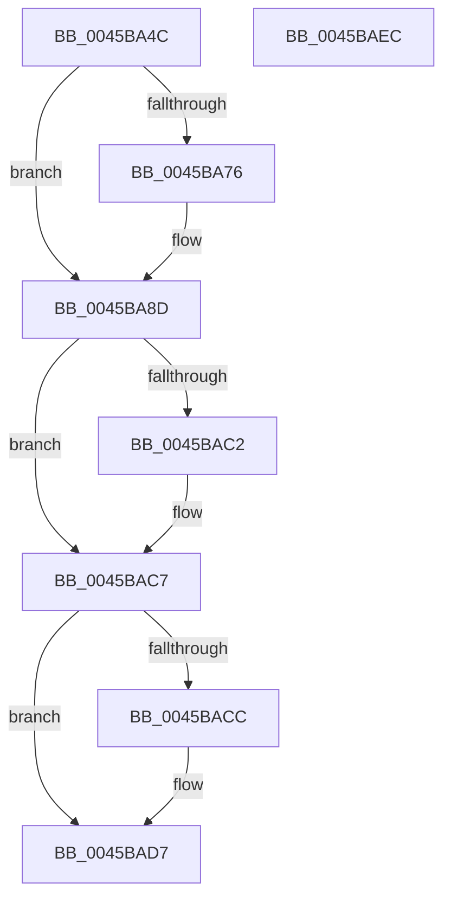

# MiProcessWsInSwapRanges

- RVA: `0x0045BA4C`–`0x0045BAED` (길이 `161` bytes)
- VA: `0x000000014045BA4C`
- 실행 섹션: `.text`
- PDB 이름 있음: `예`; PDB Function 태그: `아니요`
- unwind 정보 RVA: `0x0005C954`
- 디코드: `43`개 명령, `161/161` bytes 표시
- 미해석 바이트: `0` (있으면 어셈블리에 `.byte`로 보존)

> 이 문서는 커널 이미지의 기계어와 PDB 기호를 분석해 생성했습니다. 4번과 5번은 함수 원형과 자료형을 바이너리 사용 방식에서 추정한 C 해석이며 원본 소스 복구 결과는 아닙니다.

## 1. Dependencies

- 직접 호출 지점: **3**; 고유 호출 대상: **3**
- 직접 호출자로 확인된 함수: **1**
- RIP 상대 이미지 참조: **0**

### Outgoing calls
- `0x0045BAB9` → [MmPrefetchVirtualMemory](../../page/93/MmPrefetchVirtualMemory_function_0093A698.md) (function, `0x0093A698`)
- `0x0045BAC2` → [KeLeaveGuardedRegion](../2E/KeLeaveGuardedRegion_function_002E2C40.md) (function, `0x002E2C40`)
- `0x0045BAD2` → [MiReleaseOutSwapReservations](MiReleaseOutSwapReservations_function_0045BAF4.md) (function, `0x0045BAF4`)

### Direct callers
- [MiProcessWsInSwapSupport](MiProcessWsInSwapSupport_function_0045B954.md) at `0x0045B9B1`
- [MiProcessWsInSwapSupport](MiProcessWsInSwapSupport_function_0045B954.md) at `0x0045B9F1`

### Static image references
- 디코드된 RIP-relative 메모리 참조가 없습니다.

## 2. Other-region calls and transfers

- 다른 실행 섹션으로 향하는 call: **1**
  - `0x0045BAB9` → [MmPrefetchVirtualMemory](../../page/93/MmPrefetchVirtualMemory_function_0093A698.md) (`.text` → `PAGE`)
- 별도 외부 분기/꼬리 이동을 확인하지 못했습니다.

## 3. Assembly (complete function range)

```asm
0045BA4C  48 89 5C 24 08                  mov qword ptr [rsp + 8], rbx
0045BA51  48 89 6C 24 10                  mov qword ptr [rsp + 0x10], rbp
0045BA56  48 89 74 24 18                  mov qword ptr [rsp + 0x18], rsi
0045BA5B  57                              push rdi
0045BA5C  48 83 EC 20                     sub rsp, 0x20
0045BA60  41 8B F8                        mov edi, r8d
0045BA63  41 8B D8                        mov ebx, r8d
0045BA66  48 8B EA                        mov rbp, rdx
0045BA69  48 8B F1                        mov rsi, rcx
0045BA6C  B8 3D 10 00 00                  mov eax, 0x103d
0045BA71  83 E7 02                        and edi, 2
0045BA74  74 17                           je 0x14045ba8d
0045BA76  65 4C 8B 04 25 88 01 00 00      mov r8, qword ptr gs:[0x188]
0045BA7F  B8 3D 33 00 00                  mov eax, 0x333d
0045BA84  66 41 FF 88 E6 01 00 00         dec word ptr [r8 + 0x1e6]
0045BA8C  90                              nop
0045BA8D  44 8B C8                        mov r9d, eax
0045BA90  4C 8B C6                        mov r8, rsi
0045BA93  41 0F BA E9 10                  bts r9d, 0x10
0045BA98  F6 C3 04                        test bl, 4
0045BA9B  44 0F 44 C8                     cmove r9d, eax
0045BA9F  48 2B D6                        sub rdx, rsi
0045BAA2  48 C1 FA 04                     sar rdx, 4
0045BAA6  48 B8 00 00 00 00 00 80 FF FF   movabs rax, 0xffff800000000000
0045BAB0  48 FF C2                        inc rdx
0045BAB3  48 39 01                        cmp qword ptr [rcx], rax
0045BAB6  48 1B C9                        sbb rcx, rcx
0045BAB9  E8 DA EB 4D 00                  call 0x14093a698
0045BABE  85 FF                           test edi, edi
0045BAC0  74 05                           je 0x14045bac7
0045BAC2  E8 79 71 E8 FF                  call 0x1402e2c40
0045BAC7  F6 C3 01                        test bl, 1
0045BACA  75 0B                           jne 0x14045bad7
0045BACC  48 8B D5                        mov rdx, rbp
0045BACF  48 8B CE                        mov rcx, rsi
0045BAD2  E8 1D 00 00 00                  call 0x14045baf4
0045BAD7  48 8B 5C 24 30                  mov rbx, qword ptr [rsp + 0x30]
0045BADC  48 8B 6C 24 38                  mov rbp, qword ptr [rsp + 0x38]
0045BAE1  48 8B 74 24 40                  mov rsi, qword ptr [rsp + 0x40]
0045BAE6  48 83 C4 20                     add rsp, 0x20
0045BAEA  5F                              pop rdi
0045BAEB  C3                              ret
0045BAEC  CC                              int3
```

## 4. C-style interpretation (structured pseudocode)

```c
__int64 __fastcall MiProcessWsInSwapRanges(__int64 a1, __int64 a2, int a3)
{
    __int64 result;
    __int64 v_rdi;
    __int64 v_rsp;
    unsigned __int64 v_stack_p10;
    unsigned __int64 v_stack_p18;
    unsigned __int64 v_stack_p8;

    v_stack_p8 = v_rbx;
    v_stack_p10 = v_rbp;
    v_stack_p18 = v_rsi;
    v_rsp = (v_rsp) - (32);
    v_rdi = (unsigned int)(((unsigned int)(a3)) & (2));
    result = (unsigned int)(0x103DULL);
    if (!(condition_is_equal)) {
        a3 = *(unsigned __int64 *)(gs_base + (0 + 392));
        result = 0x333DULL;
    }
    a4 = (unsigned int)((unsigned int)(result));
    if ((((unsigned __int8)((unsigned int)(a3))) & (4)) == 0) { a4 = (unsigned int)(result); }
    a2 = (a2) - (a1);
    a2 = (a2) >> (4);
    a2 = (a2) + 1;
    result = MmPrefetchVirtualMemory(a1, a2, a1, a4);
    if ((unsigned int)(v_rdi) != 0) {
        result = KeLeaveGuardedRegion(a1, a2, a1, a4);
    }
    if ((((unsigned __int8)((unsigned int)(a3))) & (1)) == 0) {
        a2 = a2;
        a1 = a1;
        result = MiReleaseOutSwapReservations(a1, a2, a1, a4);
    }
    v_rsp = (v_rsp) + (32);
    return result;
}
```

## 5. (Beta) C Style

```c
int64_t MiProcessWsInSwapRanges(void *Arg1, int64_t Arg2, int32_t Arg3)
{
    uint8_t *arg1 = (uint8_t *)Arg1;

    int64_t result;
    int64_t local_rdi;
    int64_t local_rsp;
    uint64_t v_stack_p10;
    uint64_t v_stack_p18;
    uint64_t v_stack_p8;

    v_stack_p8 = local_rbx;
    v_stack_p10 = local_rbp;
    v_stack_p18 = local_rsi;
    local_rsp = (local_rsp) - (32);
    local_rdi = (uint32_t)(((uint32_t)(Arg3)) & (2));
    result = (uint32_t)(0x103DULL);
    if (!(condition_is_equal)) {
        Arg3 = *(uint64_t *)(gs_base + (0 + 0x188));
        result = 0x333DULL;
    }
    a4 = (uint32_t)((uint32_t)(result));
    if ((((uint8_t)((uint32_t)(Arg3))) & (4)) == 0) { a4 = (uint32_t)(result); }
    Arg2 = (Arg2) - (Arg1);
    Arg2 = (Arg2) >> (4);
    Arg2 = (Arg2) + 1;
    result = MmPrefetchVirtualMemory(Arg1, Arg2, Arg1, a4);
    if ((uint32_t)(local_rdi) != 0) {
        result = KeLeaveGuardedRegion(Arg1, Arg2, Arg1, a4);
    }
    if ((((uint8_t)((uint32_t)(Arg3))) & (1)) == 0) {
        Arg2 = Arg2;
        Arg1 = Arg1;
        result = MiReleaseOutSwapReservations(Arg1, Arg2, Arg1, a4);
    }
    local_rsp = (local_rsp) + (32);
    return result;
}
```

### 관측된 메모리 오프셋

구조체 형식이 확인되지 않은 접근은 인자 기준의 오프셋으로만 기록했습니다.

| 기준 인자 | 오프셋 표현 | 폭 (bit) | 접근 |
|---|---:|---:|---|
| `Arg1` | `+ 0x0` | `64` | `R` |

## 6. Execution-region graph

[열기: 2D/3D 그래프와 함수 탐색 컨트롤 패널](../../../control-panel.html?section=text&rva=0x0045BA4C&view=graph)

- 2D 그래프는 위에서 아래로 흐르고, 3D 그래프는 빈 공간을 드래그해 회전합니다. Shift+드래그는 이동, 휠은 확대·축소, 함수 노드 선택은 대상 보고서 이동입니다.

### Static fallback


